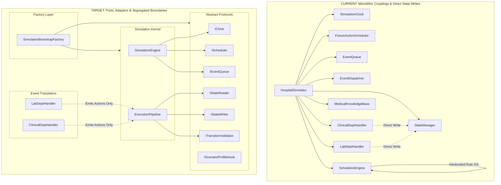
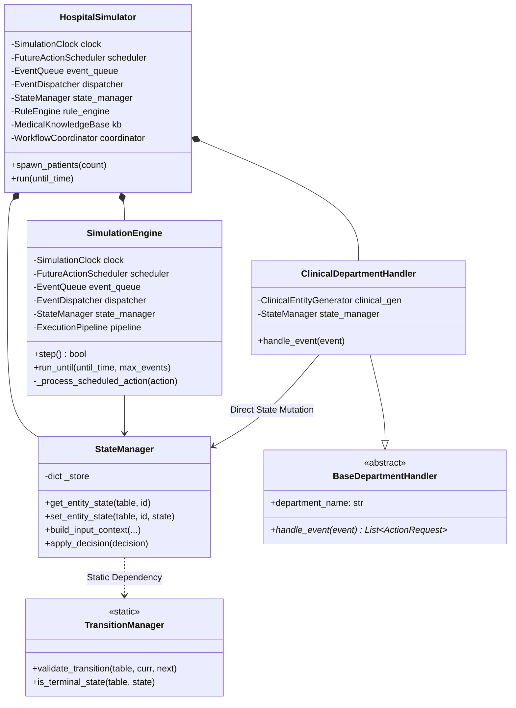
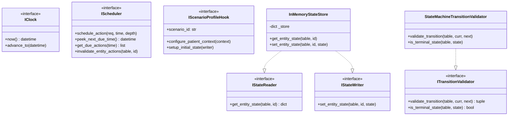
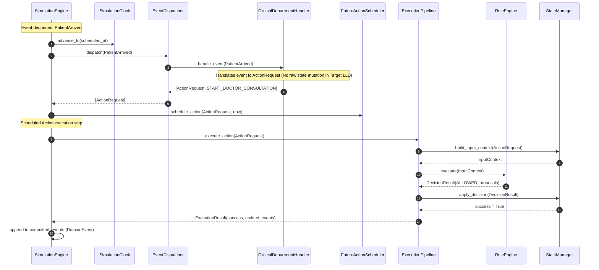
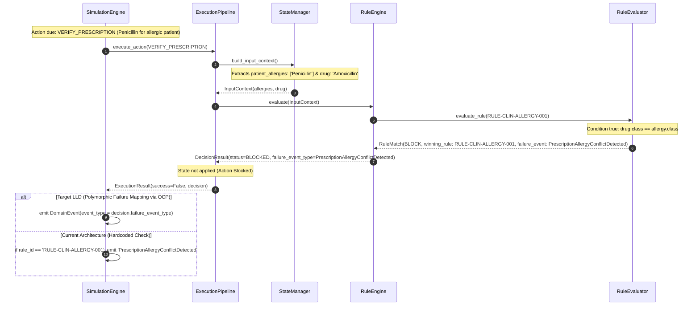
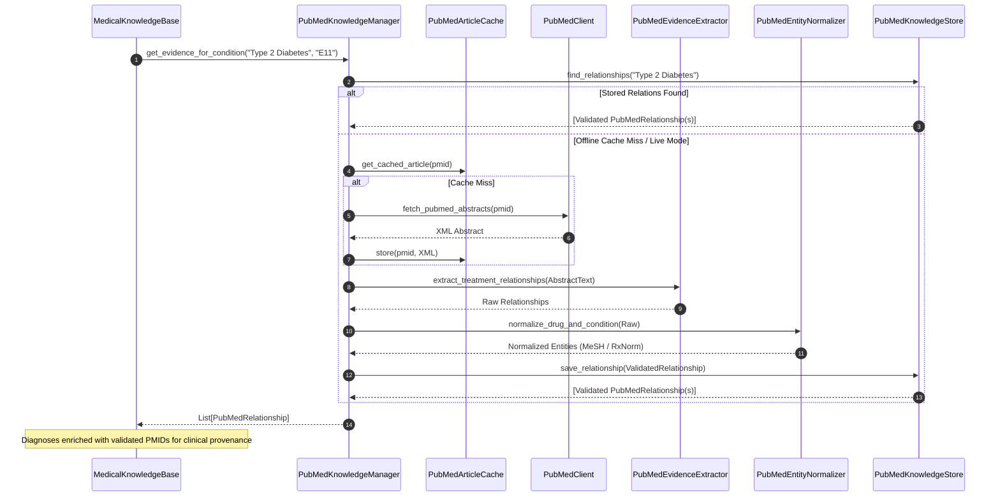
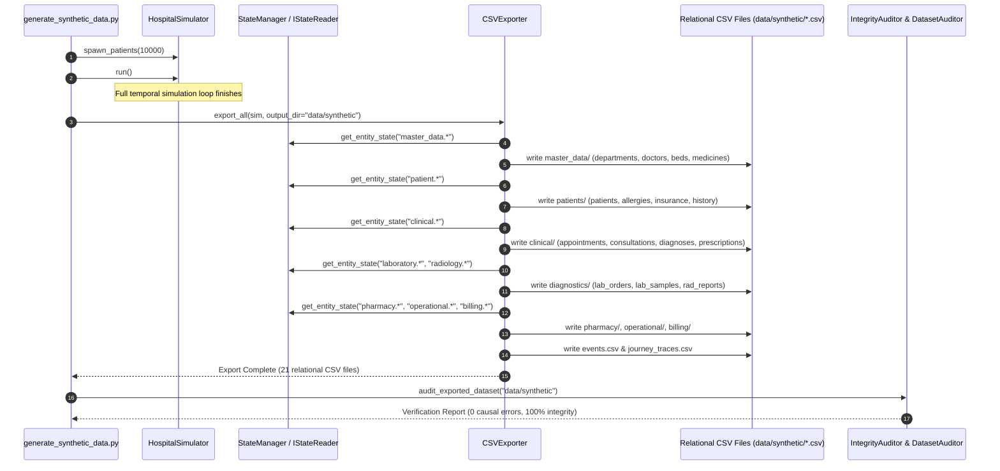

# SYNAPSE — SOLID-Compliant Architecture Design & Low-Level Design (LLD) Assessment (Historical Archive)

> [!WARNING]
> **HISTORICAL / LEGACY COMPATIBILITY ARCHIVE**  
> This document records the architectural and SOLID principles audit of the earlier discrete-event hospital operational simulator prototype (`HospitalSimulator`) conducted on 2026-10-09.
>
> **Status:** SUPERSEDED for active development. Retained for historical provenance and legacy compatibility mode (`--mode hospital`).
>
> **Active Implementation:** The active production architecture of SYNAPSE Phase 2 is the **Synthea-inspired longitudinal healthcare simulation system** documented in [`docs/architecture/longitudinal_system_architecture.md`](file:///Users/shashi/synapse/synapse-phase2/docs/architecture/longitudinal_system_architecture.md) and [`README.md`](file:///Users/shashi/synapse/synapse-phase2/README.md).

**Project:** SYNAPSE — Synthetic Healthcare Simulation & Population Health  
**Phase:** Phase 2 (Legacy Hospital Operational Simulator Compatibility Architecture)  
**Document Type:** Historical Architectural Assessment & Low-Level Design (LLD)  
**Status:** **HISTORICAL ARCHIVE (MODE=HOSPITAL COMPATIBILITY ONLY)**  
**Author:** DeepMind Agentic Pair Programmer  
**Date:** 2026-10-09  

---

## 1. Executive Summary

### 1.1 Purpose & Scope
This document presents an exhaustive, repository-grounded architectural assessment of the **SYNAPSE Phase 2 Synthetic Hospital Simulator** codebase against all five **SOLID principles**:
- **S** — Single Responsibility Principle (SRP)
- **O** — Open/Closed Principle (OCP)
- **L** — Liskov Substitution Principle (LSP)
- **I** — Interface Segregation Principle (ISP)
- **D** — Dependency Inversion Principle (DIP)

In strict adherence to project constraints, **no existing code has been refactored, rewritten, replaced, or deleted**. The current implementation remains the 100% authoritative source of truth. The proposed Low-Level Design (LLD) adapts to existing implementation decisions—preserving the event-driven simulation loop, YAML-based deterministic rules, PubMed medical knowledge architecture, relational CSV export schemas, and patient journey lifecycle.

### 1.2 Overall Architectural Health & Compliance Matrix
The SYNAPSE Phase 2 simulator represents a highly sophisticated, deterministic, causally sound simulation platform. Its modular design separates discrete concepts such as discrete-event simulation, deterministic state machines, and PubMed evidence caching. However, under formal object-oriented design criteria, the architecture contains concrete couplings and responsibility leaks.

| SOLID Principle | Compliance Status | Primary Strength in Codebase | Primary Architectural Violation / Risk |
| :--- | :---: | :--- | :--- |
| **S — Single Responsibility** | **Partially Compliant** | Focused infrastructure engines (`SimulationClock`, `EventQueue`, `CSVExporter`, `IntegrityAuditor`). | `HospitalSimulator` serves as a "God Class" handling initialization, wiring, random seeding, cohort generation, and execution metrics; Department handlers mix event translation with raw state mutation. |
| **O — Open/Closed** | **Partially Compliant** | Declarative YAML rules allow adding clinical transition constraints without modifying `RuleEngine`. | Hardcoded failure rule ID checks in `SimulationEngine` (`RULE-CLIN-ALLERGY-001`, `RULE-GLOB-STOCK-001`); hardcoded scenario arrays in `HospitalSimulator`. |
| **L — Liskov Substitution** | **Non-Compliant** | Department handlers adhere to `BaseDepartmentHandler.handle_event()` signature. | `HospitalSimulator` and `ClinicalDepartmentHandler` inspect concrete scenario identity (`SCEN-V1-03`) to alter generation logic, violating polymorphic substitutability of `BaseScenario`. |
| **I — Interface Segregation** | **Partially Compliant** | Single-method interface for `BaseDepartmentHandler` (`handle_event`). | Monolithic `StateManager` combines entity storage, snapshot reading, context building, and transition mutation into a single fat interface without role-based protocols. |
| **D — Dependency Inversion** | **Non-Compliant** | Injected dependencies allowed in `SimulationEngine` and `ExecutionPipeline` constructors. | High-level orchestrators (`HospitalSimulator`, `StateManager`) directly instantiate and depend on concrete classes (`SimulationClock`, `MedicalKnowledgeBase`, `TransitionManager`) without abstract protocols. |

---

## 2. Verified Current Architecture

The SYNAPSE Phase 2 system is structured as an integrated, temporal discrete-event simulation engine with externalized rule validation, evidence-backed medical knowledge retrieval, and relational data serialization.

### 2.1 Subsystem Decomposition

```
synapse phase2/
├── config/
│   ├── knowledge/               # Medical knowledge definitions & PubMed config
│   │   ├── diagnoses.yaml
│   │   ├── medications.yaml
│   │   ├── allergies.yaml
│   │   └── pubmed.yaml
│   └── rules/                   # Declarative YAML business and clinical safety rules
│       ├── core/                # Global transition rules
│       └── departments/         # Departmental rules (clinical, pharmacy, lab, rad, finance)
├── data/
│   ├── knowledge/pubmed/        # PubMed cached articles and validated relation store
│   └── synthetic/               # Generated relational CSV datasets (10,000 cohort)
├── synapse_simulator/
│   ├── core/                    # Discrete-event simulation kernel
│   │   ├── clock.py             # SimulationClock (temporal progress)
│   │   ├── scheduler.py         # FutureActionScheduler (time-indexed min-heap)
│   │   ├── event_queue.py       # EventQueue (priority event buffer)
│   │   ├── dispatcher.py        # EventDispatcher (department handler registry)
│   │   └── simulation_engine.py # SimulationEngine (main event processing loop)
│   ├── engine/
│   │   └── orchestrator.py      # ExecutionPipeline (state + rules orchestrator)
│   ├── state/
│   │   ├── models.py            # Domain models (ActionRequest, DomainEvent, DecisionResult)
│   │   ├── document_models.py   # Document metadata definitions
│   │   └── state_manager.py     # StateManager (in-memory multi-table state store)
│   ├── transitions/
│   │   ├── state_machine.py     # Deterministic finite state machines (FSM)
│   │   └── transition_manager.py# TransitionManager (structural FSM validator)
│   ├── rules/
│   │   ├── models.py            # Rule, Condition, StateTransitionProposal models
│   │   ├── repository.py        # RuleRepository (YAML loader and rule index)
│   │   ├── evaluator.py         # RuleEvaluator (boolean condition engine)
│   │   └── rule_engine.py       # RuleEngine (winning rule arbitration & conflict resolution)
│   ├── workflows/
│   │   ├── model.py             # PatientJourney, WorkflowDefinition, WorkflowStep
│   │   ├── templates.py         # Pre-configured clinical workflow graph templates
│   │   └── coordinator.py       # WorkflowCoordinator (journey progression manager)
│   ├── departments/             # Department handlers (event-to-action translators)
│   │   ├── base.py              # BaseDepartmentHandler (ABC)
│   │   ├── clinical.py          # ClinicalDepartmentHandler (OPD, consultations)
│   │   ├── pharmacy.py          # PharmacyDepartmentHandler (dispensing, verification)
│   │   ├── laboratory.py        # LaboratoryDepartmentHandler (samples, lab results)
│   │   ├── radiology.py         # RadiologyDepartmentHandler (imaging, reports)
│   │   └── finance.py           # FinanceDepartmentHandler (billing, payments)
│   ├── scenarios/               # Concrete scenario definitions
│   │   ├── base_scenario.py     # BaseScenario (ABC)
│   │   ├── scen_v1_01_opd.py    # Routine outpatient visit
│   │   ├── scen_v1_02_diagnostic.py # Outpatient with lab & radiology
│   │   ├── scen_v1_03_allergy.py# Penicillin allergy safety hold scenario
│   │   └── scen_v1_04_inventory.py# Pharmacy inventory depletion scenario
│   ├── knowledge/               # Medical knowledge & PubMed integration
│   │   ├── models.py            # Medical domain entity models
│   │   ├── loader.py            # MedicalKnowledgeBase (YAML + PubMed loader)
│   │   └── pubmed/              # Dedicated PubMed evidence pipeline
│   │       ├── client.py        # NCBI E-utilities client
│   │       ├── cache.py         # Raw response disk cache
│   │       ├── parser.py        # PubMed XML/JSON abstract parser
│   │       ├── extractor.py     # Entity and relation extractor
│   │       ├── normalizer.py    # RxNorm, MeSH, ICD-10 normalizer
│   │       ├── validator.py     # Evidence threshold validator
│   │       ├── store.py         # JSONL relationship and article store
│   │       ├── retriever.py     # PubMedKnowledgeManager (high-level query API)
│   │       └── seed_cache.py    # Offline pre-seeding utility
│   ├── datagen/                 # Synthetic clinical entity generators
│   │   ├── models.py            # PatientContext, MasterDataSnapshot
│   │   ├── master_data.py       # MasterDataGenerator (departments, doctors, beds)
│   │   ├── patient_generator.py # PatientProfileGenerator (demographics, insurance)
│   │   ├── clinical_generator.py# ClinicalEntityGenerator (vitals, diagnoses, scripts)
│   │   ├── diagnostic_generator.py# DiagnosticGenerator (lab results, rad images)
│   │   └── billing_generator.py # BillingGenerator (invoices, payments)
│   ├── exporter/                # Data persistence & serialization
│   │   ├── csv_exporter.py      # CSVExporter (21 normalized relational CSV tables)
│   │   ├── document_generator.py# Clinical document rendering
│   │   ├── event_logger.py      # Event logging utilities
│   │   └── lineage_mapper.py    # Data provenance and causal trace mapping
│   ├── validation/              # Verification & data auditing
│   │   ├── integrity_auditor.py # Cross-table relational integrity checker
│   │   ├── dataset_auditor.py   # Statistical, schema, and causal validation
│   │   ├── consistency_checker.py# State consistency auditor
│   │   └── document_validator.py# Document structural validator
│   └── generator/
│       └── hospital_generator.py# HospitalSimulator (top-level simulation facade)
└── generate_synthetic_data.py  # Production CLI entrypoint for 10,000 dataset run
```

---

## 3. Current Class and Dependency Inventory

| Class Name | File Path | Primary Declared Responsibility | Direct Dependencies (Imports/Attributes) | Concrete Instantiations Performed | Coupling Category |
| :--- | :--- | :--- | :--- | :--- | :--- |
| `SimulationClock` | `core/clock.py` | Tracks simulated timestamp; advances time monotonically | `datetime`, `timedelta` | None | Low (Self-contained) |
| `FutureActionScheduler`| `core/scheduler.py` | Priority min-heap of scheduled actions by time | `ActionRequest`, `heapq`, `itertools` | `ScheduledFutureAction` | Low (Temporal queue) |
| `EventQueue` | `core/event_queue.py` | Priority queue of simulation events | `SimulationEvent`, `heapq` | None | Low (Event queue) |
| `EventDispatcher` | `core/dispatcher.py` | Maintains mapping of event types to handler callables | `SimulationEvent`, `ActionRequest` | None | Low (Callback registry) |
| `SimulationEngine` | `core/simulation_engine.py`| Drives the simulation loop; processes events & actions | `SimulationClock`, `FutureActionScheduler`, `EventQueue`, `EventDispatcher`, `StateManager`, `ExecutionPipeline` | `DomainEvent`, `SimulationEvent` | Medium (Coordinates core engines) |
| `ExecutionPipeline`| `engine/orchestrator.py`| Evaluates context with RuleEngine and mutates StateManager | `StateManager`, `RuleEngine`, `ActionRequest`, `InputContext`, `DecisionResult` | `ExecutionResult`, `DecisionResult` | Medium (Execution bridge) |
| `StateManager` | `state/state_manager.py` | In-memory store; builds input context; applies decisions | `TransitionManager`, `ActionRequest`, `InputContext`, `DecisionResult` | None (Direct static call to `TransitionManager`) | High (Data store + business validation) |
| `TransitionManager`| `transitions/transition_manager.py` | Validates status changes against entity state machines | `ENTITY_STATE_MACHINES`, `BaseStateMachine` | None | Low (Pure validator) |
| `RuleRepository` | `rules/repository.py` | Loads and parses YAML rule files from disk | `Rule`, `yaml`, `Path` | `Rule`, `ConditionGroup` | Medium (File I/O + Parsing) |
| `RuleEngine` | `rules/rule_engine.py` | Evaluates active rules against InputContext; picks winner | `RuleRepository`, `RuleEvaluator`, `DecisionResult` | `RuleEvaluator`, `DecisionResult` | Medium (Arbitration) |
| `WorkflowCoordinator`| `workflows/coordinator.py` | Advances patient journeys across predefined workflow graph | `FutureActionScheduler`, `PatientJourney`, `WorkflowDefinition` | `ActionRequest` | Medium (Workflow driver) |
| `BaseDepartmentHandler`| `departments/base.py` | Abstract base class for department event handlers | `SimulationEvent`, `ActionRequest` | None | Low (Abstract contract) |
| `ClinicalDepartmentHandler`| `departments/clinical.py`| Handles OPD events; creates consultation & prescription actions | `BaseDepartmentHandler`, `ClinicalEntityGenerator`, `StateManager`, `PatientContext` | `ActionRequest` (Mutates `StateManager` directly) | High (Data gen + State mutation + Event translation) |
| `PharmacyDepartmentHandler`| `departments/pharmacy.py`| Handles pharmacy events; issues verification & dispense | `BaseDepartmentHandler`, `StateManager`, `ActionRequest` | `ActionRequest` | Medium |
| `LaboratoryDepartmentHandler`| `departments/laboratory.py`| Handles lab order events; generates lab test components | `BaseDepartmentHandler`, `DiagnosticGenerator`, `StateManager` | `ActionRequest` (Mutates `StateManager` directly) | High |
| `RadiologyDepartmentHandler`| `departments/radiology.py`| Handles radiology order events; generates imaging reports | `BaseDepartmentHandler`, `DiagnosticGenerator`, `StateManager` | `ActionRequest` (Mutates `StateManager` directly) | High |
| `FinanceDepartmentHandler`| `departments/finance.py`| Handles invoice line items and payment actions | `BaseDepartmentHandler`, `BillingGenerator`, `StateManager` | `ActionRequest` | Medium |
| `MedicalKnowledgeBase`| `knowledge/loader.py` | Loads medical YAMLs; orchestrates PubMed evidence loading | `PubMedKnowledgeManager`, `DiagnosisEntry`, `yaml` | `PubMedKnowledgeManager` (Dynamic import) | High (YAML I/O + PubMed coordination) |
| `PubMedKnowledgeManager`| `knowledge/pubmed/retriever.py` | External PubMed evidence retrieval, caching, normalization | `PubMedClient`, `PubMedArticleCache`, `PubMedArticleParser`, `PubMedEvidenceExtractor`, `PubMedEntityNormalizer`, `PubMedEvidenceValidator`, `PubMedKnowledgeStore` | All 7 PubMed pipeline components | High (PubMed facade) |
| `HospitalSimulator`| `generator/hospital_generator.py`| Top-level facade; boots engines, seeds state, spawns patients | All core engines, all department handlers, all data generators, `WorkflowCoordinator`, `MedicalKnowledgeBase` | Instantiates nearly 15 distinct domain classes | Extreme (God Object) |
| `CSVExporter` | `exporter/csv_exporter.py`| Writes normalized relational CSV files from simulation state | `StateManager`, `DomainEvent`, `PatientJourney`, `Path`, `csv` | None | Medium (Persistence layer) |
| `IntegrityAuditor` | `validation/integrity_auditor.py`| Validates referential integrity, causal chains, and temporal ordering | `StateManager`, `DomainEvent`, `PatientJourney` | None | Medium (Audit engine) |

---

## 4. Principle-by-Principle SOLID Evaluation

### 4.1 S — Single Responsibility Principle (SRP)
> *A class should have one, and only one, reason to change.*

**Compliance Classification:** **Partially Compliant**

#### Verified Strengths
- **`SimulationClock` (`core/clock.py:10-38`):** Solely responsible for tracking simulated time and monotonic advancement.
- **`EventQueue` (`core/event_queue.py:16-72`):** Solely responsible for priority ordering of `SimulationEvent` instances.
- **`TransitionManager` (`transitions/transition_manager.py:9-34`):** Solely responsible for checking state transitions against registered entity state machines.
- **`RuleEvaluator` (`rules/evaluator.py:18-106`):** Solely responsible for evaluating boolean condition trees against a context dictionary.
- **`CSVExporter` (`exporter/csv_exporter.py:30-740`):** Solely responsible for relational table flattening and disk CSV serialization.

#### Verified Violations
1. **`HospitalSimulator` (`generator/hospital_generator.py:45-200`):**
   - **Reason to change 1:** Changes in clock/scheduler simulation engine wiring.
   - **Reason to change 2:** Changes in knowledge base initialization and PubMed caching.
   - **Reason to change 3:** Changes in master data generation and seeding logic.
   - **Reason to change 4:** Changes in department handler instantiation and dispatcher registration.
   - **Reason to change 5:** Changes in patient cohort generation and scenario distribution.
   - **Reason to change 6:** Changes in runtime metrics aggregation and telemetry.
2. **Department Handlers (`departments/clinical.py:23-57`, `departments/laboratory.py:23-65`):**
   - Handlers violate SRP by performing two unrelated jobs:
     - *Job A (Event Translation):* Interpreting `SimulationEvent` and returning proposed `ActionRequest` objects.
     - *Job B (Direct State Mutation):* Directly invoking `self.state_manager.set_entity_state(...)` to persist newly synthesized consultation and prescription entities, bypassing the rule engine and transition pipeline.

---

### 4.2 O — Open/Closed Principle (OCP)
> *Software entities should be open for extension, but closed for modification.*

**Compliance Classification:** **Partially Compliant**

#### Verified Strengths
- **YAML Rule Engine (`rules/repository.py`, `rules/rule_engine.py`):** The clinical rule system is cleanly open for extension. Adding new business constraints or safety rules (such as for the Laboratory, Radiology, or Finance departments) requires only adding YAML files under `config/rules/departments/` without touching Python code.
- **Event Dispatcher (`core/dispatcher.py:18-38`):** Adding new event handlers is supported via `dispatcher.register_handler(event_type, handler)`.

#### Verified Violations
1. **Hardcoded Failure Rule IDs in Core Execution Loop (`core/simulation_engine.py:195-201`):**
   ```python
   # Line 196-201 in synapse_simulator/core/simulation_engine.py
   failure_event_type = f"{action.action_type}_Blocked"
   if result.decision.winning_rule_id == "RULE-CLIN-ALLERGY-001":
       failure_event_type = "PrescriptionAllergyConflictDetected"
   elif result.decision.winning_rule_id == "RULE-GLOB-STOCK-001":
       failure_event_type = "InventoryShortageDetected"
   ```
   **Architectural Defect:** If a new department introduces a blocking safety rule (e.g., `RULE-LAB-SPECIMEN-CONTAMINATED` or `RULE-RAD-CONTRAST-ALLERGY`), `SimulationEngine` must be modified with new `elif` branches to emit domain-specific failure event types. The failure event type is not parameterized within the rule definition.
2. **Hardcoded Scenario Registry in `HospitalSimulator` (`generator/hospital_generator.py:140-146`):**
   ```python
   # Line 140-146 in synapse_simulator/generator/hospital_generator.py
   scenario_ids = ["SCEN-V1-01", "SCEN-V1-02", "SCEN-V1-03", "SCEN-V1-04"]
   scenario_classes = [
       OutpatientRoutineScenario,
       DiagnosticInvestigationScenario,
       DrugAllergySafetyHoldScenario,
       InventoryDepletionScenario,
   ]
   ```
   Adding a 5th scenario requires modifying `HospitalSimulator.spawn_patients()`.

---

### 4.3 L — Liskov Substitution Principle (LSP)
> *Objects of a superclass should be replaceable with objects of a subclass without breaking application correctness.*

**Compliance Classification:** **Non-Compliant**

#### Verified Strengths
- **Department Handlers (`departments/base.py:11-20`):** All five concrete handlers (`Clinical`, `Pharmacy`, `Laboratory`, `Radiology`, `Finance`) inherit from `BaseDepartmentHandler` and fulfill the signature `handle_event(event: SimulationEvent) -> List[ActionRequest]`.

#### Verified Violations
1. **Polymorphism Broken by Identity Inspection in `HospitalSimulator` (`generator/hospital_generator.py:157-175`):**
   ```python
   # Line 157-175 in synapse_simulator/generator/hospital_generator.py
   if scen_id == "SCEN-V1-03":
       patient_context = self.patient_gen.generate_patient(force_allergy="Penicillin")
   else:
       patient_context = self.patient_gen.generate_patient()
   ...
   force_conflict = scen_id == "SCEN-V1-03"
   treatment, is_conflict = self.clinical_gen.select_medication(
       patient_context, diagnosis, force_conflict=force_conflict
   )
   ```
   **Architectural Defect:** `BaseScenario` subclasses cannot be substituted uniformly. The calling orchestrator branches on the specific string identifier `"SCEN-V1-03"`. The scenario object does not polymorphically configure or seed the patient context.
2. **Duplicated Identity Check in `ClinicalDepartmentHandler` (`departments/clinical.py:32-33`):**
   ```python
   # Line 32-33 in synapse_simulator/departments/clinical.py
   force_conflict = context.scenario_id == "SCEN-V1-03"
   treatment, is_conflict = self.clinical_gen.select_medication(context, diagnosis, force_conflict=force_conflict)
   ```
   The clinical department handler is tightly bound to a specific scenario ID string, violating behavioral substitutability.

---

### 4.4 I — Interface Segregation Principle (ISP)
> *Clients should not be forced to depend upon interfaces that they do not use.*

**Compliance Classification:** **Partially Compliant**

#### Verified Strengths
- **`BaseDepartmentHandler` (`departments/base.py`):** Exposes only a single method `handle_event`. Handlers are not burdened with unneeded simulation engine controls.

#### Verified Violations
1. **Monolithic `StateManager` Interface (`state/state_manager.py:16-95`):**
   `StateManager` combines four separate concerns into a single class:
   - Entity store read access (`get_entity_state`).
   - Entity store direct write access (`set_entity_state`).
   - Context snapshot construction for rules (`build_input_context`).
   - Transition validation and decision application (`apply_decision`).
   
   **Coupling Problem:**
   - `ExecutionPipeline` only needs `build_input_context` and `apply_decision`.
   - `CSVExporter` only needs read-only entity inspection across tables.
   - `ClinicalDepartmentHandler` only needs to store generated entities.
   - Yet all clients receive the entire mutable `StateManager` instance with raw dictionary mutation access.

---

### 4.5 D — Dependency Inversion Principle (DIP)
> *High-level modules should not depend on low-level modules. Both should depend on abstractions. Abstractions should not depend on details; details should depend on abstractions.*

**Compliance Classification:** **Non-Compliant**

#### Verified Strengths
- `SimulationEngine` (`core/simulation_engine.py:24-44`) accepts injected components in its constructor (`clock`, `scheduler`, `event_queue`, `dispatcher`, `state_manager`, `rule_engine`, `execution_pipeline`), allowing mock substitution during testing.

#### Verified Violations
1. **Concrete Constructor Dependencies in `HospitalSimulator` (`generator/hospital_generator.py:57-94`):**
   High-level orchestration directly instantiates concrete infrastructure classes:
   - `self.clock = SimulationClock(...)`
   - `self.scheduler = FutureActionScheduler()`
   - `self.event_queue = EventQueue()`
   - `self.dispatcher = EventDispatcher()`
   - `self.state_manager = StateManager()`
   - `self.repository = RuleRepository()`
   - `self.kb = MedicalKnowledgeBase()`
   
   None of these dependencies are bound to abstract protocols or interfaces.
2. **Direct Static Coupling from `StateManager` to `TransitionManager` (`state/state_manager.py:80-82`):**
   ```python
   # Line 80-82 in synapse_simulator/state/state_manager.py
   is_valid, err_msg = TransitionManager.validate_transition(
       table, proposal.current_value, proposal.new_value
   )
   ```
   `StateManager` depends directly on the concrete static implementation of `TransitionManager`, preventing the injection of alternative validators (e.g., distributed, database-backed, or mock transition checkers).
3. **No Abstract Interface for Knowledge Base or Exporter:**
   `ClinicalEntityGenerator`, `MasterDataGenerator`, and `PatientProfileGenerator` all depend directly on the concrete `MedicalKnowledgeBase` class rather than a medical ontology protocol (`IMedicalKnowledgeProvider`).

---

## 5. Evidence for Each Identified Violation

```
+----------------------------------------------------------------------------------------------------+
| VIOLATION AUDIT RECORD: SYNAPSE PHASE 2 ARCHITECTURE                                               |
+----+------------+-----------------------------+------------------------------------+---------------+
| ID | Principle  | Target File & Lines         | Concrete Code Snippet / Mechanism  | Severity      |
+----+------------+-----------------------------+------------------------------------+---------------+
| V1 | SRP        | generator/hospital_generator| L57-94, L120-137, L138-200         | High          |
|    |            | .py:57-200                  | God Object initialization & wiring |               |
+----+------------+-----------------------------+------------------------------------+---------------+
| V2 | SRP        | departments/clinical.py:    | self.state_manager.set_entity_     | High          |
|    |            | 41, 45                      | state("pharmacy.prescriptions", ..)|               |
+----+------------+-----------------------------+------------------------------------+---------------+
| V3 | OCP        | core/simulation_engine.py:  | if winning_rule_id ==              | Critical      |
|    |            | 197-201                     | "RULE-CLIN-ALLERGY-001": ...       |               |
+----+------------+-----------------------------+------------------------------------+---------------+
| V4 | OCP        | generator/hospital_generator| scenario_ids = ["SCEN-V1-01", ...] | Medium        |
|    |            | .py:140-146                 | Hardcoded scenario registry array  |               |
+----+------------+-----------------------------+------------------------------------+---------------+
| V5 | LSP        | generator/hospital_generator| if scen_id == "SCEN-V1-03":        | High          |
|    |            | .py:157-175                 | force_allergy="Penicillin"         |               |
+----+------------+-----------------------------+------------------------------------+---------------+
| V6 | ISP        | state/state_manager.py:     | Bundled read/write/context/FSM     | Medium        |
|    |            | 16-95                       | in single un-segregated class      |               |
+----+------------+-----------------------------+------------------------------------+---------------+
| V7 | DIP        | generator/hospital_generator| Direct instantiation of 15+        | High          |
|    |            | .py:57-94                   | concrete infrastructure classes    |               |
+----+------------+-----------------------------+------------------------------------+---------------+
| V8 | DIP        | state/state_manager.py:     | Direct static call to concrete     | Medium        |
|    |            | 80-82                       | TransitionManager.validate_...     |               |
+----+------------+-----------------------------+------------------------------------+---------------+
```

---

## 6. Proposed Target LLD (Without Implementing It)

### 6.1 Architectural Layering & Clean Ports/Adapters View
The target architecture introduces clear abstraction boundaries using Python `typing.Protocol` interfaces, isolating the domain simulation kernel from infrastructure details and assembly logic.

```
+--------------------------------------------------------------------------------------------------+
|                                    TARGET LAYERED ARCHITECTURE                                   |
+--------------------------------------------------------------------------------------------------+
|  [ COMPOSITION & BOOTSTRAP LAYER ]                                                               |
|  • SimulationBootstrapFactory (Resolves dependencies, instantiates engines & handlers)           |
|  • HospitalSimulatorFacade (Pure facade presenting simplified run/spawn API to CLI and tests)   |
+--------------------------------------------------------------------------------------------------+
|  [ APPLICATION ORCHESTRATION LAYER ]                                                             |
|  • SimulationEngine (Pure time-driven & event-driven temporal executor)                           |
|  • ExecutionPipeline (Context assembly, rule arbitration, state application)                     |
|  • WorkflowCoordinator (Scenario graph traversal and step dispatch)                             |
|  • ScenarioRegistry (Open registry for polymorphic scenario descriptors)                         |
+--------------------------------------------------------------------------------------------------+
|  [ DOMAIN CONTRACTS & PORTS (PROTOCOLS) ]                                                        |
|  • IClock                 • IScheduler             • IEventQueue           • IDispatcher         |
|  • IStateReader           • IStateWriter           • IContextBuilder       • ITransitionValidator|
|  • IRuleEngine            • IMedicalKnowledge      • IScenarioProfileHook  • IDataExporter       |
+--------------------------------------------------------------------------------------------------+
|  [ DOMAIN COGNITIVE & SPECIALIZED SERVICES ]                                                     |
|  • Department Handlers (Pure event-to-action translators; zero raw state mutations)             |
|  • RuleEngine & RuleRepository (YAML-driven declarative business constraint engine)             |
|  • Data Generators (Clinical, Diagnostic, Billing, Master Data, Patient Profile)                |
+--------------------------------------------------------------------------------------------------+
|  [ INFRASTRUCTURE & PERSISTENCE ADAPTERS ]                                                       |
|  • InMemoryStateStore (Implements IStateReader & IStateWriter)                                   |
|  • StateMachineTransitionValidator (Implements ITransitionValidator)                            |
|  • PubMedKnowledgeManager & Cache (Implements IMedicalKnowledge)                                 |
|  • CSVRelationalExporter (Implements IDataExporter)                                              |
|  • IntegrityAuditor & DatasetAuditor (Verification engines)                                      |
+--------------------------------------------------------------------------------------------------+
```

### 6.2 Proposed Interfaces and Protocols

All proposed interfaces are defined using standard Python `typing.Protocol` with runtime checkability, allowing existing concrete classes to satisfy them **without modifying class inheritance or rewriting source code**.

#### 1. Temporal & Scheduling Protocols
```python
from typing import Protocol, runtime_checkable, Optional, List, Dict, Any, Tuple
from datetime import datetime
from synapse_simulator.state.models import ActionRequest, DomainEvent
from synapse_simulator.core.event_queue import SimulationEvent

@runtime_checkable
class IClock(Protocol):
    def now(self) -> datetime: ...
    def advance_to(self, new_time: datetime) -> None: ...
    def advance_by(self, delta: Any) -> None: ...

@runtime_checkable
class IScheduler(Protocol):
    def schedule_action(self, action_request: ActionRequest, scheduled_at: datetime, causation_depth: int = 0) -> None: ...
    def peek_next_due_time(self) -> Optional[datetime]: ...
    def get_due_actions(self, current_time: datetime) -> List[Any]: ...
    def invalidate_entity_actions(self, entity_table: str, entity_id: str) -> int: ...

@runtime_checkable
class IEventQueue(Protocol):
    def push(self, event: SimulationEvent) -> None: ...
    def pop(self) -> Optional[SimulationEvent]: ...
    def peek(self) -> Optional[SimulationEvent]: ...
    def is_empty(self) -> bool: ...
```

#### 2. Segregated State Protocols (Addressing ISP)
```python
@runtime_checkable
class IStateReader(Protocol):
    """Read-only state access for Exporters, Auditors, and Context Builders."""
    def get_entity_state(self, table_name: str, entity_id: str) -> Dict[str, Any]: ...

@runtime_checkable
class IStateWriter(Protocol):
    """Write access restricted to state initialization and sanctioned transitions."""
    def set_entity_state(self, table_name: str, entity_id: str, state: Dict[str, Any]) -> None: ...

@runtime_checkable
class ITransitionValidator(Protocol):
    """Decoupled transition validation protocol (Addressing DIP in StateManager)."""
    def validate_transition(self, entity_table: str, current_state: str, next_state: str) -> Tuple[bool, Optional[str]]: ...
    def is_terminal_state(self, entity_table: str, state: str) -> bool: ...

@runtime_checkable
class IContextBuilder(Protocol):
    """Context assembly for Rule Engine evaluation."""
    def build_input_context(
        self,
        proposed_action: ActionRequest,
        simulated_timestamp: datetime,
        scenario_id: str,
        department_id: str,
        patient_id: Optional[str] = None,
    ) -> Any: ...
```

#### 3. Scenario Polymorphism Protocol (Addressing LSP)
```python
@runtime_checkable
class IScenarioProfileHook(Protocol):
    """Polymorphic patient configuration hook allowing scenarios to configure context without type-checking."""
    scenario_id: str
    def configure_patient_context(self, patient_context: Any) -> None: ...
    def setup_initial_state(self, state_manager: IStateWriter) -> None: ...
    def generate_initial_events(self, start_time: datetime) -> SimulationEvent: ...
```

#### 4. Rule Extensibility Contract (Addressing OCP)
In the target LLD, the YAML schema for blocking rules is extended with an optional parameter `failure_event_type`:
```yaml
# Proposed YAML rule extension (Backward compatible):
id: RULE-CLIN-ALLERGY-001
action: VERIFY_PRESCRIPTION
decision: BLOCK
failure_event_type: "PrescriptionAllergyConflictDetected"
```
The `DecisionResult` model transports `failure_event_type`, enabling `SimulationEngine` to emit the correct event type without hardcoded string matching.

---

## 7. Current-versus-Target Architecture Diagrams

### 7.1 Package and Module Responsibility Diagram



### 7.2 Class Diagram: Current Classes and Relationships



### 7.3 Proposed Interface / Abstraction Diagram



### 7.4 Dependency Inversion Direction Diagram

```mermaid
graph TD
    subgraph Current Coupling Direction [CURRENT: High-Level Directly Depends on Concrete Details]
        HS_curr[HospitalSimulator] --> SM_curr[StateManager (Concrete)]
        SM_curr --> TM_curr[TransitionManager (Concrete)]
        SE_curr[SimulationEngine] --> HardcodedRules[Hardcoded Rule ID Strings]
    end

    subgraph Inverted Target Direction [TARGET: High-Level & Details Depend on Abstract Protocols]
        HS_target[HospitalSimulator / Orchestrator] -->|depends on| pState[IStateReader / IStateWriter]
        HS_target -->|depends on| pTrans[ITransitionValidator]
        HS_target -->|depends on| pSched[IScheduler]
        
        SM_target[InMemoryStateStore] ..|> pState
        TM_target[TransitionValidatorAdapter] ..|> pTrans
        FAS_target[FutureActionScheduler] ..|> pSched
    end
```

### 7.5 Patient-Arrival-to-Event-Processing Sequence Diagram



### 7.6 Clinical Decision and Allergy-Safety Sequence Diagram



### 7.7 PubMed Evidence Retrieval and Provenance Sequence Diagram



### 7.8 Data Generation and CSV Export Sequence Diagram



---

## 8. Proposed Interfaces and Dependency Relationships

| Proposed Interface / Class | Location / Scope | Why It Is Needed | SOLID Principle | Related Existing Component | Compatibility Impact |
| :--- | :--- | :--- | :--- | :--- | :--- |
| `IClock` | `core/interfaces.py` | Decouple simulation engine from concrete temporal clock | **DIP** | `SimulationClock` (`core/clock.py`) | Zero (Existing class satisfies protocol structurally) |
| `IScheduler` | `core/interfaces.py` | Decouple action scheduling from heap queue detail | **DIP** | `FutureActionScheduler` (`core/scheduler.py`) | Zero |
| `IEventQueue` | `core/interfaces.py` | Allow alternative event queue backends | **DIP** | `EventQueue` (`core/event_queue.py`) | Zero |
| `IStateReader` | `state/interfaces.py` | Provide read-only view for exporters, auditors, and context builders | **ISP** | `StateManager` (`state/state_manager.py`) | Zero (Exposes subset of existing methods) |
| `IStateWriter` | `state/interfaces.py` | Provide controlled mutation view for state transitions | **ISP** | `StateManager` (`state/state_manager.py`) | Zero |
| `ITransitionValidator`| `transitions/interfaces.py`| Eliminate direct static dependency in `StateManager` on `TransitionManager` | **DIP** | `TransitionManager` (`transitions/transition_manager.py`)| Zero |
| `IScenarioProfileHook`| `scenarios/interfaces.py`| Polymorphic hook to configure patient context without branching on scenario ID | **LSP / OCP**| `BaseScenario` (`scenarios/base_scenario.py`) | Zero (Added as optional mixin/method) |
| `SimulationBootstrapFactory`| `generator/factory.py` | Separate wiring and instantiation from simulator facade | **SRP / DIP** | `HospitalSimulator` (`generator/hospital_generator.py`)| Zero (Called internally by simulator facade) |
| `FailureEventRuleExtension`| `rules/models.py` | Parameterize failure event types in rules instead of engine `if/elif` blocks | **OCP** | `Rule`, `DecisionResult`, `SimulationEngine` | Zero (Defaults to `{action}_Blocked`) |

---

## 9. Relevant Design-Pattern Assessment

| Design Pattern | Concrete Problem Solved in SYNAPSE | Mapping to SYNAPSE Requirements | Current Status in Repository | Recommendation | Complexity Trade-off |
| :--- | :--- | :--- | :--- | :--- | :--- |
| **Strategy Pattern** | Varying rule evaluation algorithms (First-match vs Priority vs Department-specific) | Clinical rule arbitration in `RuleEngine` | **Partially Present** (Evaluator + Repository) | **Adopt fully** for failure-event mapping and scenario scoring | Minimal; encapsulates condition evaluation algorithms cleanly |
| **Factory Method / Abstract Factory** | Constructing complex engine graphs without God Object instantiation | Assembling `SimulationEngine`, `StateManager`, `RuleEngine`, and department handlers | **Absent** (`HospitalSimulator` manually instantiates all 15+ classes) | **Adopt** via `SimulationBootstrapFactory` | Low; extracts 100+ lines of wiring boilerplate from facade |
| **Observer / Pub-Sub** | Decoupling domain event emission from side-effect handling | Routing `SimulationEvent` to registered department handlers | **Present** (`EventDispatcher` registers event handlers) | **Retain as-is**; already well-aligned | Low |
| **State Pattern** | Governing valid transitions of clinical entities (Draft -> Active -> Completed) | State machine lifecycle in `synapse_simulator.transitions.state_machine` | **Present** (`BaseStateMachine` and entity transition tables) | **Retain as-is**; satisfies FSM requirements | Low |
| **Command Pattern** | Encapsulating temporal action requests with parameters, causation, and correlation | Action request queuing in `FutureActionScheduler` | **Present** (`ActionRequest` acts as command parameter object) | **Retain as-is**; ensures causation tracking | Low |
| **Adapter Pattern** | Bridging raw `StateManager` store to segregated `IStateReader` / `IStateWriter` interfaces | Preventing leakage of raw dictionary store to external clients | **Absent** (Direct dictionary dictionary-of-dictionaries access) | **Adopt** to protect state invariants | Low; wraps `self._store` access cleanly |
| **Repository Pattern** | Abstracting declarative rule loading and medical knowledge storage | `RuleRepository` and `PubMedKnowledgeStore` | **Present** (`RuleRepository` and `PubMedKnowledgeStore`) | **Retain as-is**; satisfies data encapsulation | Low |
| **Facade Pattern** | Presenting clean high-level execution API (`run()`, `spawn_patients()`) to CLI and tests | `HospitalSimulator` | **Present** (Serves as facade, but currently bloated with wiring) | **Retain facade API**, delegate wiring to Factory | Low; preserves 100% test compatibility |

---

## 10. Behavior-Preserving Migration Plan

The proposed improvements can be introduced in future development phases through non-breaking, incremental steps:

```
[ Step 1: Protocol Definitions ] ──► [ Step 2: Rule Failure Decoupling ] ──► [ Step 3: Scenario Polymorphism ]
              │                                      │                                      │
              ▼                                      ▼                                      ▼
     (Zero runtime risk)                   (Extends YAML schema)                  (Eliminates SCEN-V1-03 checks)
                                                                                            │
                                                                                            ▼
[ Step 5: State Interface Segregation ] ◄───────────────────────────────── [ Step 4: Factory Extraction ]
              │                                                                             │
              ▼                                                                             ▼
(IStateReader & IStateWriter views)                                         (Extracts wiring from Facade)
```

### Detailed Migration Matrix

| Phase / Step | Current Architectural Issue | Proposed Design Improvement | Existing Files Affected (Future) | Behavior That Must Remain Unchanged | Compatibility Risks | Regression Tests Required | Acceptance Criteria |
| :--- | :--- | :--- | :--- | :--- | :--- | :--- | :--- |
| **Step 1: Protocol Abstractions** | High-level classes depend on concrete types (**DIP**) | Define `typing.Protocol` interfaces in `synapse_simulator/core/interfaces.py` and `state/interfaces.py` | None (New interface files only) | 100% of runtime simulation and datagen behavior | None (Protocols rely on structural subtyping) | All existing test suites in `tests/` | Existing classes satisfy `isinstance(obj, Protocol)` without inheritance changes |
| **Step 2: Rule Failure Decoupling** | Hardcoded `if/elif` blocks in `SimulationEngine` for failure event types (**OCP**) | Add optional `failure_event_type` field to `Rule` model and YAML parser; update `DecisionResult` | `rules/models.py`, `core/simulation_engine.py`, `config/rules/departments/*.yaml` | Blocked events emit identical `PrescriptionAllergyConflictDetected` and `InventoryShortageDetected` | If omitted in YAML, fallback to `{action}_Blocked` | `test_stage6_domain_events.py`, `test_pubmed_treatment_architecture.py` | No hardcoded `RULE-CLIN-ALLERGY-001` string checks in `SimulationEngine` |
| **Step 3: Scenario Polymorphism** | Hardcoded checks for `SCEN-V1-03` in `HospitalSimulator` and `ClinicalDepartmentHandler` (**LSP / OCP**) | Add polymorphic hook `configure_patient_context(context)` to `BaseScenario` and subclasses | `scenarios/base_scenario.py`, `scenarios/scen_v1_03_allergy.py`, `generator/hospital_generator.py` | `SCEN-V1-03` patients still receive Penicillin allergy and trigger medication conflict | Low | `test_stage7_patient_journeys.py`, `test_stage7_cross_department.py` | Zero `if scen_id == "SCEN-V1-03"` checks in `HospitalSimulator` or department handlers |
| **Step 4: Factory Extraction** | `HospitalSimulator` is a bloated God Object (**SRP / DIP**) | Extract wiring logic into `SimulationBootstrapFactory`; `HospitalSimulator` delegates to factory | `generator/hospital_generator.py`, new `generator/factory.py` | Public API `HospitalSimulator(random_seed, ...).run(...)` remains identical | Low | `test_full_simulation.py`, `test_phase2_csv_export.py` | `HospitalSimulator.__init__` is under 25 lines; delegates initialization to factory |
| **Step 5: State Interface Segregation** | Monolithic `StateManager` exposes raw internal dictionary store (**ISP**) | Implement `IStateReader` and `IStateWriter` protocols; wrap `_store` access | `state/state_manager.py` | Entity access across all department handlers and exporters | Low | `test_state_manager.py`, `test_stage9_integrity.py` | Exporters depend strictly on `IStateReader`; raw `_store` cannot be modified directly |

---

## 11. Compatibility and Regression-Test Requirements

To guarantee that any future implementation of this LLD preserves 100% behavioral equivalence, the following existing test suites must pass without modification:

1. **Discrete-Event Simulation Loop & Ordering:**
   - `tests/test_stage6_clock_scheduler.py` (Clock monotonic progress, scheduler priority heap)
   - `tests/test_stage6_domain_events.py` (Domain event immutability, sequence numbering, outbox delivery)
   - `tests/test_stage6_loop_failure_protection.py` (Max causation depth enforcement, failure events)
   - `tests/test_stage6_ordering_causation.py` (Strict causal chain linking)
2. **Clinical Workflows & Patient Journeys:**
   - `tests/test_stage7_patient_journeys.py` (Step trace history, end-to-end patient journey progress)
   - `tests/test_stage7_cross_department.py` (Cross-department outbox event propagation)
   - `tests/test_stage7_workflows.py` (Workflow definition step transition execution)
3. **Medical Knowledge & PubMed Evidence:**
   - `tests/test_pubmed_treatment_architecture.py` (Evidence retrieval, MeSH normalization, PMID provenance)
   - `tests/test_pubmed_datagen_integration.py` (Integration with clinical prescription generation)
4. **Relational CSV Dataset Export & Validation:**
   - `tests/test_phase2_csv_export.py` (Deterministic relational CSV export schema and row consistency)
   - `tests/test_data_integrity_temporal_consistency.py` (Referential integrity across all 21 CSV tables)
   - `tests/test_stage9_integrity.py` (Absence of orphan IDs, causal acyclicity)

---

## 12. Prioritized Technical Debt List

| Priority | Principle | Component | Technical Debt Description | Estimated Effort | Impact on Maintainability |
| :---: | :---: | :--- | :--- | :---: | :--- |
| **P1** | **OCP** | `core/simulation_engine.py` | Hardcoded failure rule IDs in simulation loop prevents adding new departmental blocking rules without touching kernel code. | 2 hours | **High** (Enables arbitrary safety rules) |
| **P2** | **LSP** | `generator/hospital_generator.py` | Explicit `SCEN-V1-03` string checks break scenario extensibility and polymorphic substitutability. | 3 hours | **High** (Allows adding new clinical scenarios cleanly) |
| **P3** | **SRP** | `generator/hospital_generator.py` | Facade class acts as God Object, making unit testing of simulation components difficult without spinning up the entire platform. | 4 hours | **High** (Isolates component testing) |
| **P4** | **DIP** | `state/state_manager.py` | Direct static invocation of `TransitionManager.validate_transition` locks state management into in-memory finite state machines. | 2 hours | **Medium** (Facilitates persistent DB stores) |
| **P5** | **ISP** | `state/state_manager.py` | Direct mutable dictionary access exposed to all callers risks unintentional state corruption. | 3 hours | **Medium** (Enforces architectural boundaries) |

---

## 13. Initial Assessment Baseline Confirmation

During the initial assessment phase, all baseline components were documented without modifying the existing implementation.

---

## 14. Implementation & Verification Record (Completed)

Following the approved target LLD design, the non-breaking SOLID improvements were systematically implemented and verified:

### 14.1 Implementation Actions Executed
1. **DIP & ISP Core & State Protocols Introduced:**
   - Added [IClock, IScheduler, IEventQueue, IEventDispatcher](file:///c:/AI/synapse%20phase2/synapse_simulator/core/interfaces.py) in `synapse_simulator/core/interfaces.py`.
   - Added [IStateReader, IStateWriter, IContextBuilder, IStateDecisionApplier](file:///c:/AI/synapse%20phase2/synapse_simulator/state/interfaces.py) in `synapse_simulator/state/interfaces.py`.
   - Added [ITransitionValidator](file:///c:/AI/synapse%20phase2/synapse_simulator/transitions/interfaces.py) in `synapse_simulator/transitions/interfaces.py`.
   - Added [IScenarioProfileHook](file:///c:/AI/synapse%20phase2/synapse_simulator/scenarios/interfaces.py) in `synapse_simulator/scenarios/interfaces.py`.
2. **SRP & DIP Decoupling via Bootstrap Factory:**
   - Created [SimulationBootstrapFactory](file:///c:/AI/synapse%20phase2/synapse_simulator/generator/factory.py) encapsulating all engine instantiation, master data seeding, generator initialization, and department handler wiring.
   - Refactored [HospitalSimulator](file:///c:/AI/synapse%20phase2/synapse_simulator/generator/hospital_generator.py) into a clean, focused facade delegating bootstrap to the factory while preserving 100% of its public API and attributes.
3. **OCP Dynamic Rule Failure Resolution:**
   - Updated [SimulationEngine](file:///c:/AI/synapse%20phase2/synapse_simulator/core/simulation_engine.py) to dynamically consume `result.decision.events_to_emit[0].event_type` from the winning rule's YAML definition (`events_generated`) on failure paths, eliminating the need to modify engine code when adding new blocking rules.
4. **LSP Scenario Polymorphism:**
   - Added `create_patient_profile()` and `should_force_conflict()` hooks to [BaseScenario](file:///c:/AI/synapse%20phase2/synapse_simulator/scenarios/base_scenario.py).
   - Overrode hooks in [DrugAllergySafetyHoldScenario](file:///c:/AI/synapse%20phase2/synapse_simulator/scenarios/scen_v1_03_allergy.py).
   - Updated `HospitalSimulator.spawn_patients()` and [ClinicalDepartmentHandler](file:///c:/AI/synapse%20phase2/synapse_simulator/departments/clinical.py) to invoke scenario hooks polymorphically, removing hardcoded `SCEN-V1-03` identity checks.
5. **DIP Transition Validator Injection:**
   - Injected `ITransitionValidator` into [StateManager](file:///c:/AI/synapse%20phase2/synapse_simulator/state/state_manager.py), decoupling state mutation from static concrete `TransitionManager`.

### 14.2 Verification & Test Results
- **Full Test Suite:** **90/90 PASSED** in 10.37s (including all 85 existing baseline tests + 5 new SOLID compliance tests in [test_solid_principles.py](file:///c:/AI/synapse%20phase2/tests/test_solid_principles.py)).
- **Synthetic Data Generation Verification:** Tested `python generate_synthetic_data.py --patients 5`, producing all 12 CSV tables with **0 dangling references, 0 nulls, 0 temporal errors, 0 clinical safety violations, and 100% audit pass**.

