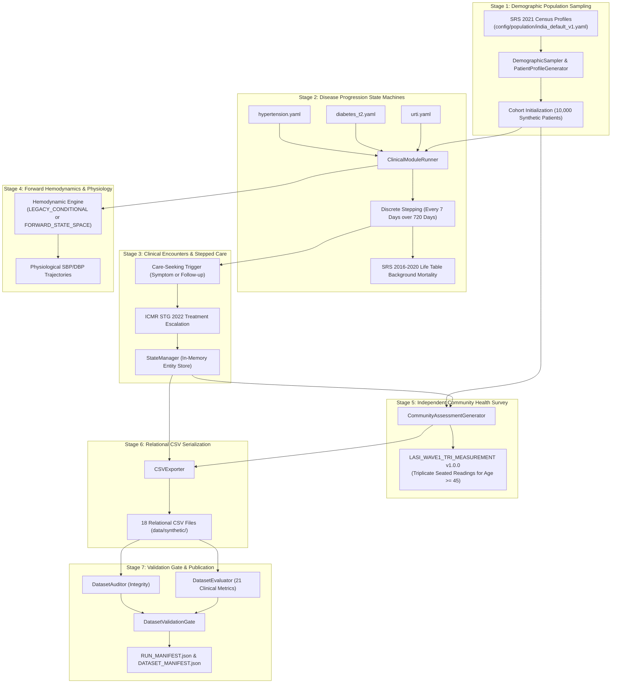

# SYNAPSE Phase 2 — Synthea-Inspired Longitudinal Simulation Architecture

**Document Type:** Canonical System Architecture Specification  
**System Name:** SYNAPSE Phase 2 Longitudinal Healthcare Simulator  
**Status:** **AUTHORITATIVE IMPLEMENTATION**  
**Canonical Entry Point:** `generate_synthetic_data.py` (default: `--mode longitudinal`)  
**Canonical Dataset:** `data/synthetic/` ($N=10,000$, Seed 42, 720 Days, Timestep 7 Days)  
**External Validation Gate Status:** `REFERENCE_DATA_PENDING`  

---

## 1. Architectural Overview & Design Philosophy

SYNAPSE Phase 2 implements an agentic, Synthea-inspired longitudinal healthcare simulation engine tailored to Indian epidemiological and demographic structures. Unlike point-in-time hospital encounter generators or discrete-event queue models, this platform models the continuous, causal evolution of a synthetic human population over time.

### 1.1 Core Principles
1. **Longitudinal Causality:** Patients are tracked continuously across a multi-year observation window (default: 720 days / 24 months, $\Delta t = 7$ days).
2. **Modular Disease State Machines:** Chronic and acute conditions are defined in declarative YAML state machines executed by a centralized module runner.
3. **Dual Hemodynamic Engine:** Continuous blood pressure generation supports both standard conditional physiology (`LEGACY_CONDITIONAL`, default) and continuous forward state-space ODE/SDE modeling (`FORWARD_STATE_SPACE`, experimental opt-in).
4. **Decoupled Community vs. Clinical Observation:** Independent household community health surveys (analogous to the Longitudinal Ageing Study in India, LASI Wave 1) are generated without conflating community biomarkers with outpatient hospital electronic health records (EHR).
5. **Strict Pre-Registered Validation Gates:** All exported datasets must pass structural referential integrity, clinical safety invariants, and statistical acceptance thresholds before publication.

---

## 2. End-to-End Simulation Lifecycle (The 7 Stages)



---

## 3. Subsystem Breakdown & Source Code Mapping

### 3.1 Population Demographics (`synapse_simulator.population`)
- **Config:** [`config/population/india_default_v1.yaml`](file:///Users/shashi/synapse/synapse-phase2/config/population/india_default_v1.yaml).
- **Implementation:** [`synapse_simulator/population/loader.py`](file:///Users/shashi/synapse/synapse-phase2/synapse_simulator/population/loader.py), [`synapse_simulator/population/models.py`](file:///Users/shashi/synapse/synapse-phase2/synapse_simulator/population/models.py), [`synapse_simulator/datagen/patient_generator.py`](file:///Users/shashi/synapse/synapse-phase2/synapse_simulator/datagen/patient_generator.py).
- **Methodology:** Stratified sampling across 5 age bands (`0-14`, `15-24`, `25-44`, `45-64`, `65+`), sex ratio ($51.5\%$ male, $48.5\%$ female), geographical states, and baseline health indicators matching the Sample Registration System (SRS 2021).

### 3.2 Disease Progression State Machines (`synapse_simulator.modules`)
- **Module Engine:** [`synapse_simulator/modules/engine.py`](file:///Users/shashi/synapse/synapse-phase2/synapse_simulator/modules/engine.py), [`synapse_simulator/modules/models.py`](file:///Users/shashi/synapse/synapse-phase2/synapse_simulator/modules/models.py).
- **Declarative YAML Modules:**
  1. **Essential Hypertension** ([`config/modules/hypertension.yaml`](file:///Users/shashi/synapse/synapse-phase2/config/modules/hypertension.yaml)):
     - Progression: `HEALTHY` $\rightarrow$ `PRE_HYPERTENSION` $\rightarrow$ `STAGE_1_HTN` $\rightarrow$ `STAGE_2_HTN` $\rightarrow$ `HYPERTENSIVE_CKD`.
     - First-line treatment: Amlodipine ($5\text{ mg/day}$).
     - Treatment intensification: Stepped care escalation to Telmisartan ($40\text{ mg/day}$) if uncontrolled after 90 days.
  2. **Type 2 Diabetes Mellitus** ([`config/modules/diabetes_t2.yaml`](file:///Users/shashi/synapse/synapse-phase2/config/modules/diabetes_t2.yaml)):
     - Progression: `HEALTHY` $\rightarrow$ `PRE_DIABETES` $\rightarrow$ `T2D_UNCOMPLICATED` $\rightarrow$ `DIABETIC_NEPHROPATHY`.
     - First-line treatment: Metformin ($500\text{--}1000\text{ mg/day}$).
     - Treatment intensification: Stepped care escalation to Glimepiride ($1\text{--}2\text{ mg/day}$).
  3. **Acute Upper Respiratory Tract Infection (URTI)** ([`config/modules/urti.yaml`](file:///Users/shashi/synapse/synapse-phase2/config/modules/urti.yaml)):
     - Progression: `SUSCEPTIBLE` $\rightarrow$ `INCUBATION` $\rightarrow$ `ACUTE_INFECTION` $\rightarrow$ `CONVALESCENT` $\rightarrow$ `SUSCEPTIBLE`.
     - Seasonal Poisson dynamics; episodic resolution in 7–10 days; symptomatic therapy or Amoxicillin.

### 3.3 Background All-Cause Mortality
- **Implementation:** [`synapse_simulator/evaluation/experiment.py`](file:///Users/shashi/synapse/synapse-phase2/synapse_simulator/evaluation/experiment.py:149-168).
- **Source Data:** Office of the Registrar General of India, Sample Registration System (SRS) Abridged Life Tables 2016–2020.
- **Stepping:** At each 7-day timestep, annual mortality probability $q_x$ is converted to step probability:
  $$P(\text{death in }\Delta t) = 1.0 - (1.0 - q_x)^{\Delta t / 365.25}$$
- **Invariant:** Deceased patients produce zero subsequent post-mortem encounters, prescriptions, or observations (`deaths.csv`).

### 3.4 Hemodynamic Engines (`synapse_simulator.datagen.forward_hemodynamics`)
- **Default Mode:** `LEGACY_CONDITIONAL` (calibrated physiological distributions conditioned on age, sex, BMI, and disease state).
- **Experimental Opt-In:** `FORWARD_STATE_SPACE` (continuous stochastic differential state-space tracking arterial compliance, peripheral resistance, and treatment responses).
- **Selected via:** CLI flag `--hemodynamic-mode {LEGACY_CONDITIONAL,FORWARD_STATE_SPACE}`.

### 3.5 Independent Community Health Survey (`synapse_simulator.datagen.community_assessment`)
- **Protocol:** `LASI_WAVE1_TRI_MEASUREMENT` v1.0.0.
- **Specification:** [`synapse_simulator/datagen/bp_measurement.py`](file:///Users/shashi/synapse/synapse-phase2/synapse_simulator/datagen/bp_measurement.py).
- **Target Population:** Community residents aged $\ge 45$ years ($N=2,638$ in the canonical cohort).
- **Protocol Details:** Exactly 3 seated readings taken during a household enumerator visit at 3-minute intervals.
- **Biophysical Validation:** Captures authentic habituation / accommodation effect (reading 1 $\rightarrow$ reading 3 systolic drop of $-3.45\text{ mmHg}$).
- **EHR Isolation:** Stored in `community_assessments.csv` and `community_bp_readings.csv`. Has no `encounter_id`, completely decoupled from hospital electronic medical records.

### 3.6 Persistence & CSV Export (`synapse_simulator.exporter.csv_exporter`)
- **Implementation:** [`synapse_simulator/exporter/csv_exporter.py`](file:///Users/shashi/synapse/synapse-phase2/synapse_simulator/exporter/csv_exporter.py).
- **Output:** 18 normalized relational CSV tables written to the target directory (`data/synthetic/`).
- **Relational Tables:**
  - Core Population: `patients.csv`, `deaths.csv`.
  - Clinical Events: `encounters.csv`, `conditions.csv`, `medications.csv`, `symptoms.csv`, `observations.csv`, `care_plans.csv`.
  - Community Survey: `community_assessments.csv`, `community_bp_readings.csv`.
  - Telemetry: `generation_summary.csv`, `patient_timeline.csv`.
  - Structural Placeholders (Zero rows in longitudinal mode): `labs.csv`, `radiology.csv`, `invoices.csv`, `payments.csv`, `events.csv`, `journey_traces.csv`.

### 3.7 Evaluation & Validation Gates (`synapse_simulator.validation` & `evaluation`)
- **Dataset Auditor:** [`synapse_simulator/validation/dataset_auditor.py`](file:///Users/shashi/synapse/synapse-phase2/synapse_simulator/validation/dataset_auditor.py) checks primary-key uniqueness, foreign-key referential integrity, null field violations, and temporal consistency ($t_{\text{birth}} \le t_{\text{event}} \le t_{\text{death}}$).
- **Dataset Evaluator:** [`synapse_simulator/evaluation/evaluator.py`](file:///Users/shashi/synapse/synapse-phase2/synapse_simulator/evaluation/evaluator.py) evaluates 21 preregistered clinical and demographic metrics against SRS, ICMR-INDIAB, and NHP benchmarks.
- **Validation Gate:** [`synapse_simulator/validation/validation_gate.py`](file:///Users/shashi/synapse/synapse-phase2/synapse_simulator/validation/validation_gate.py) enforces atomic promotion from staging directory to publication path. Rejects corrupted runs fail-fast.

---

## 4. Execution Commands

### 4.1 Canonical Synthetic Data Generation
```bash
# Generate canonical 10,000-patient longitudinal cohort (default mode is longitudinal)
python generate_synthetic_data.py --patients 10000 --seed 42 --days 720 --timestep 7 --output-dir data/synthetic

# Generate experimental cohort with forward state-space hemodynamics
python generate_synthetic_data.py --patients 1000 --seed 42 --hemodynamic-mode FORWARD_STATE_SPACE --output-dir data/experiments/forward_1000
```

### 4.2 Independent Dataset Evaluation
```bash
# Evaluate an exported dataset directory against real-world benchmarks
python evaluate_dataset.py --dataset-dir data/synthetic
```

### 4.3 Multi-Seed Monte Carlo Evaluation
```bash
# Run multi-seed Monte Carlo evaluation across multiple random seeds
python run_evaluation_experiment.py --patients 250 --seeds 42,101,202,303,404 --output-dir data/experiments/monte_carlo
```

### 4.4 Legacy Hospital Operational Compatibility Mode
```bash
# Explicitly opt-in to legacy discrete-event hospital operational prototype
python generate_synthetic_data.py --mode hospital --patients 100 --seed 42 --output-dir data/experiments/legacy_hospital_100
```

---

## 5. Scientific Governance Statement

> **EXTERNAL VALIDATION GATE STATUS**:
>
> $$\mathbf{REFERENCE\_DATA\_PENDING}$$
>
> In accordance with ethical standards, data governance, and scientific integrity:
> 1. **Zero Microdata Access:** No genuine individual participant data from the Longitudinal Ageing Study in India (LASI Wave 1) or other restricted clinical databases were accessed, processed, or reverse-engineered.
> 2. **Public Aggregate Reference Anchors:** All comparisons are grounded exclusively in published aggregate national statistics (SRS 2021, ICMR-INDIAB 2023, National Health Profile 2020).
> 3. **No Empirical Clinical Claim:** Evaluation passes indicate internal mathematical consistency and calibration alignment against aggregate population priors. They do not constitute empirical clinical validation of individual real-world outcomes.
