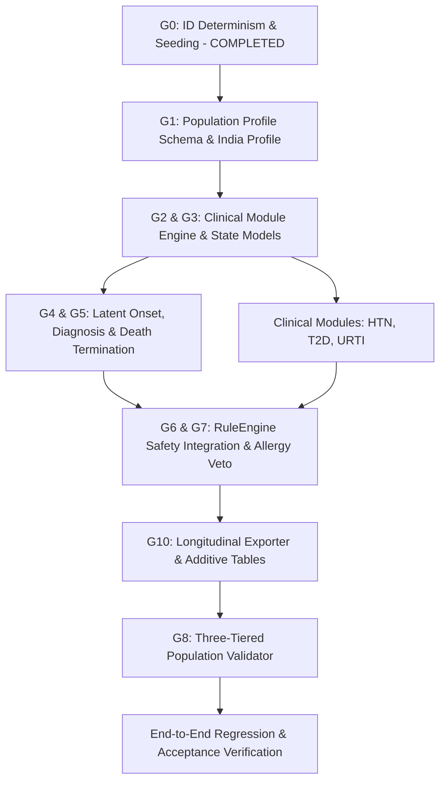

# SYNAPSE Phase 2 × Synthea: Architecture Decision Record (ADR-001)

**Status:** APPROVED FOR IMPLEMENTATION  
**Date:** 2026-10-21  
**Authors:** Antigravity AI & SYNAPSE Core Architecture Team  
**Primary Reference:** Walonoski et al., *Synthea: an approach, method, and software mechanism for generating synthetic patients and the synthetic electronic health care record*, JAMIA 2018 (PMC7651916).

---

## 1. Executive Summary & Architectural Context

SYNAPSE Phase 2 is an event-driven synthetic healthcare simulation platform. Prior to this alignment, SYNAPSE executed fixed-duration scenario journeys (one encounter per patient, four cycling hardcoded scenarios) with structural-only validation and unseeded UUIDs. 

This ADR establishes the architectural foundation to transform SYNAPSE into a longitudinal, research-aligned synthetic patient generator embodying the Generic Module Framework of Synthea while preserving:
1. The discrete-event simulation engine (`FutureActionScheduler`, `SimulationEngine`).
2. The multi-department operational execution pipeline (`clinical`, `pharmacy`, `laboratory`, `radiology`, `finance`).
3. The multi-tier clinical safety rule engine (`RuleEngine`, `RuleRepository`).
4. Strict backwards compatibility with the 12 simplified CSV export schemas.
5. Absolute deterministic reproducibility across identical random seeds.

---

## 2. Resolution of Architectural Decisions (A – H)

### Decision A: Simulation Time, Lifetimes, and Scheduling Integration

1. **Patient Lifetimes and Temporal Boundaries:**
   - Every patient has an intrinsic `birth_date` and an optional `death_date`.
   - The simulation executes across a configurable `observation_window` defined by `[observation_start, observation_end]` (e.g. `2024-01-01 00:00:00` to `2026-12-31 23:59:59`).
   - **Prevalent Cohort:** Patients whose lifetimes begin prior to `observation_start` are born at `birth_date < observation_start`. Their historical age at window entry is calculated, and baseline chronic conditions are initialized at or prior to entry based on age-stratified prevalence. They enter the active simulated hospital cohort at `observation_start`.
   - **Incident Cohort:** Patients born during the simulation enter at `birth_date >= observation_start`.
   - **Clamping Invariant:** No clinical event, encounter, diagnosis, observation, or medication shall ever have a timestamp $t < \text{birth\_date}$ or $t > \text{death\_date}$. Any scheduled event violating this invariant is rejected at schedule time.

2. **Configurable Timestep and Intra-Timestep Dynamics:**
   - The simulation adopts the Synthea default 7-day timestep ($\Delta t = 7\text{ days}$, configurable down to 1 day).
   - Module state progression is evaluated at each timestep $t_k = t_{k-1} + \Delta t$.
   - When a clinical transition or event is triggered during timestep $[t_k, t_k + \Delta t]$, an intra-timestep offset is sampled using the patient's dedicated seeded RNG:
     $$t_{\text{event}} = t_k + \text{timedelta}(\text{seconds} = \text{int}(\text{rng.uniform}(0, \Delta t.\text{total\_seconds}())))$$
   - This prevents artificial temporal clustering at 7-day boundaries while preserving discrete-event determinism.

3. **Integration with `FutureActionScheduler` (No Second Scheduler):**
   - The simulation engine does NOT implement a secondary scheduler.
   - At patient population initialization, each patient receives an initial `STEP_PATIENT_MODULES` action registered in the existing `FutureActionScheduler` at their entry time.
   - When `SimulationEngine` processes `STEP_PATIENT_MODULES`, the patient's active clinical modules evaluate transitions, emit operational `ActionRequest` objects (for encounters, prescriptions, lab orders) into `FutureActionScheduler`, and schedule the next `STEP_PATIENT_MODULES` at $t_k + \Delta t$ if the patient remains alive and $t_k + \Delta t \le \text{observation\_end}$.
   - Hospital workflow events and clinical module steps share the exact same priority min-heap.

---

### Decision B: Population Profiles and Provenance

1. **Versioned YAML Population Profile Schema:**
   - Location: `config/population/{region}_{version}.yaml` (default: `india_default_v1.yaml`).
   - Strict Pydantic schema: `PopulationProfile`:
     ```yaml
     schema_version: "1.0.0"
     metadata:
       id: "pop-in-2024"
       name: "India National Representative Synthetic Baseline"
       target_geography: "IN"
       reference_year: 2021
     provenance_catalog:
       SRS_2021_AGE:
         title: "Sample Registration System (SRS) Statistical Report 2021"
         publisher: "Registrar General of India"
         year: 2021
         source_type: "GOVERNMENT_CENSUS"
         url_or_ref: "Census of India SRS Report 2021"
         is_assumption: false
       ICMR_INDIAB_2023:
         title: "ICMR-INDIAB national cross-sectional study"
         publisher: "Lancet Diabetes & Endocrinology / ICMR"
         year: 2023
         source_type: "PEER_REVIEWED_STUDY"
         url_or_ref: "Lancet Diabetes Endocrinol 2023; 11: 474–89"
         is_assumption: false
     demographics:
       age_distribution:
         provenance_id: "SRS_2021_AGE"
         bands:
           - { min_age: 0, max_age: 14, weight: 0.252 }
           - { min_age: 15, max_age: 24, weight: 0.178 }
           - { min_age: 25, max_age: 44, weight: 0.312 }
           - { min_age: 45, max_age: 64, weight: 0.188 }
           - { min_age: 65, max_age: 100, weight: 0.070 }
       sex_distribution:
         provenance_id: "SRS_2021_AGE"
         male_ratio: 0.515
         female_ratio: 0.485
     ```

2. **Provenance Mandate & Geographic Isolation:**
   - Every distribution MUST link to a key in `provenance_catalog`.
   - Any modeled parameter lacking empirical literature is flagged with `is_assumption: true` and requires an explicit rationale.
   - If a target geography (e.g. `IN`) lacks a required demographic or epidemiological reference, the system raises `MissingReferenceStatisticError`. Under no circumstances will US-specific statistics (e.g. CDC NHANES) be silently substituted into an Indian profile.

---

### Decision C: Clinical Module Framework (States and Transitions)

1. **State Machine Definition:**
   Modules are declared in declarative YAML (`config/modules/{module_id}.yaml`) and parsed into validated Pydantic models:
   - **Control States (7):**
     1. `Initial`: Entry point of module.
     2. `Terminal`: Concludes pathway.
     3. `Simple`: Instantaneous execution pass-through.
     4. `Guard`: Blocks transition until a predicate evaluates to `True`.
     5. `Delay`: Suspends progression for an explicit duration (e.g. 180 days).
     6. `SetAttribute`: Modifies internal patient clinical variable (e.g. `sbp_category = "Stage2"`).
     7. `Counter`: Increments or decrements a cycle counter with boundary guards.
   - **Clinical States (11):**
     1. `Encounter`: Schedules an inpatient, outpatient, or emergency encounter.
     2. `ConditionOnset`: Initiates a latent disease condition.
     3. `ConditionEnd`: Resolves an active condition.
     4. `MedicationOrder`: Proposes a drug prescription with dosage, route, frequency.
     5. `MedicationEnd`: Discontinues active medication.
     6. `CarePlanStart`: Initiates a structured protocol (e.g. diabetic lifestyle counselling).
     7. `CarePlanEnd`: Completes or terminates a care plan.
     8. `Procedure`: Proposes a diagnostic or therapeutic procedure.
     9. `Observation`: Records vital sign or laboratory metric (e.g., SBP, HbA1c).
     10. `Symptom`: Sets a patient-perceived symptom and severity score $[0.0, 1.0]$.
     11. `Death`: Terminal death state with documented cause code.
   - **Transitions (4):**
     1. `DirectTransition`: Deterministic jump to next state.
     2. `DistributedTransition`: Categorical probability distribution across targets.
     3. `ConditionalTransition`: Boolean evaluation over patient attributes and historical record.
     4. `ComplexTransition`: Conditional logic branching to distributed sub-transitions.

2. **Conditional Logic and Record Queries:**
   - Evaluated via `simpleeval` with registered safe functions:
     - `has_condition(code)`: Checks active diagnosed conditions.
     - `has_symptom(name)`: Checks current symptoms.
     - `latest_observation(code)`: Returns most recent recorded quantitative value.
     - `age()`, `gender()`, `attribute(key)`.

3. **Seeded Reproducibility of Distributed Transitions:**
   - Each patient holds an independent sub-RNG seeded from `hash_combine(simulation_seed, patient_id)`.
   - Stochastic branching consumes exclusively the patient's local stream, guaranteeing that simulating additional patients does not alter the clinical trajectory of preceding patients.

4. **Integration with `ActionRequest` and Operational Handlers:**
   - Clinical states emit typed `ActionRequest` objects into the simulation pipeline:
     - `Encounter` state $\to$ `ActionRequest(dept="clinical", type="RegisterEncounter")`
     - `MedicationOrder` state $\to$ `ActionRequest(dept="pharmacy", type="DispensePrescription")`
     - `Procedure` / `Observation` state $\to$ `ActionRequest(dept="laboratory" | "radiology", type="OrderInvestigation")`
   - Operational workflows (bed allocation, pharmacy stock deduction, invoice generation) execute through their existing departmental handlers.

---

### Decision D: Condition Onset vs. Clinical Diagnosis

1. **Separation of Latent Onset and Encounter Diagnosis:**
   - `ConditionOnset` records the biological beginning of disease inside `patient.active_latent_conditions`:
     ```python
     LatentCondition(condition_code="I10", onset_time=t_now, recognized=False)
     ```
   - Biological onset is invisible in the clinical record (`conditions.csv`) at onset time.
2. **Recognition Encounter:**
   - A condition transitions from latent to diagnosed only when the patient undergoes an `Encounter` where diagnostic criteria are satisfied (e.g. routine screening, symptom-prompted visit, or elevated lab observation).
   - Upon clinical recognition, an `ActionRequest(dept="clinical", type="RecordDiagnosis")` is emitted.
   - The diagnosis record is stamped with `timestamp = encounter.start_time` and links to `encounter_id`.
   - **Export Guarantee:** No entry in `conditions.csv` will ever have a recording timestamp prior to its corresponding encounter start time.

---

### Decision E: Death and Terminal Behavior

1. **Death Mechanics:**
   - When a patient transitions into a `Death` clinical state:
     - `patient.status` transitions to `Deceased` (an explicit terminal state added to `PatientStateMachine`).
     - `patient.death_date` is stamped with the exact simulation timestamp.
     - A death record is staged with primary cause code (ICD-10).
2. **Action Invalidation and Anti-Zombification:**
   - The simulation calls `scheduler.invalidate_entity_actions("patients", patient.id)`.
   - All pending laboratory tests, radiology appointments, pharmacy pickups, follow-up visits, and future `STEP_PATIENT_MODULES` actions are marked `INVALIDATED` and excised from future execution.
   - `SimulationEngine._process_scheduled_action` executes a mandatory pre-flight guard: if `patient.is_deceased == True`, any non-post-mortem action is aborted with zero side effects.
3. **Mortality Modeling Source:**
   - Background natural mortality utilizes the Registrar General of India SRS Abridged Life Table (2016–2020) age-sex annual mortality rates $q_x$.
   - Disease-specific excess mortality is modeled directly in disease modules with explicit citation.
   - If life-table data is disabled, background mortality is set to zero, and all deaths must stem from explicit clinical module terminal pathways.

---

### Decision F: Evidence, Guidelines, Assumptions, and Safety Rules

1. **Taxonomy of Knowledge Objects:**
   - `Evidence`: Peer-reviewed clinical publications (with PMID, DOI, authors).
   - `Guideline`: Structured medical guidelines (e.g. ICMR Type 2 Diabetes Guidelines 2022).
   - `PopulationStatistic`: Empirical demographic/epidemiological distributions (SRS, NFHS-5).
   - `ModelingAssumption`: Expert-estimated transition probabilities (explicitly tagged `is_assumption: true`).
   - `SafetyRule`: Hard computational guardrails in `RuleEngine` (e.g. Level 100 System, Level 80 Clinical Safety).

2. **Immutability of Safety Precedence (Probabilistic Proposals Cannot Override Safety):**
   - Clinical modules are *probabilistic proposal generators*, not authoritative execution arbiters.
   - Every `ActionRequest` emitted by a module is evaluated by `RuleEngine.evaluate(request)`.
   - Level 80 Clinical Safety Rules (e.g., `RULE-CLIN-ALLERGY-001`) have complete veto authority.
   - **Allergy Rule Generalization:** `RULE-CLIN-ALLERGY-001` is updated to apply across all scenarios (`scenarios: ["*"]`), and module-generated medication requests always carry `extra_context.drug_class` and patient allergy profiles. If a module stochastically proposes Amoxicillin for a Penicillin-allergic patient, the Rule Engine blocks the request.

---

### Decision G: Three-Tiered Validation Framework

1. **Tier 1: Structural Integrity (BLOCKS PUBLICATION):**
   - Foreign key integrity across all 12 simplified CSVs and additive tables.
   - Primary key uniqueness.
   - Temporal consistency: $\text{birth} \le \text{onset} \le \text{diagnosis} \le \text{death}$.
   - No negative charges, quantities, or durations.
   - *Result on failure:* Publication halted; artifacts placed in `failed_run_*`.

2. **Tier 2: Clinical Plausibility (WARNING AUDIT):**
   - Physiological plausibility bounds (HbA1c $3.0 - 20.0\%$, SBP $60 - 260\text{ mmHg}$, DBP $40 - 150\text{ mmHg}$).
   - Zero procedures or prescriptions post-mortem.
   - All diagnosed patients with chronic diseases have at least one corresponding encounter.

3. **Tier 3: Statistical Realism & Reference Grounding:**
   - Comparison against documented population profile references:
     - Age/Sex distribution: Chi-square goodness-of-fit test ($\chi^2$) and Jensen-Shannon Divergence (JSD).
     - Disease prevalence: Calculated cohort prevalence with 95% Wilson Score confidence intervals:
       $$\tilde{p} \pm \frac{z}{1 + z^2/n}\sqrt{\frac{\hat{p}(1-\hat{p})}{n} + \frac{z^2}{4n^2}}$$
   - **Rigorous Verification Labelling:**
     - `VERIFIED`: The metric has a direct, documented reference distribution in the profile and falls within the expected statistical uncertainty for the cohort sample size ($n$).
     - `UNVERIFIED_ESTIMATE`: The metric is an uncalibrated emergent property or assumption without an external empirical benchmark.
     - No metric shall ever be labeled `VERIFIED` without an active reference citation.

---

### Decision H: Longitudinal Exports and Schema Preservation

1. **Preservation of the 12 Simplified CSV Schemas:**
   All original columns, headers, and formats in the 12 simplified CSVs remain 100% backward compatible:
   - `patients.csv` (age represents age at observation end or death)
   - `encounters.csv` (supports multiple encounters per patient)
   - `conditions.csv` (supports multiple conditions per patient with unique `condition_id`)
   - `medications.csv`, `symptoms.csv`, `labs.csv`, `radiology.csv`, `invoices.csv`, `payments.csv`, `events.csv`, `journey_traces.csv`, `generation_summary.csv`.

2. **Removal of 1-Encounter-Per-Patient Constraints in Exporter:**
   - `csv_exporter.py` is refactored to remove the `f"cond-{pid}"` constraint and `get_patient_enc_id` single-encounter assumption.
   - Condition IDs are allocated dynamically via `new_id("cond-")`.
   - Consultations, symptoms, and orders link to their true triggering `encounter_id`.

3. **Additive Longitudinal Tables:**
   To capture full longitudinal richness without breaking existing schemas, four additive CSV tables are generated:
   - `patient_timeline.csv`: `timeline_id`, `patient_id`, `timestamp`, `event_type`, `entity_id`, `description`
   - `observations.csv`: `observation_id`, `patient_id`, `encounter_id`, `timestamp`, `observation_code`, `observation_name`, `value`, `unit`, `is_abnormal`
   - `care_plans.csv`: `care_plan_id`, `patient_id`, `encounter_id`, `plan_code`, `plan_name`, `start_date`, `end_date`, `status`
   - `deaths.csv`: `death_id`, `patient_id`, `death_date`, `cause_code`, `cause_name`, `is_premature`

---

## 3. Minimal End-to-End Implementation Modules

Three representative clinical modules are selected to exercise the full generic module specification:

| Module | ICD-10 | Primary Sourced Reference | Capabilities Exercised |
|---|---|---|---|
| **Hypertension (Essential)** | `I10` | ICMR-INDIAB (2023), JNC-8 Guidelines | Longitudinal chronic progression, latent onset, screening blood pressure observations (SBP/DBP), antihypertensive prescription (Telmisartan/Amlodipine), conditional transition to cardiovascular mortality. |
| **Type 2 Diabetes Mellitus** | `E11.9` | ICMR-INDIAB (2023), ICMR Guidelines (2022) | Latent prediabetes $\to$ diabetes onset, fasting glucose & HbA1c observations, diagnosis encounter, lifestyle care plan initiation, Metformin prescription, comorbidity interaction with Hypertension. |
| **Acute Upper Respiratory Infection (URTI)** | `J06.9` | National Health Portal India, Clinical Knowledge Base | Episodic acute onset, symptom manifestation (cough, fever), acute encounter, antibiotic order (Amoxicillin) explicitly testing allergy safety veto, natural recovery (`ConditionEnd`). |

---

## 4. Acceptance Criteria (14 Measurable Gates)

1. **Deterministic Reproducibility:** Two runs with identical configuration and seed yield byte-identical SHA-256 hashes across all 12 simplified CSVs and 4 additive CSVs.
2. **Stochastic Variation:** Two runs with different random seeds yield distinct patient cohorts, event sequences, and clinical trajectories.
3. **Population Fidelity:** Sampled demographic marginals (age brackets, sex ratio) match the population profile within 95% Wilson confidence intervals / chi-square test ($p > 0.01$).
4. **Longitudinal History:** In a multi-year observation window, patients accumulate $>1$ encounter over time, and chronic patients display longitudinal event timelines.
5. **Temporal Boundary Consistency:** $100\%$ of generated records satisfy: $\text{birth\_date} \le \text{onset\_date} \le \text{encounter\_time} \le \text{death\_date} \le \text{observation\_end}$.
6. **No Retroactive Diagnoses:** Zero conditions in `conditions.csv` possess a diagnosis timestamp prior to their associated encounter start time.
7. **Absolute Death Invalidation:** Deceased patients have zero clinical events, prescriptions, or encounters scheduled or executed after their recorded death date.
8. **Clinical Safety Rule Enforcement:** When a module proposes a medication contraindicated by patient allergies (e.g. Amoxicillin in Penicillin allergy), `RuleEngine` vetos the order.
9. **Scenario Compatibility:** Legacy operational scenarios (`SCEN-V1-01` through `SCEN-V1-04`) continue to execute with 100% test pass rate.
10. **Schema Compatibility:** The 12 simplified CSV files retain exact header names and column orders.
11. **Structural Gate Authority:** Any Tier 1 structural validation failure halts artifact promotion and exits with non-zero status.
12. **Rigorous Verification Reporting:** Validation reports strictly separate `VERIFIED` metrics (with cited provenance) from `UNVERIFIED_ESTIMATE` metrics.
13. **Comprehensive Test Coverage:** All existing 115 tests pass, and new modules/features achieve $>90\%$ unit and integration test coverage.
14. **Performance Benchmark:** Cohort generation of 1,000 patients over a 3-year observation window completes within acceptable execution time ($<60\text{ seconds}$ on standard hardware).

---

## 5. Implementation Roadmap & Dependency Graph



### Affected Files and New Artifacts

- **New Files:**
  - `synapse_simulator/population/models.py` (Population profile Pydantic models)
  - `synapse_simulator/population/loader.py` (Profile loader and validator)
  - `synapse_simulator/modules/models.py` (Module, state, transition Pydantic models)
  - `synapse_simulator/modules/engine.py` (Clinical module execution runner)
  - `synapse_simulator/modules/evaluator.py` (Safe expression evaluation)
  - `synapse_simulator/validation/population_validator.py` (Three-tier validator)
  - `config/population/india_default_v1.yaml` (Documented Indian demographic & epidemiological profile)
  - `config/modules/hypertension.yaml` (I10 clinical module)
  - `config/modules/diabetes_t2.yaml` (E11.9 clinical module)
  - `config/modules/urti.yaml` (J06.9 clinical module)
  - `tests/test_population_profile.py`
  - `tests/test_clinical_modules.py`
  - `tests/test_longitudinal_export.py`
  - `tests/test_population_validator.py`

- **Modified Files:**
  - `synapse_simulator/datagen/patient_generator.py` (Support profile-based initialization)
  - `synapse_simulator/core/state_machine.py` (Add `Deceased` status to `PatientStateMachine`)
  - `synapse_simulator/core/simulation_engine.py` (Deceased patient guards)
  - `synapse_simulator/exporter/csv_exporter.py` (Remove 1-encounter constraint, add additive tables)
  - `config/rules/departments/pharmacy.yaml` (Generalize allergy rule to all scenarios)
