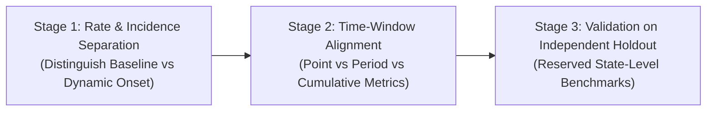

# SYNAPSE Phase 2 — Calibration Plan & Acceptance Policies

## 1. Principles of Empirical Calibration

Model calibration in SYNAPSE Phase 2 is governed by strict scientific rules:
1. **Separation of Calibration from Independent Evaluation:** Model tuning must be performed against training benchmarks, while final acceptance is evaluated against held-out validation benchmarks.
2. **No Blind Probability Hacking:** Probabilities must not be arbitrarily adjusted simply to force aggregate outputs to pass tests. Every transition parameter must be anchored in documented clinical literature.
3. **Preservation of Invariant Integrity:** Under no circumstances may calibration compromise causal, temporal, or safety invariants.

---

## 2. Multi-Stage Calibration Plan

Based on the baseline discrepancy analysis, calibration will be conducted in three sequential, isolated stages:



### Stage 1: Disentangling Baseline Prevalence from Longitudinal Incidence
- **Problem:** Patients initialized with chronic disease at simulation start were also eligible for incident transition in the clinical module.
- **Calibrated Protocol:**
  - When patient $p$ is seeded with baseline chronic condition $C$ at simulation start, their clinical module state must initialize at `MaintenanceDelay` or `ScreeningEncounter` rather than `Initial` -> `AgeCheck` -> `ConditionOnset`.
  - The dynamic transition weight in `AgeCheck` will then represent strictly **new-onset annual incidence** among previously healthy individuals.
  - **Hypertension Annual Incidence Target:** Calibrate transition weight to **0.035 (3.5% per year)** based on ICMR-INDIAB prospective follow-up data.
  - **Type 2 Diabetes Annual Incidence Target:** Calibrate transition weight to **0.015 (1.5% per year)** based on ICMR-INDIAB prediabetes conversion literature.

### Stage 2: Temporal Window and Prevalence Concept Alignment
- **Problem:** Historical diagnoses in `conditions.csv` measure cumulative 2-year attack rate for acute conditions, whereas survey benchmarks measure 14-day point prevalence.
- **Calibrated Protocol:**
  - Define two distinct evaluation metrics for acute conditions:
    1. `prev_urti_point_prevalence`: Filtered strictly to active conditions where condition status is `Active` and diagnosis time is within the final 30 days of simulation ($t > t_{\text{end}} - 30\text{d}$).
    2. `prev_urti_cumulative_attack_rate`: Evaluated against multi-year cumulative attack rate benchmarks (~60%–80%).

### Stage 3: Validation Against Held-Out Independent Data
To ensure that calibration does not overfit to the national summary statistics:
- **Calibration Training Set:** National pooled statistics from ICMR-INDIAB 2023.
- **Reserved Holdout Validation Targets:** State-specific sub-regional benchmarks (e.g. Tamil Nadu adult diabetes prevalence: 14.4%, Maharashtra: 10.8%) and gender-stratified sub-cohorts (Male: 12.1%, Female: 10.7%).
- Calibration parameters will be accepted only if held-out sub-strata maintain low divergence ($JSD < 0.05$).

---

## 3. Explicit Acceptance Policies

Acceptance criteria are established separately for each dimension. SYNAPSE explicitly rejects combining all metrics into a single arbitrary "accuracy percentage", which could permit excellent demographic scores to mask fatal clinical safety violations.

```
+-----------------------------------------------------------------------------------+
|                           MANDATORY EVALUATION GATES                              |
+-----------------------------------------------------------------------------------+
|  GATE 1: Structural & Referential Integrity (0 errors allowed)                    |
|  GATE 2: Causal & Temporal Invariants (0 pre-birth, 0 post-mortem, 0 unsafe drugs)|
|  GATE 3: Demographic Fidelity (JSD < 0.05, Male sex within 5.0%)                  |
|  GATE 4: Disease Prevalence (HTN within 8.0%, T2D within 6.0% of adult benchmark) |
|  GATE 5: Comorbidity Clustering (Conditional P(HTN|T2D) within 15.0%)             |
+-----------------------------------------------------------------------------------+
```

### Detailed Acceptance Thresholds

| Dimension | Metric | Pass Threshold | Warning Threshold | Failure Threshold | Action on Failure |
| :--- | :--- | :---: | :---: | :---: | :--- |
| **Invariants** | All 4 Invariant Checks | 0 violations | — | $> 0$ violations | **BLOCK PUBLICATION** (Fatal software/causal bug) |
| **Demographics** | Male Sex Proportion | $|\text{Diff}| \le 5.0\%$ | $5.0\% < |\text{Diff}| \le 10.0\%$ | $|\text{Diff}| > 10.0\%$ | Review sampling generator seed |
| **Demographics** | Age Pyramid JSD | $JSD < 0.05$ | $0.05 \le JSD < 0.15$ | $JSD \ge 0.15$ | Recalibrate census age weights |
| **Demographics** | Age-by-Sex Matrix JSD | $JSD < 0.08$ | $0.08 \le JSD < 0.20$ | $JSD \ge 0.20$ | Recalibrate joint weights |
| **Prevalence** | Adult Hypertension (`I10`) | $|\text{Diff}| \le 8.0\%$ | $8.0\% < |\text{Diff}| \le 15.0\%$ | $|\text{Diff}| > 15.0\%$ | Recalibrate incidence rate |
| **Prevalence** | Adult Type 2 Diabetes (`E11.9`)| $|\text{Diff}| \le 6.0\%$ | $6.0\% < |\text{Diff}| \le 12.0\%$ | $|\text{Diff}| > 12.0\%$ | Recalibrate transition weight |
| **Prevalence** | Acute URTI (`J06.9`) | $|\text{Diff}| \le 5.0\%$ | $5.0\% < |\text{Diff}| \le 10.0\%$ | $|\text{Diff}| > 10.0\%$ | Align time window definition |
| **Comorbidity** | P(HTN \| T2D) in Adults | $|\text{Diff}| \le 15.0\%$ | $15.0\% < |\text{Diff}| \le 25.0\%$ | $|\text{Diff}| > 25.0\%$ | Investigate risk dependencies |
| **Longitudinal**| Encounters / Pt-Yr | $[0.2, 5.0]$ | $[0.1, 0.2) \cup (5.0, 8.0]$ | $< 0.1 \text{ or } > 8.0$ | Adjust scheduling delays |
| **Treatment** | First-line CCB/ARB in HTN | $\ge 80.0\%$ | $[60.0\%, 80.0\%)$ | $< 60.0\%$ | Audit prescription module rules |
| **Treatment** | First-line Metformin in T2D | $\ge 80.0\%$ | $[60.0\%, 80.0\%)$ | $< 60.0\%$ | Audit prescription module rules |
| **Treatment** | Adherence Assumption | Documented | — | Undisclosed | Mandatory disclosure tag |
