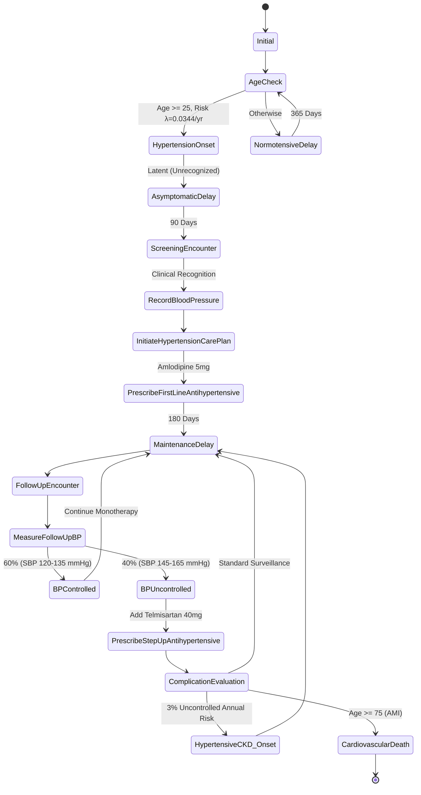
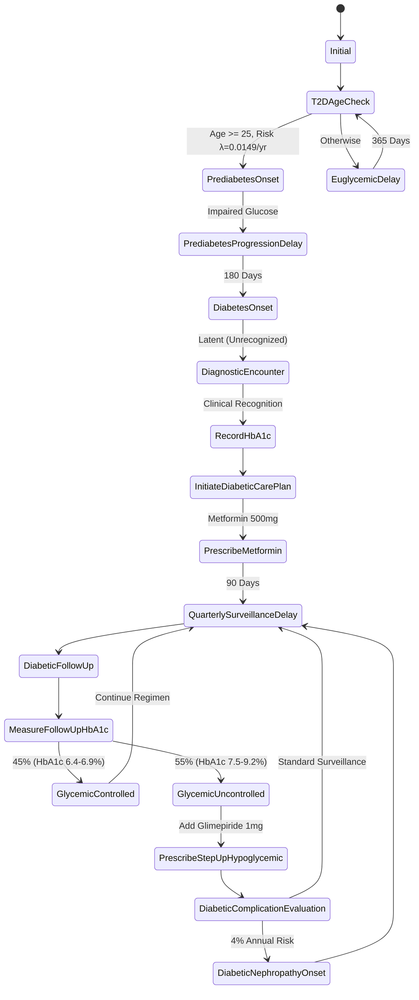

# Clinical Trajectory Specification: Hypertension & Type 2 Diabetes

**Document ID:** `SYNAPSE-AUDIT-DELIV-02`  
**Date:** October 2026  
**Auditor:** SYNAPSE Model Credibility & Clinical Trajectory Audit Team  
**Focus Area:** Longitudinal Patient Pathways, Discrete Clinical States, Control Loops, and Treatment Intensification  

---

## 1. Scope and Design Principles

This specification defines the discrete-event clinical trajectories for **Essential Hypertension (ICD-10 `I10`)** and **Type 2 Diabetes Mellitus (ICD-10 `E11.9`)** in SYNAPSE Phase 2. The design adheres strictly to the Synthea longitudinal state-machine paradigm (Walonoski et al., PMC7651916) while incorporating Indian clinical practice guidelines (ICMR, IHCI, RSSDI).

### Foundational Trajectory Invariants
1. **Separation of Biological Onset from Clinical Diagnosis:**
   Biological disease onset creates a latent condition record (`recognized: False`) with an exact biological onset timestamp. The clinical diagnosis (`CONSULTATION_DIAGNOSE`, `recognized: True`) occurs strictly at a subsequent clinical encounter when diagnostic observations (blood pressure or HbA1c) are performed.
2. **Elimination of Premature Terminal Dead-Ends:**
   Chronic conditions are non-remitting, lifelong diseases. Clinical modules must not transition to terminal states after a single follow-up visit. They must maintain continuous surveillance, monitoring, and therapy adjustment loops.
3. **Dynamic Disease Control Trajectories:**
   Follow-up encounters must re-evaluate physiological control (SBP/DBP, HbA1c). Patients are probabilistically partitioned into controlled versus uncontrolled states based on longitudinal therapy response evidence.
4. **Guideline-Concordant Treatment Intensification:**
   Uncontrolled chronic disease triggers stepped escalation (monotherapy $\to$ dual combination therapy) in accordance with clinical practice guidelines.
5. **Competing Risks and Complications:**
   Prolonged uncontrolled disease risk-weights progression to target-organ damage (Chronic Kidney Disease / Nephropathy, Cardiovascular Events).

---

## 2. Hypertension Clinical Trajectory (`mod-htn-01`)

### 2.1 State-by-State Specification: Hypertension

| State Name | State Type | Action / Semantic | Transition Logic & Parameters | Evidence / Provenance |
| :--- | :---: | :--- | :--- | :--- |
| **`Initial`** | `Initial` | Entry point. | Direct to `AgeCheck`. | Architectural Invariant |
| **`AgeCheck`** | `Guard` | Evaluates eligibility: `age >= 25`. | Distributed: Onset ($0.0344$) vs Delay ($0.9656$). | CURES/CCDC Cohorts |
| **`NormotensiveDelay`** | `Delay` | 365-day annual risk step. | Direct to `AgeCheck`. | Annual Incidence Model |
| **`HypertensionOnset`** | `ConditionOnset` | Creates latent `I10` (`recognized: False`). | Direct to `AsymptomaticDelay`. | Separation of Onset/Diag |
| **`AsymptomaticDelay`** | `Delay` | Asymptomatic period: 90 days. | Direct to `ScreeningEncounter`. | Screening Interval Model |
| **`ScreeningEncounter`** | `Encounter` | Outpatient screening visit (`enc-`). Diagnoses `I10`. | Direct to `RecordBloodPressure`. | Clinical Recognition |
| **`RecordBloodPressure`** | `Observation` | Records initial SBP: $145.0\text{--}168.0\text{ mmHg}$. | Direct to `InitiateHypertensionCarePlan`. | Diagnostic Observation |
| **`InitiateHypertensionCarePlan`** | `CarePlanStart` | Lifestyle protocol: dietary salt reduction (`CP-HTN-01`). | Direct to `PrescribeFirstLineAntihypertensive`. | IHCI / Indian HTN Guidelines |
| **`PrescribeFirstLineAntihypertensive`** | `MedicationOrder` | Prescribes Amlodipine 5mg once daily (`AML-5`). | Direct to `MaintenanceDelay`. | Indian HTN Guidelines IV |
| **`MaintenanceDelay`** | `Delay` | Semi-annual surveillance interval: 180 days. | Direct to `FollowUpEncounter`. | Chronic Review Standard |
| **`FollowUpEncounter`** | `Encounter` | Outpatient follow-up monitoring visit. | Direct to `MeasureFollowUpBP`. | Scheduled Monitoring |
| **`MeasureFollowUpBP`** | `Observation` | Re-measures SBP. | Distributed: Controlled ($0.60$) vs Uncontrolled ($0.40$). | IHCI Clinical Audits |
| **`BPControlled`** | `Simple` | SBP controlled ($120.0\text{--}135.0\text{ mmHg}$). | Direct to `MaintenanceDelay` (continue monotherapy). | Treatment Adherence Model |
| **`BPUncontrolled`** | `Simple` | SBP uncontrolled ($145.0\text{--}165.0\text{ mmHg}$). | Direct to `PrescribeStepUpAntihypertensive`. | Therapeutic Inertia Step |
| **`PrescribeStepUpAntihypertensive`** | `MedicationOrder` | Dual therapy: Add Telmisartan 40mg (`TEL-40`, ARB). | Direct to `ComplicationEvaluation`. | Step-up Combination Care |
| **`ComplicationEvaluation`** | `Simple` | Assesses target-organ complications. | Complex: CKD ($0.03$), AMI Death (Age $\ge 75$), or Delay. | GBD / Epidemiological Model |
| **`HypertensiveCKD_Onset`** | `ConditionOnset` | Latent Hypertensive Nephropathy (`I12.9`). | Direct to `MaintenanceDelay`. | Chronic Complication |
| **`CardiovascularDeath`** | `Death` | Fatal Acute Myocardial Infarction (`I21.9`). | Terminal. | Competing Acute Mortality |

---

## 2. Type 2 Diabetes Clinical Trajectory (`mod-t2d-01`)

### 2.2 State-by-State Specification: Type 2 Diabetes

| State Name | State Type | Action / Semantic | Transition Logic & Parameters | Evidence / Provenance |
| :--- | :---: | :--- | :--- | :--- |
| **`Initial`** | `Initial` | Entry point. | Direct to `T2DAgeCheck`. | Architectural Invariant |
| **`T2DAgeCheck`** | `Guard` | Evaluates eligibility: `age >= 25`. | Distributed: Prediabetes ($0.0149$) vs Delay ($0.9851$). | CARRS Study India |
| **`EuglycemicDelay`** | `Delay` | 365-day annual risk step. | Direct to `T2DAgeCheck`. | Annual Incidence Model |
| **`PrediabetesOnset`** | `SetAttribute` | Marks `glycemic_status = 'impaired'`. | Direct to `PrediabetesProgressionDelay`. | Biological Precursor |
| **`PrediabetesProgressionDelay`** | `Delay` | Latent progression: 180 days. | Direct to `DiabetesOnset`. | Natural History Model |
| **`DiabetesOnset`** | `ConditionOnset` | Creates latent `E11.9` (`recognized: False`). | Direct to `DiagnosticEncounter`. | Separation of Onset/Diag |
| **`DiagnosticEncounter`** | `Encounter` | Outpatient diagnostic consultation. Recognizes `E11.9`. | Direct to `RecordHbA1c`. | Clinical Recognition |
| **`RecordHbA1c`** | `Observation` | Records diagnostic HbA1c: $7.4\text{--}9.6\%$. | Direct to `InitiateDiabeticCarePlan`. | Diagnostic Observation |
| **`InitiateDiabeticCarePlan`** | `CarePlanStart` | Lifestyle protocol: nutrition/exercise (`CP-DIAB-01`). | Direct to `PrescribeMetformin`. | ICMR T2D Guidelines |
| **`PrescribeMetformin`** | `MedicationOrder` | Biguanide monotherapy: Metformin 500mg BID (`MET-500`). | Direct to `QuarterlySurveillanceDelay`. | First-Line Standard |
| **`QuarterlySurveillanceDelay`** | `Delay` | Quarterly monitoring interval: 90 days. | Direct to `DiabeticFollowUp`. | Surveillance Standard |
| **`DiabeticFollowUp`** | `Encounter` | Outpatient quarterly review visit. | Direct to `MeasureFollowUpHbA1c`. | Continuous Care Loop |
| **`MeasureFollowUpHbA1c`** | `Observation` | Re-measures surveillance HbA1c. | Distributed: Controlled ($0.45$) vs Uncontrolled ($0.55$). | CARRS / ICMR-INDIAB |
| **`GlycemicControlled`** | `Simple` | Glycemic control achieved (HbA1c $6.4\text{--}6.9\%$). | Direct to `QuarterlySurveillanceDelay` (maintain dose). | Treatment Success Model |
| **`GlycemicUncontrolled`** | `Simple` | Inadequate control (HbA1c $7.5\text{--}9.2\%$). | Direct to `PrescribeStepUpHypoglycemic`. | Treatment Failure Model |
| **`PrescribeStepUpHypoglycemic`** | `MedicationOrder` | Intensification: Add Glimepiride 1mg daily (`GLIM-1`, SU). | Direct to `DiabeticComplicationEvaluation`. | Step-Up Dual Therapy |
| **`DiabeticComplicationEvaluation`** | `Simple` | Evaluates microvascular complications. | Distributed: Nephropathy ($0.04$) vs Surveillance ($0.96$). | ICMR / Mohan et al. |
| **`DiabeticNephropathyOnset`** | `ConditionOnset` | Latent Diabetic Nephropathy (`E11.2`). | Direct to `QuarterlySurveillanceDelay`. | Microvascular Damage |

---

## 3. Disentanglement of Baseline Chronic Cohorts

When synthetic patients enter the simulation with pre-existing chronic disease (`has_htn` or `has_t2d` at $t=0$):
1. **Historical Onset Timestamp:** Assigned an onset timestamp prior to simulation start ($t_{\text{onset}} = t_0 - 2\text{ years}$), stored with `is_baseline: True`.
2. **Immediate Encounter Entry:** Rather than passing through `HypertensionOnset` or `PrediabetesOnset` (which would generate spurious incident counts), baseline-positive patients are routed directly to their initial monitoring encounters (`ScreeningEncounter` or `DiagnosticEncounter`).
3. **Clinical Continuity:** This ensures that baseline-positive patients have active prescriptions (`AML-5`, `MET-500`), baseline diagnostic observations, and active care plans, while remaining eligible for longitudinal disease control evaluation and treatment intensification.
