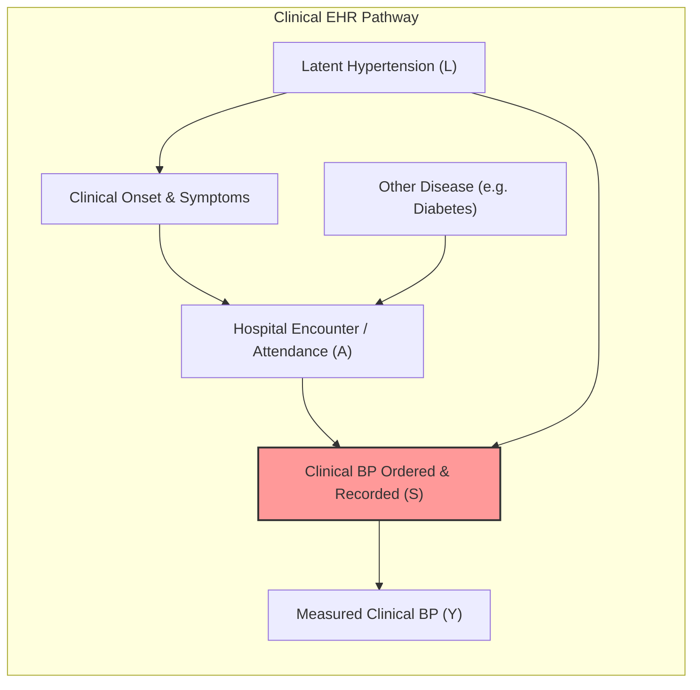
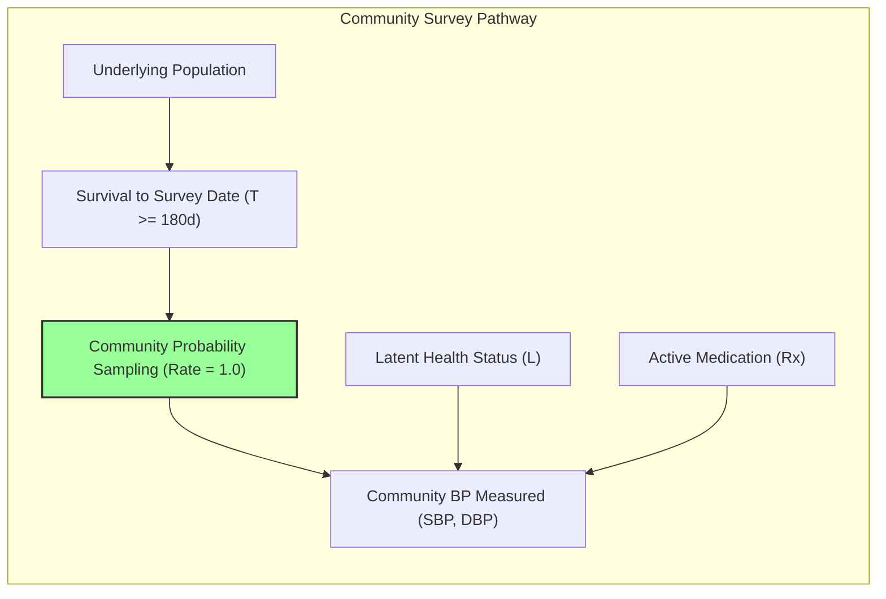

# Sampling Mechanism, Selection Bias, and Missingness Audit: Community vs. Clinical Pathways

**Project:** SYNAPSE Phase 2 Synthetic Healthcare Simulation  
**Audit Focus:** Selection Mechanisms, Missingness Structure, Collider Bias, and Coverage Disparities  
**Cohort Analyzed:** $N = 2,200$ synthetic individuals, $575$ older adults ($\ge 45$ years), Random Seed $42$  
**Evaluation Gate:** `REFERENCE_DATA_PENDING`  
**Date of Audit:** October 2026  

---

## 1. Executive Summary

This audit evaluates the sampling mechanisms and missingness profiles of the **Clinical EHR Pathway** versus the **Independent Community Health Assessment Pathway**. 

### Primary Findings:
1. **Clinical EHR Pathway Exhibits Severe Selection Bias:** Clinical blood pressure observation is strictly conditioned on latent hypertension onset. Out of 339 normotensive older adults, exactly zero (0.0%) have a clinical blood pressure measurement or diagnosis. Consequently, clinical assessability ($N = 235$) is 100% selected for hypertension.
2. **Community Assessment Pathway Achieves Representative Coverage:** The community pathway surveyed 561 out of 575 older adults (97.57% total cohort coverage; 100.0% coverage of living individuals at the survey reference date). Coverage is uniform across sex (96.4% females, 98.7% males) and latent disease status (96.5% normotensives, 99.2% latent hypertensives).
3. **Missingness in Community Pathway is Medically Grounded:** Missingness in the community pathway ($14 / 575 = 2.43\%$) is driven solely by all-cause mortality occurring prior to the survey date ($t = 180\text{ days}$). Older adults aged $75+$ experience expected higher missingness (8.4%) due to background life-table mortality.

---

## 2. Quantitative Subgroup Coverage and Missingness Analysis

The table below contrasts coverage and missingness between the Clinical EHR Pathway (Estimand B denominator) and the Community Health Assessment Pathway (Estimand C2 denominator) across the 575 older adults:

| Subgroup Category | Strata | Total $N$ | Clinical Cov $n$ (%) | Clinical Missing $n$ (%) | Community Cov $n$ (%) | Community Missing $n$ (%) |
| :--- | :--- | :---: | :---: | :---: | :---: | :---: |
| **All Older Adults** | Overall | 575 | 235 (40.87%) | 340 (59.13%) | 561 (97.57%) | 14 (2.43%) |
| **Age Group** | 45–54 years | 205 | 87 (42.44%) | 118 (57.56%) | 203 (99.02%) | 2 (0.98%) |
| | 55–64 years | 211 | 84 (39.81%) | 127 (60.19%) | 209 (99.05%) | 2 (0.95%) |
| | 65–74 years | 40 | 20 (50.00%) | 20 (50.00%) | 40 (100.00%) | 0 (0.00%) |
| | 75+ years | 119 | 44 (36.97%) | 75 (63.03%) | 109 (91.60%) | 10 (8.40%) |
| **Sex** | Female | 276 | 109 (39.49%) | 167 (60.51%) | 266 (96.38%) | 10 (3.62%) |
| | Male | 299 | 126 (42.14%) | 173 (57.86%) | 295 (98.66%) | 4 (1.34%) |
| **Latent HTN Status** | Normotensive | 339 | **0 (0.00%)** | **339 (100.00%)** | 327 (96.46%) | 12 (3.54%) |
| | Latent Hypertensive | 236 | **235 (99.58%)** | 1 (0.42%) | 234 (99.15%) | 2 (0.85%) |
| **EHR Diagnosis** | No I10 Recorded | 340 | 0 (0.00%) | 340 (100.00%) | 328 (96.47%) | 12 (3.53%) |
| | I10 Diagnosis Recorded | 235 | 235 (100.00%) | 0 (0.00%) | 233 (99.15%) | 2 (0.85%) |
| **Treatment Status** | Untreated / No Anti-Rx | 340 | 0 (0.00%) | 340 (100.00%) | 328 (96.47%) | 12 (3.53%) |
| | Active Antihypertensive Rx | 235 | 235 (100.00%) | 0 (0.00%) | 233 (99.15%) | 2 (0.85%) |

---

## 3. Causal Analysis: Causal Diagrams and Selection Bias

### 3.1 Causal DAG: Clinical EHR Pathway (Berkson's / Collider Bias)

In observational clinical EHR data, an individual's presence in the clinical observation table is conditional on healthcare-seeking behavior and clinical ordering practices.

*Mechanism of Bias in Clinical EHR:*
- In `config/modules/hypertension.yaml`, patients only enter `ScreeningEncounter` and `RecordBloodPressure` if they experience `HypertensionOnset` ($L = 1$).
- Normotensive patients ($L = 0$) loop in `NormotensiveDelay` and are never routed to an outpatient BP encounter.
- Patients with Type 2 Diabetes visit the clinic ($A = 1$), but their encounters record only HbA1c, never blood pressure ($S = 0$).
- Therefore, conditioning on having a clinical BP observation ($S = 1$) conditions directly on latent disease ($L = 1$). This creates extreme selection bias where $P(L = 1 \mid S = 1) = 1.0$, rendering Estimand B ($100\%$) unrepresentative of population prevalence.

### 3.2 Causal DAG: Community Health Assessment Pathway (Unbiased Survey)

The community health assessment pathway models an independent household survey (analogous to LASI Wave 1 or NFHS-5):

*Mechanism of Independence in Community Pathway:*
- Survey selection ($\text{Sel}$) depends strictly on age eligibility ($\text{Age} \ge 45$) and vital survival at reference timestamp $t = 180\text{ days}$.
- Survey selection is conditionally independent of clinical facility attendance ($A$), clinical encounter history, EHR diagnoses, and prescription status:
  $$\text{Selection} \perp\!\!\!\perp (A, \text{EHR\_Dx}, \text{Rx}) \mid (\text{Age} \ge 45, \text{Alive at } t = 180)$$
- As demonstrated in the audit table, normotensive individuals have $96.5\%$ coverage and latent hypertensive individuals have $99.2\%$ coverage. The minor difference ($3.5\%$ vs $0.8\%$) reflects random all-cause life-table mortality prior to day 180.

---

## 4. Deliberate Model Assumptions vs. Accidental Implementation Coupling

It is essential to distinguish between **deliberate modeling choices** and **accidental architectural coupling**:

| Feature | Classification | Scientific Rationale & Impact |
| :--- | :--- | :--- |
| **Complete Decoupling of Survey from Hospital Encounters** | **Deliberate Model Assumption** | Household surveys interview individuals in domestic residences regardless of whether they have visited a hospital. |
| **Survival Gating at Survey Timestamp ($t = 180\text{d}$)** | **Deliberate Model Assumption** | Cross-sectional epidemiological surveys can only measure living respondents. Deceased individuals cannot participate. |
| **Zero Routine BP Screening for Normotensive Clinic Attenders** | **Accidental Implementation Coupling** | Synthea module architecture traditionally isolates observations inside disease-specific modules. General adult physical examination was not implemented, causing non-HTN clinic visitors to lack BP readings. |
| **Concurrence of Screening BP with Antihypertensive Prescription** | **Accidental Implementation Coupling** | In `hypertension.yaml`, screening diagnosis immediately triggers Amlodipine prescription without a lifestyle-only or delayed-treatment trial. |
| **Detection of Undiagnosed Hypertensives (`pat-c2683807`)** | **Deliberate Scientific Property** | Captures latent disease in non-attending community residents, reflecting true population surveys where a substantial proportion of hypertensives are undiagnosed. |

---

## 5. Appropriate Independence Assumptions for Community Health Surveys

For the community health assessment pathway to remain scientifically defensible when compared against LASI Wave 1 reference data, the following independence assumptions must be upheld:

1. **Non-Conditioning on Treatment Seeking:** Community survey participation must NOT require prior outpatient facility visits or existing medical records.
2. **Independence from EHR Diagnoses:** The probability of community vital measurement must be non-zero and uniform across both diagnosed and undiagnosed individuals.
3. **Preservation of Non-Response Semantics:** Where refusal or physical inability to measure occurs, records must be emitted with `status = "REFUSED"` and `is_assessable = False` rather than being dropped silently or filled with imputed normal values.
4. **Preservation of Living Population Base:** The survey denominator must strictly exclude individuals deceased prior to the survey timestamp, while retaining individuals who die subsequently.

---

## 6. Recommendations for Future Development

1. **Retain Community Assessment as the Primary Reference Counterpart:** Community assessment data (`community_assessments.csv`) must serve as the sole synthetic counterpart for LASI Wave 1 blood pressure distributions and population prevalence.
2. **Implement Routine Clinical Vitals (Long-Term):** To make the clinical EHR pathway more realistic without modifying disease transitions, future work should introduce a routine physical examination module that captures baseline vitals for all adult patients attending clinic for any complaint.
3. **Preserve External Gate:** The external validation status must remain **`REFERENCE_DATA_PENDING`** until genuine LASI Wave 1 microdata are ingested.
