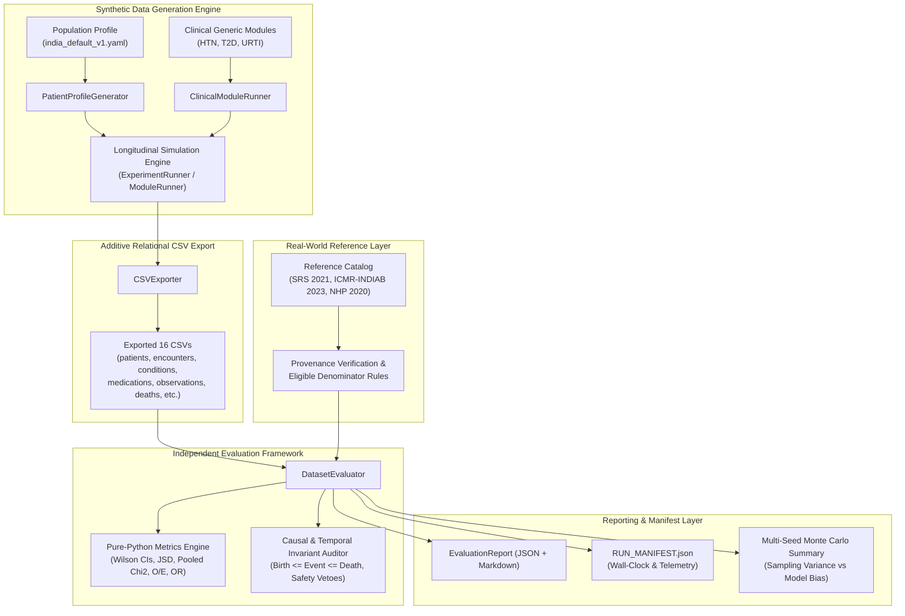

# SYNAPSE Phase 2 — Evaluation Architecture Report

## 1. Executive Summary

The objective of **SYNAPSE Phase 2** is to generate realistic synthetic healthcare data using a Synthea-inspired discrete-event simulation architecture and to systematically evaluate the fidelity with which this synthetic data represents real-world demographic structures, clinical disease trajectories, comorbidities, and treatment pathways.

A foundational architectural requirement of this research phase is the **strict separation of generation from evaluation**:
1. The **Synthetic Data Generation Engine** (`synapse_simulator/datagen/`, `synapse_simulator/modules/`, `synapse_simulator/core/`) executes discrete-event patient simulation.
2. The **Real-World Reference Data Layer** (`synapse_simulator/evaluation/reference_data.py`, `config/population/`) manages empirical real-world statistics, formal citations, provenance metadata, and explicit eligibility criteria.
3. The **Synthetic Data Evaluation Framework** (`synapse_simulator/evaluation/evaluator.py`, `synapse_simulator/evaluation/metrics.py`) independently inspects exported CSV artifacts without relying on runtime simulation memory objects.
4. The **Reporting and Manifest Layer** (`synapse_simulator/evaluation/report.py`, `synapse_simulator/evaluation/experiment.py`) records reproducible execution manifests (`RUN_MANIFEST.json`) and exports machine-readable JSON and human-readable Markdown reports.

---

## 2. Four-Tier Decoupled Architecture

### 2.1 Synthetic Data Generation Engine
- **Population Profiling:** Ingests `config/population/india_default_v1.yaml` with versioned metadata and SRS 2021 demographic distributions.
- **Bijective Seeded IDs:** Employs deterministic ID generation (`synapse_simulator/core/ids.py`) ensuring byte-identical replication for identical seeds while producing stochastic variation across seeds.
- **Generic State-Machine Execution:** Clinical modules (`config/modules/`) operate as state charts with Initial, Guard, Delay, ConditionOnset, Observation, CarePlanStart, MedicationOrder, and Terminal states.

### 2.2 Relational CSV Export Boundary
The simulation state is persisted to disk as sixteen relational CSV artifacts:
- **12 Simplified Hospital Tables:** `patients.csv`, `encounters.csv`, `conditions.csv`, `symptoms.csv`, `medications.csv`, `labs.csv`, `radiology.csv`, `invoices.csv`, `payments.csv`, `events.csv`, `journey_traces.csv`, `generation_summary.csv`.
- **4 Additive Longitudinal Tables:** `patient_timeline.csv`, `observations.csv`, `care_plans.csv`, `deaths.csv`.

**Critical Boundary Principle:** The evaluation framework treats the exported CSV directory as a black-box relational database. It never accesses `StateManager`, `PatientContext`, or in-memory generator structures. This ensures that synthetic healthcare data can be independently audited by third-party regulators or external researchers.

### 2.3 Real-World Reference Data Management Layer
Located in `synapse_simulator/evaluation/reference_data.py`:
- Encapsulates formal empirical targets with mandatory provenance identifiers.
- Defines **strict denominator rules** to prevent invalid comparisons (e.g. matching adult-only disease benchmarks against child-inclusive populations).
- Disallows cross-geographic borrowing unless flagged explicitly as an assumption.

### 2.4 Independent Evaluation & Metrics Layer
Located in `synapse_simulator/evaluation/evaluator.py` and `metrics.py`:
- Implemented entirely in standard Python without native C/SciPy dependencies, guaranteeing reproducibility across computing platforms.
- Handles sparse bins via automated pooling before conducting goodness-of-fit testing.
- Differentiates hard invariant violations (which cause an immediate `FAIL`) from statistical discrepancies (which trigger `WARNING` or require calibration).

---

## 3. Separation of Concerns & Evaluation Policies

To avoid common pitfalls in synthetic data research, SYNAPSE explicitly separates:

| Concept | Definition | Evaluation Mechanism | Failure Consequence |
| :--- | :--- | :--- | :--- |
| **1. Software Correctness** | Code executes without exceptions or memory leaks | Automated unit and regression tests | Build breaks; execution aborts |
| **2. Structural Validity** | Referential integrity, foreign keys, non-null constraints | `IntegrityAuditor`, `DatasetAuditor` | Export staging rejected |
| **3. Clinical Invariants** | Causal order, zero pre-birth or post-mortem events, allergy vetoes | `DatasetEvaluator.evaluate_invariants()` | Mandatory `FAIL` |
| **4. Statistical Similarity** | Concordance with empirical reference distributions | JSD, Chi-Square, Wilson intervals, TVD | `PASS` or `WARNING`/`FAIL` |
| **5. Clinical Plausibility** | Co-occurrence of diseases, realistic treatment sequences | Comorbidity $O/E$ ratio, guideline concordance | Diagnostic report flag |
| **6. Adherence Assumptions** | Assumed patient compliance to medication | Disclosure flag (`rx_adherence_assumption`) | Tagged `UNVERIFIED` |

---

## 4. Execution Manifests and Determinism

Every experiment execution records an audit manifest (`RUN_MANIFEST.json`) containing:
- **Software State:** Git commit SHA, Python runtime version.
- **Experiment Parameters:** Cohort size, random seed, observation start/end, timestep days.
- **Reference Catalog Hash:** Version and URI of the population profile.
- **Performance Telemetry:** Simulation wall-clock seconds, export seconds, evaluation seconds, peak RAM (RSS in MB).
- **Evaluation Scorecard:** Counts of PASS, WARNING, FAIL, UNVERIFIED, and NOT_APPLICABLE metrics.

By decoupling deterministic output generation from wall-clock timing and system telemetry, byte-level output reproducibility is preserved across identical random seeds.
