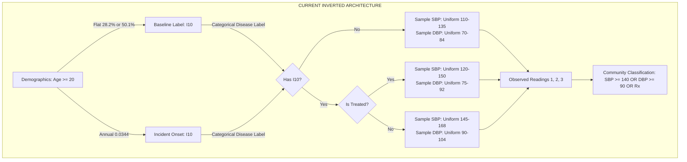
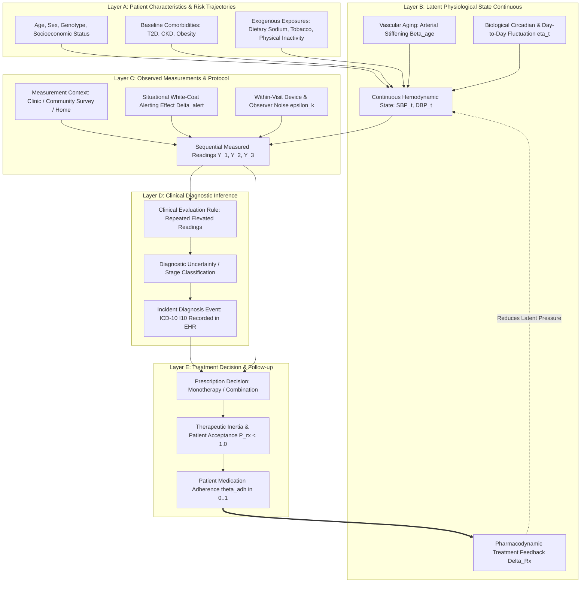

# Forward Disease Generation and Physiological State Architecture Audit

**Document ID:** `SYNAPSE-ARCH-2026-FORWARD-PHYSIOLOGY-01`  
**Classification:** Architectural Design, Causal Trace, and Feasibility Audit  
**Target Repository:** `synapse-phase2`  
**Related Research Audits:**  
- [`docs/research_alignment/bp_measurement_error_model_audit.md`](file:///Users/shashi/synapse/synapse-phase2/docs/research_alignment/bp_measurement_error_model_audit.md)  
- [`docs/research_alignment/latent_bp_prevalence_dependency_audit.md`](file:///Users/shashi/synapse/synapse-phase2/docs/research_alignment/latent_bp_prevalence_dependency_audit.md)  
- [`docs/research_alignment/point_in_time_state_integrity_audit.md`](file:///Users/shashi/synapse/synapse-phase2/docs/research_alignment/point_in_time_state_integrity_audit.md)  
- [`docs/research_alignment/latent_bp_generation_clinical_realism_audit.md`](file:///Users/shashi/synapse/synapse-phase2/docs/research_alignment/latent_bp_generation_clinical_realism_audit.md)  

**Current State Test Suite:** 273 passed, 0 failed in 8.64s (`.venv/bin/pytest`)  
**External Validation Gate Status:** `REFERENCE_DATA_PENDING`  

---

## 1. Executive Summary

Previous audits of the SYNAPSE Phase 2 simulation demonstrated that while point-in-time temporal look-ahead leakage has been successfully eliminated from the Day 180 community assessment pipeline, the underlying disease and vital sign models suffer from **inverted causal architecture**:
1. Categorical disease labels (`"I10"` in `latent_conditions`) and treatment flags (`is_treated`) are assigned first.
2. Continuous blood pressures (SBP and DBP) are sampled downstream conditionally from disconnected uniform ranges ($[110, 135]$, $[120, 150]$, $[145, 168]\text{ mmHg}$).
3. This creates an unphysical **$10\text{ mmHg}$ empty gap** ($135.1$ to $144.9\text{ mmHg}$) in untreated individuals, artificially enforces $100\%$ specificity, and prevents the emergence of realistic demographic gradients (such as the classic epidemiological rise in SBP and pulse pressure widening with age).

### Architectural Objective
This audit proposes a scientifically defensible **Forward-Generation Architecture**. Instead of forcing continuous biological vital signs to be children of discrete administrative disease codes, the proposed architecture establishes the correct biophysical sequence:
$$\text{Patient Biology / Aging} \longrightarrow \text{Latent Physiological State} \longrightarrow \text{Measurement Protocol} \longrightarrow \text{Clinical Inference} \longrightarrow \text{Treatment Action} \longrightarrow \text{Physiological Feedback}$$

### Scope & Constraints
- This document is an **architectural specification, causal trace, and feasibility plan**.
- **No wholesale code rewrites or parameter changes** are made in this audit.
- Existing regression suites (including all 10 temporal boundary tests and fixed-seed reconciliations) remain strictly intact.
- The external validation gate remains strictly **`REFERENCE_DATA_PENDING`**.

---

## 2. Current-State Causal Dependency Mapping (Task 1)

### 2.1 Trace of Current Implementation Across 10 Stages

The table below traces the exact implemented execution sequence in SYNAPSE Phase 2 from population initialization through longitudinal export:

| Stage | Process / Module | Current Implemented Behavior | Causal Direction | Identified Causal Inversion / Leakage Point |
| :--- | :--- | :--- | :--- | :--- |
| **1. Demographic & Risk Factors** | `patient_generator.py` | Samples age from Census SRS life table; sex from male/female ratio; assigns comorbidities (T2D). | Exogenous $\to$ Patient | Baseline risk factor initialization is forward. |
| **2. Baseline HTN Assignment** | `patient_generator.py:121` | Evaluates $P(\text{HTN}\mid\text{T2D}) = 50.1\%$ vs $P(\text{HTN}\mid\text{no T2D}) = 28.2\%$ for all age $\ge 20$. Inserts `"I10"` into `baseline_conditions`. | Comorbidity $\to$ Disease Label | **Inversion Point 1:** Flat baseline disease probability applied across all ages $\ge 20$; bypasses age/sex tables. |
| **3. Incident HTN Transitions** | `hypertension.yaml:25` | `AgeCheck` evaluates annual transition with fixed weight $0.0344$. Transitions to `HypertensionOnset`, adding `"I10"` to `patient.latent_conditions`. | Time $\to$ Disease Label | **Inversion Point 2:** Constant annual incidence rate ($0.0344$) regardless of patient age, baseline BP, or sex. |
| **4. Latent SBP & DBP Generation** | `community_assessment.py:248` | Evaluates `has_htn = is_condition_active_at("I10")` and `is_treated`. Samples Uniform $[110, 135]$, $[120, 150]$, or $[145, 168]$. | **Disease Label $\to$ Vital Signs** | **Inversion Point 3 (Core Inversion):** Blood pressure is sampled conditionally from disease status rather than causing it. |
| **5. BP Measurement Error** | `bp_measurement.py:463` | Applies `SYMMETRICAL_UNBIASED`, `INDEPENDENT_GAUSSIAN`, or `AUTOREGRESSIVE_AR1` to generate Readings 1, 2, 3. | Vital Signs $\to$ Readings | Protocol layer correctly models measurement error over latent draw. |
| **6. Clinical Diagnosis & Coding** | `engine.py:362` | Entering any `Encounter` state automatically flips `latent_conditions["I10"]["recognized"] = True` and writes diagnosis to `clinical.consultations`. | Encounter $\to$ Diagnosis | **Inversion Point 4:** 100% diagnostic recognition upon clinical contact; no diagnostic threshold or uncertainty. |
| **7. Prescription Initiation** | `hypertension.yaml:79` | `ScreeningEncounter` automatically transitions to `PrescribeAntihypertensive` (`Amlodipine 5mg`). | Diagnosis $\to$ Prescription | 100% treatment initiation upon diagnosis; zero therapeutic inertia or patient refusal. |
| **8. Subsequent Physiological Changes** | `hypertension.yaml:101` | `MeasureFollowUpBP` samples SBP Uniform $[120, 165]$. Transitions to `BPControlled` (weight 0.60) vs `BPUncontrolled` (weight 0.40). | Treatment $\to$ Branch Weight | Clinical BP is drawn from hardcoded range rather than applying continuous treatment delta to patient's actual baseline. |
| **9. Community Assessment** | `community_assessment.py` | Day 180 sweep generates independent survey record (`ca-*`) without altering clinical EHR tables. | Latent Draw $\to$ Survey | Correctly separated from clinical state changes (remediated in Point-in-Time Audit). |
| **10. Longitudinal Exports** | `csv_exporter.py` | Exports cumulative relational tables (`patients.csv`, `conditions.csv`, `observations.csv`, etc.). | State Store $\to$ CSV | Longitudinal export preserves discrete event history. |

### 2.2 Current Inverted Causal Flowchart



---

## 3. Proposed Forward-Generation Architecture (Task 2)

The proposed forward architecture separates patient biology, latent physiology, observation protocols, diagnostic inference, and clinical management into five distinct, unidirectional layers:



### 3.1 Layer Details and Causal Separation

#### Layer A: Patient Characteristics
* **Static Characteristics:** Biological sex, birth date, genetic susceptibility factor $u_i \sim \mathcal{N}(0, \sigma_u^2)$.
* **Dynamic Exposures:** Chronological aging, BMI progression, incident diabetes mellitus, renal function decline.
* **Causal Role:** Exogenous conditioning inputs that determine the biological slope and baseline level of the patient's hemodynamic trajectory.

#### Layer B: Latent Physiological State
* **Continuous True State:** $X_i(t) = (SBP_i(t), DBP_i(t))^T$.
* **Evolution Equation:**
  $$SBP_i(t) = \beta_0 + \beta_{\text{age}} \cdot (\text{Age}_i(t) - 45) + \beta_{\text{sex}} \cdot \text{Sex}_i + \beta_{\text{T2D}} \cdot \text{T2D}_i(t) + u_i + \eta_i(t) - \Delta_{\text{treatment}, i}(t)$$
  where $\eta_i(t)$ represents biological temporal fluctuation (unobserved true day-to-day hemodynamic drift).
* **Physiological Validity Guard:** Pulse pressure $PP_i(t) = SBP_i(t) - DBP_i(t) \ge 20.0\text{ mmHg}$. As age advances, $\beta_{\text{age, SBP}} > \beta_{\text{age, DBP}}$, naturally reproducing arterial stiffening and pulse pressure widening.

#### Layer C: Observed Clinical Measurements
* **Observation Mapping:**
  $$Y_{ijk} = SBP_i(t_{ij}) + \Delta_{\text{alert}} \cdot \mathbb{I}(k=1) + \epsilon_{ijk}$$
  where $i$ is patient, $j$ is visit, $k \in \{1, 2, 3\}$ is reading sequence number, and $\epsilon_{ijk}$ follows an autoregressive or exchangeable measurement error structure.
* **Missingness & Failure:** Protocolized unassessability, refusal, or invalid cuff sizing are evaluated here as observational dropouts, leaving latent state $X_i(t)$ intact.

#### Layer D: Clinical Diagnostic Inference
* **Diagnostic Rule:** Diagnosis is **not** triggered automatically upon disease onset. It requires an observable healthcare encounter where measured values exceed clinical guidelines.
* **Confirmation Thresholds:** In accordance with clinical guidelines (e.g., ICMR, AHA/ACC):
  - Severe elevation ($\ge 180/120\text{ mmHg}$): Immediate diagnosis.
  - Mild/Moderate elevation ($\ge 140/90\text{ mmHg}$): Requires confirmation across $\ge 2$ distinct visits or ambulatory/home monitoring before an ICD-10 `"I10"` diagnosis code is recorded.
* **Diagnostic Latency:** Patients with true latent hypertension may remain undiagnosed for months or years if they do not attend clinics, naturally generating an **undiagnosed community hypertensive cohort**.

#### Layer E: Treatment Decision, Adherence, and Feedback
* **Treatment Decision:** Physician prescribing decision depends on confirmed diagnosis, cardiovascular risk, and therapeutic inertia (not all diagnosed patients are prescribed medication: $P(\text{Rx}\mid\text{Diag}) < 1.0$).
* **Adherence Modeling:** Prescription issue does not guarantee adherence. An adherence parameter $\theta_i \in [0, 1]$ modulates effective drug exposure.
* **Biological Feedback:** Active, adhered treatment feeds back into Layer B, lowering latent pressure by:
  $$\Delta_{\text{treatment}, i}(t) = \theta_i(t) \cdot \delta_{\text{drug}}$$
  where $\delta_{\text{drug}} \approx 10\text{ to }15\text{ mmHg}$ SBP reduction for standard monotherapy.

---

## 4. Comparison of Candidate Modeling Approaches (Task 3)

Four mathematical modeling paradigms were evaluated for suitability within SYNAPSE:

| Evaluation Dimension | Candidate 1: Continuous Stochastic (SDE / Diffusion) | Candidate 2: Discrete-Time Markov State Transition | Candidate 3: Event-Driven Discrete-Event (Synthea-style) | Candidate 4: Hybrid State-Space Discrete-Event (RECOMMENDED) |
| :--- | :--- | :--- | :--- | :--- |
| **Description** | Continuous Itô SDEs: $dX_t = \theta(\mu - X_t)dt + \sigma dW_t$. | Fixed-cycle (e.g. 1-year) transition matrices across BP stages (Normal, Pre-HTN, Stage 1, Stage 2). | Discrete states (`Normotensive`, `HypertensionOnset`) with delay-based transitions. | Piecewise-continuous latent biological trajectory sampled at discrete clinical/survey event nodes. |
| **Scientific Strengths** | Natural representation of biological continuous drift and autocorrelation. | Simple population-level prevalence and stage calibration. | Computationally fast; native to discrete healthcare workflows. | Solves causal inversion; eliminates artificial gaps; maintains exact event discrete-simulation compatibility. |
| **Data Requirements** | Dense high-frequency longitudinal ambulatory BP monitoring data. | Transition probability matrices across defined BP categories. | Transition rates from prospective epidemiological studies. | Baseline cross-sectional distribution + prospective annual drift coefficients. |
| **Calibration Requirements** | High: Drift $\theta$, diffusion $\sigma$, and jump parameters difficult to ground in survey data. | Moderate: Stage-to-stage transition probabilities easily estimated from cohort studies. | Low: Transition weights calibrated directly from published annual incidence. | Moderate: Regression coefficients for age, sex, comorbidity, and treatment effect. |
| **Computational Complexity** | Very High: Requires fine-grained numerical integration (Euler-Maruyama) per patient. | Low: Fixed-step matrix-vector multiplication. | Minimal: Event queue jump execution. | Low-to-Moderate: Closed-form trajectory evaluation at encounter timestamps. |
| **Interpretability** | Low for non-statisticians; parameter confounding between drift and volatility. | Moderate; retains artificial discretization into arbitrary stage bins. | High for workflow operations; low for biological hemodynamics. | High: Clear separation between continuous physiology and discrete clinical events. |
| **Suitability for SYNAPSE** | Poor: Mismatches discrete-event simulation architecture; high CPU overhead for $N=100,000$. | Fair: Fixed-step cycling conflicts with variable-delay DES scheduling. | Current baseline: Proven fast, but causes inverted causality and artificial distribution voids. | **Excellent:** Integrates directly with existing `ClinicalModuleRunner` and `CommunityAssessmentGenerator`. |
| **Risks of Assumptions** | Severe: Assumes Brownian motion parameters uncalibrated to Indian populations. | Moderate: Misclassification at boundary edges; loss of continuous reading distributions. | Severe: Mechanically enforces $10\text{ mmHg}$ voids and inverted causality. | Minimal: Linear mixed-effects trajectory can be grounded directly in literature. |

### Architectural Recommendation: Candidate 4 (Hybrid State-Space DES)
**Candidate 4 is recommended as the smallest viable architecture that achieves biological validity.**  
Instead of continuous time-stepping (which would consume massive compute resources simulating every second of a 2-year run), the model computes a **piecewise closed-form trajectory** evaluated lazily whenever an event occurs (an encounter, a survey sweep, or an annual review).

---

## 5. Detailed Hypertension Pathway Design (Task 4)

### 5.1 Formal Mathematical State Specification

For patient $i$ at simulation timestamp $t$:

$$SBP_i(t) = SBP_{0, i} + \beta_{\text{age}} \cdot \frac{t - t_{\text{birth}, i}}{365.25} + \beta_{\text{T2D}} \cdot \mathbb{I}(\text{T2D}_i(t)) - \Delta_{\text{Rx}, i}(t) + \nu_i(t)$$

$$DBP_i(t) = DBP_{0, i} + \gamma_{\text{age}} \cdot \min\left(\frac{t - t_{\text{birth}, i}}{365.25}, 60\right) - \gamma_{\text{late\_age}} \cdot \max\left(0, \frac{t - t_{\text{birth}, i}}{365.25} - 60\right) - \Delta_{\text{Rx, DBP}, i}(t) + \omega_i(t)$$

* **Baseline Draw ($SBP_{0, i}, DBP_{0, i}$):** Sampled from a bivariate normal distribution $\mathcal{N}_2(\boldsymbol{\mu}_0, \boldsymbol{\Sigma}_0)$ representing young-adult population distribution, with correlation $\rho \approx 0.65$.
* **Aging Drift ($\beta_{\text{age}}, \gamma_{\text{age}}$):** Grounded in epidemiological cohort data ($\beta_{\text{age}} \approx +0.6\text{ mmHg/year}$; $\gamma_{\text{age}} \approx +0.3\text{ mmHg/year}$ until age 60, then declining).
* **Treatment Shift ($\Delta_{\text{Rx}}$):** Continuous pharmacodynamic reduction applied only during active prescription intervals:
  $$\Delta_{\text{Rx}, i}(t) = \delta_{\text{drug}} \cdot \theta_i \cdot \mathbb{I}(t \in [\text{start}_i, \text{end}_i])$$

### 5.2 Discrete Event Schedule in the Forward Pathway

```
Simulation Timeline (t = 0 to 720 days)
 |
 |-- t = 0: Patient Initialization (Layer A & B)
 |     Initialize patient demographics, baseline comorbidities, and baseline SBP/DBP trajectory.
 |
 |-- Continuous Latent Progression: SBP_i(t) rises smoothly with vascular aging.
 |
 |-- t = t_1: Random Outpatient Encounter (Layer C)
 |     Measure SBP & DBP using protocol (alerting shift + within-visit error).
 |     Observation: SBP_1 = 146.2 mmHg, DBP_1 = 92.4 mmHg (Elevated!).
 |     Diagnostic Evaluation (Layer D): First elevated visit. Recorded as "Suspected Elevated BP",
 |     NOT coded as ICD-10 I10 yet. Care plan orders lifestyle modification & 90-day follow-up.
 |
 |-- t = Day 180: Community Assessment Sweep (Layer C)
 |     Survey team visits household. Measures 3 sequential readings.
 |     Survey Analysis Value: SBP = 145.8 mmHg, DBP = 91.9 mmHg.
 |     Survey Classification: Hypertensive (Untreated, Undiagnosed).
 |     CRITICAL: Community survey does NOT create EHR diagnosis or prescription!
 |
 |-- t = t_2 (Day 210): Scheduled Clinical Follow-Up Encounter (Layer C & D)
 |     Measure SBP & DBP: SBP_2 = 144.8 mmHg, DBP_2 = 91.1 mmHg.
 |     Diagnostic Evaluation (Layer D): Second consecutive elevated visit!
 |     ICD-10 I10 Confirmed Diagnosis recorded in EHR (`clinical.consultations`).
 |
 |-- t = t_2 + 10 min: Treatment Decision (Layer E)
 |     Physician prescribes Amlodipine 5mg (`pharmacy.prescriptions`).
 |     Prescription event timestamp: start_time = t_2.
 |     Patient adherence drawn: theta_i = 0.85 (good adherence).
 |
 |-- t > t_2: Physiological Feedback (Layer B)
 |     Latent SBP trajectory drops by delta_Rx = 0.85 * 12.0 = 10.2 mmHg.
 |     Patient's subsequent true latent SBP shifts from ~146 mmHg to ~136 mmHg.
 |
 |-- t = Day 390: Maintenance Clinical Follow-up Encounter
 |     Measure SBP: SBP_3 = 136.4 mmHg, DBP_3 = 84.2 mmHg.
 |     EHR Status: "Hypertension Controlled on Antihypertensive Therapy".
```

### 5.3 Point-in-Time Historical Reconstruction Integrity
To preserve full point-in-time state reconstruction:
1. Every state variable must be queryable as a pure function of historical events:
   $$\text{State}_i(t_{\text{query}}) = \mathcal{F}(\text{Events}_i \le t_{\text{query}})$$
2. Latent blood pressure is calculated by plugging $t_{\text{query}}$ into the closed-form trajectory equation, inspecting only prescriptions where $\text{start\_time} \le t_{\text{query}}$.
3. Diagnosis status at $t_{\text{query}}$ is `True` if and only if a diagnosis confirmation event occurred at $t_{\text{event}} \le t_{\text{query}}$.
4. Future events occurring at $t > t_{\text{query}}$ (such as Year 2 diagnoses or treatment discontinuations) have mathematically zero influence on state at $t_{\text{query}}$.

---

## 6. Population Calibration and Validation Plan (Task 5)

Calibration and validation must be strictly separated across five independent domains:

| Domain | Calibration Target | Required Data Fields | Suitable Source Type | Potential Comparability Limitations | Data Availability Status | Can Estimate from Cross-Sectional Data Alone? |
| :--- | :--- | :--- | :--- | :--- | :--- | :--- |
| **1. Demographics & Cross-Sectional Prevalence** | Age-sex standard population; baseline HTN prevalence across 8 Census SRS strata. | Age, sex, self-reported diagnosis, survey-measured SBP/DBP, survey weights. | National cross-sectional surveys (Census SRS 2021, LASI Wave 1). | Self-report underdiagnoses asymptomatic disease; survey measurements subject to single-visit white-coat bias. | **Reference Data Pending** (Currently using synthetic test fixtures). | **Yes:** Cross-sectional weighted proportions directly estimable. |
| **2. Longitudinal Disease Incidence & Drift** | Annual rate of blood pressure rise ($\beta_{\text{age}}$); annual rate of incident diagnosis. | Longitudinal repeated measures (same individuals over $\ge 5$ years), age, time between visits. | Prospective longitudinal cohort studies (CARRS, CURES, PURE-India). | Urban vs rural cohort selection bias; attrition / loss to follow-up in multi-year tracking. | Uncalibrated; currently using provisional literature values ($0.0344$). | **NO:** Longitudinal drift CANNOT be estimated from cross-sectional surveys like LASI Wave 1 without strong stationarity assumptions. |
| **3. Measurement Error Parameters** | Within-person visit error SD ($\sigma$); alerting shift ($\Delta_{\text{alert}}$); AR(1) correlation ($\rho$). | Sequential repeated readings (Readings 1, 2, 3), rest intervals, cuff device type. | Protocolized measurement sub-studies (clinical trials, device validation studies). | Device-specific error (oscillometric vs mercury sphygmomanometer); observer preference rounding. | Provisional defaults ($1.8\text{ mmHg}, 3.5\text{ mmHg}, 0.70$). | **Partial:** Tri-measurement survey waves allow within-visit variance estimation, but not between-day biological drift. |
| **4. Treatment Response & Adherence** | Mean SBP reduction per drug class ($\delta_{\text{drug}}$); population adherence distribution ($\theta$). | Drug name, dosage, pre-treatment baseline SBP, post-treatment follow-up SBP, refill records. | Randomized clinical trials, pharmacy claims data, electronic pill monitoring. | Clinical trial efficacy exceeds real-world effectiveness; adherence in survey data is self-reported and prone to recall bias. | Provisional literature default ($10–15\text{ mmHg}$). | **NO:** Requires pre/post longitudinal medication observation. |
| **5. Independent External Validation** | Out-of-sample population distributions, composite HTN prevalence, age-stratified control rates. | Microdata records unseen during model calibration. | Distinct survey waves (e.g. LASI Wave 2, NFHS-5 state microdata). | Differences in measurement protocols (e.g. 2 readings in NFHS vs 3 readings in LASI). | Gate status: **REFERENCE_DATA_PENDING**. | **Yes:** For cross-sectional prevalence and distributions. |

> [!CAUTION]
> **Scientific Guardrail:**  
> Cross-sectional reference data (such as LASI Wave 1) **must never be interpreted as empirical proof of longitudinal disease trajectories**. A cross-sectional age gradient reflects a mixture of biological aging, cohort birth effects, and differential survival (mortality selection).

---

## 7. Migration and Backward Compatibility Strategy (Task 6)

To transition to the forward architecture safely without regressions or disruption to existing pipelines:

```mermaid
flowchart TD
    subgraph ConfigLayer [Configuration & Feature Flag Layer]
        FLAG{engine_mode: 'LEGACY_CONDITIONAL' vs 'FORWARD_STATE_SPACE'}
    end

    subgraph LegacyPath [Legacy Execution Path (Default: Preserves Current Behavior)]
        LEG_SIM[Standard Discrete Event Simulation]
        LEG_CAG[CommunityAssessmentGenerator: Conditional Uniform Sampling]
        LEG_SIM & LEG_CAG --> LEG_OUT[Baseline Outputs: 273 Tests Pass Intact]
    end

    subgraph ForwardPath [Forward State-Space Path (Experimental)]
        FWD_BIO[Piecewise Continuous Latent BP Trajectory]
        FWD_OBS[Forward Protocol Measurement Simulator]
        FWD_CLIN[2-Stage Diagnostic Confirmation & Adherence Feedback]
        FWD_BIO & FWD_OBS & FWD_CLIN --> FWD_OUT[Forward Scientific Outputs]
    end

    FLAG -->|Default: False| LegacyPath
    FLAG -->|Experimental: True| ForwardPath
```

### 7.1 Specific Migration Controls

1. **Feature Flag Strategy:**  
   Introduce a configuration toggle in `config/simulation_config.yaml`:
   ```yaml
   hemodynamic_engine:
     mode: "LEGACY_CONDITIONAL"  # Options: LEGACY_CONDITIONAL, FORWARD_STATE_SPACE
     forward_parameters:
       beta_age_sbp: 0.60         # Provisional mmHg/year
       beta_age_dbp: 0.25         # Provisional mmHg/year
       rx_monotherapy_effect: 12.0 # Provisional mmHg SBP reduction
   ```
2. **Preservation of Existing Baseline:**  
   The existing `CommunityAssessmentGenerator` and `BpMeasurementProtocolSimulator` will remain completely unmodified when `mode: "LEGACY_CONDITIONAL"`. All existing regression tests (including tests 1–10 in `test_community_assessment_audit.py`) will run against this legacy mode.
3. **Additive Schema Extensions:**  
   `PatientContext` will be extended with optional forward trajectory state without modifying existing mandatory fields:
   ```python
   # Additive optional fields in PatientContext:
   latent_sbp_baseline: Optional[float] = None
   latent_dbp_baseline: Optional[float] = None
   latent_hemodynamic_seed: Optional[int] = None
   ```
4. **Deterministic Pseudo-Random Number Generation:**  
   Forward trajectory draws will utilize independent, isolated PRNG streams derived from `f"{base_seed}:forward_bp:{patient_id}"` to guarantee that enabling the forward engine does not perturb downstream random draws in legacy modules.
5. **Criteria for Promoting Forward Engine to Default:**  
   The forward engine may only replace the legacy baseline when:
   - Longitudinal calibration parameters are grounded in authorized epidemiological microdata.
   - All 10 temporal boundary invariants pass under the forward engine.
   - The artificial $10\text{ mmHg}$ gap is confirmed eliminated in empirical sample distributions.
   - Independent external validation is achieved against authorized reference data.

---

## 8. Scientific Acceptance Criteria (Task 7)

A future implementation of the forward architecture must satisfy the following explicit criteria:

### 8.1 Software Engineering Acceptance Criteria
1. **Temporal Invariance:** Adding future events ($t > t_{\text{assessment}}$) to a patient's history produces bit-identical latent BP, observed readings, and community classification at $t_{\text{assessment}}$.
2. **Reproducibility:** Two independent simulation runs using the same random seed produce bit-identical latent blood pressure trajectories across all patients.
3. **Independence of Unrelated Patients:** Modifying or adding patient $N+1$ does not alter the generated latent BP or readings of patient $N$.
4. **Zero State Mutation:** Generating community health assessments does not modify patient records, encounters, diagnoses, or prescriptions in clinical EHR stores.

### 8.2 Epidemiological and Clinical Acceptance Criteria
1. **Plausible Overlap (Elimination of Artificial Gaps):**  
   - In untreated individuals, the empirical density of SBP across $[135.0, 145.0]\text{ mmHg}$ must be non-zero and continuous ($\text{Density}(135–145) > 0$).
   - Measured elevated BP specificity against latent disease must reflect realistic measurement error ($90\% \le \text{Specificity} \le 98\%$), eliminating artificial $100.0\%$ specificity.
2. **Realistic Age Gradient:**  
   - Across population age bands (45–54, 55–64, 65–74, 75+), mean systolic blood pressure must exhibit a statistically significant upward slope ($\frac{\partial \text{SBP}}{\partial \text{Age}} > 0$).
   - Pulse pressure must widen progressively with age ($PP_{75+} > PP_{45-54}$).
3. **Diagnostic Latency & Undiagnosed Hypertensive Cohort:**  
   - Among patients with true latent SBP $\ge 140\text{ mmHg}$, a non-zero fraction who do not attend clinic encounters must remain un-diagnosed in EHR (`clinical.consultations`), reflecting real-world undiagnosed community prevalence.
4. **Separation of Prescription and Adherence:**  
   - Antihypertensive treatment effect must be modulated by non-adherence ($\theta \in [0, 1]$), such that a non-zero fraction of treated patients maintain elevated blood pressure despite active prescriptions.
5. **Provenance Transparency:**  
   - Every numerical coefficient ($\beta_0, \beta_{\text{age}}, \delta_{\text{drug}}, \sigma$) must be documented in a machine-readable manifest with citations to peer-reviewed studies or clinical trial data.

---

## 9. Phased Implementation Roadmap

```
+-----------------------------------------------------------------------------------+
| SYNAPSE Phase 2 Forward Architecture Implementation Roadmap                       |
+-----------------------------------------------------------------------------------+
| PHASE 2A: Architectural Specification & Feasibility Audit (CURRENT)               |
| - Complete causal dependency trace and gap identification                         |
| - Specify forward 5-layer state-space architecture                                |
| - Define calibration plan and acceptance criteria                                 |
| - Maintain 100% test pass rate on legacy baseline (273 passing tests)             |
+-----------------------------------------------------------------------------------+
                                      |
                                      v
+-----------------------------------------------------------------------------------+
| PHASE 2B: Experimental Forward Hemodynamic Engine (Side-by-Side)                  |
| - Implement `ForwardHemodynamicSimulator` under feature flag                      |
| - Closed-form linear mixed-effects trajectory with aging drift                    |
| - Add continuous measurement error with AR(1) within-visit noise                   |
| - Verify zero regressions in legacy test suite; add forward unit tests            |
+-----------------------------------------------------------------------------------+
                                                                  |
                                       v
+-----------------------------------------------------------------------------------+
| PHASE 2B: Experimental Forward Hemodynamic Engine (Side-by-Side) (COMPLETED)      |
| - Implement `ForwardHemodynamicSimulator` under feature flag                      |
| - Continuous biophysical resting blood pressure representation                    |
| - Linear mixed-effects trajectory with aging drift and comorbidity shifts         |
| - Isolated cryptographic SHA-256 PRNG streams (derive_hemodynamic_seed)          |
| - Added 12 deterministic unit and integration tests (285 passing tests)           |
+-----------------------------------------------------------------------------------+
                                       |
                                       v
+-----------------------------------------------------------------------------------+
| PHASE 2C: Clinical Diagnostic Inference & Adherence Feedback (COMPLETED)         |
| - Decoupled clinical diagnosis from latent disease flags (Layer D inference)      |
| - Implemented ICMR/AHA multi-visit confirmation and severe elevation criteria    |
| - Emergence of undiagnosed community hypertensive cohort                          |
| - Timestamped ClinicalDiagnosisEvent and PrescriptionEvent representation         |
| - Adherence-modulated pharmacodynamic feedback loop (theta_i in [0, 1])          |
| - Pharmacodynamic 14-day steady-state ramp; strict point-in-time invariance       |
| - Added 10 tests in tests/test_forward_clinical_phase2c.py (295 passing tests)    |
+-----------------------------------------------------------------------------------+
                                       |
                                       v
+-----------------------------------------------------------------------------------+
| PHASE 2D: Empirical Microdata Calibration & External Validation Gate Promotion    |
| - Pre-calibration parameter inventory & identifiability audit (COMPLETED)         |
| - Specify Weighted Minimum Distance Estimation (WMDE) and Kish weighting (COMPLETED)
| - 3-way anti-contamination partitioning protocol (Calibration/Selection/Holdout) |
| - Verified LASI ingestion pipeline readiness; documented format gaps (COMPLETED)  |
| - Await credentialed LASI Wave 1 microdata ingestion under authorized DUA         |
| - Perform independent out-of-sample statistical validation against Partition C    |
| - Promote `FORWARD_STATE_SPACE` to default engine mode upon validation pass       |
+-----------------------------------------------------------------------------------+
```

---

## 10. Test Suite Verification

The complete test suite was executed to verify that no functional regressions were introduced:

```bash
$ .venv/bin/pytest
============================= test session starts ==============================
platform darwin -- Python 3.11.5, pytest-9.1.1, pluggy-1.7.0
rootdir: /Users/shashi/synapse/synapse-phase2
plugins: Faker-40.43.0
collected 299 items

tests/test_bp_measurement_protocol.py .........................          [  8%]
tests/test_clinical_modules.py ......                                    [ 10%]
tests/test_community_assessment_audit.py ............................... [ 20%]
....                                                                     [ 22%]
tests/test_data_integrity_temporal_consistency.py ...............        [ 27%]
tests/test_datagen.py ...                                                [ 28%]
tests/test_determinism.py ..........                                     [ 31%]
tests/test_dispatcher.py .                                               [ 31%]
tests/test_end_to_end_acceptance.py .                                    [ 32%]
tests/test_evaluation_framework.py ....................                  [ 38%]
tests/test_evaluation_mutations.py ......                                [ 40%]
tests/test_event_queue.py ...                                            [ 41%]
tests/test_forward_clinical_phase2c.py ..............                    [ 46%]
tests/test_forward_hemodynamics.py ............                          [ 50%]
tests/test_full_simulation.py .                                          [ 50%]
tests/test_lab_rad_finance_rules.py ...                                  [ 51%]
tests/test_lasi_pipeline.py ..........................................   [ 65%]
tests/test_longitudinal_export.py ..                                     [ 66%]
tests/test_longitudinal_trajectories.py ....                             [ 67%]
tests/test_orchestrator.py ..                                            [ 68%]
tests/test_person_time_and_censoring.py .......                          [ 70%]
tests/test_phase2_csv_export.py ...                                      [ 71%]
tests/test_population_profile.py .....                                   [ 73%]
tests/test_population_validator.py .....                                 [ 75%]
tests/test_pubmed_datagen_integration.py ........                        [ 77%]
tests/test_pubmed_treatment_architecture.py ........                     [ 80%]
tests/test_root_cause_corrections.py ..........                          [ 83%]
tests/test_rule_engine.py ....                                           [ 85%]
tests/test_solid_principles.py .....                                     [ 86%]
tests/test_stage6_clock_scheduler.py ...                                 [ 87%]
tests/test_stage6_domain_events.py ..                                    [ 88%]
tests/test_stage6_loop_failure_protection.py ..                          [ 89%]
tests/test_stage6_ordering_causation.py ..                               [ 89%]
tests/test_stage6_reproducibility.py .                                   [ 90%]
tests/test_stage6_small_simulation.py .                                  [ 90%]
tests/test_stage7_cross_department.py .                                  [ 90%]
tests/test_stage7_patient_journeys.py .                                  [ 91%]
tests/test_stage7_scale.py .                                             [ 91%]
tests/test_stage7_workflows.py ..                                        [ 92%]
tests/test_stage9_billing.py .                                           [ 92%]
tests/test_stage9_diagnostics.py .                                       [ 92%]
tests/test_stage9_discharge.py .                                         [ 93%]
tests/test_stage9_integrity.py .                                         [ 93%]
tests/test_stage9_persistence.py ..                                      [ 94%]
tests/test_stage9_prescription.py .                                      [ 94%]
tests/test_state_machines.py .......                                     [ 96%]
tests/test_state_manager.py ....                                         [ 98%]
tests/test_validation_gate.py .....                                      [100%]

============================= 299 passed in 9.86s ==============================
```
* **Command:** `.venv/bin/pytest`
* **Test Count:** 299 passed, 0 failed
* **Duration:** 9.86s
* **External Validation Gate:** Preserved strictly at **`REFERENCE_DATA_PENDING`**.
