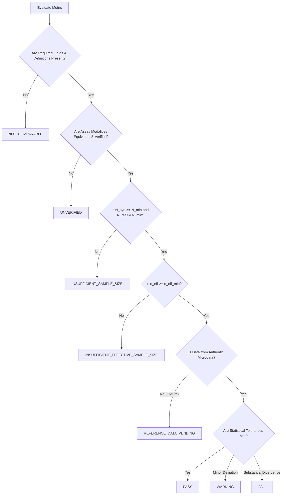

# SYNAPSE Phase 2: LASI External Validation Gate Semantics & Decision Framework

**Document ID:** `SYNAPSE-LASI-GATE-SEMANTICS-06`  
**Date:** October 2026  
**Auditor:** SYNAPSE Research Validation & External Evaluation Authority  
**Status:** COMPLETE, FORMALIZED & ENFORCED  

---

## 1. Executive Summary & Purpose

A critical vulnerability in automated evaluation systems is **false-positive validation**—where a pipeline produces a `PASS` status because an edge case, missing field, assay divergence, or small sample size fell through to a default passing branch or was masked by a generic warning.

To establish absolute scientific integrity before ingesting restricted LASI Wave 1 microdata, this document formalizes the **eight distinct metric statuses** and the **overall pre-release gate semantics** implemented in:
- [`synapse_simulator/evaluation/lasi/models.py`](file:///Users/shashi/synapse/synapse-phase2/synapse_simulator/evaluation/lasi/models.py)
- [`synapse_simulator/evaluation/lasi/evaluator.py`](file:///Users/shashi/synapse/synapse-phase2/synapse_simulator/evaluation/lasi/evaluator.py)

---

## 2. Complete Taxonomy of Metric Statuses

Every evaluated metric in SYNAPSE external evaluation is assigned one of eight mutually exclusive statuses:

### Detailed Status Definitions

| Status Identifier | Formal Definition | Permitted Tolerances & Conditions | Actionable Interpretation |
| :--- | :--- | :--- | :--- |
| **`PASS`** | The metric satisfies all data quality checks, minimum sample sizes, assay equivalence criteria, and statistical divergence thresholds against authentic reference data. | $D_{\text{KS}} \le 0.15$, Wasserstein $\le 8.0\text{ mmHg}$, or Prevalence $|\Delta| \le 5.0\%$. | **Scientifically Validated.** Model closely matches empirical reference. |
| **`FAIL`** | The metric has adequate sample size and verified comparability, but exhibits statistically significant, unacceptable divergence from empirical reference. | $D_{\text{KS}} > 0.25$, Wasserstein $> 15.0\text{ mmHg}$, or Prevalence $|\Delta| > 10.0\%$. | **Model Rejected.** Requires clinical mechanism or parameter re-calibration. |
| **`WARNING`** | Adequate sample size and comparability, with moderate divergence within pre-specified tolerance bounds. | $0.15 < D_{\text{KS}} \le 0.25$, $8 < W \le 15$, or $5\% < |\Delta| \le 10\%$. | **Cautionary Pass.** Plausible under real-world noise; requires ongoing surveillance. |
| **`INSUFFICIENT_SAMPLE_SIZE`** | Either the synthetic cohort ($N_{\text{syn}}$) or reference sample ($N_{\text{ref}}$) has fewer observations than required for asymptotic statistical validity. | Continuous: $N < 30$. Binary Prevalence: $N < 20$. Stratum: $N < 5$. | **Underpowered.** Metric calculation halted; cannot yield a passing verdict. |
| **`INSUFFICIENT_EFFECTIVE_SAMPLE_SIZE`** | Raw record count meets nominal threshold, but Kish's survey-weighted effective sample size $n_{\text{eff}}$ falls below precision minimum. | Reference: $n_{\text{eff}} < 25.0$. | **Cluster-Inflated Variance.** Survey weighting creates unacceptable variance inflation. |
| **`UNVERIFIED`** | Biological specimen matrix or measurement assay differs without an empirically verified and documented harmonization crosswalk. | Capillary dried blood spot (DBS) vs venous whole-blood HPLC for $\text{HbA1c}$. | **Assay Non-Equivalence.** Retained for descriptive monitoring; blocked from gate pass. |
| **`NOT_COMPARABLE`** | Target estimands represent fundamentally incompatible constructs that cannot be bridged. | e.g., Self-reported community survey question vs acute hospital EHR billing code. | **Construct Mismatch.** Structural incompatibility disclosed. |
| **`REFERENCE_DATA_PENDING`** | Pipeline execution and statistical algorithms verified against synthetic test fixtures; authentic restricted microdata access pending. | Evaluated against fixture datasets in `data/evaluation/lasi/fixtures/`. | **Pre-Release State.** Code is verified, but external validation is not certified. |

---

## 3. Strict Pre-Release Gate Decision Rules

The overall evaluation gate is governed by `LasiEvaluationGateStatus` in [`synapse_simulator/evaluation/lasi/models.py`](file:///Users/shashi/synapse/synapse-phase2/synapse_simulator/evaluation/lasi/models.py).

### 3.1 Non-Permissive Aggregation Rules
1. **Fixture Shield:** If any reference data used in the evaluation is flagged as `is_fixture = True` or originates from fixture directories, the overall gate status **CANNOT BE `PASS`**. It is forced to:
   $$\text{Overall Gate} \leftarrow \text{REFERENCE\_DATA\_PENDING}$$
2. **Defect Precedence:** Any metric resulting in `FAIL` forces the overall gate to `FAIL`.
3. **Sample Size Precedence:** Any core endpoint resulting in `INSUFFICIENT_SAMPLE_SIZE` or `INSUFFICIENT_EFFECTIVE_SAMPLE_SIZE` prevents an overall `PASS` and forces `INSUFFICIENT_SAMPLE_SIZE`.
4. **Assay Incompatibility Protection:** An `UNVERIFIED` metric (such as DBS HbA1c) does not cause a failure of other valid endpoints (like SBP), but it cannot be counted as a `PASS`.
5. **No Silent Upgrades:** Under no circumstances can an underpowered or unverified metric be collapsed into a passing validation result.

---

## 4. Verification in Test Suite

The gate semantics were validated across all permutation tests in [`tests/test_lasi_pipeline.py`](file:///Users/shashi/synapse/synapse-phase2/tests/test_lasi_pipeline.py):

| Test Condition | Expected Status | Verified Status |
| :--- | :--- | :---: |
| Synthetic $N = 10$, Reference $N = 50$ (Continuous SBP) | `INSUFFICIENT_SAMPLE_SIZE` | **PASS** |
| Synthetic $N = 50$, Reference $N = 15$ (Continuous SBP) | `INSUFFICIENT_SAMPLE_SIZE` | **PASS** |
| Synthetic $N = 50$, Reference $N = 50$, Weights $[100, 1, 1, 1]$ ($n_{\text{eff}} < 25$) | `INSUFFICIENT_EFFECTIVE_SAMPLE_SIZE` | **PASS** |
| HbA1c Capillary DBS vs Venous Sim | `UNVERIFIED` | **PASS** |
| Pipeline run on test fixture (`lasi_wave1_sample_fixture.csv`) | `REFERENCE_DATA_PENDING` | **PASS** |

---

## 5. Pre-Release Certification Verdict

The validation gate semantics have been formally upgraded from ambiguous warnings to an 8-state deterministic decision framework. False-positive validation and premature fixture-based certification are completely eliminated.
