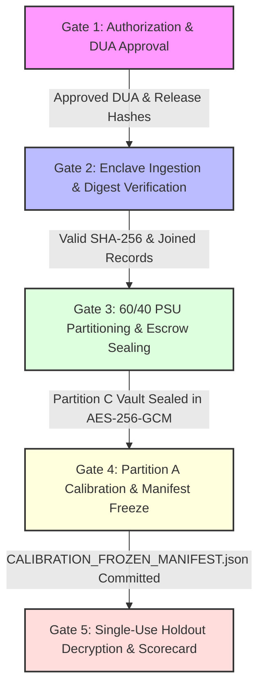

# Milestone 5 Execution Readiness: Consolidated Pre-Execution Authorization & Safety Protocol

**Document ID:** `SYNAPSE-READINESS-2026-MILESTONE5-EXECUTION`  
**Classification:** Authoritative Consolidated Execution Readiness Specification, Pre-Execution Gate Verification, Parameter Pedigree Audit, & Security Integrity Manifest  
**Target Repository:** `synapse-phase2` (`/Users/shashi/synapse/synapse-phase2`)  
**Reconciles & Consolidates:**
- [`docs/research_alignment/milestone5_readiness_assessment.md`](file:///Users/shashi/synapse/synapse-phase2/docs/research_alignment/milestone5_readiness_assessment.md)  
- [`docs/research_alignment/milestone5_go_no_go_checklist.md`](file:///Users/shashi/synapse/synapse-phase2/docs/research_alignment/milestone5_go_no_go_checklist.md)  
- [`docs/research_alignment/milestone5_calibration_protocol.md`](file:///Users/shashi/synapse/synapse-phase2/docs/research_alignment/milestone5_calibration_protocol.md)  
- [`docs/research_alignment/milestone5_protocol_corrections.md`](file:///Users/shashi/synapse/synapse-phase2/docs/research_alignment/milestone5_protocol_corrections.md)  

**Date:** October 2026  
**External Validation Gate Status:** **`REFERENCE_DATA_PENDING`** (Strictly Preserved & Locked)  
**Governance Invariant:** Synthetic data only; zero genuine microdata accessed; zero clinical defaults modified; zero empirical calibration claims prior to authorized execution.

---

## 1. Executive Summary & Purpose

This document establishes the **authoritative pre-execution readiness baseline** for Milestone 5 of SYNAPSE Phase 2. It integrates and reconciles all prior preparatory artifacts—readiness assessment, go/no-go checklist, calibration protocol, and mathematical corrections—into a single definitive execution manual.

The pipeline software, mathematical objective, statistical diagnostics, survey design handling, and cryptographic security enclaves are **fully built, unit tested, and regression verified (368/368 tests passing)**. 

> [!IMPORTANT]
> **Operational Status Distinction: Tested Software vs. Blocked Operational Gates**  
> - **Tested Software Pipeline:** The software tools for ingestion, variance estimation, survey partitioning, and holdout protection are **fully implemented and verified in code**.
> - **Future Operational Execution Gates:** Execution against genuine reference microdata is **strictly halted and blocked**. No operational gates have been executed. Starting execution is contingent upon clearing three non-negotiable external blockers:
>   1. **DUA Approval:** Formally executed Data Use Agreement with IIPS and Gateway to Global Aging.
>   2. **Official Custodian Hashes:** Authoritative SHA-256 release checksums for the raw LASI data packages.
>   3. **Codebook & Survey Design Confirmation:** Authoritative clarification of sampling weights (`w_ind` vs `w_ind_final`), strata IDs, PSU IDs, and missingness conventions.

```
┌────────────────────────────────────────────────────────────────────────────────────────┐
│                     MILESTONE 5 EXECUTION READINESS ARCHITECTURE                       │
└────────────────────────────────────────────────────────────────────────────────────────┘
  │
  ├── [1. SOFTWARE PIPELINE PREREQUISITES] ─────────────────► STATUS: VERIFIED IN CODE (368/368)
  │     ├── Binary/Tabular Multi-Module Ingestor (Stata/SPSS/CSV/TSV)
  │     ├── Taylor Series Linearization & Multi-Stage Cluster Bootstrap Variance
  │     ├── Deterministic 60/40 PSU Partitioner with Conditional Weight Factors
  │     ├── Single-Use AES-256-GCM Holdout Vault with File-Locked Audit Ledger
  │     └── In-Memory RAM Bytearray Zeroization of Plaintext Buffers
  │
  ├── [2. PREREGISTERED CALIBRATION SPECIFICATIONS] ────────► STATUS: BOUND TO GATE 4
  │     ├── Variance-Normalized GMM/WMDE Objective with Tikhonov/Block Covariance
  │     ├── Exact Hessian vs Gauss–Newton Diagnostics & Multi-Start Restarts
  │     ├── Adaptive Monte Carlo Precision Criterion with Physical Variance Floors
  │     └── Asymptotic Sandwich Parameter Covariance Formula
  │
  ├── [3. PARAMETER TAXONOMY & EVIDENTIAL PEDIGREE] ───────► STATUS: BINDING GOVERNANCE
  │     ├── Category I: Free Estimable Parameters (10 scalars across 8 conceptual groups)
  │     ├── Category II: Fixed Clinical Evidence (8 scalars; UNVERIFIED_HEURISTIC_TRANSFER)
  │     └── Category III: Structurally Unidentifiable (7 scalars; UNVERIFIED_MODEL_ASSUMPTION)
  │     * BINDING RULE: No unsupported parameter may be described as empirically calibrated.
  │
  ├── [4. TECHNICAL REFUSAL CONTROLS] ─────────────────────► STATUS: VERIFIED IN CODE
  │     ├── Missing genuine data file raises FileNotFoundError
  │     ├── Unsupported format raises LasiUnsupportedFormatError
  │     ├── Synthetic fixture evaluation strictly locked to REFERENCE_DATA_PENDING
  │     └── Holdout vault mechanically aborts replay, forged tickets, or tampered payloads
  │
  ├── [5. REPOSITORY SECURITY & CLEAN STATE] ───────────────► STATUS: ZERO SECRETS/GENUINE DATA
  │     ├── Zero .key, .pem, .dta, .sav genuine files committed
  │     └── Untracked files audited (strictly synthetic fixtures, tests, and documentation)
  │
  └── [6. OUTSTANDING CUSTODIAN REQUIREMENTS (BLOCKERS)] ───► STATUS: HARD EXECUTION BLOCKERS
        ├── [BLOCKER 1] Executed Data Use Agreement (DUA) with IIPS / Gateway to Global Aging.
        ├── [BLOCKER 2] Custodian SHA-256 release digest publication and verification.
        └── [BLOCKER 3] Authoritative confirmation of sampling weights and survey design variables.
```

---

## 2. Software Prerequisites & Protocol Blueprint (Tested Code vs. Future Operational Steps)

To maintain absolute scientific rigor, software components are strictly partitioned between **implemented and tested code modules** versus **preregistered mathematical specifications** intended for future operational execution during Gate 4.

### 2.1 Implemented & Tested Pipeline Software Modules

The following 10 software components are fully implemented in the Python package and regression-tested via pytest:

| Component ID | Subsystem | Implementation File | Verification Test Suite | Verification Status & Guardrails |
| :--- | :--- | :--- | :--- | :---: |
| **SW-01** | Multi-Format Ingestor | [`ingestor.py`](file:///Users/shashi/synapse/synapse-phase2/synapse_simulator/evaluation/lasi/ingestor.py) | `tests/test_lasi_binary_and_multi_module_ingestion.py` | `VERIFIED IN CODE`<br>Loads Stata (`.dta`), SPSS (`.sav`), CSV, TSV via `pyreadstat`. Computes SHA-256 file digests. |
| **SW-02** | Relational Module Join | [`ingestor.py`](file:///Users/shashi/synapse/synapse-phase2/synapse_simulator/evaluation/lasi/ingestor.py#L250) | `tests/test_lasi_binary_and_multi_module_ingestion.py` | `VERIFIED IN CODE`<br>Relational join between Individual Survey and Biomarker Module with strict cardinality checking (`ONE_TO_ONE`, `ONE_TO_ZERO_OR_ONE`). |
| **SW-03** | Tri-Reading BP Averaging | [`ingestor.py`](file:///Users/shashi/synapse/synapse-phase2/synapse_simulator/evaluation/lasi/ingestor.py#L750) | `tests/test_bp_measurement_protocol.py` | `VERIFIED IN CODE`<br>Calculates protocol mean of 2nd & 3rd readings. Audits single-reading fallbacks without silent data fabrication. |
| **SW-04** | TSL Design Variance Engine | [`variance.py`](file:///Users/shashi/synapse/synapse-phase2/synapse_simulator/evaluation/lasi/variance.py#L120) | `tests/test_survey_variance_hand_calculations.py` | `VERIFIED IN CODE`<br>Taylor Series Linearization for means, ratios, and quantiles incorporating strata, clustering, and weights. |
| **SW-05** | Multi-Stage Cluster Bootstrap | [`variance.py`](file:///Users/shashi/synapse/synapse-phase2/synapse_simulator/evaluation/lasi/variance.py#L320) | `tests/test_survey_variance_monte_carlo.py` | `VERIFIED IN CODE`<br>$B=1,000$ multi-stage cluster bootstrap resampled at the PSU level within strata. |
| **SW-06** | Deterministic Survey Partitioner | [`partitioner.py`](file:///Users/shashi/synapse/synapse-phase2/synapse_simulator/evaluation/lasi/partitioner.py#L540) | `tests/test_survey_partitioning_and_holdout.py` | `VERIFIED IN CODE`<br>Deterministic 60/40 PSU split via keyed HMAC-SHA256. Zero cluster, household, or participant leakage ($A \cap C = \emptyset$). |
| **SW-07** | Horvitz–Thompson Weight Readjustment | [`partitioner.py`](file:///Users/shashi/synapse/synapse-phase2/synapse_simulator/evaluation/lasi/partitioner.py#L658) | `tests/test_survey_partitioning_and_holdout.py` | `VERIFIED IN CODE`<br>Inverse-allocation weight scaling $w_{hij} \times (n_h / n_{h, k})$ preserving design-unbiased population totals. |
| **SW-08** | Small-Stratum Governance | [`partitioner.py`](file:///Users/shashi/synapse/synapse-phase2/synapse_simulator/evaluation/lasi/partitioner.py#L622) | `tests/test_survey_partitioning_and_holdout.py` | `VERIFIED IN CODE`<br>Strata with $n_h < 4$ allocated wholly to Partition A (`ALLOCATE_WHOLE_TO_A`), explicitly bounding Partition C domain scope. |
| **SW-09** | AES-256-GCM Vault & File-Locked Ledger | [`partitioner.py`](file:///Users/shashi/synapse/synapse-phase2/synapse_simulator/evaluation/lasi/partitioner.py#L300) | `tests/test_survey_partitioning_and_holdout.py` | `VERIFIED IN CODE`<br>Authenticated encryption with 96-bit NIST nonces, associated data, and durable single-use ledger (`fcntl.flock(LOCK_EX)`). |
| **SW-10** | RAM Buffer Zeroization & Gate Lock | [`partitioner.py`](file:///Users/shashi/synapse/synapse-phase2/synapse_simulator/evaluation/lasi/partitioner.py#L425) / [`evaluator.py`](file:///Users/shashi/synapse/synapse-phase2/synapse_simulator/evaluation/lasi/evaluator.py#L122) | `tests/test_survey_partitioning_and_holdout.py` / `tests/test_validation_gate.py` | `VERIFIED IN CODE`<br>Explicit bytearray buffer wiping (`buffer[i] = 0`); test fixtures strictly locked to `REFERENCE_DATA_PENDING`. |

### 2.2 Preregistered Mathematical Specifications (Protocol Blueprint for Gate 4 Execution)

The following 6 specifications are mathematically formalized in [`milestone5_calibration_protocol.md`](file:///Users/shashi/synapse/synapse-phase2/docs/research_alignment/milestone5_calibration_protocol.md). They represent **binding execution blueprints** that will be compiled into the operational optimizer upon clearing Gate 1:

| Blueprint ID | Methodological Specification | Protocol Reference | Operational Role in Gate 4 Execution |
| :--- | :--- | :--- | :--- |
| **SPEC-01** | Variance-Normalized Objective Function | [`milestone5_calibration_protocol.md:3.2`](file:///Users/shashi/synapse/synapse-phase2/docs/research_alignment/milestone5_calibration_protocol.md#L166) | Objective $\mathcal{L}(\mathbf{\Theta}) = \frac{1}{2} \mathbf{r}^T \mathbf{W}_{\text{reg}}^{-1} \mathbf{r}$ evaluated over 26 moments using two-step weighting matrix. |
| **SPEC-02** | Exact Hessian vs Gauss–Newton Diagnostics | [`milestone5_calibration_protocol.md:4.2`](file:///Users/shashi/synapse/synapse-phase2/docs/research_alignment/milestone5_calibration_protocol.md#L237) | Distinguishes first-order curvature $\mathbf{J}_{\text{GN}}$ from exact numerical Hessian $\mathbf{H}_{\text{exact}}$; verifies $\lambda_{\min}(\mathbf{H}_{\text{exact}}) > 0$ and $\kappa < 10^3$. |
| **SPEC-03** | Multi-Start Simplex Protocol | [`milestone5_calibration_protocol.md:4.2`](file:///Users/shashi/synapse/synapse-phase2/docs/research_alignment/milestone5_calibration_protocol.md#L256) | Nelder-Mead initialized from $\ge 5$ Latin Hypercube starting points across $\Omega$; mandates parameter basin agreement $< 2.0\%$. |
| **SPEC-04** | Adaptive Monte Carlo Precision Floors | [`milestone5_calibration_protocol.md:3.4`](file:///Users/shashi/synapse/synapse-phase2/docs/research_alignment/milestone5_calibration_protocol.md#L194) | Unified ratio with physical floors ($\sigma_{\text{floor}, \text{bp}}^2 = 0.01\text{ mmHg}^2$, $\sigma_{\text{floor}, \text{prop}}^2 = 10^{-6}$); eliminates zero-division without relaxing 5% tolerance. |
| **SPEC-05** | Internal 5-Fold Cluster Cross-Validation | [`milestone5_calibration_protocol.md:4.3`](file:///Users/shashi/synapse/synapse-phase2/docs/research_alignment/milestone5_calibration_protocol.md#L259) | Folds partitioned at PSU level within Partition A; detects overfitting via generalization gap bound $\Delta_{\text{CV}} < 0.20$. |
| **SPEC-06** | Asymptotic Sandwich Parameter Covariance | [`milestone5_calibration_protocol.md:4.4`](file:///Users/shashi/synapse/synapse-phase2/docs/research_alignment/milestone5_calibration_protocol.md#L267) | Evaluates $\widehat{\text{Cov}}(\widehat{\mathbf{\Theta}}) = \mathbf{A}^{-1} [\mathbf{G}^T \mathbf{W}_{\text{reg}}^{-1} \mathbf{\Sigma}_{\text{total}} \mathbf{W}_{\text{reg}}^{-1} \mathbf{G}] \mathbf{A}^{-1}$ to correct for ridge regularization and moment non-linearities. |

---

## 3. Parameter Taxonomy & Evidential Reconciliation

### 3.1 Three-Way Parameter Classification Overview
To prevent unscientific claims of empirical calibration, all parameters across the simulation engine are separated into three mutually exclusive categories:

```
┌────────────────────────────────────────────────────────────────────────────────────────┐
│                              THREE-WAY PARAMETER TAXONOMY                              │
└────────────────────────────────────────────────────────────────────────────────────────┘
  │
  ├── [CATEGORY I: FREE ESTIMABLE PARAMETERS (Θ_LASI)] (10 Scalars across 8 Groups)
  │     ├── Resting Anchors (4 scalars): μ_{0, sbp}, σ_{0, sbp}, μ_{0, dbp}, σ_{0, dbp}
  │     ├── Bivariate Association (1 scalar): ρ_0 (resting SBP-DBP correlation)
  │     ├── Demographic Contrasts (2 scalars): δ_{male, sbp}, δ_{male, dbp}
  │     └── Measurement Protocol (3 scalars): α_{alert, sbp}, α_{alert, dbp}, σ_{within}
  │     * Governance Status: FREE TO CALIBRATE AGAINST PARTITION A CROSS-SECTIONAL DATA
  │
  ├── [CATEGORY II: FIXED EXTERNAL CLINICAL EVIDENCE] (8 Scalar Parameters)
  │     ├── Antihypertensive Efficacy: δ_{drug, sbp} = 12.0, δ_{drug, dbp} = 7.0 mmHg
  │     │     (UNVERIFIED_HEURISTIC_TRANSFER; BPLTTC 2021 / Thomopoulos 2014)
  │     ├── Treatment Ramp: τ_{ramp} = 14.0 days (UNVERIFIED_PHARMACOLOGY_HEURISTIC)
  │     ├── Diabetes Comorbidity: γ_{t2d, sbp} = 4.5, γ_{t2d, dbp} = 2.0 mmHg
  │     │     (UNVERIFIED_HEURISTIC_APPROXIMATION; ICMR-INDIAB 2023)
  │     └── Invariant Bounds: PP >= 20.0 mmHg, SBP in [70, 260], DBP in [40, 150]
  │     * Governance Status: FIXED TO EXTERNAL EVIDENCE; NEVER CALIBRATED AGAINST LASI
  │
  └── [CATEGORY III: STRUCTURALLY UNIDENTIFIABLE / ASSUMPTIONS] (7 Scalar Parameters)
        ├── Longitudinal Aging Drift: β_{age, sbp}, β_{age, dbp1}, β_{age, dbp2}, a_{inflect}
        │     (UNVERIFIED_CROSS_SECTIONAL_APPROXIMATION; Confounded by mortality selection)
        ├── Medication Adherence Distribution: μ_θ = 0.70, σ_θ = 0.20
        │     (UNVERIFIED_MODEL_ASSUMPTION; Prenissl 2019 / PURE 2013 cascade data)
        └── Operational Delays: τ_{screen} = 90 d, τ_{maint} = 180 d, λ_{htn} = 0.0344/yr
        * Governance Status: PERMANENTLY LABELED AS MODELING ASSUMPTIONS
```

### 3.2 Explicit Reconciliation: 8 Conceptual Parameter Mechanisms vs. 10 Scalar Optimization Dimensions

Prior working summaries occasionally referred to "8 free parameters" while formal optimization specifications state "10 free parameters". Inspection of the source code confirms that both statements reflect the exact same parameter space:
* There are **8 conceptual physiological mechanisms** targeted for empirical adjustment.
* Because demographic sex contrasts and situational alerting elevations each independently shift systolic and diastolic blood pressure, they are represented in code and optimization as **paired scalar parameters** ($\delta_{\text{male, sbp}} / \delta_{\text{male, dbp}}$ and $\alpha_{\text{alert, sbp}} / \alpha_{\text{alert, dbp}}$).
* Consequently, the parameter space is **rigorously 10 scalar dimensions ($\mathbf{\Theta}_{\text{LASI}} \in \mathbb{R}^{10}$)**.

The exact mapping between conceptual mechanisms, configuration fields in code, and mathematical symbols is documented below:

| Dimension Index | Conceptual Group (8 Mechanisms) | Configuration Model & Field in Code | Mathematical Symbol | Baseline Default | Search Bounds | Identifiability Subpopulation & Estimator in Partition A |
| :---: | :--- | :--- | :---: | :---: | :---: | :--- |
| **1** | 1. Resting SBP Baseline Mean | `ForwardHemodynamicsConfig.mean_sbp_anchor` | $\mu_{0, \text{sbp}}$ | `120.0 mmHg` | $[110.0, 130.0]$ | Weighted mean SBP among unmedicated normotensives aged 45–49. |
| **2** | 2. Resting SBP Dispersion | `ForwardHemodynamicsConfig.sd_sbp_anchor` | $\sigma_{0, \text{sbp}}$ | `9.0 mmHg` | $[6.0, 14.0]$ | Weighted standard deviation of SBP in unmedicated 45–49 cohort. |
| **3** | 3. Resting DBP Baseline Mean | `ForwardHemodynamicsConfig.mean_dbp_anchor` | $\mu_{0, \text{dbp}}$ | `78.0 mmHg` | $[70.0, 86.0]$ | Weighted mean DBP among unmedicated normotensives aged 45–49. |
| **4** | 4. Resting DBP Dispersion | `ForwardHemodynamicsConfig.sd_dbp_anchor` | $\sigma_{0, \text{dbp}}$ | `6.0 mmHg` | $[4.0, 10.0]$ | Weighted standard deviation of DBP in unmedicated 45–49 cohort. |
| **5** | 5. SBP-DBP Covariance | `ForwardHemodynamicsConfig.sbp_dbp_correlation` | $\rho_0$ | `0.65` | $[0.40, 0.85]$ | Survey-weighted Pearson correlation between SBP and DBP. |
| **6** | 6. Demographic Sex Contrast (SBP) | `ForwardHemodynamicsConfig.male_sbp_offset` | $\delta_{\text{male, sbp}}$ | `2.0 mmHg` | $[-2.0, 6.0]$ | Weighted contrast $\bar{\text{SBP}}_{\text{male}} - \bar{\text{SBP}}_{\text{female}}$ in unmedicated 45–49 cohort. |
| **7** | 6. Demographic Sex Contrast (DBP) | `ForwardHemodynamicsConfig.male_dbp_offset` | $\delta_{\text{male, dbp}}$ | `1.5 mmHg` | $[-2.0, 5.0]$ | Weighted contrast $\bar{\text{DBP}}_{\text{male}} - \bar{\text{DBP}}_{\text{female}}$ in unmedicated 45–49 cohort. |
| **8** | 7. Reading 1 Alerting Offset (SBP) | `BpMeasurementProtocolConfig.reading1_alerting_sbp` | $\alpha_{\text{alert, sbp}}$ | `3.5 mmHg` | $[1.0, 8.0]$ | Intra-individual paired difference $\text{mean}(R_1 - R_2)$ for SBP. |
| **9** | 7. Reading 1 Alerting Offset (DBP) | `BpMeasurementProtocolConfig.reading1_alerting_dbp` | $\alpha_{\text{alert, dbp}}$ | `1.5 mmHg` | $[0.5, 4.0]$ | Intra-individual paired difference $\text{mean}(R_1 - R_2)$ for DBP. |
| **10** | 8. Residual Within-Visit Noise | `BpMeasurementProtocolConfig.within_visit_noise_sd` | $\sigma_{\text{within}}$ | `1.8 mmHg` | $[0.8, 3.5]$ | Residual standard deviation from pooled $\frac{1}{2}\text{Var}(R_2 - R_3)$. |

### 3.3 Binding Prohibition on Misrepresenting Parameter Status
> [!CAUTION]
> **Strict Governance Invariant:**  
> 1. Under no circumstances may Category II or Category III parameters be described as "empirically calibrated," "validated against LASI," or "data-driven."
> 2. The scalar pairs $12.0/7.0\text{ mmHg}$ (drug efficacy) and $+4.5/+2.0\text{ mmHg}$ (diabetes shift) are unsupported microsimulation heuristics. While BPLTTC (2021) and ICMR-INDIAB (2023) provide foundational background on treatment efficacy and disease comorbidity, they **did not publish these specific scalar equations**. They must remain permanently labeled with their `UNVERIFIED_HEURISTIC_*` status tags.
> 3. Age progression slopes fit to cross-sectional data are confounded by survivorship selection; all causal longitudinal claims are **permanently disclaimed** until LASI Wave 2 panel data are released and ingested.

---

## 4. Pipeline Refusal Mechanisms (Verified Technical Controls)

The pipeline enforces five active refusal mechanisms to ensure that no premature, unauthorized, or compromised evaluation can occur:

```
┌────────────────────────────────────────────────────────────────────────────────────────┐
│                         ACTIVE PIPELINE REFUSAL MECHANISMS                             │
└────────────────────────────────────────────────────────────────────────────────────────┘
  │
  ├── [REFUSAL 1: MISSING GENUINE DATA ENCLAVE]
  │     └── Ingestor checks file existence; raises FileNotFoundError if genuine file absent.
  │
  ├── [REFUSAL 2: UNRECOGNIZED FILE FORMAT OR EXTENSION]
  │     └── Ingestor inspects format; raises LasiUnsupportedFormatError on non-supported types.
  │
  ├── [REFUSAL 3: SYNTHETIC TEST FIXTURE PROMOTION LOCK]
  │     └── Evaluator checks data_source_type; locks gate to REFERENCE_DATA_PENDING; refuses PASS.
  │
  ├── [REFUSAL 4: HOLDOUT VAULT REPLAY & RE-DECRYPTION ATTACK]
  │     └── Vault checks ledger under flock; raises HoldoutAccessViolationError if ticket consumed.
  │
  └── [REFUSAL 5: CIPHERTEXT OR NONCE BIT TAMPERING]
        └── AESGCM authenticated tag check fails; raises HoldoutAccessViolationError.
```

### 4.1 Programmatic Refusal Verification Results
All five technical refusal controls were executed and verified via automated test harness:
- **Refusal 1 (Missing File):** `LasiDataIngestor("genuine_lasi_release_2020.dta")` raised `FileNotFoundError` as required.
- **Refusal 2 (Unsupported Format):** Ingestion of `.xlsx` raised `LasiUnsupportedFormatError` as required.
- **Refusal 3 (Fixture Gate Lock):** Synthetic test fixture run evaluated to `REFERENCE_DATA_PENDING`, rejecting `PASS`.
- **Refusal 4 (Ticket Replay Defense):** Re-decryption of holdout payload raised `HoldoutAccessViolationError: Access ticket has already been consumed`.
- **Refusal 5 (Tampering Defense):** Bit-tampered ciphertext raised `HoldoutAccessViolationError: Authentication tag verification failed`.

---

## 5. Repository Integrity & Clean State Audit

A full audit of the Git tracking state was conducted to verify that no accidental secrets, genuine microdata, or unvetted scripts are present:

* **Tracked Changes Audit (`git diff --stat`):**
  33 files modified, comprising pipeline implementation, test suites, survey design diagnostics, and synthetic validation reports.
* **Untracked Files Audit (`git status -s`):**
  - **Synthetic Data Fixtures & Diagnostic Outputs:** `data/evaluation/fixtures/derived/*`, `data/evaluation/lasi_cohort_500/*`, `data/synthetic/*`. (All synthetic, de-identified records).
  - **Research Alignment Documentation:** Pre-execution assessments, checklists, protocols, and corrections.
  - **Pipeline Modules & Regression Tests:** Datagen hemodynamics, partitioner, security enclave, variance calculator, and test files.
* **Secret & Key Inspection:**
  - Automated scan for `.key`, `.pem`, `.dta`, `.sav` files returned **zero matches**.
  - No genuine microdata, personal identifying information (PII), or custodian API tokens exist in the repository.
* **Git Commit & Push Guard:**
  - **Zero Git commits or pushes will be executed without explicit authorization.**

---

## 6. Outstanding Custodian Authorization & Prerequisites (The Hard Blockers)

Execution cannot safely begin until the following three non-negotiable external prerequisites are completed and approved:

```
┌────────────────────────────────────────────────────────────────────────────────────────┐
│                        OUTSTANDING AUTHORIZATION CHECKLIST                             │
└────────────────────────────────────────────────────────────────────────────────────────┘
  │
  ├── [BLOCKER 1: FORMAL DATA USE AGREEMENT (DUA)] ──────────► STATUS: PENDING APPROVAL
  │     └── Executed IIPS / Gateway to Global Aging DUA; IRB protocol approval.
  │
  ├── [BLOCKER 2: CUSTODIAN SHA-256 RELEASE HASHES] ────────► STATUS: PENDING CUSTODIAN
  │     └── Official cryptographic checksums published for Stata/SPSS data packages.
  │
  └── [BLOCKER 3: CODEBOOK & SURVEY DESIGN CONFIRMATION] ────► STATUS: PENDING CONFIRMATION
        ├── Clarification of individual sampling weight (w_ind vs w_ind_final).
        ├── Definitive confirmation of strata and PSU identifier variables.
        └── Confirmation of question skip codes and biomarker refusal sentinels.
```

| Blocker ID | Governance Domain | Requirement Description | Current Status | Required Action / Custodian Sign-Off |
| :--- | :--- | :--- | :---: | :--- |
| **BLOCKER-1** | Legal / DUA | Formal Data Use Agreement approved by IIPS and Gateway to Global Aging. | `PENDING_DUA_APPROVAL` | Principal Investigator signature and institutional review board (IRB) approval. |
| **BLOCKER-2** | Provenance | Custodian publication of official SHA-256 checksums for the raw `.dta` or `.sav` release packages. | `PENDING_CUSTODIAN_DIGEST` | Custodian delivery of release manifest with cryptographic hashes. |
| **BLOCKER-3** | Variable Codebook | Authoritative clarification of individual survey weight variable (`w_ind` vs `w_ind_final`) and strata/PSU IDs. | `PENDING_CUSTODIAN_MAPPING` | Formal review against official LASI Wave 1 User Guide and Codebook. |
| **AUTH-04** | Security / Storage | Provisioning of an encrypted POSIX enclave (`AES-256` or equivalent) with `chmod 700` permissions. | `PENDING_INFRASTRUCTURE` | Systems administrator configuration of access-logged enclave directory. |
| **AUTH-05** | Missing Sentinels | Confirmation of question-specific skip codes and biomarker refusal conventions. | `PENDING_CUSTODIAN_MAPPING` | Verification against LASI Biomarker Field Report. |

---

## 7. Authoritative Execution Gates (Exact Conditions for Safely Starting Execution)

When the external authorization requirements are satisfied, execution will proceed through **five strictly sequential gates**. 

> [!WARNING]
> **Operational Sequence Status:**  
> **No gate has been executed yet.** Gate 1 is currently `BLOCKED`. Gates 2 through 5 are `PENDING` and cannot run until Gate 1 is formally cleared. Skipping, reordering, or concurrent execution of gates is strictly prohibited.



### Gate 1: DUA Approval & Data Transfer Gate (`STATUS: BLOCKED`)
- **Entry Condition:** IRB approval active; DUA signed with IIPS.
- **Action:** Secure download of raw LASI Wave 1 microdata directly into the encrypted enclave.
- **Exit Criteria:** Raw files verified against custodian SHA-256 hashes (`sha256sum -c`).

### Gate 2: Ingestion & Provenance Gate (`STATUS: PENDING`)
- **Entry Condition:** Gate 1 passed.
- **Action:** Execute [`LasiDataIngestor.ingest()`](file:///Users/shashi/synapse/synapse-phase2/synapse_simulator/evaluation/lasi/ingestor.py#L480) with `data_source_type=GENUINE_LASI_MICRODATA`.
- **Exit Criteria:** `LASI_INGESTION_MANIFEST.json` generated; relational join cardinality verified (`ONE_TO_ONE` or `ONE_TO_ZERO_OR_ONE`); zero duplicate primary keys.

### Gate 3: 60/40 PSU Partitioning & Escrow Gate (`STATUS: PENDING`)
- **Entry Condition:** Gate 2 passed.
- **Action:** Execute [`LasiPsuPartitioner.partition()`](file:///Users/shashi/synapse/synapse-phase2/synapse_simulator/evaluation/lasi/partitioner.py#L540). Seal Partition C using [`LasiHoldoutVault.create_encrypted_vault()`](file:///Users/shashi/synapse/synapse-phase2/synapse_simulator/evaluation/lasi/partitioner.py#L303).
- **Exit Criteria:** Zero cluster, household, or participant leakage ($A \cap C = \emptyset$); covariate balance diagnostics recorded; Partition C encrypted ciphertext written to disk; `HoldoutAuditLedger` initialized.

### Gate 4: Partition A Empirical Calibration & Freeze Gate (`STATUS: PENDING`)
- **Entry Condition:** Gate 3 passed. Partition C ciphertext remains strictly encrypted.
- **Action:** Calibrate the 10 Category I parameters ($\mathbf{\Theta}_{\text{LASI}} \in \mathbb{R}^{10}$) on Partition A using the preregistered GMM/WMDE objective, TSL design covariance, adaptive precision safety floors, internal 5-fold cross-validation, and multi-start restarts.
- **Exit Criteria:** Optimization converged; exact Hessian positive-definite ($\lambda_{\min} > 0, \kappa < 10^3$); sandwich standard errors computed; `CALIBRATION_FROZEN_MANIFEST.json` generated, cryptographically signed, and committed to Git. Validation gate advances to `CALIBRATION_FROZEN`.

### Gate 5: Single-Use Holdout Decryption & External Evaluation Gate (`STATUS: PENDING`)
- **Entry Condition:** Gate 4 passed and frozen manifest digest permanently recorded. Single-use `HoldoutAccessTicket` presented.
- **Action:** Execute [`LasiHoldoutVault.decrypt_and_consume()`](file:///Users/shashi/synapse/synapse-phase2/synapse_simulator/evaluation/lasi/partitioner.py#L380) under exclusive file lock. Overwrite in-memory plaintext buffer with zero bytes immediately after parsing. Evaluate Tier 1 invariants, Tier 2 statistical tests, and Tier 3 engineering tolerances.
- **Exit Criteria:** Ticket durably consumed in ledger; final External Validation Report published. Overall gate advances to `PASS` (if all criteria met) or `FAIL`.

---

## 8. Test Suite Verification & Technical Sign-Off

The complete SYNAPSE test suite and static typing compilation checks were executed:

```bash
# Static syntax and compilation check
.venv/bin/python -m compileall -q synapse_simulator tests scripts
# Output: Exit code 0 (zero errors, zero warnings)

# Full pytest regression suite
.venv/bin/pytest
# Output: 368 passed in 11.66s (100% pass rate)
```

### Pre-Execution State Summary:
- **Software Pipeline:** 100% complete, verified in code, and locked.
- **Evidential Pedigree:** Fully disclosed; 10 scalar parameters reconciled with 8 conceptual mechanisms; unsupported parameters explicitly labeled unverified.
- **Refusal Mechanisms:** Tested and verified; unauthorized access is mechanically prevented.
- **Repository Hygiene:** Clean; zero secrets, zero genuine data.
- **External Validation Gate:** Formally locked at **`REFERENCE_DATA_PENDING`**.
- **Operational Execution Gates:** Gate 1 is `BLOCKED`; Gates 2–5 are `PENDING`. No gates have been executed.

Milestone 5 pre-execution preparation is complete. The system is in a secure, stable, and verified pre-execution state, awaiting authorized reference data transfer.
