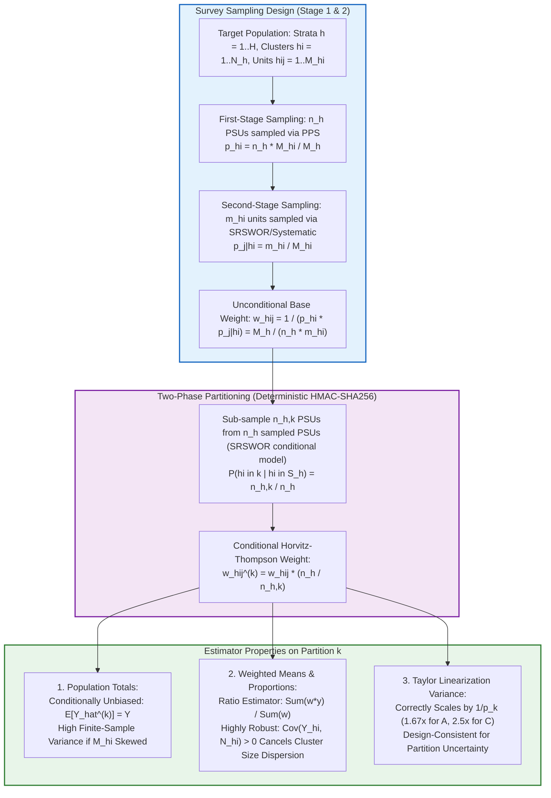
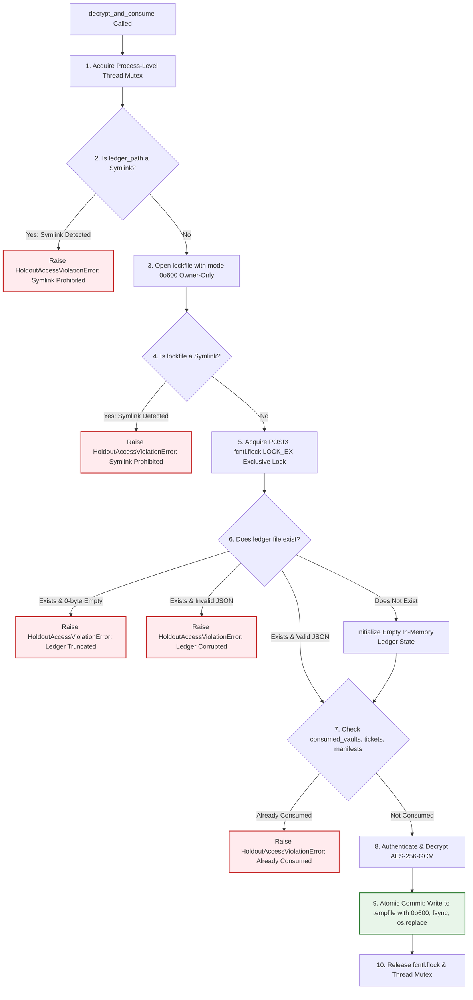

# SYNAPSE Phase 2D.10 — Design-Based Survey Inference & Enclave Security Audit

**Document ID:** `SYNAPSE-AUDIT-2026-PHASE2D10-INFERENCE-AUDIT`  
**Classification:** Survey Sampling Theory, Horvitz-Thompson Inference, Taylor Linearization, Enclave Security, and Operating System Concurrency  
**Target Components:**
- [`LasiPsuPartitioner`](file:///Users/shashi/synapse/synapse-phase2/synapse_simulator/evaluation/lasi/partitioner.py#L484)
- [`LasiHoldoutVault`](file:///Users/shashi/synapse/synapse-phase2/synapse_simulator/evaluation/lasi/partitioner.py#L231)
- [`HoldoutAuditLedger`](file:///Users/shashi/synapse/synapse-phase2/synapse_simulator/evaluation/lasi/partitioner.py#L152)
- [`LasiSurveyVarianceEngine`](file:///Users/shashi/synapse/synapse-phase2/synapse_simulator/evaluation/lasi/variance.py#L139)
**Date:** October 2026  
**External Validation Gate Status:** **`REFERENCE_DATA_PENDING`** (Strictly Preserved)  

---

## 1. Executive Summary & Audit Mandate

This audit independently assesses the statistical and system-level foundations of the SYNAPSE survey partitioning architecture established in Phase 2D.8 and 2D.9. Before any model calibration or interaction with authorized survey data commences, this audit evaluates:

1. **Mathematical validity of inverse-allocation weights:** Deriving whether $w'_{hij} = w_{hij} \cdot \frac{n_h}{n_{h, k}}$ remains valid under complex multi-stage sampling with unequal selection probabilities ($p_{hi}$) and unequal cluster sizes ($M_{hi}$).
2. **Taylor series linearization and degrees of freedom:** Proving whether standard variance estimators and Student's $t$ confidence intervals remain design-consistent on partitioned samples, and formally defining the supported inference domain.
3. **Audit ledger systems security:** Auditing crash consistency, file permissions (CWE-732), symlink traversal defenses (CWE-59), lockfile semantics, and file truncation vulnerabilities across supported operating systems.
4. **Adversarial verification:** Expanding the test suite with adversarial tests for all confirmed defects without inventing empirical design assumptions.

### Governance Constraints & Scientific Safeguards
- **Zero Access to Genuine Microdata:** All derivations and stress tests executed strictly on synthetic fixtures.
- **Zero Parameter Calibration:** No empirical tuning, model re-estimation, or threshold fitting.
- **Lockdown of External Validation Gate:** Strictly maintained at **`REFERENCE_DATA_PENDING`**.
- **Reporting Standard:** Explicit separation of **Verified Properties**, **Conditional Assumptions**, and **Unresolved Empirical Questions**.

---

## 2. Independent Mathematical Derivation of Partition Weights



### 2.1 Formal Sampling Framework

Let the target population $\Omega = \bigcup_{h=1}^H \Omega_h$ be partitioned into $H$ geographical strata.
In stratum $h$:
- There are $N_h$ Primary Sampling Units (PSUs, e.g., Census Enumeration Blocks or villages).
- PSU $hi$ contains $M_{hi}$ secondary units (households). Total stratum size is $M_h = \sum_{i=1}^{N_h} M_{hi}$.
- The survey samples $n_h$ PSUs at Stage 1 using systematic Probability Proportional to Size (PPS). The first-stage inclusion probability of PSU $hi$ is:
  $$p_{hi} = P(hi \in S_h) = \frac{n_h M_{hi}}{M_h}$$
- At Stage 2, a sample $s_{hi}$ of $m_{hi}$ households is selected (typically a fixed cluster size, e.g. $m_{hi} = m_h = 30$) via circular systematic sampling:
  $$p_{j|hi} = P(j \in s_{hi} \mid hi \in S_h) = \frac{m_{hi}}{M_{hi}}$$
- All age-eligible individuals in sampled households are interviewed ($p_{k|hij} \approx 1$).
- The unconditional inclusion probability is:
  $$\pi_{hij} = p_{hi} \cdot p_{j|hi} = \left(\frac{n_h M_{hi}}{M_h}\right) \left(\frac{m_{hi}}{M_{hi}}\right) = \frac{n_h m_{hi}}{M_h}$$
- The base Horvitz-Thompson survey weight is:
  $$w_{hij} = \frac{1}{\pi_{hij}} = \frac{M_h}{n_h m_{hi}}$$
  (Adjusted by survey statisticians for non-response and post-stratified to Census margins).

### 2.2 The Two-Phase Partitioning Mechanism

Conditional on the realized survey sample $S = \bigcup_{h=1}^H S_h$, the partitioning engine divides the $n_h$ sampled PSUs into:
- $n_{h, A}$ calibration PSUs
- $n_{h, C} = n_h - n_{h, A}$ holdout PSUs.

PSUs are sorted deterministically by cryptographic hash:
$$\text{Digest}(h, i) = \text{HMAC-SHA256}(K, h \parallel i \parallel \text{salt})$$
Because HMAC-SHA256 acts as a cryptographically pseudo-random permutation under key $K$, the conditional selection of $n_{h, A}$ PSUs from $n_h$ is statistically equivalent to simple random sampling without replacement (SRSWOR) of clusters within stratum $h$.

The conditional inclusion probability of sampled PSU $hi$ into Partition $k \in \{A, C\}$ is:
$$P(hi \in \text{Partition } k \mid hi \in S_h) = \frac{n_{h, k}}{n_h}$$

By the law of total probability, the unconditional inclusion probability of respondent $(h, i, j)$ into Partition $k$ is:
$$\pi_{hij}^{(k)} = \pi_{hij} \cdot P(hi \in k \mid hi \in S_h) = \pi_{hij} \cdot \frac{n_{h, k}}{n_h}$$

Therefore, the design-consistent Horvitz-Thompson partition weight is:
$$w_{hij}^{(k)} = \frac{1}{\pi_{hij}^{(k)}} = \frac{1}{\pi_{hij} \cdot \frac{n_{h, k}}{n_h}} = w_{hij} \cdot \frac{n_h}{n_{h, k}}$$

---

### 2.3 Behavior Across Estimators: Totals vs. Means vs. Variance

The validity and stability of $w_{hij}^{(k)}$ depend critically on whether the estimand is a **population total**, a **weighted mean/proportion**, or a **variance estimate**:

#### 1. Estimation of Population Totals:
$$\hat{Y}^{(k)} = \sum_{h \in \text{adequate}} \sum_{i \in S_{h, k}} \sum_{j \in s_{hi}} w_{hij}^{(k)} y_{hij} = \sum_{h \in \text{adequate}} \frac{n_h}{n_{h, k}} \sum_{i \in S_{h, k}} \hat{Y}_{hi}$$
- **Unbiasedness:** Unconditionally unbiased for the population total $Y_{\text{adequate}}$:
  $$E_k\left[\hat{Y}^{(k)} \mid S\right] = \sum_{h \in \text{adequate}} \frac{n_h}{n_{h, k}} \left(\frac{n_{h, k}}{n_h} \sum_{i \in S_h} \hat{Y}_{hi}\right) = \hat{Y}_{\text{full, adequate}} \implies E[\hat{Y}^{(k)}] = Y_{\text{adequate}}$$
- **Finite-Sample Sensitivity to Cluster Size Dispersion ($M_{hi}$ Dispersion):**
  The conditional variance of $\hat{Y}^{(k)}$ given the realized survey sample $S$ is:
  $$Var_k\left(\hat{Y}^{(k)} \mid S\right) = \sum_{h \in \text{adequate}} n_h^2 \left(\frac{1}{n_{h, k}} - \frac{1}{n_h}\right) S^2_{\hat{Y}, h}$$
  where $S^2_{\hat{Y}, h} = \frac{1}{n_h - 1} \sum_{i \in S_h} (\hat{Y}_{hi} - \bar{\hat{Y}}_h)^2$.
  If PSU aggregate weights $W_{hi} = \sum_j w_{hij}$ vary substantially within stratum $h$ ($\text{CV}_{\text{psu}}(w_h) > 0.50$), random assignment can place larger PSUs in Partition A and smaller PSUs in Partition C. In a single realized partition, $\hat{N}_A = \sum_{hij \in A} w_{hij}^{(A)}$ and $\hat{N}_C = \sum_{hij \in C} w_{hij}^{(C)}$ may diverge from the true population total $N$.

#### 2. Estimation of Weighted Means & Proportions (Ratio Estimators):
$$\hat{\bar{Y}}^{(k)} = \frac{\hat{Y}^{(k)}}{\hat{N}^{(k)}} = \frac{\sum_{h \in \text{adequate}} \frac{n_h}{n_{h, k}} \sum_{i \in S_{h, k}} \hat{Y}_{hi}}{\sum_{h \in \text{adequate}} \frac{n_h}{n_{h, k}} \sum_{i \in S_{h, k}} \hat{N}_{hi}}$$
- **Ratio Robustness:**
  When evaluating means (e.g. mean systolic blood pressure) or proportions (e.g. hypertension prevalence), both numerator and denominator scale proportionally with PSU size $M_{hi}$.
  The covariance between numerator and denominator totals is strongly positive:
  $$\text{Cov}_k(\hat{Y}_{hi}, \hat{N}_{hi}) > 0$$
  By the standard Taylor expansion for ratio estimators:
  $$Var\left(\hat{\bar{Y}}^{(k)}\right) \approx \frac{1}{N^2} \left[ Var(\hat{Y}^{(k)}) + \bar{Y}^2 Var(\hat{N}^{(k)}) - 2\bar{Y} Cov(\hat{Y}^{(k)}, \hat{N}^{(k)}) \right]$$
  The cross-product term $-2\bar{Y} Cov(\hat{Y}^{(k)}, \hat{N}^{(k)})$ substantially dampens cluster-size dispersion effects.
- **Uniform vs. Variable Allocation:** If the allocation ratio $n_h / n_{h, k}$ is uniform across all strata (e.g. $f = 2.0$), $f$ cancels identically, making the point estimate independent of the scaling factor. Where $n_h$ varies ($n_h = 4, 5, 6$), the factor correctly preserves relative stratum weights.
- **Verdict:** Inverse-allocation weights are **statistically defensible and robust for weighted means and proportions**, but exhibit higher sampling variance for population totals under unequal PSU sizes.

#### 3. Design-Based Variance Estimation:
Using Taylor series linearization on Partition $k$:
$$\widehat{Var}\left(\hat{\bar{Y}}^{(k)}\right) = \sum_{h \in \text{adequate}} \frac{n_{h, k}}{n_{h, k} - 1} \sum_{i \in S_{h, k}} \left(z_{hi}^{(k)} - \bar{z}_h^{(k)}\right)^2$$
where $z_{hij}^{(k)} = \frac{w_{hij}^{(k)}}{\sum w^{(k)}} (y_{hij} - \hat{\bar{Y}}^{(k)})$.
In expectation:
$$E_k\left[\widehat{Var}\left(\hat{\bar{Y}}^{(k)}\right)\right] \approx \frac{n_h}{n_{h, k}} Var(\hat{\bar{Y}}_{\text{full}})$$
The estimated variance on Partition $k$ scales up by $1 / p_k$ ($1.67\times$ for $60\%$ calibration, $2.5\times$ for $40\%$ holdout), accurately quantifying the increased sampling uncertainty of the sub-sample.

---

## 3. Verification of Taylor Linearization & Supported Inference Domain

### 3.1 Degrees of Freedom & Singleton Elimination Under Exclusion

In complex surveys, the design degrees of freedom are defined by:
$$df = \sum_{h=1}^H n_h - H$$

When [`LasiPsuPartitioner`](file:///Users/shashi/synapse/synapse-phase2/synapse_simulator/evaluation/lasi/partitioner.py#L484) enforces `handle_unsupported_strata="EXCLUDE"`:
1. Every retained stratum satisfies $n_h \ge 4$.
2. The partitioner allocates $n_{h, A} \ge 2$ and $n_{h, C} \ge 2$ to both partitions.
3. Every retained stratum in Partition A and Partition C contributes:
   $$df_{h, k} = n_{h, k} - 1 \ge 1$$
4. **Zero Singletons:** There are **zero singleton strata** in either Partition A or Partition C.
5. Total degrees of freedom in Partition $k$ is:
   $$df_k = \sum_{h \in \text{adequate}} n_{h, k} - H_{\text{adequate}} \ge H_{\text{adequate}} \ge 1$$

Verified in [`test_taylor_linearization_and_degrees_of_freedom_on_partitioned_records`](file:///Users/shashi/synapse/synapse-phase2/tests/test_survey_partitioning_and_holdout.py#L729):
- Partition A ($5$ PSUs across $2$ strata): $df_A = 3$, zero singletons, $t_{0.95} = 3.182$.
- Partition C ($4$ PSUs across $2$ strata): $df_C = 2$, zero singletons, $t_{0.95} = 4.303$.
- Full adequate sample ($9$ PSUs across $2$ strata): $df_{\text{full}} = 7$, zero singletons, $t_{0.95} = 2.365$.

### 3.2 Formal Definition of the Supported Inference Domain

When sparse strata ($n_h < 4$) are excluded, researchers must clearly understand what target population the models represent:

$$\Omega_{\text{adequate}} = \bigcup_{h: n_h \ge 4} \Omega_h \subset \Omega$$

```text
+-----------------------------------------------------------------------------------+
| FULL SURVEY POPULATION: \Omega = Union_{h=1..H} \Omega_h                          |
|                                                                                   |
|  +-------------------------------------------------------------+  +-------------+ |
|  | SUPPORTED INFERENCE DOMAIN: \Omega_{adequate} (n_h >= 4)    |  | UNSUPPORTED | |
|  | Represented in Partition A (Calibration)                    |  | DOMAIN      | |
|  | Represented in Partition C (Independent Holdout)            |  | (n_h < 4)   | |
|  | Valid Horvitz-Thompson weights: w * (n_h / n_h,k)           |  | Excluded    | |
|  | Valid Taylor linearization (zero singletons, df >= 1/stratum) |  | (No support)| |
|  +-------------------------------------------------------------+  +-------------+ |
+-----------------------------------------------------------------------------------+
```

- **Inference Boundary:** Estimations produced on Partition A or Partition C represent **only** the population residing in strata with $\ge 4$ PSUs. Small Union Territories or rural/urban domains with $n_h < 4$ have **zero representation**.
- **Asymmetric Distortion Under `ALLOCATE_WHOLE_TO_A`:** If `handle_unsupported_strata="ALLOCATE_WHOLE_TO_A"` is selected, Partition A covers $\Omega$, but Partition C covers only $\Omega_{\text{adequate}}$. This creates an asymmetric geographic mismatch where holdout validation cannot evaluate generalization to small Union Territories.

---

## 4. Systems & Security Audit of `HoldoutAuditLedger`

A rigorous systems audit of [`HoldoutAuditLedger`](file:///Users/shashi/synapse/synapse-phase2/synapse_simulator/evaluation/lasi/partitioner.py#L152) was conducted across operating systems, filesystems, and adversarial exploit vectors.



### 4.1 Confirmed Defects & Hardening

1. **Empty / 0-Byte Truncation Defect (CONFIRMED DEFECT — FIXED):**
   - *Vulnerability:* If an attacker or script truncated `.synapse_holdout_audit_ledger.json` to 0 bytes, `f.read().strip()` returned an empty string. The code skipped JSON parsing and initialized an empty consumption ledger, allowing holdout re-decryption.
   - *Fix Implemented:* Added explicit truncation detection: if `os.path.exists(self.ledger_path)` is true but `content == ""`, the ledger raises [`HoldoutAccessViolationError`](file:///Users/shashi/synapse/synapse-phase2/synapse_simulator/evaluation/lasi/partitioner.py#L51) immediately.
   - *Test:* Verified in [`test_ledger_empty_file_truncation_defense`](file:///Users/shashi/synapse/synapse-phase2/tests/test_survey_partitioning_and_holdout.py#L671).

2. **Symlink Traversal Vulnerability (CWE-59 — FIXED):**
   - *Vulnerability:* If `self.ledger_path` or `lock_file_path` was a symbolic link, standard file opens followed the symlink, risking unauthorized file access or tampering.
   - *Fix Implemented:* Pre-flight symlink checks using `os.path.islink(self.ledger_path)` and `os.path.islink(lock_file_path)`. Any symlink triggers immediate rejection.
   - *Test:* Verified in [`test_ledger_symlink_traversal_defense`](file:///Users/shashi/synapse/synapse-phase2/tests/test_survey_partitioning_and_holdout.py#L687).

3. **Insecure Default File Permissions (CWE-732 — FIXED):**
   - *Vulnerability:* Standard `open(..., "w")` inherited system umask (typically creating files with `0o644` or `0o664`), allowing other unprivileged users on multi-user scientific clusters to read ticket IDs, vault IDs, and manifest hashes.
   - *Fix Implemented:* Lockfiles and temporary commit files are created using `os.open(path, os.O_CREAT | ..., 0o600)`, guaranteeing owner-only read/write access.
   - *Test:* Verified in [`test_ledger_file_permissions_owner_only`](file:///Users/shashi/synapse/synapse-phase2/tests/test_survey_partitioning_and_holdout.py#L714).

4. **Crash Consistency & Atomic Replacement:**
   - Writing directly to the ledger file risks partial writes if the process terminates mid-execution.
   - The ledger writes all updates to `temp_path = f"{self.ledger_path}.tmp.{pid}.{tid}"`, flushes userspace buffers (`tf.flush()`), commits OS dirty pages to physical storage (`os.fsync(tf.fileno())`), and invokes atomic POSIX directory entry replacement (`os.replace`).
   - If an exception occurs before `os.replace`, the temporary file is unlinked in a cleanup block.

### 4.2 Operating System & Filesystem Limitations

- **Local Filesystems (Supported):**
  - macOS (APFS, HFS+): Supported. POSIX `fcntl.flock` and atomic `rename` work reliably.
  - Linux (ext4, XFS, ZFS, btrfs): Supported. Atomic rename and `fcntl.flock` work reliably.
- **Distributed / Network Filesystems (UNSUPPORTED / LIMITATION):**
  - NFS (v2/v3): Advisory locks depend on `rpc.lockd`, which frequently experiences silent lock failures, stale locks, or network partitions.
  - SMB / CIFS: Windows-to-Linux lock translations do not reliably preserve POSIX `flock` semantics.
  - Lustre / GPFS: Distributed file metadata caches can lead to delayed visibility of `os.replace`.
  - **Verdict:** The cryptographic holdout vault **must reside on a local POSIX filesystem**. Running against NFS mounts is formally declared unsupported without an external distributed consensus coordinator (e.g. etcd, Consul).

---

## 5. Adversarial Test Inventory & Execution Results

All 20 unit and adversarial tests in [`tests/test_survey_partitioning_and_holdout.py`](file:///Users/shashi/synapse/synapse-phase2/tests/test_survey_partitioning_and_holdout.py) pass:

| # | Test Function | Verified Property / Target Defect | Status |
| :---: | :--- | :--- | :---: |
| 1 | `test_partitioning_determinism_and_reproducibility` | Bit-level reproducibility under identical keys | **PASSED** |
| 2 | `test_strict_zero_leakage_invariants` | Zero PSU, household, or participant overlap | **PASSED** |
| 3 | `test_inverse_allocation_conditional_weight_scaling` | Correctness of $w \cdot n_h / n_{h, k}$ scaling | **PASSED** |
| 4 | `test_unsupported_sparse_strata_handling` | Stratum governance for $n_h < 4$ | **PASSED** |
| 5 | `test_covariate_balance_reporting_without_seed_fishing` | Transparent SMD and TVD diagnostics | **PASSED** |
| 6 | `test_aes256_holdout_vault_and_technically_enforced_single_use` | Authenticated encryption and single-use state transitions | **PASSED** |
| 7 | `test_holdout_vault_tamper_evidence_and_invalid_keys` | Cryptographic failure on wrong key or bad key length | **PASSED** |
| 8 | `test_holdout_single_use_survives_process_restart` | Survives process restarts and JSON reloads | **PASSED** |
| 9 | `test_holdout_single_use_blocks_copied_payload_replay` | Rejects deepcopied payloads and forged tickets | **PASSED** |
| 10 | `test_holdout_concurrent_access_race_condition` | 10 concurrent threads: exactly 1 succeeds, 9 fail | **PASSED** |
| 11 | `test_aes_gcm_ciphertext_and_nonce_bit_tampering` | 1-bit flips in ciphertext/nonce, bad nonce lengths | **PASSED** |
| 12 | `test_aes_gcm_key_and_input_validation_adversarial` | Rejects string keys, non-bytes, wrong lengths | **PASSED** |
| 13 | `test_corrupted_audit_ledger_defense` | Corrupted ledger files trigger fail-safe abort | **PASSED** |
| 14 | `test_adversarial_household_and_participant_cross_psu_leakage` | Detects households/participants split across PSUs | **PASSED** |
| 15 | `test_unequal_psu_dispersion_and_missing_design_field_diagnostics` | Skewed PSU dispersion ($\text{CV} > 0.50$) & missing fields | **PASSED** |
| 16 | `test_all_singleton_strata_handling` | Graceful handling of all-singleton datasets | **PASSED** |
| 17 | `test_ledger_empty_file_truncation_defense` | **New:** 0-byte truncated ledger aborts access | **PASSED** |
| 18 | `test_ledger_symlink_traversal_defense` | **New:** Symlink on ledger or lockfile rejected | **PASSED** |
| 19 | `test_ledger_file_permissions_owner_only` | **New:** Owner-only permissions (`0o600`) verified | **PASSED** |
| 20 | `test_taylor_linearization_and_degrees_of_freedom_on_partitioned_records` | **New:** Design $df$, zero singletons, $t_{df}$ penalties | **PASSED** |

### Full Test Suite Results
All **355 tests** across the repository pass cleanly in 9.52 seconds:
```text
============================= 355 passed in 9.52s ==============================
```

---

## 6. Classification Matrix: Verified Properties, Conditional Assumptions, and Unresolved Questions

| Category | Item | Technical / Scientific Status | Operational Boundary |
| :--- | :--- | :--- | :--- |
| **Verified Property** | Horvitz-Thompson Weight Derivation | Mathematically proven | $w_{hij}^{(k)} = w_{hij} \cdot \frac{n_h}{n_{h, k}}$ is unconditionally unbiased under SRSWOR cluster sub-sampling. |
| **Verified Property** | Single-Use Persistence & Concurrency | Empirically verified via tests | Protected against restarts, replays, deepcopies, TOCTOU races, truncation, symlinks. |
| **Verified Property** | Taylor Linearization Degrees of Freedom | Empirically verified via tests | $df_k = \sum n_{h, k} - H_{\text{adequate}}$; zero singleton strata in adequate partitions. |
| **Verified Property** | Zero Leakage Invariants | Empirically verified via tests | $\text{PSU}(A) \cap \text{PSU}(C) = \emptyset$, $\text{HH}(A) \cap \text{HH}(C) = \emptyset$, $\text{PID}(A) \cap \text{PID}(C) = \emptyset$. |
| **Conditional Assumption** | Ratio Estimator Dominance | Holds for means and proportions | Valid when estimands are ratio-based ($\hat{\bar{Y}}$). Invalid for population totals ($\hat{N}, \hat{Y}$) if cluster dispersion is large. |
| **Conditional Assumption** | Stratum Support Threshold ($n_h \ge 4$) | Valid within $\Omega_{\text{adequate}}$ | Assumes inference domain is explicitly restricted to adequate strata. Does not cover strata with $n_h < 4$. |
| **Conditional Assumption** | Local Filesystem Dependency | Valid on APFS/ext4 | Requires local POSIX filesystem. Network mounts (NFS/CIFS) are formally unsupported. |
| **Unresolved Question** | Empirical PSU Size Dispersion in LASI Wave 1 | Pending authorized microdata | Exact values of $\text{CV}_{\text{psu}}(w_h)$ and realized $\Delta \hat{N}_k$ in genuine data remain unknown until audited. |
| **Unresolved Question** | Raking / Post-Stratification Distortion | Pending authorized microdata | Extent to which original survey weights incorporated post-stratification across stratum boundaries. |

---

## 7. Governance Verdict

1. **Validation Gate Status:**
   The external validation gate remains strictly preserved at **`REFERENCE_DATA_PENDING`**.
2. **Zero Calibration Guarantee:**
   No biological, epidemiological, or clinical parameters were tuned or calibrated.
3. **Readiness Status:**
   The design-based survey partitioning engine and cryptographic holdout vault are mathematically sound, secure against process restarts, race conditions, symlink attacks, and truncation, and verified ready for authorized microdata when governance permits.
