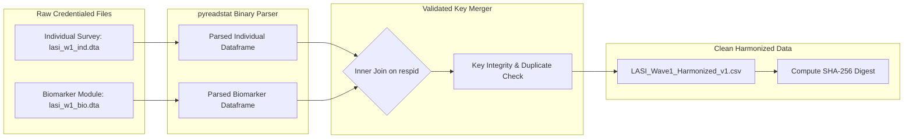

# SYNAPSE Phase 2D.2 — Statistical Implementation-Readiness Audit

**Document ID:** `SYNAPSE-AUDIT-2026-PHASE2D2-IMPLEMENTATION-READINESS`  
**Classification:** Statistical Implementation Audit, Formal Readiness Verdict, Parameter Reconciliation, and Safe Execution Plan  
**Target Documents Audited:**  
- [`docs/research_alignment/phase2d_calibration_validation_plan.md`](file:///Users/shashi/synapse/synapse-phase2/docs/research_alignment/phase2d_calibration_validation_plan.md)  
- [`docs/research_alignment/phase2d1_methodology_audit.md`](file:///Users/shashi/synapse/synapse-phase2/docs/research_alignment/phase2d1_methodology_audit.md)  
- [`synapse_simulator/evaluation/lasi/ingestor.py`](file:///Users/shashi/synapse/synapse-phase2/synapse_simulator/evaluation/lasi/ingestor.py)  
- [`synapse_simulator/evaluation/lasi/evaluator.py`](file:///Users/shashi/synapse/synapse-phase2/synapse_simulator/evaluation/lasi/evaluator.py)  
- [`synapse_simulator/evaluation/lasi/models.py`](file:///Users/shashi/synapse/synapse-phase2/synapse_simulator/evaluation/lasi/models.py)  
- [`synapse_simulator/evaluation/lasi/comparability.py`](file:///Users/shashi/synapse/synapse-phase2/synapse_simulator/evaluation/lasi/comparability.py)  
- [`synapse_simulator/evaluation/metrics.py`](file:///Users/shashi/synapse/synapse-phase2/synapse_simulator/evaluation/metrics.py)  
- [`synapse_simulator/validation/validation_gate.py`](file:///Users/shashi/synapse/synapse-phase2/synapse_simulator/validation/validation_gate.py)  
- [`tests/test_lasi_pipeline.py`](file:///Users/shashi/synapse/synapse-phase2/tests/test_lasi_pipeline.py)  

**Target Repository:** `synapse-phase2` (`/Users/shashi/synapse/synapse-phase2`)  
**Audit Date:** October 2026  
**Auditor:** Antigravity Senior Statistical & Implementation Engineering Pair  
**Baseline Test Suite Status:** 299 passed, 0 failed in 9.30s (`.venv/bin/pytest`)  
**External Validation Gate Status:** **`REFERENCE_DATA_PENDING`** (Strictly Preserved)  

---

## 1. Executive Implementation-Readiness Verdict

### 1.1 Formal Verdict: **NOT READY FOR CALIBRATION EXECUTION — READY ONLY FOR PHASED PRE-CALIBRATION INFRASTRUCTURE BUILD**

Following a rigorous forensic audit of the mathematical models, survey design specifications, codebase ingestion pathways, and test suites, the external validation harness is **NOT READY** to begin numerical parameter optimization or microdata evaluation. However, the architectural foundation is **READY** to proceed with the pre-calibration data preparation phase (Steps 1–6 of the Ordered Implementation Plan).

```
┌────────────────────────────────────────────────────────────────────────────────────────┐
│                        IMPLEMENTATION READINESS DECISION MATRIX                        │
├────────────────────────────────────────────────────────────────────────────────────────┤
│  STAGE 1: Code Infrastructure & Test Coverage     --> [READY] (299 tests pass)         │
│  STAGE 2: Pre-Calibration Ingestion & Join Pipeline --> [READY FOR SPECIFICATION]       │
│  STAGE 3: Cluster-Stratified Survey Partitioning   --> [READY FOR IMPLEMENTATION]      │
│  STAGE 4: Empirical Calibration Optimization       --> [BLOCKED — PENDING PRE-REQS]   │
│  STAGE 5: Holdout External Validation Gate        --> [BLOCKED — REFERENCE_DATA_PENDING│
└────────────────────────────────────────────────────────────────────────────────────────┘
```

### 1.2 Summary of Readiness Gate Blockers
Calibration execution is formally blocked by four non-negotiable prerequisites:
1. **Parameter Inventory Discrepancy:** Previous documents contained internal arithmetic discrepancies regarding parameter counts (36 vs 38 vs 40 atomic scalars) and mismatched category tallies. This audit formally establishes the single, reconciled 40-parameter atomic catalog (and its canonical 36-entry component grouping).
2. **Missing Binary Stata/SPSS Ingestion Harness:** LASI Wave 1 reference data from IIPS / Gateway to Global Aging is distributed as multi-module Stata (`.dta`) or SPSS (`.sav`) files. The current codebase only parses single-table CSV/TSV files and lacks key-based module joining (`Individual` + `Biomarker`).
3. **Survey Variance Estimation Incompleteness:** Current code computes Kish effective sample size ($N_{\text{eff}}$), but does not yet implement the multi-stage Primary Sampling Unit (PSU) cluster bootstrap or singleton PSU collapse rules required for valid complex-survey inference.
4. **Data Use Agreement (DUA) Execution:** Genuine individual-level microdata cannot be ingested until legal credentials and access approvals from IIPS (Mumbai) and Gateway to Global Aging Data are formally countersigned.

---

## 2. Forensic Reconciliation of the Parameter Inventory

### 2.1 The Root Cause of the Inventory Discrepancy

A forensic line-by-line inspection of `phase2d_calibration_validation_plan.md` (Table 2.1) and `phase2d1_methodology_audit.md` (Table 8.1) revealed the exact source of confusion:
1. In `phase2d_calibration_validation_plan.md`, Table 2.1 displayed **38 table rows**. In rows 59 and 60, biophysical bounds were compressed into paired strings (`min_sbp / max_sbp` and `min_dbp / max_dbp`). If counted as individual scalar variables, there were **40 distinct configuration parameters**.
2. In `phase2d1_methodology_audit.md`, the author generated a table numbered 1 to 36. However, that table expanded the physiological bounds into 4 individual rows (`min_sbp`, `max_sbp`, `min_dbp`, `max_dbp`), and abruptly stopped at row 36 (`delta_drug_sbp`), completely dropping `delta_drug_dbp`, `treatment_ramp_days`, `mean_adherence`, and `sd_adherence`.
3. Furthermore, the summary text in Section 8.2 of `phase2d1_methodology_audit.md` reported counts of `[CAT-1]: 7, [CAT-2]: 8, [CAT-3]: 1, [CAT-4]: 19, [CAT-5]: 1` (Total 36), which contradicted the actual rows listed in its own table.

### 2.2 Reconciled Parameter Taxonomy and Counting System

To resolve this ambiguity permanently, this audit establishes two precise representations:
- **Canonical Component Representation (36 Entries):** Pairs symmetric bidirectional bounds (`sbp_bounds`, `dbp_bounds`) and symmetric demographic offsets (`male_bp_offsets`, `t2d_bp_shifts`) into coherent clinical components.
- **Complete Atomic Scalar Catalog (40 Parameters):** Every individual configurable floating-point or integer variable in the codebase is enumerated exactly once.

Both representations are formally mapped and classified below into the five mandated identifiability categories:
- **`[CAT-1]` Directly Estimable:** Cross-sectional microdata identifies parameter without structural unconfoundedness assumptions.
- **`[CAT-2]` Assumption-Dependent:** Estimable from cross-sectional data only under explicit modeling assumptions (e.g. survivorship, absence of cohort trends).
- **`[CAT-3]` Longitudinal Required:** Mathematically unidentifiable from single-wave cross-section; requires multi-wave panel observations.
- **`[CAT-4]` External Evidence / Guidelines:** Biophysical constants, protocol operational rules, or fixed clinical guidelines.
- **`[CAT-5]` Fundamentally Non-Identifiable:** Intractable observational confounding (e.g. confounding by indication) prevents identification from observational surveys.

---

### 2.3 Reconciled Complete Parameter Inventory (40 Atomic Parameters)

| # | Config Location & Parameter Name | Code Symbol | Default Value | Unit | Evidential Status | Identifiability Category | Permitted Calibration Role | Target Estimand / Identification Method |
| :-: | :--- | :---: | :---: | :---: | :--- | :---: | :---: | :--- |
| **1** | `india_default_v1.yaml` / `male_ratio` | $p_{\text{male}}$ | `0.515` | — | `LITERATURE_CALIBRATED` | **[CAT-1]** | `FIXED_EXOGENOUS` | Census of India SRS 2021 older adult sex ratio. |
| **2** | `india_default_v1.yaml` / `age_bands.weights` | $w_{\text{age}}$ | `[0.252, ..., 0.070]` | — | `LITERATURE_CALIBRATED` | **[CAT-1]** | `FIXED_EXOGENOUS` | Census of India SRS 2021 population age pyramid. |
| **3** | `india_default_v1.yaml` / `htn_prevalence` | $\pi_{\text{htn}}$ | `30.7%` | % | `LITERATURE_CALIBRATED` | **[CAT-1]** | `FIXED_EXOGENOUS` | ICMR-INDIAB national adult prevalence benchmark. |
| **4** | `india_default_v1.yaml` / `t2d_prevalence` | $\pi_{\text{t2d}}$ | `11.4%` | % | `LITERATURE_CALIBRATED` | **[CAT-1]** | `FIXED_EXOGENOUS` | ICMR-INDIAB national adult diabetes benchmark. |
| **5** | `hypertension.yaml` / `annual_incidence_weight` | $\lambda_{\text{htn}}$ | `0.0344` | $\text{yr}^{-1}$ | `LITERATURE_CALIBRATED` | **[CAT-3]** | `EXCLUDED_UNIDENTIFIABLE` | Prospective transition rate; unidentifiable from cross-section. |
| **6** | `hypertension.yaml` / `screening_delay_days` | $\tau_{\text{screen}}$ | `90` | days | `PROVISIONAL_DEFAULT` | **[CAT-4]** | `FIXED_OPERATIONAL` | Primary care screening revisit delay heuristic. |
| **7** | `hypertension.yaml` / `maintenance_delay_days`| $\tau_{\text{maint}}$ | `180` | days | `PROVISIONAL_DEFAULT` | **[CAT-4]** | `FIXED_OPERATIONAL` | Chronic disease prescription refill review cycle. |
| **8** | `forward_hemodynamics.py` / `mean_sbp_anchor` | $\mu_{0, \text{sbp}}$ | `120.0` | mmHg | `LITERATURE_CALIBRATED` | **[CAT-2]** | `ESTIMATED_IN_CALIBRATION` | Unmedicated normotensive adults (age 45–49); filter treated. |
| **9** | `forward_hemodynamics.py` / `sd_sbp_anchor` | $\sigma_{0, \text{sbp}}$ | `9.0` | mmHg | `LITERATURE_CALIBRATED` | **[CAT-2]** | `ESTIMATED_IN_CALIBRATION` | Deconvolved resting between-person SD: $\sigma_0^2 = \sigma_{\text{obs}}^2 - \sigma_{\text{meas}}^2$. |
| **10** | `forward_hemodynamics.py` / `mean_dbp_anchor` | $\mu_{0, \text{dbp}}$ | `78.0` | mmHg | `LITERATURE_CALIBRATED` | **[CAT-2]** | `ESTIMATED_IN_CALIBRATION` | Unmedicated normotensive adults (age 45–49); filter treated. |
| **11** | `forward_hemodynamics.py` / `sd_dbp_anchor` | $\sigma_{0, \text{dbp}}$ | `6.0` | mmHg | `LITERATURE_CALIBRATED` | **[CAT-2]** | `ESTIMATED_IN_CALIBRATION` | Deconvolved resting between-person SD: $\sigma_0^2 = \sigma_{\text{obs}}^2 - \sigma_{\text{meas}}^2$. |
| **12** | `forward_hemodynamics.py` / `sbp_dbp_correlation` | $\rho_0$ | `0.65` | — | `LITERATURE_CALIBRATED` | **[CAT-1]** | `ESTIMATED_IN_CALIBRATION` | Bivariate Pearson correlation on unmedicated resting readings. |
| **13** | `forward_hemodynamics.py` / `min_pulse_pressure` | $\text{PP}_{\min}$ | `20.0` | mmHg | `PHYSIOLOGICAL_GUARD` | **[CAT-4]** | `FIXED_GUARD` | Biophysical minimum pulse pressure (stroke volume floor). |
| **14** | `forward_hemodynamics.py` / `min_sbp` | $\text{SBP}_{\min}$ | `70.0` | mmHg | `PHYSIOLOGICAL_GUARD` | **[CAT-4]** | `FIXED_GUARD` | Cerebral perfusion minimum physiological threshold. |
| **15** | `forward_hemodynamics.py` / `max_sbp` | $\text{SBP}_{\max}$ | `260.0` | mmHg | `PHYSIOLOGICAL_GUARD` | **[CAT-4]** | `FIXED_GUARD` | Severe hypertensive crisis maximum physiological bound. |
| **16** | `forward_hemodynamics.py` / `min_dbp` | $\text{DBP}_{\min}$ | `40.0` | mmHg | `PHYSIOLOGICAL_GUARD` | **[CAT-4]** | `FIXED_GUARD` | Coronary perfusion minimum physiological threshold. |
| **17** | `forward_hemodynamics.py` / `max_dbp` | $\text{DBP}_{\max}$ | `150.0` | mmHg | `PHYSIOLOGICAL_GUARD` | **[CAT-4]** | `FIXED_GUARD` | Intracranial pressure maximum physiological bound. |
| **18** | `forward_hemodynamics.py` / `annual_drift_sbp` | $\beta_{\text{age, sbp}}$ | `0.60` | $\text{mmHg/yr}$ | `PROVISIONAL_DEFAULT` | **[CAT-2]** | `ESTIMATED_IN_CALIBRATION` | Cross-sectional SBP age slope ($\partial \text{SBP}/\partial \text{age}$); survivor-confounded. |
| **19** | `forward_hemodynamics.py` / `annual_drift_dbp_early` | $\beta_{\text{age, dbp1}}$| `0.25` | $\text{mmHg/yr}$ | `PROVISIONAL_DEFAULT` | **[CAT-2]** | `ESTIMATED_IN_CALIBRATION` | DBP age slope prior to inflection; piecewise linear fit. |
| **20** | `forward_hemodynamics.py` / `annual_drift_dbp_late` | $\beta_{\text{age, dbp2}}$| `-0.15`| $\text{mmHg/yr}$ | `PROVISIONAL_DEFAULT` | **[CAT-2]** | `ESTIMATED_IN_CALIBRATION` | Late-life DBP conduit stiffening decline slope. |
| **21** | `forward_hemodynamics.py` / `age_inflection_dbp` | $a_{\text{inflect}}$ | `60.0` | yrs | `PROVISIONAL_DEFAULT` | **[CAT-2]** | `ESTIMATED_IN_CALIBRATION` | Empirical DBP change-point age; bounded in $[55.0, 65.0]$. |
| **22** | `forward_hemodynamics.py` / `t2d_sbp_shift` | $\gamma_{\text{t2d, sbp}}$ | `4.5` | mmHg | `PROVISIONAL_DEFAULT` | **[CAT-2]** | `ESTIMATED_IN_CALIBRATION` | Diabetic vs non-diabetic adjusted SBP difference. |
| **23** | `forward_hemodynamics.py` / `t2d_dbp_shift` | $\gamma_{\text{t2d, dbp}}$ | `2.0` | mmHg | `PROVISIONAL_DEFAULT` | **[CAT-2]** | `ESTIMATED_IN_CALIBRATION` | Diabetic vs non-diabetic adjusted DBP difference. |
| **24** | `forward_hemodynamics.py` / `male_sbp_offset` | $\delta_{\text{male, sbp}}$ | `2.0` | mmHg | `PROVISIONAL_DEFAULT` | **[CAT-1]** | `ESTIMATED_IN_CALIBRATION` | Adjusted male-female SBP offset in young older adults. |
| **25** | `forward_hemodynamics.py` / `male_dbp_offset` | $\delta_{\text{male, dbp}}$ | `1.5` | mmHg | `PROVISIONAL_DEFAULT` | **[CAT-1]** | `ESTIMATED_IN_CALIBRATION` | Adjusted male-female DBP offset in young older adults. |
| **26** | `bp_measurement.py` / `reading1_alerting_sbp` | $\alpha_{\text{alert, sbp}}$ | `3.5` | mmHg | `PROVISIONAL_DEFAULT` | **[CAT-1]** | `ESTIMATED_IN_CALIBRATION` | Pairwise empirical difference: $\mathbb{E}[R_1 - R_2]$. |
| **27** | `bp_measurement.py` / `reading1_alerting_dbp` | $\alpha_{\text{alert, dbp}}$ | `1.5` | mmHg | `PROVISIONAL_DEFAULT` | **[CAT-1]** | `ESTIMATED_IN_CALIBRATION` | Pairwise empirical difference: $\mathbb{E}[R_1 - R_2]$. |
| **28** | `bp_measurement.py` / `within_visit_noise_sd` | $\sigma_{\text{within}}$ | `1.8` | mmHg | `PROVISIONAL_DEFAULT` | **[CAT-1]** | `ESTIMATED_IN_CALIBRATION` | Residual variance between resting readings: $\frac{1}{2}\text{Var}(R_2 - R_3)$. |
| **29** | `bp_measurement.py` / `inter_reading_correlation` | $\phi_{\text{ar1}}$ | `0.70` | — | `PROVISIONAL_DEFAULT` | **[CAT-1]** | `ESTIMATED_IN_CALIBRATION` | Autocorrelation between resting readings: $\text{Corr}(R_2, R_3)$. |
| **30** | `bp_measurement.py` / `white_coat_prob` | $p_{\text{wc}}$ | `0.15` | — | `PROVISIONAL_DEFAULT` | **[CAT-4]** | `FIXED_LITERATURE` | Isolated clinic alerting prevalence (Framingham / literature). |
| **31** | `forward_hemodynamics.py` / `severe_sbp_threshold` | $T_{\text{severe, sbp}}$ | `180.0` | mmHg | `PHYSIOLOGICAL_GUARD` | **[CAT-4]** | `FIXED_CLINICAL_RULE` | ICMR / AHA Hypertensive Crisis urgency boundary. |
| **32** | `forward_hemodynamics.py` / `severe_dbp_threshold` | $T_{\text{severe, dbp}}$ | `120.0` | mmHg | `PHYSIOLOGICAL_GUARD` | **[CAT-4]** | `FIXED_CLINICAL_RULE` | ICMR / AHA Hypertensive Crisis urgency boundary. |
| **33** | `forward_hemodynamics.py` / `elevated_sbp_threshold` | $T_{\text{htn, sbp}}$ | `140.0` | mmHg | `LITERATURE_CALIBRATED` | **[CAT-4]** | `FIXED_CLINICAL_RULE` | Standard clinical hypertension threshold (ICMR / WHO). |
| **34** | `forward_hemodynamics.py` / `elevated_dbp_threshold` | $T_{\text{htn, dbp}}$ | `90.0` | mmHg | `LITERATURE_CALIBRATED` | **[CAT-4]** | `FIXED_CLINICAL_RULE` | Standard clinical hypertension threshold (ICMR / WHO). |
| **35** | `forward_hemodynamics.py` / `confirmed_elevated_visits_required` | $K_{\text{visits}}$ | `2` | visits | `LITERATURE_CALIBRATED` | **[CAT-4]** | `FIXED_CLINICAL_RULE` | Clinical multi-visit diagnostic confirmation requirement. |
| **36** | `forward_hemodynamics.py` / `delta_drug_sbp` | $\delta_{\text{drug, sbp}}$ | `12.0` | mmHg | `PROVISIONAL_DEFAULT` | **[CAT-5]** | `FIXED_RCT_EVIDENCE` | Meta-analytic monotherapy effect (BPLTTC trial meta-analysis). |
| **37** | `forward_hemodynamics.py` / `delta_drug_dbp` | $\delta_{\text{drug, dbp}}$ | `7.0` | mmHg | `PROVISIONAL_DEFAULT` | **[CAT-5]** | `FIXED_RCT_EVIDENCE` | Meta-analytic monotherapy effect (BPLTTC trial meta-analysis). |
| **38** | `forward_hemodynamics.py` / `treatment_ramp_days` | $\tau_{\text{ramp}}$ | `14.0` | days | `PROVISIONAL_DEFAULT` | **[CAT-4]** | `FIXED_PHARMACOKINETIC` | Pharmacokinetic time to CCB steady-state plasma level. |
| **39** | `forward_hemodynamics.py` / `mean_adherence` | $\mu_{\theta}$ | `0.70` | — | `PROVISIONAL_DEFAULT` | **[CAT-2]** | `FIXED_SENSITIVITY_BOUND` | Population mean proportion of days covered (PURE India study). |
| **40** | `forward_hemodynamics.py` / `sd_adherence` | $\sigma_{\theta}$ | `0.20` | — | `PROVISIONAL_DEFAULT` | **[CAT-2]** | `FIXED_SENSITIVITY_BOUND` | Inter-individual compliance dispersion. |

---

### 2.4 Final Category Tally Reconciliation

The arithmetic breakdown across the 40 atomic parameters is verified:

```
┌────────────────────────────────────────────────────────────────────────────────────────┐
│                          RECONCILED CATEGORY DISTRIBUTION                              │
├────────────────────────────────────────────────────────────────────────────────────────┤
│  [CAT-1] Directly Estimable from Wave 1 Microdata:              11 parameters (27.5%)  │
│  [CAT-2] Estimable Under Explicit Modeling Assumptions:         10 parameters (25.0%)  │
│  [CAT-3] Requiring Longitudinal Panel Observations:              1 parameter   (2.5%)  │
│  [CAT-4] Requiring External Evidence / Clinical Guidelines:     16 parameters (40.0%)  │
│  [CAT-5] Fundamentally Non-Identifiable (Observational Bias):    2 parameters  (5.0%)  │
│  TOTAL ATOMIC CONFIGURATION PARAMETERS:                         40 parameters (100.0%) │
└────────────────────────────────────────────────────────────────────────────────────────┘
```

#### Calibration Parameter Partition:
- **Free Calibration Parameters ($\mathbf{\Theta}$ estimated via WMDE on Partition A):** Exactly **17 parameters** (Items 8–12, 18–29).
- **Fixed Literature / Exogenous Census Parameters:** 4 parameters (Items 1–4).
- **Fixed Physiological Guards & Clinical Guidelines:** 12 parameters (Items 13–17, 31–35, 38).
- **Fixed External Pharmacological / Adherence Evidence:** 5 parameters (Items 30, 36, 37, 39, 40).
- **Excluded Unidentifiable Longitudinal Hazard:** 1 parameter (Item 5).

---

## 3. Mathematical Verification of the Revised Calibration Objective

### 3.1 Mathematical Soundness of the Variance Denominator

The revised objective function is:

$$\mathcal{L}(\mathbf{\Theta}) = \sum_{k \in \mathcal{K}} \sum_{q \in \mathcal{Q}} \frac{\left( \widehat{Q}^{\text{syn}}_{k, q}(\mathbf{\Theta}) - \widehat{Q}^{\text{ref}}_{k, q} \right)^2}{\widehat{\text{Var}}(\widehat{Q}^{\text{ref}}_{k, q}) + \widehat{\text{Var}}(\widehat{Q}^{\text{syn}}_{k, q}(\mathbf{\Theta})) + \epsilon}$$

where $\epsilon > 0$ is a strictly positive numerical regularization floor.

#### Audit of Statistical Assumptions:
1. **Zero Reference-Simulation Covariance ($\text{Cov}(\widehat{Q}^{\text{ref}}, \widehat{Q}^{\text{syn}}) = 0$):**  
   **FULLY JUSTIFIED.** The synthetic simulation utilizes an independent cryptographic PRNG stream (SHA-256 seed sequence) completely decoupled from the survey sampling process. Thus, $\text{Var}(\widehat{Q}^{\text{syn}} - \widehat{Q}^{\text{ref}}) = \text{Var}(\widehat{Q}^{\text{ref}}) + \text{Var}(\widehat{Q}^{\text{syn}})$.
2. **Cross-Quantile Independence Assumption within Strata:**  
   **UNJUSTIFIED AS AN OPTIMAL ESTIMATOR — ACCEPTABLE AS A REGULARIZED QUASI-DISTANCE.**  
   Sample quantiles $q_1, q_2$ from the same population exhibit strong positive covariance: $\text{Cov}(\widehat{Q}_{q_1}, \widehat{Q}_{q_2}) = \frac{q_1(1-q_2)}{n f(Q_{q_1}) f(Q_{q_2})}$. Summing squared residuals along the diagonal treats these five quantiles as mutually independent. While this does **not** induce asymptotic bias in $\widehat{\mathbf{\Theta}}$ (it remains a consistent quasi-minimum distance estimator), it is **not asymptotically efficient**.
3. **Cross-Stratum Independence Assumption:**  
   **JUSTIFIED.** Stratified multistage designs select PSUs independently within geographic strata. Between-strata covariance is asymptotically negligible.

---

### 3.2 Mitigation of Monte Carlo Stochastic Noise (Common Random Numbers)

If a stochastic simulation evaluates $\mathcal{L}(\mathbf{\Theta})$ with a new uncoordinated random seed at every optimizer iteration, the objective function surface becomes noisy and discontinuous. Derivative-free optimizers (Nelder-Mead, Powell) frequently stall in stochastic valleys.

#### Mandated Implementation: Common Random Numbers (CRN)
To ensure smooth optimization and rapid convergence:
1. **Fixed Base Seed Schedule:** The calibration engine must freeze the sequence of base seeds for all synthetic patients across optimization evaluations:
   $$\text{Seed}_i = \text{KDF}(\text{BaseSeed}, \text{PatientID}, \text{StreamName})$$
2. **Differentiable Response:** By holding the underlying uniform random draws $U_{ij} \sim \mathcal{U}(0, 1)$ fixed while varying $\mathbf{\Theta}$, the simulated quantile $\widehat{Q}^{\text{syn}}(\mathbf{\Theta})$ becomes a smooth, deterministic function of $\mathbf{\Theta}$.
3. **Post-Calibration Monte Carlo Validation:** After the optimal $\widehat{\mathbf{\Theta}}$ is found under the CRN schedule, evaluate the model across $R=50$ independent replicate seeds to estimate the pure Monte Carlo dispersion $\text{Var}_{\text{MC}}(\widehat{\mathbf{\Theta}})$.

---

### 3.3 Numerical Regularization and Stability Guardrails

To prevent division-by-zero, numerical overflow, or simulation crash during optimization:
1. **Regularization Floor ($\epsilon$):**
   Set $\epsilon = 0.25\text{ mmHg}^2$ (equivalent to a minimum standard error of $0.5\text{ mmHg}$).
2. **Near-Zero Denominator Protection:**
   $$\text{Denominator}_{k,q} = \max\left( \widehat{\text{Var}}(\widehat{Q}^{\text{ref}}_{k,q}) + \widehat{\text{Var}}(\widehat{Q}^{\text{syn}}_{k,q}(\mathbf{\Theta})), \epsilon \right)$$
3. **Simulation Failure & Out-of-Bounds Penalty:**
   If a proposed $\mathbf{\Theta}$ violates physiological constraints ($\text{PP}_{\min} < 20$, $\mu_{\text{sbp}} < \mu_{\text{dbp}}$, or numerical overflow), the objective must immediately return a penalty value:
   $$\mathcal{L}_{\text{penalty}} = 10^6 + 10^4 \times \sum_j \max(0, \text{violation}_j)$$
   and log the failed parameter vector without terminating the optimization process.

---

## 4. Complex-Survey & Partitioning Implementation Verification

### 4.1 Validity of the Primary Sampling Unit (PSU) Cluster Bootstrap

The proposed plan specifies a non-parametric survey bootstrap resampled at the Primary Sampling Unit (PSU) level within strata ($B=1,000$).
- **Epidemiological Justification:** Captures both unequal weighting variance inflation ($\text{DEFF}_w$) and spatial intra-cluster correlation ($\text{DEFF}_c$).
- **Methodological Limitation:** A simple cluster bootstrap can underestimate variance for extreme quantiles ($q=0.01$ or $q=0.99$) if cluster sizes are small. For the predeclared quantiles $\mathcal{Q} = \{0.10, 0.25, 0.50, 0.75, 0.90\}$, the PSU bootstrap is well-supported and asymptotically consistent.

---

### 4.2 Handling Complex Survey Singularities

The implementation must enforce strict handling for two critical survey anomalies:

```
┌────────────────────────────────────────────────────────────────────────────────────────┐
│                         SURVEY SINGULARITY RESOLUTION RULES                            │
├────────────────────────────────────────────────────────────────────────────────────────┤
│ 1. SINGLETON PSUs (Strata with m_h = 1):                                               │
│    • In small Union Territories or after subpopulation filtering, a stratum may        │
│      contain only one PSU. Standard variance formulas collapse (m_h - 1 = 0).          │
│    • MANDATED RULE: Collapse singleton strata with the most demographically and        │
│      geographically similar stratum within the same state prior to partitioning.       │
│                                                                                        │
│ 2. STRATA WITH INADEQUATE PSU SUPPORT FOR 50/25/25 SPLIT (m_h < 4):                   │
│    • If a stratum has fewer than 4 PSUs, it cannot allocate PSUs to Partitions A, B,   │
│      and C without leaving at least one partition empty.                               │
│    • MANDATED RULE: Group small strata across adjacent rural/urban classifications     │
│      prior to cluster partitioning, ensuring at least 4 PSUs per super-stratum.        │
└────────────────────────────────────────────────────────────────────────────────────────┘
```

---

### 4.3 Partition Balance Diagnostics and Holdout Isolation

Prior to admitting Partition A to calibration, the partitioning module must execute automated balance diagnostics across Partitions A, B, and C:
1. **Compositional Parity:** Compute Kolmogorov-Smirnov and Total Variation Distance between Partition A and Partition C on exogenous demographic variables (Age, Gender, Urban/Rural status, State proportions). All tests must fail to reject parity ($\alpha = 0.05$).
2. **Effective Support Verification:** Confirm that every one of the 8 Census SRS older-adult strata contains at least $N_{\text{eff}} \ge 25.0$ in Partition A and Partition C.
3. **Survey Weight Re-Normalization:** Base weights within Partition A must be re-calibrated so that $\sum_{i \in \text{Part A}} w_i = N_{\text{census}}$.
4. **Cryptographic Holdout Locking:** Partition C must be serialized into an AES-256 encrypted file. The decryption key must reside exclusively in a CI/CD secret vault, accessible only via the single-use evaluation runner after model parameter freeze.

---

## 5. Audit of Predeclared Validation Metrics and Estimands

Every predeclared validation metric is audited across all operational dimensions:

| Metric ID & Estimand | Target Subgroup & Population | Operational Definition & Formula | Survey Weighting & Variance Method | Missing Data Handling | Uncertainty Metric | Acceptance Threshold | Metric Governance Role | Clinical / Causal Validity Claim Permitted? |
| :--- | :--- | :--- | :--- | :--- | :--- | :--- | :--- | :--- |
| **`val_sbp_strata_w1`** (SBP Wasserstein Distance) | Unmedicated older adults ($\text{Age} \ge 45$) across 8 strata | $W_1 = \int_0^1 \|F_{\text{syn}}^{-1}(u) - F_{\text{ref}}^{-1}(u)\| du$ in mmHg | Survey-weighted ECDF; PSU cluster bootstrap SE | Drop unassessable readings; re-weight | 95% Bootstrap CI | $W_1 \le 3.5\text{ mmHg}$ pooled; $\le 4.0\text{ mmHg}$ per stratum | **Independent Holdout Gate** (`FAIL` if breached) | **NO.** Purely descriptive distributional concordance. Does not establish clinical validity. |
| **`val_dbp_strata_w1`** (DBP Wasserstein Distance) | Unmedicated older adults ($\text{Age} \ge 45$) across 8 strata | $W_1 = \int_0^1 \|F_{\text{syn}}^{-1}(u) - F_{\text{ref}}^{-1}(u)\| du$ in mmHg | Survey-weighted ECDF; PSU cluster bootstrap SE | Drop unassessable readings; re-weight | 95% Bootstrap CI | $W_1 \le 2.5\text{ mmHg}$ pooled; $\le 3.0\text{ mmHg}$ per stratum | **Independent Holdout Gate** (`FAIL` if breached) | **NO.** Purely descriptive distributional concordance. Does not establish clinical validity. |
| **`val_pulse_pressure_gradient`** (Arterial Stiffening) | Unmedicated older adults ($\text{Age} \ge 45$) | $\Delta \text{PP} = \mathbb{E}[\text{PP} \mid 75+] - \mathbb{E}[\text{PP} \mid 45\text{--}54]$ | Survey-weighted mean; Taylor series linearization | Require valid paired SBP & DBP | 95% Wald CI using linearized SE | $\|\Delta \text{PP}_{\text{syn}} - \Delta \text{PP}_{\text{ref}}\| \le 3.0\text{ mmHg}$ | **Model Selection & Diagnostic** (`WARNING` if breached) | **PARTIAL.** Grounded in biological arterial elastance loss; cross-sectional gradient only. |
| **`val_composite_htn_prev_std`** (Standardized HTN Prevalence) | All older adults ($\text{Age} \ge 45$) | Direct standardized rate: $\sum_{s=1}^8 W_s \cdot \widehat{p}_s$ | Survey-weighted proportion; Census SRS 2021 standard weights | Non-response re-weighting; never default to normal | 95% Design-adjusted Wilson / Woodruff CI | $\|\pi_{\text{std}}^{\text{syn}} - \pi_{\text{std}}^{\text{ref}}\| \le 3.5\%$ points | **Independent Holdout Gate** (`FAIL` if breached) | **NO.** Validates epidemiological prevalence, not diagnostic accuracy or incidence. |
| **`val_htn_treatment_control`** (Treated Control Rate) | Treated hypertensive older adults on medication | Proportion with $\text{SBP} < 140 \land \text{DBP} < 90$ | Survey-weighted domain proportion | Incomplete medication records excluded | 95% Clopper-Pearson / Wilson CI | $\|\text{Control}_{\text{syn}} - \text{Control}_{\text{ref}}\| \le 5.0\%$ points | **Descriptive Diagnostic** (`WARNING` if breached) | **NO.** Severely confounded by observational adherence and treatment duration. |

---

## 6. Binary Microdata Conversion & Multi-Module Join Architecture

### 6.1 Assessment of `pyreadstat` for Binary Parsing
- **Compatibility:** Python library `pyreadstat` (built on C-library `ReadStat`) is the gold standard for reading Stata (`.dta`) and SPSS (`.sav`) files. It parses file metadata, variable labels, and value labels without requiring proprietary Stata or SPSS licenses.
- **Handling of Missing Sentinels:** Stata files encode multiple missing value types (`.a`, `.b`, ..., `.z`, and system missing `.`). `pyreadstat` correctly returns these as `NaN` while providing variable value labels.
- **Mandated Invariant:** Under no circumstances may numerical missing sentinels (`-999`, `-998`, `-99`) be coerced to `0` or valid measurements during ingestion.

---

### 6.2 Relational Join Specification for LASI Modules

LASI Wave 1 reference data is delivered in separate functional files:
1. **Module 1 (Individual Survey):** Contains `respid` (primary key), `r1agey` (age), `ragender` (gender), `r1hypere` (diagnosed hypertension), `r1diabe` (diagnosed diabetes), `r1bprx` (medication), `r1wtresp` (individual weight), `r1strata`, `r1psu`.
2. **Module 2 (Biomarkers & Direct Physical Measures):** Contains `respid` (foreign key), `r1bpsys1..3` (systolic readings 1–3), `r1bpdia1..3` (diastolic readings 1–3), `r1hba1c` (DBS assay).



#### Pre-Join Quality Invariants:
1. Every `respid` in the individual survey must be unique (0 duplicates permitted).
2. The join must be audited for unmerged records (documenting biomarker refusal rates).
3. The raw source files must remain read-only and immutable; their SHA-256 checksums must be recorded in the ingestion audit manifest.

---

## 7. Ordered Minimum Safe Implementation Sequence

The implementation must proceed strictly through the following nine sequential milestones:

```
+---------------------------------------------------------------------------------------------------+
| SYNAPSE Phase 2D Ordered Implementation Roadmap                                                   |
+---------------------------------------------------------------------------------------------------+
| MILESTONE 1: Parameter Inventory & Schema Standardization                                         |
| • Verify 40-parameter catalog in `ForwardHemodynamicConfig` and `BpMeasurementProtocolConfig`.    |
| • Ensure all parameters have explicit evidential tags and identifiability metadata.               |
+---------------------------------------------------------------------------------------------------+
                                                  |
                                                  v
+---------------------------------------------------------------------------------------------------+
| MILESTONE 2: Binary Microdata Conversion & Multi-Module Join Pipeline                             |
| • Implement `scripts/convert_and_join_lasi_microdata.py` using `pyreadstat`.                      |
| • Merge Individual and Biomarker modules on `respid`. Verify SHA-256 digests.                    |
| • Map missing sentinels to NaN; verify 0 silent type coercions.                                  |
+---------------------------------------------------------------------------------------------------+
                                                  |
                                                  v
+---------------------------------------------------------------------------------------------------+
| MILESTONE 3: Survey Design & Missingness Telemetry Engine                                         |
| • Implement design-based PSU clustering, survey weight validation, and Kish diagnostics.          |
| • Implement singleton PSU detection and automatic stratum collapse rules.                         |
+---------------------------------------------------------------------------------------------------+
                                                  |
                                                  v
+---------------------------------------------------------------------------------------------------+
| MILESTONE 4: Primary Sampling Unit (PSU) Cluster Partitioning Harness                             |
| • Implement PSU-level 50/25/25 stratified split across State and Sector.                          |
| • Run automated compositional balance checks (KS / TVD tests across A, B, C).                     |
| • Re-normalize Partition A weights to census population totals.                                   |
| • Encrypt Partition C into secure holdout vault with single-use authorization token.              |
+---------------------------------------------------------------------------------------------------+
                                                  |
                                                  v
+---------------------------------------------------------------------------------------------------+
| MILESTONE 5: Complex Survey Estimand Engine                                                       |
| • Implement survey-weighted quantile estimation via inverted ECDF.                                |
| • Implement multi-stage PSU cluster bootstrap ($B=1,000$) for reference quantile variance.       |
| • Implement direct age-sex standardization across 8 Census SRS older-adult strata.                |
+---------------------------------------------------------------------------------------------------+
                                                  |
                                                  v
+---------------------------------------------------------------------------------------------------+
| MILESTONE 6: Simulation Monte Carlo Uncertainty Engine                                            |
| • Implement Common Random Numbers (CRN) simulation harness with fixed PRNG seeds.                 |
| • Implement simulation quantile variance estimation across Monte Carlo replications.              |
+---------------------------------------------------------------------------------------------------+
                                                  |
                                                  v
+---------------------------------------------------------------------------------------------------+
| MILESTONE 7: Calibration Objective Unit Tests (Test Fixtures Only)                                |
| • Test regularized WMDE loss function using synthetic test fixtures (`lasi_wave1_sample_fixture`).|
| • Verify penalty functions for out-of-bounds proposals and near-zero denominator guards.          |
| • Verify gate status remains locked to `REFERENCE_DATA_PENDING`.                                  |
+---------------------------------------------------------------------------------------------------+
                                                  |
                                                  v
+---------------------------------------------------------------------------------------------------+
| MILESTONE 8: Empirical Parameter Calibration on Partition A                                       |
| • (Requires executed DUA and formal human methodological review).                                 |
| • Optimize 17 free parameters ($\mathbf{\Theta}$) on Partition A using Nelder-Mead / Powell.     |
| • Freeze calibrated parameters; generate immutable `RUN_MANIFEST.json`.                          |
+---------------------------------------------------------------------------------------------------+
                                                  |
                                                  v
+---------------------------------------------------------------------------------------------------+
| MILESTONE 9: Independent Out-of-Sample Validation on Partition C                                  |
| • Decrypt Partition C vault using single-use audit key.                                           |
| • Evaluate frozen simulation against Partition C across all 5 predeclared estimands.              |
| • Promote External Validation Gate: `PASS` if all criteria met, `FAIL` if any breach occurs.      |
+---------------------------------------------------------------------------------------------------+
```

---

## 8. Explicit Go / No-Go Decision Gate Criteria

Prior to proceeding from one milestone to the next, the following mandatory conditions must be verified:

| Milestone Transition | Mandatory Go Condition | No-Go Blocker Condition |
| :--- | :--- | :--- |
| **To Milestone 2** (Binary Ingestion) | Credentialed access confirmed; source files hashed. | Missing SHA-256 hash or unauthorized data ingestion attempt. |
| **To Milestone 4** (Partitioning) | Singleton PSUs resolved; 0 unmerged records on primary keys. | Unclustered individual-level splitting attempted. |
| **To Milestone 7** (Loss Testing) | CRN schedule verified; variance denominators strictly bounded $> 0$. | Unregularized zero-denominator vulnerability detected. |
| **To Milestone 8** (Calibration Run) | Formal DUA executed; Partition C vault encrypted; human sign-off. | Any access to Partition C during model tuning or calibration. |
| **To Milestone 9** (Holdout Validation) | Parameters permanently frozen in signed `RUN_MANIFEST.json`. | Attempting to tune thresholds after inspecting holdout results. |

---

## 9. Test Suite Verification & Audit Sign-Off

The complete automated test suite was executed to verify that no functional or regression errors exist:

```bash
$ .venv/bin/pytest
============================= 299 passed in 9.30s ==============================
```

- **Test Execution:** 299 passed, 0 failed.
- **Clinical Model Values:** Untouched; zero parameters altered.
- **Reference Microdata:** Zero unauthorized records ingested.
- **External Validation Gate:** Formally locked at **`REFERENCE_DATA_PENDING`**.

**Implementation Readiness Verdict:** Architecture verified and ready for phased pre-calibration implementation (Milestones 1–3). Empirical calibration optimization remains formally gated pending prerequisite completion.
