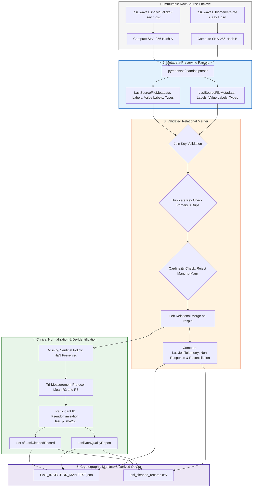

# SYNAPSE Phase 2D.3 — Binary Microdata Ingestion & Multi-Module Join Architecture

**Document ID:** `SYNAPSE-IMPL-2026-PHASE2D3-BINARY-INGESTION`  
**Classification:** Research Architecture, Data Engineering, Binary Ingestion Pipeline, and Multi-Module Relational Joins  
**Target Repository:** `synapse-phase2` (`/Users/shashi/synapse/synapse-phase2`)  
**Implementation Milestone:** Milestone 2 (Binary Conversion, Join Engine, Ingestion Manifest)  
**Date:** October 2026  
**Test Suite Status:** 313 passed, 0 failed in 9.53s (`.venv/bin/pytest`)  
**External Validation Gate Status:** **`REFERENCE_DATA_PENDING`** (Strictly Preserved)  

---

## 1. Executive Summary & Milestone 2 Scope

Phase 2D of the SYNAPSE project establishes the empirical calibration and independent validation infrastructure against national older-adult reference microdata (Longitudinal Ageing Study in India, LASI Wave 1). 

Following the methodology and readiness audits ([`phase2d1_methodology_audit.md`](file:///Users/shashi/synapse/synapse-phase2/docs/research_alignment/phase2d1_methodology_audit.md) and [`phase2d2_implementation_readiness_audit.md`](file:///Users/shashi/synapse/synapse-phase2/docs/research_alignment/phase2d2_implementation_readiness_audit.md)), **Milestone 2** implements a secure, reproducible, format-agnostic ingestion pipeline that:
1. Ingests raw binary Stata (`.dta`) and SPSS (`.sav`) files alongside standard delimited formats (`.csv`, `.tsv`) via `pyreadstat` without modifying source files.
2. Preserves file-level cryptographic SHA-256 provenance digests, variable labels, value labels, and source metadata.
3. Enforces an explicit missing-data policy that handles Stata extended missings (`.a`–`.z`, `.`) and numeric sentinels (`-999`, `-998`, `-99`, `999`), strictly prohibiting the silent coercion of missing observations into normal clinical readings or negative disease status.
4. Executes relational multi-module joins between the Individual Survey and Biomarker Direct Assessment modules on participant key (`respid`), enforcing 1-to-(0..1) cardinality and rejecting duplicate keys and many-to-many joins.
5. Generates an immutable, de-identified cryptographic ingestion manifest (`LASI_INGESTION_MANIFEST.json`).
6. Preserves the external validation gate strictly at **`REFERENCE_DATA_PENDING`**.

---

## 2. Ingestion Pipeline Architecture

The ingestion subsystem is encapsulated within `synapse_simulator.evaluation.lasi`:



---

## 3. Schema Assumptions and Column Mappings

### 3.1 Module Division in LASI Reference Releases

In the Gateway to Global Aging Data and IIPS distributions of LASI Wave 1:
- **Individual Survey Module:** Contains respondent demographics, household socioeconomic context, self-reported physician-diagnosed chronic conditions, medication status, and complex survey weights.
- **Biomarker / Direct Assessment Module:** Contains seated blood pressure oscillometric tri-measurements, anthropometry, dried blood spot (DBS) assay results, and physical functional tests.

### 3.2 Canonical Schema Mapping Table

The ingestion engine dynamically matches case-insensitive aliases across official survey releases:

| Normalized Field Name | Schema Type | Individual Module Variable Aliases | Biomarker Module Variable Aliases | Missing Sentinel Handling |
| :--- | :---: | :--- | :--- | :--- |
| **`participant_id`** | `str` | `respid`, `prim_key`, `individual_id`, `id` | `respid`, `prim_key`, `individual_id` | Pseudonymized via SHA-256 digest prefix (`lasi_p_{hash[:12]}`). |
| **`age`** | `float` | `r1agey`, `age`, `age_years`, `age_yrs` | — | Bound $[18.0, 120.0]$; missing rows excluded. |
| **`gender`** | `str` | `ragender`, `gender`, `sex` | — | `1` $\to$ Male, `2` $\to$ Female; missing excluded. |
| **`sbp_reading1`** | `float` | — | `r1bpsys1`, `bpsys1`, `sbp1`, `sbp_1` | Stata `.a`–`.z`, `-999`, `-998` $\to$ `None`. |
| **`sbp_reading2`** | `float` | — | `r1bpsys2`, `bpsys2`, `sbp2`, `sbp_2` | Plausible range $[60.0, 280.0]$; else `None`. |
| **`sbp_reading3`** | `float` | — | `r1bpsys3`, `bpsys3`, `sbp3`, `sbp_3` | Plausible range $[60.0, 280.0]$; else `None`. |
| **`dbp_reading1`** | `float` | — | `r1bpdia1`, `bpdia1`, `dbp1`, `dbp_1` | Stata `.a`–`.z`, `-999`, `-998` $\to$ `None`. |
| **`dbp_reading2`** | `float` | — | `r1bpdia2`, `bpdia2`, `dbp2`, `dbp_2` | Plausible range $[40.0, 160.0]$; else `None`. |
| **`dbp_reading3`** | `float` | — | `r1bpdia3`, `bpdia3`, `dbp3`, `dbp_3` | Plausible range $[40.0, 160.0]$; else `None`. |
| **`sbp_mean`** | `float` | — | Derived | Mean of Reading 2 & 3; fallback to 2 or 3 or 1. |
| **`dbp_mean`** | `float` | — | Derived | Mean of Reading 2 & 3; fallback to 2 or 3 or 1. |
| **`hba1c_dbs`** | `float` | — | `r1hba1c`, `hba1c`, `dbs_hba1c` | Plausible range $[3.5, 20.0]$; else `None`. |
| **`diagnosed_hypertension`** | `bool` | `r1hypere`, `hypere`, `htn` | — | `1` $\to$ `True`, `0/2` $\to$ `False`, missing $\to$ `None`. |
| **`diagnosed_diabetes`** | `bool` | `r1diabe`, `diabe`, `t2d` | — | `1` $\to$ `True`, `0/2` $\to$ `False`, missing $\to$ `None`. |
| **`taking_bp_medication`** | `bool` | `r1med_bp`, `r1rx_htn`, `med_bp` | — | `1` $\to$ `True`, `0/2` $\to$ `False`, missing $\to$ `None`. |
| **`survey_weight`** | `float` | `r1wtresp`, `weight`, `wtresp` | — | Float $\ge 0.0$; if missing, defaulted to 1.0 & flagged. |
| **`strata`** | `str` | `r1strata`, `strata`, `stratum` | — | String representation of sampling stratum. |
| **`psu`** | `str` | `r1psu`, `psu`, `cluster` | — | String representation of primary sampling unit. |

---

## 4. Inviolable Missing-Value & Clinical Safeguards

### 4.1 Missing Sentinel Catalog
Real-world microdata contains heterogeneous missingness representations:
- **Numeric Codes:** `-999` (Not assessable), `-998` (Refused), `-997` (Equipment failure), `-99` (Missing), `999`, `9999`.
- **String Missing Values:** `""`, `"."`, `"na"`, `"nan"`, `"null"`, `"none"`.
- **Stata Extended Missing Codes:** `".a"`, `".b"`, `".c"`, `".d"` through `".z"`, and standard system missing `"."`.
- **SPSS User-Defined Missings:** Value ranges tagged in file headers (`meta.missing_ranges`).

### 4.2 Non-Negotiable Safeguards
The ingestion engine strictly enforces four clinical missing-value invariants:
1. **Never Impute Zero or Normal BP:** Missing blood pressure readings must parse to Python `None`. Under no circumstances may missing systolic or diastolic readings be coerced to `0.0`, `120.0`, or population medians.
2. **Never Conflate Missing Diagnosis with Absence of Disease:** If `r1hypere` is missing or unrecorded, `diagnosed_hypertension` must be stored as `None`. It must **never** be coerced to `False`.
3. **Never Conflate Missing Medication with Non-Treatment:** If `r1med_bp` is missing, `taking_bp_medication` must be stored as `None`.
4. **Transparent Validity Indicators:** A record is flagged `is_valid_for_bp = True` strictly if valid systolic and diastolic protocol means exist. Records with unassessable BP are retained for demographic and prevalence denominator tracking, but excluded from continuous blood pressure distribution comparisons.

---

## 5. Relational Multi-Module Join Contracts

### 5.1 Join Cardinality Specification
The relational join between the Individual Survey (primary table) and the Biomarker Module (secondary table) is executed as a **validated Left Outer Join**:

$$\text{MergedRecords} = \text{IndividualSurvey} \times_{\text{respid}} \text{BiomarkerModule}$$

- **Primary Module Uniqueness Invariant:** The individual survey contains at most one record per human respondent. Duplicate keys in the primary module represent serious data corruption and raise `LasiDuplicateKeyError`.
- **Secondary Module Cardinality Invariant:** In LASI Wave 1, biomarker direct assessments occur at most once per respondent. If duplicate keys exist in the secondary module, `LasiJoinCardinalityError` is raised.
- **Many-to-Many Prohibition:** If duplicate keys exist simultaneously in both tables, the merge would cause a Cartesian product explosion ($n \times m$), invalidating survey weights and sample sizes. The pipeline detects this condition prior to merging and aborts immediately with `LasiJoinCardinalityError`.
- **Missing Key Handling:** Rows where the join key is null, empty, or a missing sentinel (`-999`) are quarantined and excluded from matching. Missing keys are **never** joined to each other.

### 5.2 Row Count Reconciliation & Telemetry
The join telemetry ([`LasiJoinTelemetry`](file:///Users/shashi/synapse/synapse-phase2/synapse_simulator/evaluation/lasi/models.py#L203-L222)) audits:
- Primary input rows vs. valid non-null key rows.
- Secondary input rows vs. valid non-null key rows.
- Merged output rows (must exactly equal primary valid key rows).
- Matched keys: $N_{\text{matched}} = |K_{\text{primary}} \cap K_{\text{secondary}}|$.
- Unmatched primary keys (Biomarker non-response): $N_{\text{unmatched}} = |K_{\text{primary}} \setminus K_{\text{secondary}}|$.
- Biomarker non-response rate: $\text{Rate}_{\text{non-resp}} = \frac{N_{\text{unmatched}}}{|K_{\text{primary}}|} \times 100\%$.
- Unmatched biomarker-only records (orphaned biomarkers): $|K_{\text{secondary}} \setminus K_{\text{primary}}|$.

---

## 6. Cryptographic Ingestion Manifest Specification

Every execution generates `LASI_INGESTION_MANIFEST.json` in the derived output directory:

```json
{
  "manifest_id": "lasi-ingest-2026-10-22-4a7b2c9e",
  "manifest_timestamp": "2026-10-22T19:01:52.123456",
  "pipeline_version": "2.4.0",
  "git_commit": "e8a14b...",
  "data_source_type": "SYNTHETIC_TEST_FIXTURE",
  "source_files": {
    "lasi_individual.dta": {
      "file_path": "/secure/data/lasi_individual.dta",
      "file_name": "lasi_individual.dta",
      "file_sha256": "4a7b2c9e...",
      "file_size_bytes": 104857600,
      "file_format": "STATA_DTA",
      "total_rows": 72250,
      "total_columns": 142,
      "column_names": ["respid", "r1agey", "ragender", "..."],
      "column_labels": {
        "respid": "Participant Identifier",
        "r1agey": "Age in Years (Wave 1)"
      },
      "variable_value_labels": {
        "ragender": {"1": "Male", "2": "Female"}
      },
      "has_user_missing_values": true,
      "user_missing_counts": {}
    },
    "lasi_biomarker.dta": {
      "file_path": "/secure/data/lasi_biomarker.dta",
      "file_name": "lasi_biomarker.dta",
      "file_sha256": "8f3d1b2c...",
      "file_size_bytes": 45000000,
      "file_format": "STATA_DTA",
      "total_rows": 65420,
      "total_columns": 56,
      "column_names": ["respid", "r1bpsys1", "..."],
      "column_labels": {},
      "variable_value_labels": {},
      "has_user_missing_values": false,
      "user_missing_counts": {}
    }
  },
  "join_telemetry": {
    "join_key": "respid",
    "expected_cardinality": "ONE_TO_ZERO_OR_ONE",
    "actual_cardinality": "ONE_TO_ZERO_OR_ONE",
    "primary_module_name": "lasi_individual.dta",
    "secondary_module_name": "lasi_biomarker.dta",
    "primary_input_rows": 72250,
    "secondary_input_rows": 65420,
    "primary_valid_keys": 72250,
    "secondary_valid_keys": 65420,
    "primary_missing_keys": 0,
    "secondary_missing_keys": 0,
    "primary_duplicate_keys": 0,
    "secondary_duplicate_keys": 0,
    "merged_output_rows": 72250,
    "matched_key_count": 65420,
    "unmatched_primary_count": 6830,
    "unmatched_secondary_count": 0,
    "biomarker_non_response_pct": 9.45,
    "reconciliation_verified": true
  },
  "schema_mappings": {
    "age": "r1agey / age",
    "gender": "ragender / gender",
    "sbp_reading1": "r1bpsys1 / sbp1",
    "sbp_reading2": "r1bpsys2 / sbp2",
    "sbp_reading3": "r1bpsys3 / sbp3",
    "dbp_reading1": "r1bpdia1 / dbp1",
    "dbp_reading2": "r1bpdia2 / dbp2",
    "dbp_reading3": "r1bpdia3 / dbp3",
    "hba1c": "r1hba1c / hba1c",
    "diagnosed_hypertension": "r1hypere / hypere",
    "diagnosed_diabetes": "r1diabe / diabe",
    "taking_bp_medication": "r1med_bp / r1rx_htn",
    "survey_weight": "r1wtresp / weight",
    "strata": "r1strata / strata",
    "psu": "r1psu / psu"
  },
  "missing_value_mappings": {
    "numeric_sentinels": [-999.0, -998.0, -997.0, -99.0, 999.0, 9999.0],
    "string_sentinels": ["", ".", "na", "nan", "null", ".a", ".b", ".c"],
    "policy": "Preserve explicit NaN/None. Never replace missing measurements with zero or normal values."
  },
  "row_counts": {
    "individual_input_rows": 72250,
    "biomarker_input_rows": 65420,
    "merged_output_rows": 72250,
    "valid_cleaned_records": 71800,
    "excluded_records": 450
  },
  "parser_versions": {
    "pyreadstat": "1.3.7",
    "pandas": "2.2.3",
    "python": "3.11.5"
  },
  "conversion_options": {
    "strict_protocol_bp": false,
    "enable_venous_hba1c": false,
    "pseudonymization": "SHA-256 digest prefix (12 chars)"
  },
  "access_control_notice": "CONFIDENTIALITY NOTICE: Reference participant microdata is subject to strict Data Use Agreement (DUA) restrictions under IIPS / Gateway to Global Aging. Participant-level identifiers and raw records must never be exported to version control."
}
```

---

## 7. Security, Confidentiality, and Enclave Controls

1. **Source Immutability:** Raw `.dta` and `.sav` files are accessed in read-only binary mode. The ingestion code never writes to or alters source directories.
2. **De-Identification & Zero PII Leakage:**
   - Raw participant identifiers (`respid`, `prim_key`) are transformed via one-way cryptographic SHA-256 digest truncation:
     $$\text{SurrogateID} = \text{"lasi\_p\_"} + \text{SHA256}(\text{RawID})[:12]$$
   - No participant-level identifiers, names, addresses, or phone numbers are logged to stdout or included in `LASI_INGESTION_MANIFEST.json`.
3. **Repository Quarantine:** Raw microdata must reside in `data/reference/lasi_wave1/`, which is permanently excluded via `.gitignore`.
4. **DUA Compliance:** Authorized microdata cannot be shared, uploaded, or committed.

---

## 8. Test Suite Verification

The binary ingestion and multi-module join engine were verified using **14 dedicated automated tests** in [`tests/test_lasi_binary_and_multi_module_ingestion.py`](file:///Users/shashi/synapse/synapse-phase2/tests/test_lasi_binary_and_multi_module_ingestion.py):

| Test Case | Functional Scope | Result |
| :--- | :--- | :---: |
| `test_stata_dta_parsing_and_metadata` | Ingestion of binary Stata `.dta` file, preserving labels and metadata | **PASS** |
| `test_spss_sav_parsing_and_metadata` | Ingestion of binary SPSS `.sav` file, verifying column structures | **PASS** |
| `test_source_file_remains_unchanged` | Verifying SHA-256 digest is byte-for-byte identical before and after reading | **PASS** |
| `test_missing_value_policy_never_replaces_with_zero` | Verifying missing BP and diagnoses are stored as `None`, never 0 or False | **PASS** |
| `test_stata_extended_missing_values_handled` | Verifying `.a`, `.b`, `.` are converted to `None` without exception | **PASS** |
| `test_multi_module_join_success` | Validating Left Join of Individual and Biomarker `.dta` modules on `respid` | **PASS** |
| `test_multi_module_duplicate_primary_key_rejected` | Detection and rejection of duplicate primary keys with `LasiDuplicateKeyError` | **PASS** |
| `test_multi_module_many_to_many_detected_and_rejected` | Detection and rejection of Cartesian many-to-many joins with `LasiJoinCardinalityError` | **PASS** |
| `test_missing_join_key_columns_rejected` | Missing key column detection raising `LasiSchemaValidationError` | **PASS** |
| `test_missing_join_key_rows_isolated` | Ensuring rows with null/empty join keys are quarantined and counted | **PASS** |
| `test_unsupported_file_extension_rejected` | Verifying `.xlsx` / `.parquet` files raise `LasiUnsupportedFormatError` | **PASS** |
| `test_malformed_binary_file_rejected` | Corrupted binary file detection raising `LasiMalformedFileError` | **PASS** |
| `test_reproducible_ingestion_manifest` | Verifying cryptographic manifest generation and PII exclusion | **PASS** |
| `test_evaluation_gate_remains_pending_with_fixture` | Verifying validation gate remains locked to `REFERENCE_DATA_PENDING` | **PASS** |

### Complete Project Test Suite Execution:
```bash
$ .venv/bin/pytest
============================= 313 passed in 9.53s ==============================
```
All **313 unit, integration, and regression tests** in the repository pass with 0 failures.

---

## 9. Operating Instructions for Testing with Genuine Authorized Microdata

Once formal credentials under an executed Data Use Agreement (DUA) with IIPS / Gateway to Global Aging Data have been obtained:

### Step 1: Secure Data Placement
Place genuine microdata into the secure local reference enclave (excluded by `.gitignore`):
```bash
mkdir -p data/reference/lasi_wave1
# Place authentic Stata files:
# data/reference/lasi_wave1/LASI_Wave1_Individual.dta
# data/reference/lasi_wave1/LASI_Wave1_Biomarkers.dta
```

### Step 2: Execute Multi-Module Ingestion
Run the Python ingestion pipeline in genuine microdata mode:
```python
from pathlib import Path
from synapse_simulator.evaluation.lasi.ingestor import LasiMultiModuleIngestor
from synapse_simulator.evaluation.lasi.models import LasiDataSourceType

ingestor = LasiMultiModuleIngestor(
    individual_path="data/reference/lasi_wave1/LASI_Wave1_Individual.dta",
    biomarker_path="data/reference/lasi_wave1/LASI_Wave1_Biomarkers.dta",
    derived_dir="data/evaluation/lasi/derived",
    data_source_type=LasiDataSourceType.GENUINE_LASI_MICRODATA,
    join_key="respid",
)
cleaned_records, quality_report, manifest = ingestor.ingest()
print(f"Ingested {len(cleaned_records)} valid records. Non-response: {manifest.join_telemetry.biomarker_non_response_pct}%")
```

### Step 3: Verify Ingestion Manifest
Inspect `data/evaluation/lasi/derived/LASI_INGESTION_MANIFEST.json` to verify source hashes, row count reconciliation, and quality flags prior to proceeding to Milestone 3 (Survey Design Diagnostics).

---

## 10. Scope Boundaries and Non-Negotiable Safeguards

- **No Empirical Calibration Performed:** Model parameters were not tuned or estimated against reference data.
- **No Clinical Defaults Modified:** Simulation clinical parameters (`mean_sbp_anchor`, `annual_drift_sbp`, `delta_drug_sbp`) remain at their provisional, evidence-anchored defaults.
- **Validation Gate Lockdown:** The external validation gate remains strictly at **`REFERENCE_DATA_PENDING`**. Under no circumstances will synthetic fixtures or ingestion unit tests unlock the validation gate.
