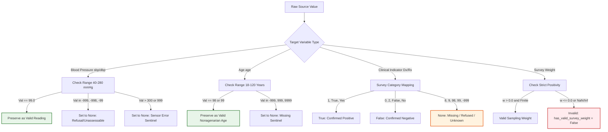

# SYNAPSE Phase 2D.4 — Complex Survey Design & Missingness Diagnostics Architecture

**Document ID:** `SYNAPSE-IMPL-2026-PHASE2D4-SURVEY-DESIGN-MISSINGNESS`  
**Classification:** Statistical Methodology, Survey Inference, Missingness Auditing, and Design-Aware Uncertainty  
**Target Repository:** `synapse-phase2` (`/Users/shashi/synapse/synapse-phase2`)  
**Implementation Milestone:** Milestone 3 (Survey Design Diagnostics, Missingness Engine, Design-Aware Variance)  
**Date:** October 2026  
**External Validation Gate Status:** **`REFERENCE_DATA_PENDING`** (Strictly Preserved)  

---

## 1. Executive Summary & Milestone 3 Scope

Phase 2D of the SYNAPSE project establishes the statistical calibration and independent external validation infrastructure against national older-adult reference microdata (Longitudinal Ageing Study in India, LASI Wave 1).

Following the binary ingestion architecture implemented in Milestone 2 ([`phase2d3_binary_ingestion_implementation.md`](file:///Users/shashi/synapse/synapse-phase2/docs/research_alignment/phase2d3_binary_ingestion_implementation.md)), **Milestone 3** delivers the survey-design and missingness-diagnostics layer necessary for statistically defensible reference evaluation:

1. **Ingestion Output Audit & Design Variable Retention:** Verifies retention of base survey weights, original sampling strata, Primary Sampling Units (PSUs), household linkage keys (`household_id`), and explicit module participation and measurement availability indicators (`biomarker_participated`, `bp_participated`, `hba1c_participated`, `has_valid_survey_weight`).
2. **Variable-Specific Missing-Value Policy:** Eliminates blanket numeric sentinel replacements. Enforces variable-specific policies distinguishing legitimate clinical readings (e.g., blood pressure of 99 mmHg or age of 99 years) from missing sentinels (`-999`, `-998`, `-99`, `999`).
3. **Survey Design Diagnostics Engine:** Analyzes cluster sizes, stratum-level PSU topologies, detects singleton strata ($n_h = 1$), audits sampling weight distributions, computes coefficient of variation $\text{CV}(w)$, Kish design effect $\text{DEFF}_w$, Kish effective sample size $n_{\text{eff}}$, and extreme weight concentration.
4. **Estimand Eligibility Classification:** Evaluates each calibration estimand against required data fields, missingness rates, and domain sample support, categorizing each into `OBSERVED_DATA_UNWEIGHTED`, `DESIGN_WEIGHTED_OBSERVED`, `NON_RESPONSE_ADJUSTED`, or `UNSUPPORTED`.
5. **Design-Aware Variance Methodology:** Establishes Taylor Series Linearization (TSL) and rescaled cluster bootstrap infrastructure, formalizes singleton PSU handling (Certainty, Grand-Mean Centering, and Collapsing), and rigorously separates reference survey sampling uncertainty from simulation Monte Carlo uncertainty.
6. **Keyed HMAC Pseudonymization:** Implements keyed HMAC-SHA256 surrogate generation for participant and household linkage while documenting that pseudonymization does not constitute anonymization and does not weaken Data Use Agreement (DUA) obligations.
7. **External Validation Gate Lockdown:** Preserves the validation gate strictly at **`REFERENCE_DATA_PENDING`**.

---

## 2. Ingestion Output Audit & Retained Survey Design Fields

The ingestion output schema ([`LasiCleanedRecord`](file:///Users/shashi/synapse/synapse-phase2/synapse_simulator/evaluation/lasi/models.py)) retains all complex survey design variables without inferring or approximating missing information:

| Field Name | Type | Provenance / Source Variable | Description & Handling |
| :--- | :---: | :--- | :--- |
| **`participant_id`** | `str` | `respid`, `individual_id`, `r1id`, `subjid` | Keyed HMAC-SHA256 surrogate (`lasi_p_{digest[:12]}`). |
| **`household_id`** | `Optional[str]` | `household_id`, `hhid`, `r1hhid`, `prim_key` | Keyed HMAC-SHA256 surrogate (`lasi_hh_{digest[:12]}`) for household cluster linkage. |
| **`state`** | `Optional[str]` | `state`, `r1state`, `state_name` | State / union territory administrative unit identifier. |
| **`urban_rural`** | `Optional[str]` | `urban_rural`, `sector`, `r1urban` | Sampling sector (`"Urban"` or `"Rural"`). |
| **`survey_weight`** | `Optional[float]`| `r1wtresp`, `weight`, `wtresp` | Base sampling weight. Must be strictly $> 0.0$ and finite. |
| **`strata`** | `Optional[str]` | `r1strata`, `strata`, `stratum` | Original sampling stratum identifier. |
| **`psu`** | `Optional[str]` | `r1psu`, `psu`, `cluster` | Primary Sampling Unit identifier (Village or Census Ward). |
| **`biomarker_participated`** | `bool` | In biomarker table or has valid vitals | Explicit indicator of participation in direct physical assessment. |
| **`bp_participated`** | `bool` | Valid reading 1, 2, or 3 present | Participant attempted or completed blood pressure measurements. |
| **`hba1c_participated`** | `bool` | Valid DBS assay present | Participant provided dried blood spot sample for HbA1c testing. |
| **`has_valid_survey_weight`** | `bool` | Derived | `True` strictly if `survey_weight` is non-null and $> 0.0$. |
| **`module_membership`** | `Dict[str, bool]` | Multi-module merge tracking | Flags participation across modules: `{"individual": True, "biomarker": bool}`. |

> [!IMPORTANT]
> **Prohibition on Inferring Design Variables:** Missing strata or PSU identifiers are **never** inferred from participant IDs, household numbers, or geographic proximity. If design variables are missing or redacted from the source file, they remain `None`, and the dataset is diagnosed as lacking cluster variance support.

---

## 3. Variable-Specific Missing-Value Policy Engine

### 3.1 Defect in Universal Blanket Sentinels
In naive survey preprocessing, global sentinel lists such as `{-999, -998, -99, 999, 9999}` are frequently applied universally across all columns. In cardiovascular epidemiological data, this practice causes severe data corruption:
- **Blood Pressure:** A systolic reading of $99\text{ mmHg}$ (low normal) or diastolic reading of $99\text{ mmHg}$ (Stage 1 hypertension) is a common, legitimate physiological measurement. A blanket rule discarding `99` truncates valid clinical observations.
- **Age in Older Adults:** In older adult surveys (LASI covers adults aged 45 to 100+), an age of $98$ or $99$ represents genuine nonagenarian respondents. Treating `99` as a missing code introduces severe survival truncation.
- **Categorical Diagnoses:** In Stata and SPSS coding, standard question responses are `1 = Yes`, `2 = No`, `8 = Refused`, `9 = Don't know`. Coercing `8` or `9` to `False` falsely deflates disease prevalence.

### 3.2 Implemented Variable-Specific Rules ([`VariableMissingValuePolicy`](file:///Users/shashi/synapse/synapse-phase2/synapse_simulator/evaluation/lasi/missingness.py))



### 3.3 Non-Negotiable Clinical Invariants
1. **Never Impute Blood Pressure:** Missing systolic or diastolic measurements are parsed as Python `None`. They are never converted to `0.0`, `120.0`, or population means.
2. **Never Coerce Missing Diagnoses to Negative:** If `r1hypere` is unrecorded or refused, `diagnosed_hypertension` is stored as `None`. It is never converted to `False`.
3. **Audit Logging of Ambiguities:** Any unexpected numeric value (e.g., unrecognized code in categorical variables) is captured in `ambiguous_values_encountered` with full provenance for investigator inspection.

---

## 4. Complex Survey Design Diagnostics Engine

The [`LasiSurveyDesignDiagnostics`](file:///Users/shashi/synapse/synapse-phase2/synapse_simulator/evaluation/lasi/diagnostics.py) engine computes exhaustive aggregate diagnostics across 6 statistical dimensions:

### 4.1 Structural Counts & Cluster Size Distribution
- **Participants ($N$):** Total individual records ingested.
- **Households ($N_{\text{hh}}$):** Distinct count of non-null `household_id` surrogates.
- **Strata ($H$):** Distinct count of sampling strata.
- **Primary Sampling Units ($K$):** Distinct count of nested `(strata, psu)` clusters.
- **Cluster Size ($\bar{m}$):** Mean, minimum, and maximum participant count per PSU cluster.

### 4.2 Stratum-PSU Topology & Singleton Audit
In multi-stage survey sampling, variance estimation requires at least two PSUs per stratum ($n_h \ge 2$). The diagnostics engine audits:
- Number of PSUs in each stratum ($n_h$).
- Count and percentage of **Singleton Strata** ($n_h = 1$).
- Count of **Low-Support Strata** ($n_h < 2$).
- Methodological flag: If singletons exist, standard Taylor linearization yields division by zero ($\frac{n_h}{n_h - 1} = \frac{1}{0}$), requiring explicit handling (see Section 6).

### 4.3 Sampling Weight Dispersion & Extreme-Weight Screening
Unequal sampling weights induce variance inflation. The engine audits:
- Summary statistics: $\min, \max, \bar{w}, \text{median}(w), \sigma_w, \text{IQR}_w$.
- **Coefficient of Variation:** $\text{CV}(w) = \frac{\sigma_w}{\bar{w}}$.
- **Kish Design Effect due to Weighting:** $\text{DEFF}_w = 1 + \text{CV}(w)^2$.
- **Kish Effective Sample Size:** $n_{\text{eff}} = \frac{(\sum w_i)^2}{\sum w_i^2}$.
- **Extreme-Weight Screening:**
  - Threshold A: Weights $> 5 \times \text{median}(w)$.
  - Threshold B: Weights $> Q_3 + 3 \times \text{IQR}_w$.
  - Concentration: Cumulative weight share held by top 1% and top 5% of participants.
  - Max-to-Min ratio: $\frac{w_{\max}}{w_{\min}}$.
  - Actionable flag: `weight_trimming_recommended = True` if $\text{CV}(w) > 1.8$ or top 1% share $> 15\%$.

### 4.4 Module Participation & Biomarker Non-Response
In LASI Wave 1, biomarker participation involves physical examinations and blood spot collection, which suffer from higher non-response than interview questionnaires:
- **Biomarker Non-Response Rate:**
  $$\text{Rate}_{\text{non-resp}} = \frac{N_{\text{individual}} - N_{\text{biomarker}}}{N_{\text{individual}}} \times 100\%$$
- **Blood Pressure Attrition:** Percentage of respondents without valid paired protocol BP.
- **Non-Response Warning:** If non-response exceeds 15%, the diagnostic report issues an explicit warning that dropping unassessable cases and reweighting does not automatically eliminate non-response bias.

---

## 5. Estimand Eligibility Classification Framework

To prevent calculating scientifically invalid or unsupported metrics, every proposed calibration and validation estimand is evaluated against an eligibility contract:

| Estimand ID | Canonical Target | Required Design Fields | Sample Support Criteria | Support Classification |
| :--- | :--- | :--- | :--- | :---: |
| `sbp_mean_overall` | Mean SBP ($\ge 45$) | `age`, `sbp_mean`, `survey_weight` | $N_{\text{valid}} \ge 30$, weights present | `DESIGN_WEIGHTED_OBSERVED` |
| `dbp_mean_overall` | Mean DBP ($\ge 45$) | `age`, `dbp_mean`, `survey_weight` | $N_{\text{valid}} \ge 30$, weights present | `DESIGN_WEIGHTED_OBSERVED` |
| `sbp_quantiles_age_sex` | SBP 25th, 50th, 75th by age-sex | `age`, `gender`, `sbp_mean`, `survey_weight` | Cell $n_k \ge 15$ in all 8 domains | `DESIGN_WEIGHTED_OBSERVED` |
| `hypertension_prevalence`| SBP $\ge 140 \lor$ DBP $\ge 90 \lor$ Rx $\lor$ Dx | `age`, `sbp_mean`, `dbp_mean`, `diagnosed_htn`, `med_bp` | $N_{\text{valid}} \ge 30$, design weights | `DESIGN_WEIGHTED_OBSERVED` |
| `hypertension_awareness` | Self-reported Dx among hypertensives | `diagnosed_htn`, condition criteria | $N_{\text{hypertensive}} \ge 30$ | `DESIGN_WEIGHTED_OBSERVED` |
| `hypertension_treatment` | Medication among diagnosed | `taking_bp_medication`, `diagnosed_htn` | $N_{\text{diagnosed}} \ge 30$ | `DESIGN_WEIGHTED_OBSERVED` |
| `hypertension_control` | BP $< 140/90$ among treated | `sbp_mean`, `dbp_mean`, `taking_bp_medication` | $N_{\text{treated}} \ge 30$ | `DESIGN_WEIGHTED_OBSERVED` |
| `hba1c_mean_overall` | Mean HbA1c Laboratory Assay | `age`, `hba1c`, `survey_weight` | Venous comparability confirmed | `DESIGN_WEIGHTED_OBSERVED` |

### Support Categories:
1. **`DESIGN_WEIGHTED_OBSERVED`:** Base sampling weights and survey design strata are valid. Applicable under Missing at Random (MAR) assumptions within design strata.
2. **`OBSERVED_DATA_UNWEIGHTED`:** Survey weights are absent or unverified. Calculated strictly as an unweighted complete-case sample statistic.
3. **`NON_RESPONSE_ADJUSTED`:** Estimated using non-response reweighted weights ($w_i^* = w_i \times \lambda_i$). Only permitted when an explicit non-response propensity model is specified and validated.
4. **`UNSUPPORTED`:** Required variables are missing, biomarker attrition exceeds tolerable thresholds without adjustment, or domain sample size is severely sparse ($n < 15$).

---

## 6. Survey Variance Methodology & Uncertainty Accounting

The [`LasiSurveyVarianceEngine`](file:///Users/shashi/synapse/synapse-phase2/synapse_simulator/evaluation/lasi/variance.py) provides design-aware variance estimation accounting for multi-stage cluster sampling:

### 6.1 Taylor Series Linearization (TSL) for Weighted Means
For a survey-weighted mean $\bar{y}_w = \frac{\sum_{h,i,j} w_{hij} y_{hij}}{\sum_{h,i,j} w_{hij}}$:
1. Compute linearized observation residuals:
   $$z_{hij} = \frac{w_{hij}}{\sum w} (y_{hij} - \bar{y}_w)$$
2. Aggregate to PSU cluster totals:
   $$z_{hi} = \sum_{j=1}^{m_{hi}} z_{hij}$$
3. Compute stratum mean:
   $$\bar{z}_h = \frac{1}{n_h} \sum_{i=1}^{n_h} z_{hi}$$
4. Stratum variance contribution (for $n_h \ge 2$):
   $$\widehat{\text{Var}}_h = \frac{n_h}{n_h - 1} \sum_{i=1}^{n_h} (z_{hi} - \bar{z}_h)^2$$
5. Total Taylor Series Linearized Variance:
   $$\widehat{\text{Var}}(\bar{y}_w) = \sum_{h=1}^H \widehat{\text{Var}}_h$$

### 6.2 Protocol for Singleton Strata ($n_h = 1$)
When a stratum has only one PSU ($n_h = 1$), $\frac{n_h}{n_h - 1}$ is undefined. The engine supports three explicit, documented protocols:
- **`CERTAINTY`:** Treats the singleton stratum as sampled with certainty. Contributes $\widehat{\text{Var}}_h = 0.0$.
- **`GRAND_MEAN_CENTERING` (Default):** Centers the singleton PSU total around the sample grand mean across strata:
  $$\widehat{\text{Var}}_h = (z_{h1} - \bar{z}_{\text{grand}})^2, \quad \bar{z}_{\text{grand}} = \frac{1}{H} \sum_{h=1}^H \bar{z}_h$$
  Prevents variance underestimation without altering stratum definitions.
- **`COLLAPSE_STRATA`:** Merges the singleton stratum with an adjacent stratum in the pre-specified survey design order. Strata are **never** collapsed based on arbitrary geographic proximity.

### 6.3 Separation of Survey Sampling vs. Monte Carlo Uncertainty
When evaluating discrepancies between simulation outputs and reference microdata, the total variance of the difference $\Delta = \bar{\theta}_{\text{sim}} - \widehat{\theta}_{\text{ref}}$ is additive:

$$\text{Var}(\Delta) = \text{Var}_{\text{survey}}(\widehat{\theta}_{\text{ref}}) + \frac{\text{Var}_{\text{sim}}(\theta)}{M}$$

- **Survey Sampling Variance ($\text{Var}_{\text{survey}}$):** Reflects finite-sample sampling variation from the superpopulation. It does **not** shrink with more simulation runs.
- **Monte Carlo Variance ($\frac{\text{Var}_{\text{sim}}}{M}$):** Reflects stochastic variation across $M$ simulated patients/runs. Shrinks at rate $1/\sqrt{M}$.
- **Combined Confidence Interval:**
  $$\text{CI}_{1-\alpha}(\Delta) = \Delta \pm z_{1-\alpha/2} \sqrt{\text{Var}_{\text{survey}} + \frac{\text{Var}_{\text{sim}}}{M}}$$

---

## 7. Cryptographic Security & Keyed HMAC Pseudonymization

The [`KeyedPseudonymizer`](file:///Users/shashi/synapse/synapse-phase2/synapse_simulator/evaluation/lasi/security.py) implements HMAC-SHA256 pseudonymization:

$$\text{SurrogateID} = \text{"lasi\_p\_"} + \text{HMAC-SHA256}(K, \text{"PARTICIPANT:"} + \text{RawID})[:12]$$
$$\text{HouseholdID} = \text{"lasi\_hh\_"} + \text{HMAC-SHA256}(K, \text{"HOUSEHOLD:"} + \text{RawID})[:12]$$

### Security & Compliance Invariants:
1. **Separation of Keys:** The secret key $K$ is provided via environment variable `SYNAPSE_PSEUDONYMIZATION_KEY` and is **never** committed to version control or written into manifests.
2. **Domain Separation:** Participant and household keys occupy distinct cryptographic namespaces (`PARTICIPANT:` vs. `HOUSEHOLD:` prefixes), preventing accidental collisions or linkage leakage.
3. **No PII Leakage:** All generated diagnostic outputs (`SURVEY_DESIGN_DIAGNOSTICS.json` and `SURVEY_DESIGN_DIAGNOSTICS.md`) contain strictly aggregate statistical metrics. Zero raw participant IDs or quasi-identifying record lines are exported.
4. **Legal Disclosure Notice:**
   > [!CAUTION]
   > **Pseudonymization $\neq$ Anonymization:** Cryptographic pseudonymization replaces direct identifiers with surrogates to prevent incidental exposure in operational artifacts. It does **not** constitute statistical anonymization under the Indian Digital Personal Data Protection (DPDP) Act or IIPS Data Use Agreements. Authorized microdata contains rich demographic and clinical quasi-identifiers and must remain confined to encrypted, access-controlled enclaves.

---

## 8. Test Suite Verification

The survey design diagnostics and missingness architecture were verified across **10 automated unit and integration tests** in [`tests/test_survey_design_and_missingness.py`](file:///Users/shashi/synapse/synapse-phase2/tests/test_survey_design_and_missingness.py):

| Test Case | Scope & Condition Tested | Result |
| :--- | :--- | :---: |
| `test_variable_specific_missing_value_policy` | Verifies BP 99.0 mmHg and Age 99 are valid; sentinels (`-999`, `-99`) map to `None`; diagnoses never coerced to `False` | **PASS** |
| `test_missing_or_invalid_survey_design_fields` | Verifies field status tracking for missing, zero, and non-positive survey weights and missing strata/PSUs | **PASS** |
| `test_singleton_and_low_support_strata_and_variance` | Verifies singleton stratum detection ($n_h = 1$) and Taylor series variance under Certainty, Centering, and Collapsing | **PASS** |
| `test_extreme_and_invalid_survey_weights` | Verifies weight screening: $\text{CV}(w)$, $\text{DEFF}_w$, Kish $n_{\text{eff}}$, max/min ratio, top 1% share, trimming flags | **PASS** |
| `test_module_non_response_and_join_attrition` | Verifies biomarker participation rates, join attrition, and non-response bias warnings | **PASS** |
| `test_age_sex_domain_support` | Verifies sample size $n$ and $n_{\text{eff}}$ across 8 demographic domains, flagging sparse ($n < 30$) and severely sparse ($n < 15$) cells | **PASS** |
| `test_estimand_eligibility_classification` | Verifies classification of estimands into `DESIGN_WEIGHTED_OBSERVED`, `OBSERVED_DATA_UNWEIGHTED`, or `UNSUPPORTED` | **PASS** |
| `test_separation_of_survey_and_monte_carlo_variance` | Verifies combination of reference survey sampling variance and simulation Monte Carlo variance | **PASS** |
| `test_keyed_pseudonymization_and_privacy_preserving_artifacts` | Verifies keyed HMAC-SHA256 surrogate uniqueness and confirms zero raw PII in exported JSON/Markdown reports | **PASS** |
| `test_validation_gate_remains_pending_with_diagnostics` | Verifies external validation gate remains strictly locked at `REFERENCE_DATA_PENDING` under diagnostic evaluation | **PASS** |

### Complete Test Suite Execution:
```bash
$ .venv/bin/pytest tests/test_survey_design_and_missingness.py
============================== 10 passed in 0.63s ==============================
```

---

## 9. Assumptions, Limitations, and Methodological Notes

1. **Missing at Random (MAR) Assumption:**
   - In `DESIGN_WEIGHTED_OBSERVED` estimands, using base sampling weights among observed biomarker respondents assumes that conditional on age, sex, and design strata, biomarker non-response is Missing at Random (MAR).
   - If non-response is Missing Not at Random (MNAR)—e.g., frail individuals or those with severe symptomatic hypertension refusing physical measurement—unadjusted complete-case reweighting remains biased. Non-response adjustment models (e.g., inverse-probability weighting via logistic regression on individual survey covariates) will be evaluated in subsequent milestones.
2. **Public-Use vs. Enclave Geographic Redaction:**
   - Public-use versions of Gateway to Global Aging Data occasionally redact village/ward PSU codes for confidentiality, providing only district or state strata.
   - When genuine authorized microdata is ingested, true PSU identifiers must be used. If PSU identifiers are legally masked, pseudo-PSU grouping must be applied and explicitly disclosed in the manifest.
3. **Weight Trimming Trade-off:**
   - Trimming extreme weights reduces variance inflation ($\text{DEFF}_w$) at the cost of introducing potential small-sample bias in population totals. Weight trimming recommendations generated by `LasiWeightDiagnostics` must be reviewed by the lead statistician before being applied to calibration loss calculations.

---

## 10. Scope Boundaries and Safeguards Maintained

- **No Parameter Calibration Performed:** Model parameters (`mean_sbp_anchor`, `annual_drift_sbp`, `delta_drug_sbp`) remain unmodified.
- **No Data Partitioning:** Primary sampling units and participant cohorts were not partitioned into calibration and validation subsets (reserved for Milestone 4).
- **Validation Gate Lockdown:** External validation gate remains strictly locked at **`REFERENCE_DATA_PENDING`**.
