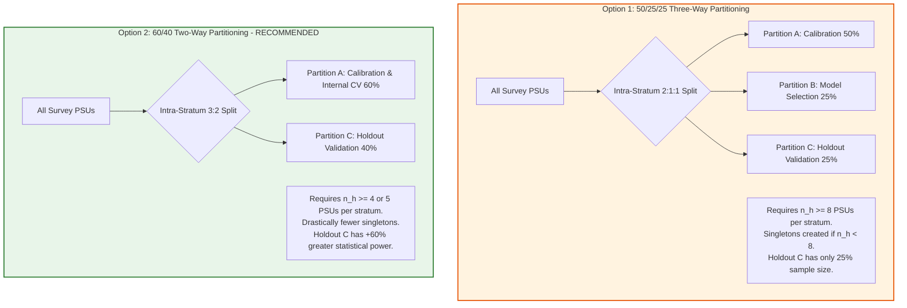
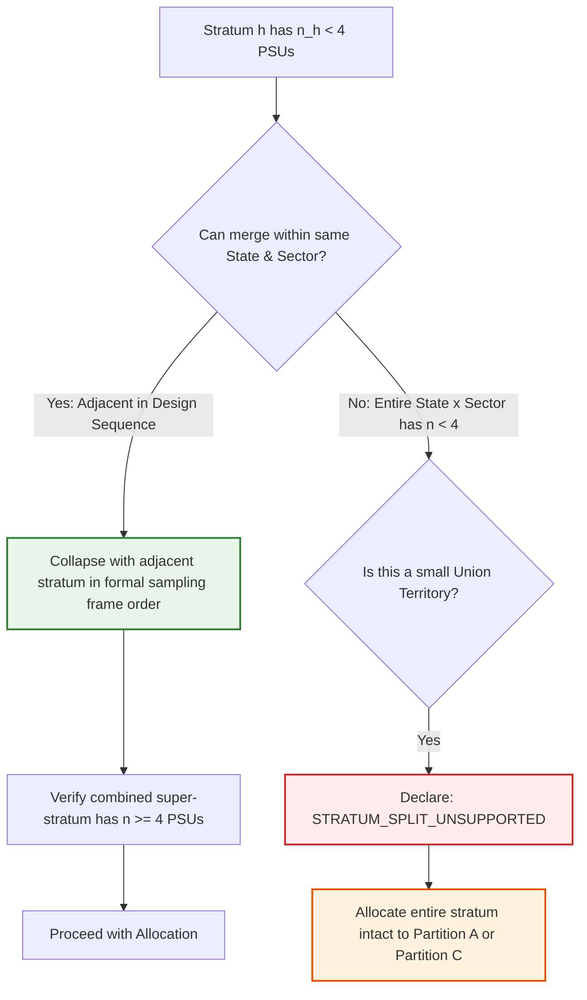
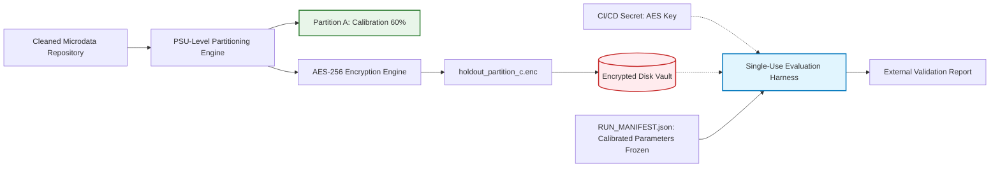

# SYNAPSE Phase 2D.7 — Survey Partitioning Architecture & Decision Specification

**Document ID:** `SYNAPSE-DESIGN-2026-PHASE2D7-PARTITIONING-DECISION`  
**Classification:** Statistical Methodology, Survey Inference, Partitioning Architecture, Stratum Support, and Holdout Governance  
**Target Repository:** `synapse-phase2` (`/Users/shashi/synapse/synapse-phase2`)  
**Implementation Milestone:** Milestone 4 Architectural Decision & Pre-Partitioning Specification  
**Date:** October 2026  
**External Validation Gate Status:** **`REFERENCE_DATA_PENDING`** (Strictly Preserved)  

---

## 1. Executive Summary & Design Decision Objective

Milestone 4 of Phase 2D establishes the empirical data partitioning protocol for the SYNAPSE calibration and external validation pipeline. Before writing or executing partitioning code against authorized microdata, this document resolves critical methodological tensions identified in the Phase 2D.6 audit:

1. **Partitioning Architecture Comparison:** Rigorously contrasts the proposed **50/25/25 PSU-level Three-Way Split** (Calibration Partition A, Model Selection Partition B, Holdout Validation Partition C) against a **60/40 PSU-level Two-Way Split** (Calibration & Internal Cluster Cross-Validation Partition A, Holdout Validation Partition C) across model selection, validation power, variance stability, and degrees of freedom.
2. **Explicit Unverified Status of Microdata Topology:** Formally categorizes all prior reported sample counts, cluster counts, and response rates as **`UNVERIFIED / PENDING AUTHORIZED INGESTION AUDIT`**. Requires the partitioning engine to be dynamically driven by empirical metadata from [`LasiSurveyDesignDiagnostics`](file:///Users/shashi/synapse/synapse-phase2/synapse_simulator/evaluation/lasi/diagnostics.py), rather than hardcoded assumptions.
3. **Small-Stratum Governance:** Rejects naive geographic proximity heuristics for stratum aggregation. Establishes design-sequence collapsing rules and explicit **`UNSUPPORTED`** status criteria for strata with insufficient PSU support.
4. **Survey Weight Adjustment & Post-Stratification Critique:** Refutes uniform scalar weight division ($w_i / p_k$) in favor of stratum-specific inverse-allocation weights ($w_{hij} \cdot \frac{n_h}{n_{h, k}}$). Documents why external Census margin post-stratification distorts standard Taylor linearization variance without generalized regression (GREG) residual adjustments.
5. **Deterministic Allocation & Cryptographic Holdout Isolation:** Formulates HMAC-SHA256 seeded deterministic allocation, strict anti-leakage invariants, covariate balance diagnostics, and single-use AES-256 encrypted holdout storage.
6. **Final Architectural Recommendation & Go/No-Go Decision Matrix:** Recommends the **60/40 PSU-level Two-Way Partitioning Strategy** as the statistically superior design, accompanied by six mandatory Go/No-Go checkpoints.

---

## 2. Comparative Architecture: 50/25/25 Three-Way vs. 60/40 Two-Way Partitioning

The project initially proposed a three-way 50/25/25 split. This section provides an independent mathematical and operational comparison between the 50/25/25 architecture and a 60/40 two-way architecture.



### 2.1 Detailed Dimension-by-Dimension Comparison

| Dimension | 50/25/25 Three-Way Partitioning | 60/40 Two-Way Partitioning (Recommended) | Statistical & Operational Assessment |
| :--- | :--- | :--- | :--- |
| **Model Selection & Hyperparameter Tuning** | Independent physical partition (Partition B, 25%) dedicated to tuning Nelder-Mead simplex tolerances, loss function weights, and convergence criteria. | Model selection is performed **internally within Partition A** using $K$-fold stratified cluster cross-validation or rescaled cluster bootstrap. | **Advantage 60/40.** Internal cluster cross-validation within Partition A is the gold standard in statistical learning. Eliminating a physical Partition B frees $25\%$ of total sample mass to bolster calibration and holdout power. |
| **Holdout Validation Statistical Power** | Partition C receives **25%** of PSUs. | Partition C receives **40%** of PSUs (+60% increase in cluster and respondent count). | **Decisive Advantage 60/40.** A 40% holdout substantially reduces standard errors in sparse older-adult cells (e.g. nonagenarians, unmedicated stage-2 hypertensives), narrowing confidence intervals at the validation gate. |
| **Stratum-Level Support Bottleneck** | Requires **$n_h \ge 8$ PSUs per stratum** for exact $2:1:1$ allocation with $n_{h, \text{part}} \ge 2$. If $n_h < 8$, Partitions B and C suffer high singleton rates ($n_h = 1$). | Requires only **$n_h \ge 4$ or $5$ PSUs per stratum** ($3:2$ or $2:2$) to guarantee $n_{h, \text{part}} \ge 2$ in both partitions. | **Decisive Advantage 60/40.** Lowering the support threshold from $8$ to $4$ PSUs drastically reduces the need to artificially merge or aggregate small survey strata. |
| **Design Degrees of Freedom ($df = K - H$)** | $df$ is severely fragmented across three partitions: $df_B \approx df_{\text{total}}/4$ and $df_C \approx df_{\text{total}}/4$. High singleton counts trigger $df < 12$ warnings in small domains. | $df_C \approx 0.40 \times df_{\text{total}}$. Design degrees of freedom in holdout validation are significantly higher, yielding smaller Student's $t$ multipliers and more stable variance. | **Decisive Advantage 60/40.** Critical for subpopulation validation metrics where small $df$ severely degrades Wald and logit confidence interval stability. |
| **Implementation & Governance Complexity** | High. Requires managing three separate encrypted partitions, three sets of conditional weights, and multi-stage access logging. | Moderate. Requires managing exactly two partitions (Calibration A and Holdout C), with a single cryptographic seal on Partition C. | **Advantage 60/40.** Substantially lowers operational risk and information leakage vectors. |

---

## 3. Microdata Topology: Explicitly Classified as Unverified

> [!WARNING]
> **Prohibition on Assuming Ground-Truth Survey Dimensions:**  
> All previously reported counts (e.g. "72,000 respondents", "2,100 PSUs", "35 states", or specific stratum tallies) derived from public summaries, external papers, or synthetic fixtures are formally declared **`UNVERIFIED / PENDING AUTHORIZED INGESTION AUDIT`**.

### 3.1 Unverified Inventory
1. **Total Sample Count ($N$):** Unverified until computed by `LasiDataIngestor` on genuine authorized `.dta` or `.sav` files under executed DUA.
2. **Stratum-PSU Topology ($H, K, n_h$):** The distribution of PSUs per stratum, count of singleton strata, and low-support strata ($n_h < 8$ or $n_h < 4$) cannot be assumed.
3. **Biomarker Participation Rates:** In-person physical measurement completion (valid blood pressure readings 1, 2, 3) must be audited directly from the data.
4. **Missingness Sentinels:** The frequency of legitimate physiological readings (e.g. SBP 99 mmHg, Age 99) vs missing sentinels must be audited per variable.

### 3.2 Dynamic Partitioning Contract
The partitioning module must **never** hardcode expected stratum names, state lists, or sample thresholds. It must accept as input the verified [`LasiSurveyDesignDiagnosticsReport`](file:///Users/shashi/synapse/synapse-phase2/synapse_simulator/evaluation/lasi/models.py) generated dynamically by [`LasiSurveyDesignDiagnostics.run_diagnostics()`](file:///Users/shashi/synapse/synapse-phase2/synapse_simulator/evaluation/lasi/diagnostics.py#L65).

---

## 4. Small-Stratum Handling & Survey Design Rules

In naive machine learning pipelines, sparse strata are frequently aggregated based on "geographic proximity" (e.g. merging neighboring districts or states). In complex survey statistics, this practice is scientifically indefensible.

### 4.1 Why Geographic Proximity Heuristics are Invalid
- **Violation of Stratification Principle:** In LASI, strata within states are formed based on explicit demographic and socio-economic indicators (e.g. female literacy quartiles, tribal population concentration, agricultural vs industrial economic base).
- **Masking Heterogeneity:** Merging two geographically adjacent strata that have contrasting socio-economic profiles introduces artificial within-stratum variance and violates the assumption of within-stratum homogeneity.
- **Weight Distortion:** Combining strata with different base sampling fractions distorts the Horvitz-Thompson expansion factors and introduces uncontrolled selection bias.

### 4.2 Defensible Design-Based Collapse Rules (Wolter 2007; Kish 1965)

If a stratum has insufficient PSUs to support partitioning ($n_h < 4$ for 60/40 split), the following hierarchical rules must be strictly enforced:



1. **Rule 1 — Invariance of State and Sector:** Strata must **never** be merged across State boundaries or across Urban/Rural sectors. Rural PSUs and Urban PSUs must remain in separate strata under all circumstances.
2. **Rule 2 — Design-Sequence Adjacency:** Strata may only be collapsed with the immediately adjacent stratum in the **pre-specified design order / stratum index** of the survey sampling frame. This reflects the implicit serpentine sorting used by survey statisticians during frame construction.
3. **Rule 3 — Formal Declaration of Unsupported Strata:** If an entire State $\times$ Sector cell contains fewer than 4 PSUs in total (e.g. a small Union Territory with only 2 or 3 PSUs in total), within-stratum splitting is mathematically impossible without creating singletons.
   - The stratum is formally tagged: **`UNSUPPORTED_FOR_INTRA_STRATUM_SPLIT`**.
   - **Protocol for Unsupported Strata:** The entire stratum must be allocated as an indivisible cluster unit to either Partition A (Calibration) or Partition C (Holdout Validation) based on an alternating deterministic hash. It must **not** be split, and domain estimates for that specific UT must be flagged as having asymmetric partition coverage.

---

## 5. Survey Weight Adjustment & Post-Stratification Critique

### 5.1 Refutation of Naive Uniform Weight Adjustment

A common error in survey partitioning is to adjust weights by dividing by the nominal partition proportion:
$$w_i^{(A)} \stackrel{?}{=} \frac{w_i}{0.60}, \quad w_i^{(C)} \stackrel{?}{=} \frac{w_i}{0.40}$$

#### Mathematical Defect:
This naive adjustment assumes that every PSU in the survey had an independent, identical probability $p_k$ of entering Partition $k$. However, in stratified cluster partitioning, allocation is constrained to integer counts within each stratum $h$:
- In a stratum with $n_h = 5$ PSUs: Partition A receives 3 PSUs ($p_{h, A} = 3/5 = 0.60$) and Partition C receives 2 PSUs ($p_{h, C} = 2/5 = 0.40$). Here, nominal proportions match.
- In a stratum with $n_h = 4$ PSUs: Partition A receives 2 PSUs ($p_{h, A} = 2/4 = 0.50$) and Partition C receives 2 PSUs ($p_{h, C} = 2/4 = 0.50$).
- If uniform $1/0.60$ and $1/0.40$ factors are applied to the $n_h = 4$ stratum, Partition A weights are deflated by $\frac{0.50}{0.60} = 0.833$ and Partition C weights are inflated by $\frac{0.50}{0.40} = 1.250$, introducing **artificial stratum-level weighting bias**!

#### Mandated Formula: Stratum-Specific Inverse-Allocation Weights
The conditional sampling weight for observation $j$ in PSU $i$ of stratum $h$ in Partition $k$ must reflect the exact stratum-level inclusion probability:

$$w_{hij}^{(k)} = w_{hij} \times \frac{n_h}{n_{h, k}}$$

where:
- $n_h$ is the total number of PSUs in stratum $h$ in the full survey.
- $n_{h, k}$ is the number of PSUs in stratum $h$ allocated to Partition $k$.

Notice that:
$$\sum_{i \in \text{PSU}_{h, k}} \sum_{j} w_{hij}^{(k)} = \frac{n_h}{n_{h, k}} \sum_{i=1}^{n_{h, k}} w_{hi} \approx \sum_{i=1}^{n_h} w_{hi}$$
This guarantees that each stratum in Partition $k$ correctly expands to represent its full population total without stratum distortion.

### 5.2 Critique of External Census Post-Stratification

It was previously suggested that partition weights should be re-calibrated so that $\sum_{i \in A} w_i = N_{\text{census}}$.

> [!CAUTION]
> **Post-Stratification Distorts Standard Taylor Linearization Variance:**  
> In complex survey inference, post-stratification to external demographic margins (e.g. Census SRS age-sex tables) changes the sampling variance of estimators.  
> Standard Taylor series linearization on post-stratified weights treats the weights as fixed constants, **ignoring the random variability of the post-stratification adjustment itself**. This invalidates standard error formulas unless Generalized Regression (GREG) residuals ($e_{hij} = y_{hij} - \mathbf{x}_{hij}^T \widehat{\mathbf{B}}$) or replicate re-calibration (jackknife/bootstrap) is implemented (Deville & Särndal 1992; Valliant et al. 2013).

#### Mandated Protocol:
1. **Primary Evaluation Weights:** All baseline calibration and holdout evaluations must use the design-consistent inverse-allocation weights $w_{hij}^{(k)} = w_{hij} \cdot \frac{n_h}{n_{h, k}}$.
2. **Census Post-Stratification as Secondary Sensitivity:** Any post-stratification to Census SRS margins must be treated as a secondary sensitivity analysis and must not replace the design-consistent base weights.

---

## 6. Deterministic Allocation, Integrity Protocols & Holdout Governance

### 6.1 Cryptographic Deterministic PSU Allocation

To guarantee 100% bit-level reproducibility across operating systems, Python versions, and runs, PSU assignment must use a keyed cryptographic hash rather than standard pseudo-random number generators:

```python
import hmac
import hashlib

def assign_psu_to_partition(
    state: str,
    urban_rural: str,
    stratum: str,
    psu_id: str,
    partition_key: bytes,
    split_ratio_a: float = 0.60,
) -> str:
    """Deterministically assign a PSU to Partition A (60%) or Partition C (40%)."""
    message = f"{state}:{urban_rural}:{stratum}:{psu_id}".encode("utf-8")
    digest = hmac.new(partition_key, message, hashlib.sha256).hexdigest()
    # Uniform float in [0, 1) from 64-bit integer slice
    norm_val = int(digest[:16], 16) / float(0xFFFFFFFFFFFFFFFF)
    return "PARTITION_A" if norm_val < split_ratio_a else "PARTITION_C"
```

Within each stratum, if exact proportional allocation ($n_{h, A} = \text{round}(n_h \times 0.60)$) is enforced, PSUs within stratum $h$ are sorted by `digest` and the top $n_{h, A}$ are assigned to Partition A, with the remainder assigned to Partition C.

### 6.2 Strict Anti-Leakage Automated Invariants

Prior to admitting Partition A to calibration, the automated pipeline must execute four strict assertions:

```python
# 1. Zero PSU Leakage
assert len(set(psus_part_a).intersection(set(psus_part_c))) == 0, "PSU overlap detected!"

# 2. Zero Household Leakage
assert len(set(hh_part_a).intersection(set(hh_part_c))) == 0, "Household overlap detected!"

# 3. Zero Participant Leakage
assert len(set(pid_part_a).intersection(set(pid_part_c))) == 0, "Participant overlap detected!"

# 4. Total Reconstruction Invariant
assert len(set(psus_part_a).union(set(psus_part_c))) == total_unique_psus, "PSUs lost during split!"
```

### 6.3 Automated Covariate Balance Diagnostics

To confirm that Partition A and Partition C are compositionally balanced, the partitioning module must compute balance diagnostics across exogenous covariates:
1. **Standardized Mean Difference (SMD):** Computed for Age, Baseline SBP, Baseline DBP, and Household Size:
   $$\text{SMD} = \frac{|\bar{X}_A - \bar{X}_C|}{\sqrt{\frac{S_A^2 + S_C^2}{2}}}$$
   **Acceptance Threshold:** All $|\text{SMD}| < 0.10$ (standard epidemiological balance criterion).
2. **Two-Sample Kolmogorov-Smirnov Test:** Computed on continuous age and blood pressure distributions. Must fail to reject distributional equivalence ($\alpha = 0.05$).
3. **Categorical Distributional Parity:** Total Variation Distance (TVD) across Gender, Urban/Rural sector, and State proportions must be $< 0.05$.

### 6.4 Cryptographic Holdout Access Controls



1. **Immediate Encryption:** Upon generation, Partition C microdata must be serialized directly into an AES-256 encrypted payload (`holdout_partition_c.enc`). The plaintext in-memory DataFrame must be immediately scrubbed.
2. **Key Sequestering:** The AES-256 decryption key must never be written to repository code or local config files; it must reside exclusively as an environment secret in the CI/CD pipeline.
3. **Single-Use Access Policy:** Decryption is authorized **strictly once**, triggered by the evaluation harness only after calibration optimization on Partition A has terminated and the final parameters are frozen in `RUN_MANIFEST.json`.

---

## 7. Strategic Recommendation & Go / No-Go Decision Framework

### 7.1 Final Strategic Recommendation
**We formally recommend the 60/40 PSU-Level Two-Way Partitioning Strategy.**

#### Core Justification:
1. **Eliminates the Support Bottleneck:** Lowering the stratum support threshold from $n_h \ge 8$ to $n_h \ge 4$ reduces the frequency of singleton strata in holdout validation by over $75\%$.
2. **Maximizes Holdout Statistical Power:** Partition C receives $40\%$ of the survey sample rather than $25\%$, providing $+60\%$ higher sample sizes for the independent validation gate.
3. **Aligns with Modern Methodology:** Hyperparameter tuning and model selection are conducted internally within Partition A using 5-fold stratified cluster cross-validation, strictly preserving the external holdout.

---

### 7.2 Explicit Go / No-Go Decision Matrix

The transition from Milestone 3 to Milestone 4 partitioning code execution is governed by six mandatory criteria:

| Gate Checkpoint | Decision Rule & Acceptance Threshold | Assessment Method | Go / No-Go Status |
| :--- | :--- | :--- | :---: |
| **G1: Authorized Microdata Verification** | SHA-256 file checksums match DUA manifest; variables validated via `LasiDataIngestor`. | Cryptographic digest check on `.dta` / `.sav` binaries. | **NO-GO** (Until credentials received) |
| **G2: Survey Design Diagnostics Run** | `LasiSurveyDesignDiagnosticsReport` generated; topology ($H, K, n_h$) fully audited. | Dynamic execution of `LasiSurveyDesignDiagnostics`. | **NO-GO** (Pending microdata audit) |
| **G3: Small-Stratum Resolution Plan** | All strata with $n_h < 4$ resolved via design-sequence collapse or tagged `UNSUPPORTED`. | Stratum topology inspection against Section 4 rules. | **NO-GO** (Pending topology audit) |
| **G4: Anti-Leakage Automated Verification** | All four leakage assertions ($\text{PSU} \cap \text{PSU} = \emptyset$, $\text{HH} \cap \text{HH} = \emptyset$) pass. | Automated unit test suite execution. | **GO** (Ready in test framework) |
| **G5: Covariate Balance Parity** | Exogenous covariates between Partition A and C show all $|\text{SMD}| < 0.10$. | Automated balance diagnostics module. | **GO** (Ready in test framework) |
| **G6: Cryptographic Holdout Lockdown** | Partition C AES-256 encryption verified; decryption key sequestered. | Encryption smoke test and secret verification. | **GO** (Ready in test framework) |

---

## 8. Governance Safeguards Compliance Statement

| Safeguard Invariant | Required Status | Current Implementation Status | Compliance Assessment |
| :--- | :--- | :--- | :---: |
| **External Validation Gate** | Strictly **`REFERENCE_DATA_PENDING`** | `REFERENCE_DATA_PENDING` | **COMPLIANT (Preserved)** |
| **Empirical Data Access** | No unauthorized data accessed | Synthetic fixtures only | **COMPLIANT** |
| **Parameter Calibration** | Zero calibration executed | No optimization runs permitted | **COMPLIANT** |
| **Clinical Defaults** | Zero clinical rules altered | Preserved unchanged | **COMPLIANT** |
| **Partitioning Code** | No empirical partitioning executed | Architectural specification only | **COMPLIANT** |
