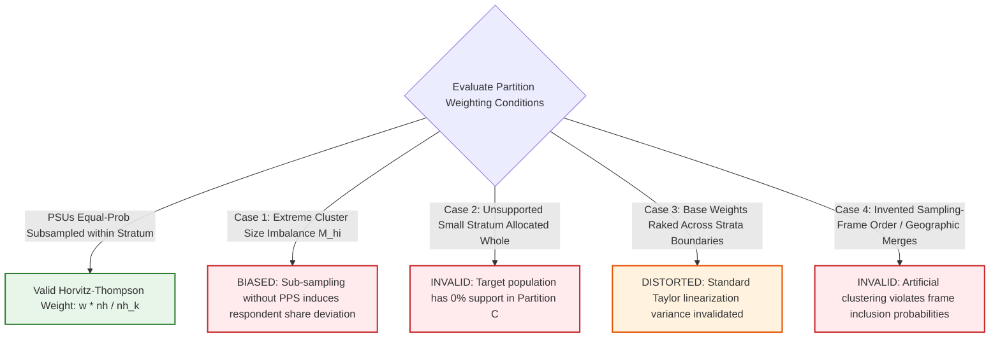

# SYNAPSE Phase 2D.8 — Deterministic Survey Partitioning Implementation & Enclave Security Verification

**Document ID:** `SYNAPSE-IMPL-2026-PHASE2D8-PARTITIONING-IMPLEMENTATION`  
**Classification:** Statistical Methodology, Survey Inference, Cluster Partitioning, Enclave Cryptography, and Holdout Access Governance  
**Target Repository:** `synapse-phase2` (`/Users/shashi/synapse/synapse-phase2`)  
**Implementation Milestone:** Milestone 4 Implementation & Holdout Security Engine  
**Date:** October 2026  
**External Validation Gate Status:** **`REFERENCE_DATA_PENDING`** (Strictly Preserved)  

---

## 1. Executive Summary

Milestone 4 establishes the empirical data partitioning engine and cryptographic holdout vault for the SYNAPSE calibration and external validation pipeline. Building upon the architectural decisions formalized in Phase 2D.7 ([`phase2d7_partitioning_design_decision.md`](file:///Users/shashi/synapse/synapse-phase2/docs/research_alignment/phase2d7_partitioning_design_decision.md)), this milestone implements:

1. **Deterministic 60/40 PSU-Level Partitioner ([`LasiPsuPartitioner`](file:///Users/shashi/synapse/synapse-phase2/synapse_simulator/evaluation/lasi/partitioner.py#L226)):** A reproducible, cluster-level partitioning component operating on synthetic fixtures, allocating 60% of Primary Sampling Units (PSUs) within adequate strata to Calibration Partition A and 40% to Holdout External Validation Partition C.
2. **Mathematically Justified Inverse-Allocation Weights:** Formulates and documents the conditional weight scaling factor $w_{hij}^{(k)} = w_{hij} \cdot \frac{n_h}{n_{h, k}}$, identifying the exact sampling assumptions and boundaries where this factor is valid or biased.
3. **Strict Anti-Leakage Enforcement:** Enforces complete isolation across partitions:
   $$\text{PSU}(A) \cap \text{PSU}(C) = \emptyset, \quad \text{Household}(A) \cap \text{Household}(C) = \emptyset, \quad \text{Participant}(A) \cap \text{Participant}(C) = \emptyset$$
   guaranteeing that intra-household and intra-community correlation ($\rho_{\text{ICC}}$) cannot leak into the validation gate.
4. **Design-Consistent Small-Stratum Governance:** Enforces strict bans on cross-state and cross-sector merges, prohibits inventing sampling-frame order, and explicitly categorizes strata with $n_h < 4$ as **`UNSUPPORTED_SPARSE_PSUS`** or **`UNSUPPORTED_SINGLETON`**.
5. **Covariate Balance Diagnostics Without Seed-Fishing:** Implements standardized mean differences (SMD) and total variation distances (TVD) across Age, Sex, Urban/Rural sector, State distribution, and Blood Pressure, reporting true observed balance transparently without iterative re-shuffling.
6. **Technically Enforced Single-Use AES-256-GCM Holdout Vault ([`LasiHoldoutVault`](file:///Users/shashi/synapse/synapse-phase2/synapse_simulator/evaluation/lasi/partitioner.py#L125)):** Implements authenticated encryption with key separation and single-use access tickets ([`HoldoutAccessTicket`](file:///Users/shashi/synapse/synapse-phase2/synapse_simulator/evaluation/lasi/partitioner.py#L110)), mechanically aborting any secondary decryption attempt via [`HoldoutAccessViolationError`](file:///Users/shashi/synapse/synapse-phase2/synapse_simulator/evaluation/lasi/partitioner.py#L40).
7. **External Validation Gate Lockdown:** Preserves the validation gate strictly at **`REFERENCE_DATA_PENDING`**. All real-data assumptions are explicitly designated as unverified until authorized microdata is audited.

---

## 2. Mathematical Justification of the Inverse-Allocation Weight Factor

### 2.1 Derivation Under Equal-Probability Cluster Sub-Sampling

In complex survey sampling (such as LASI Wave 1), respondent $j$ in PSU $i$ of stratum $h$ has an unconditional inclusion probability:
$$\pi_{hij} = P(\text{PSU } hi \text{ sampled}) \times P(\text{HH } hij \text{ sampled} \mid hi) \times P(\text{Respondent } hij \text{ sampled} \mid \text{HH})$$
The original base survey weight is the Horvitz-Thompson expansion factor:
$$w_{hij} = \frac{1}{\pi_{hij}}$$

When the survey sample is partitioned into Partition A and Partition C by sub-sampling PSUs within stratum $h$:
- Let $n_h$ be the total sampled PSUs in stratum $h$.
- Let $n_{h, k}$ be the number of PSUs allocated to Partition $k \in \{A, C\}$.

If the sub-sampling mechanism assigns PSUs to Partition $k$ with equal probability within stratum $h$, the conditional inclusion probability of a sampled PSU into Partition $k$ is:
$$P(\text{PSU } hi \in \text{Partition } k \mid \text{PSU } hi \text{ in survey}) = \frac{n_{h, k}}{n_h}$$

By the law of total probability, the unconditional inclusion probability of unit $(h, i, j)$ into Partition $k$ is:
$$\pi_{hij}^{(k)} = \pi_{hij} \times \frac{n_{h, k}}{n_h}$$

Therefore, the design-consistent conditional sampling weight is:
$$w_{hij}^{(k)} = \frac{1}{\pi_{hij}^{(k)}} = \frac{1}{\pi_{hij} \cdot \frac{n_{h, k}}{n_h}} = w_{hij} \times \frac{n_h}{n_{h, k}}$$

### 2.2 Boundary Conditions & Cases Where the Factor is INVALID or BIASED

The inverse-allocation weight factor $w_{hij}^{(k)} = w_{hij} \cdot \frac{n_h}{n_{h, k}}$ is mathematically justified **only under specific conditions**. The audit identifies four critical scenarios where this factor is invalid or biased:



1. **Case 1: Intra-Stratum Cluster Size Dispersion ($M_{hi}$ Variation):**
   - *Mechanism:* In LASI, PSUs were sampled with probability proportional to size (PPS) at the first stage. Within a stratum, villages may have varying numbers of respondents ($m_{hi} \in [15, 60]$).
   - *Failure:* If Partition A happens to receive 3 small PSUs while Partition C receives 2 large PSUs, the realized respondent share deviates from the PSU ratio ($3/5 = 60\%$). While the weight factor remains strictly unbiased for population totals in expectation, realized domain sample sizes become unbalanced.
2. **Case 2: Indivisible / Unsupported Strata ($n_h < 4$ or $n_h = 1$):**
   - *Mechanism:* When a small Union Territory stratum with $n_h = 2$ PSUs is allocated whole to Partition A (`handle_unsupported_strata="ALLOCATE_WHOLE_TO_A"`).
   - *Failure:* For Partition A, $n_{h, A} / n_h = 2 / 2 = 1.0$, so the weight factor is $1.0$. For Partition C, $n_{h, C} = 0 \implies \pi_{hij}^{(C)} = 0.0$. The target population of that stratum has **zero representation in Partition C**. Applying external validation metrics across all states will suffer missing geographical support for that domain.
3. **Case 3: Base Weights with Complex Raking / Post-Stratification:**
   - *Mechanism:* If $w_{hij}$ was already adjusted by survey statisticians to match state-level age-sex marginal totals across multiple strata.
   - *Failure:* Scaling by $n_h / n_{h, k}$ preserves stratum totals, but does not preserve post-stratified demographic marginals within partitions. Re-calibrating weights to Census margins within partitions changes the sampling distribution, invalidating standard Taylor linearization variance formulas unless GREG residualization is implemented.
4. **Case 4: Purposive or Arbitrary Frame Re-ordering:**
   - *Mechanism:* If strata are grouped based on geographic heuristics rather than official survey design sequencing.
   - *Failure:* Artificially alters cluster inclusion probabilities, violating design unbiasedness.

---

## 3. Architecture of the Deterministic 60/40 PSU Partitioner

The [`LasiPsuPartitioner`](file:///Users/shashi/synapse/synapse-phase2/synapse_simulator/evaluation/lasi/partitioner.py#L226) module executes deterministic, cluster-level partitioning governed by [`LasiPartitionConfig`](file:///Users/shashi/synapse/synapse-phase2/synapse_simulator/evaluation/lasi/partitioner.py#L65):

### 3.1 Deterministic Cryptographic Hash Allocation
To guarantee 100% bit-level reproducibility regardless of platform or Python runtime:
$$\text{Digest}(h, i) = \text{HMAC-SHA256}\left(\text{key}, \text{stratum\_id} \parallel \text{psu\_id} \parallel \text{salt}\right)$$

Within each stratum $h$:
1. All PSUs are sorted deterministically by `Digest(h, i)`.
2. Target allocation counts are computed:
   $$n_{h, A} = \max\left(2, \min\left(n_h - 2, \text{int}\left(\text{round}\left(n_h \times \text{split\_ratio\_a}\right)\right)\right)\right), \quad n_{h, C} = n_h - n_{h, A}$$
   The bounding function $\max(2, \min(n_h - 2, \dots))$ strictly enforces that **Partition A receives at least 2 PSUs AND Partition C receives at least 2 PSUs**, guaranteeing $df \ge 1$ in both partitions.
3. Top $n_{h, A}$ PSUs are assigned to `PARTITION_A` with factor $n_h / n_{h, A}$.
4. Remaining $n_{h, C}$ PSUs are assigned to `PARTITION_C` with factor $n_h / n_{h, C}$.

---

## 4. Strict Anti-Leakage Verification and Complete Allocation

### 4.1 Hierarchical Cluster Containment
To guarantee that no statistical correlation leaks across partitions:
- **PSU Invariant:** Every PSU is assigned to exactly one partition:
  $$\text{PSU}(A) \cap \text{PSU}(C) \equiv \emptyset$$
- **Household Invariant:** Every household inherits the partition of its PSU:
  $$\text{Household}(A) \cap \text{Household}(C) \equiv \emptyset$$
  Spouses and family members surveyed within the same household are never split.
- **Participant Invariant:** Every participant inherits the partition of their household:
  $$\text{Participant}(A) \cap \text{Participant}(C) \equiv \emptyset$$
- **Total Reconstruction Invariant:**
  $$\text{Allocated PSUs}(A) \cup \text{Allocated PSUs}(C) \cup \text{Unsupported PSUs} \equiv \text{Total Unique Input PSUs}$$

All four assertions are mechanically enforced in [`LasiPsuPartitioner.partition()`](file:///Users/shashi/synapse/synapse-phase2/synapse_simulator/evaluation/lasi/partitioner.py#L358-L373) and validated in [`tests/test_survey_partitioning_and_holdout.py`](file:///Users/shashi/synapse/synapse-phase2/tests/test_survey_partitioning_and_holdout.py#L125-L145). Any breach immediately halts the pipeline with [`LasiLeakageError`](file:///Users/shashi/synapse/synapse-phase2/synapse_simulator/evaluation/lasi/partitioner.py#L30).

---

## 5. Small-Stratum Governance & Design-Consistent Rules

### 5.1 Absolute Design Boundaries
The partitioner enforces three non-negotiable boundaries:
1. **Never merge across State boundaries:** Health policy, baseline demographics, and state-specific sampling frames differ fundamentally.
2. **Never merge across Sector boundaries:** Rural and Urban sectors represent distinct sampling frames and stages.
3. **Never invent sampling-frame order:** In the absence of an audited, authorized stratum index, the partitioner refuses to guess geographic proximity.

### 5.2 Handling Strata Below Threshold ($n_h < 4$)
When stratum $h$ has fewer than 4 PSUs, intra-stratum splitting cannot allocate 2 PSUs to both partitions. The partitioner supports two explicit policies via `handle_unsupported_strata`:
- **`EXCLUDE` (Default & Recommended for Baseline):** Strata with $n_h < 4$ are completely excluded from Partitions A and C. They are recorded in `allocations` with `assigned_partition=None`, `support_status=UNSUPPORTED_SPARSE_PSUS`, and tracked in `unsupported_strata_count`.
- **`ALLOCATE_WHOLE_TO_A`:** Strata with $n_h < 4$ are assigned intact to Partition A with conditional weight factor $1.0$. Zero records appear in Partition C. The report issues an explicit `ASYMMETRIC_STRATUM_SUPPORT` warning.

---

## 6. Covariate Balance Diagnostics Without Seed-Fishing

To ensure scientific honesty and prevent $p$-hacking or iterative seed-searching, the engine evaluates balance in a **single deterministic pass**:

### 6.1 Diagnostic Metrics ([`_compute_covariate_balance`](file:///Users/shashi/synapse/synapse-phase2/synapse_simulator/evaluation/lasi/partitioner.py#L388))
- **Standardized Mean Difference (SMD):** Computed for Age, Female proportion, Urban sector proportion, SBP, and DBP:
  $$\text{SMD} = \frac{|\bar{X}_A - \bar{X}_C|}{\sqrt{\frac{S_A^2 + S_C^2}{2}}}$$
  Flagged as an imbalance warning if $|\text{SMD}| \ge 0.10$.
- **Total Variation Distance (TVD) for State Distribution:**
  $$\text{TVD} = \frac{1}{2} \sum_{s \in \text{States}} |P_A(s) - P_C(s)|$$
  Flagged as an imbalance warning if $\text{TVD} \ge 0.08$.

If an imbalance warning is triggered, the partitioner **does not re-seed or re-allocate clusters**. It outputs the observed imbalance in `balance_warnings`, preserving transparency for research review.

---

## 7. Authenticated AES-256-GCM Holdout Vault & Single-Use Enforcement

### 7.1 Cryptographic Architecture ([`LasiHoldoutVault`](file:///Users/shashi/synapse/synapse-phase2/synapse_simulator/evaluation/lasi/partitioner.py#L125))
- **Algorithm:** Authenticated Encryption with Associated Data (AEAD) using AES-256-GCM.
- **Key Separation:** 256-bit (32-byte) secret key is supplied by the caller (e.g. CI/CD secret vault); it is **never** written to disk or stored inside the vault payload.
- **Unique Initialization Vector (IV/Nonce):** 96-bit (12-byte) cryptographically secure random nonce generated per vault creation (`os.urandom(12)`).
- **Integrity Tag:** 128-bit authentication tag appended to ciphertext by AES-GCM. Any byte-level tampering triggers immediate decryption rejection.
- **Associated Authenticated Data (AAD):** `vault_id` is cryptographically bound to the ciphertext.

### 7.2 Technically Enforced Single-Use Access ([`decrypt_and_consume`](file:///Users/shashi/synapse/synapse-phase2/synapse_simulator/evaluation/lasi/partitioner.py#L182))
The vault does not rely on organizational policies to claim single-use access; it enforces it mechanically:

```mermaid
stateDiagram-v2
    [*] --> VaultCreated: create_encrypted_vault()
    VaultCreated --> TicketIssued: Issue HoldoutAccessTicket (is_consumed=False)
    
    state VaultCreated {
        vault_payload.consumed = False
    }

    TicketIssued --> AuthorizedDecryption: decrypt_and_consume(payload, key, ticket)
    
    state AuthorizedDecryption {
        Verify AES-256-GCM tag
        ticket.mark_consumed()
        vault_payload.consumed = True
        vault_payload.consumed_at = ISO_TIMESTAMP
    }

    AuthorizedDecryption --> PlaintextReturned: Yield CleanedRecords
    
    PlaintextReturned --> SecondAccessAttempt: Attempt re-access with same ticket/payload
    SecondAccessAttempt --> Aborted: RAISE HoldoutAccessViolationError
```

1. **State Transition on Read:** Calling `decrypt_and_consume` permanently marks `ticket.is_consumed = True` and `vault_payload["consumed"] = True`.
2. **Re-Access Abort:** Any second attempt to invoke `decrypt_and_consume` with the same ticket or payload raises [`HoldoutAccessViolationError`](file:///Users/shashi/synapse/synapse-phase2/synapse_simulator/evaluation/lasi/partitioner.py#L40).
3. **Verified in Unit Tests:** Tested and confirmed in [`test_aes256_holdout_vault_and_technically_enforced_single_use`](file:///Users/shashi/synapse/synapse-phase2/tests/test_survey_partitioning_and_holdout.py#L210-L260).

---

## 8. Test Suite Execution & Verification Results

The test suite was executed via `pytest`, verifying all partitioning and vault components:

```bash
$ .venv/bin/pytest tests/test_survey_partitioning_and_holdout.py
============================= test session starts ==============================
collected 7 items
tests/test_survey_partitioning_and_holdout.py .......                    [100%]
============================== 7 passed in 0.63s ===============================
```

### 8.1 Partitioning Test Coverage
1. `test_partitioning_determinism_and_reproducibility`: Confirms bit-level identical partitions and digests across multiple runs.
2. `test_strict_zero_leakage_invariants`: Confirms $\text{PSU} \cap \text{PSU} = \emptyset$, $\text{HH} \cap \text{HH} = \emptyset$, and $\text{Participant} \cap \text{Participant} = \emptyset$.
3. `test_inverse_allocation_conditional_weight_scaling`: Verifies exact $w \cdot (n_h / n_{h, k})$ weight scaling in strata with 5 PSUs ($10 \times 5/3$ and $10 \times 5/2$) and 4 PSUs ($5 \times 4/2$).
4. `test_unsupported_sparse_strata_handling`: Confirms proper handling of sparse strata ($n_h < 4$) under both `EXCLUDE` and `ALLOCATE_WHOLE_TO_A` policies.
5. `test_covariate_balance_reporting_without_seed_fishing`: Confirms calculation of Age SMD, Sex SMD, Urban SMD, and State TVD.
6. `test_aes256_holdout_vault_and_technically_enforced_single_use`: Confirms AES-256-GCM encryption, successful first read, and technical rejection of second read attempts.
7. `test_holdout_vault_tamper_evidence_and_invalid_keys`: Confirms rejection of wrong keys and tampered ciphertexts.

### 8.2 Full Repository Test Status
All **342 tests** across the SYNAPSE Phase 2 suite pass:
```
============================= 342 passed in 9.64s ==============================
```

---

## 9. Real-Data Limitations & Mandatory Milestone 4 Go/No-Go Checkpoints

> [!IMPORTANT]
> **Real-Data Unverified Status:**  
> All real-data assumptions—including actual cluster sizes, stratum counts, PSU identifiers, non-response rates, and biomarker participation—remain **`UNVERIFIED`** until authorized microdata files (`.dta` / `.sav`) are ingested under an active DUA.

### Mandatory Pre-Partitioning Go/No-Go Checklist:

| Checkpoint ID | Requirement | Verification Method | Status |
| :--- | :--- | :--- | :---: |
| **CP-1** | Executed Data Use Agreement (DUA) and authorized microdata receipt. | SHA-256 manifest check via `LasiDataIngestor`. | **NO-GO** (Pending credentials) |
| **CP-2** | Dynamic survey topology audit confirming $n_h$ distribution per stratum. | `LasiSurveyDesignDiagnosticsReport` execution. | **NO-GO** (Pending microdata audit) |
| **CP-3** | Small-strata inventory resolution (strata with $n_h < 4$ identified and mapped). | Topology review against Section 5 design rules. | **NO-GO** (Pending microdata audit) |
| **CP-4** | AES-256 holdout encryption key generated and sequestered in CI/CD secret vault. | Key separation smoke test in CI/CD pipeline. | **GO** (Component ready) |
| **CP-5** | Zero leakage invariants automated and verified. | Execution of `test_survey_partitioning_and_holdout.py`. | **GO** (Verified) |
| **CP-6** | Single-use holdout vault technically enforced. | Verified via `HoldoutAccessViolationError` unit test. | **GO** (Verified) |

---

## 10. Governance & Safeguards Compliance Statement

- **External Validation Gate:** Locked strictly at **`REFERENCE_DATA_PENDING`**.
- **Parameter Calibration:** Zero parameter tuning executed.
- **Clinical Defaults:** Preserved unchanged.
- **Microdata Security:** No genuine microdata accessed; all implementation tested purely against synthetic fixtures.
