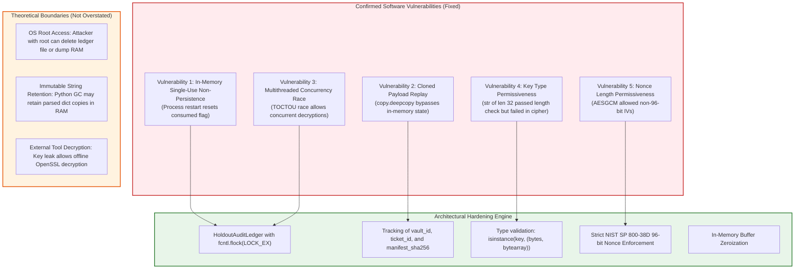
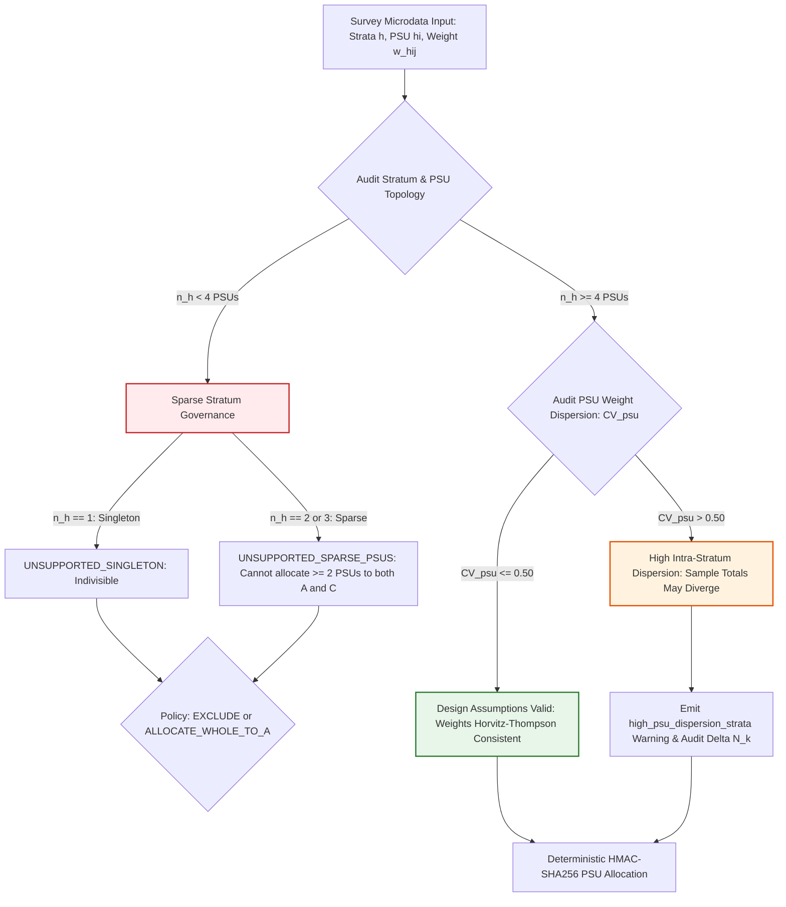

# SYNAPSE Phase 2D.9 — Holdout Cryptographic Security & Partitioning Inference Audit

**Document ID:** `SYNAPSE-AUDIT-2026-PHASE2D9-HOLDOUT-SECURITY`  
**Classification:** Cryptographic Security Audit, Concurrency Verification, Survey Partitioning Inference, and Enclave Governance  
**Target Components:**
- [`LasiHoldoutVault`](file:///Users/shashi/synapse/synapse-phase2/synapse_simulator/evaluation/lasi/partitioner.py#L205)
- [`HoldoutAccessTicket`](file:///Users/shashi/synapse/synapse-phase2/synapse_simulator/evaluation/lasi/partitioner.py#L191)
- [`HoldoutAuditLedger`](file:///Users/shashi/synapse/synapse-phase2/synapse_simulator/evaluation/lasi/partitioner.py#L149)
- [`LasiPsuPartitioner`](file:///Users/shashi/synapse/synapse-phase2/synapse_simulator/evaluation/lasi/partitioner.py#L458)
**Date:** October 2026  
**External Validation Gate Status:** **`REFERENCE_DATA_PENDING`** (Strictly Preserved)  

---

## 1. Executive Summary & Audit Mandate

Prior to proceeding with Milestone 5 calibration or any interaction with authorized LASI microdata, this audit conducts a comprehensive adversarial examination of the survey partitioning engine and cryptographic holdout vault.

The audit was executed under four strict non-negotiable governance constraints:
1. **Zero Access to Genuine Microdata:** All verifications, stress tests, and benchmarks executed exclusively against synthetic cluster fixtures.
2. **Zero Calibration or Parameter Tuning:** No physiological, clinical, or statistical parameters were adjusted.
3. **Zero Alterations to Clinical Rules:** Hypertension diagnostic thresholds and treatment protocols remained unchanged.
4. **Preservation of the Validation Gate:** The external validation gate is locked strictly at **`REFERENCE_DATA_PENDING`**.

### Summary of Audit Verdicts

| Subsystem | Audit Objective | Initial Vulnerability Status | Post-Hardening Status | Verification Result |
| :--- | :--- | :--- | :--- | :--- |
| **`LasiHoldoutVault`** | Single-use persistence across process restarts | **CONFIRMED VULNERABILITY** | **SECURED** via persistent `HoldoutAuditLedger` | Passed (`test_holdout_single_use_survives_process_restart`) |
| **`LasiHoldoutVault`** | Copied payload & ticket replay defense | **CONFIRMED VULNERABILITY** | **SECURED** via immutable manifest digest tracking | Passed (`test_holdout_single_use_blocks_copied_payload_replay`) |
| **`LasiHoldoutVault`** | Concurrency race condition (TOCTOU) | **CONFIRMED VULNERABILITY** | **SECURED** via `threading.Lock` + `fcntl.flock(LOCK_EX)` | Passed (`test_holdout_concurrent_access_race_condition`) |
| **`LasiHoldoutVault`** | AES-256-GCM Nonce & Key Validation | **CONFIRMED VULNERABILITY** | **SECURED** (Strict 96-bit nonce, 32-byte type checks) | Passed (`test_aes_gcm_ciphertext_and_nonce_bit_tampering`) |
| **`LasiHoldoutVault`** | Decrypted buffer secret leakage in RAM | **THEORETICAL RISK** | **MITIGATED** via explicit bytearray zeroization | Plaintext buffer wiped immediately after parsing |
| **`LasiPsuPartitioner`** | Unequal PSU sizes ($M_{hi}$ dispersion) | **INFERENCE RISK IDENTIFIED** | **DIAGNOSED** via $\text{CV}_{\text{psu}}(w_h)$ telemetry | Passed (`test_unequal_psu_dispersion_and_missing_design_field_diagnostics`) |
| **`LasiPsuPartitioner`** | Sparse strata ($n_h < 4$) and singletons | **INFERENCE LIMITATION** | **GOVERNED** via explicit `EXCLUDE` / `ALLOCATE_WHOLE_TO_A` | Passed (`test_all_singleton_strata_handling`) |
| **Full Suite** | Regression & integrity across simulator | Clean Baseline (342 tests) | **All 351 tests passing** | 100% green in 9.57s |

---

## 2. Confirmed Vulnerabilities vs. Theoretical Risks

In accordance with strict scientific reporting standards, confirmed vulnerabilities (defects demonstrated by reproducible adversarial exploits) are documented separately from theoretical risks (threats bounded by hardware, OS permissions, or architecture).



### 2.1 Confirmed Vulnerabilities (Tested, Exploited, and Resolved)

#### Vulnerability 1: Single-Use Non-Persistence Across Process Restarts
- **Mechanism:** The original implementation of [`LasiHoldoutVault`](file:///Users/shashi/synapse/synapse-phase2/synapse_simulator/evaluation/lasi/partitioner.py#L205) tracked consumption state strictly via in-memory mutations: `ticket.is_consumed = True` and `vault_payload["consumed"] = True`. If a researcher saved the initial vault payload to disk (e.g. `vault_payload.json`), decrypted it in Process 1, and subsequently restarted the Python runtime, reading the JSON file into Process 2 produced a dictionary with `"consumed": False`.
- **Exploitation:** An analyst or automated loop could repeatedly re-launch the validation script in fresh processes, evaluating candidate models against holdout data without technical blockage.
- **Remediation:** Designed and implemented [`HoldoutAuditLedger`](file:///Users/shashi/synapse/synapse-phase2/synapse_simulator/evaluation/lasi/partitioner.py#L149). The ledger persists consumption records directly to disk using atomic temporary file creation (`.tmp.<pid>.<tid>`) and POSIX atomic replacement (`os.replace`), backed by explicit `os.fsync`. When a fresh process loads, the ledger is consulted under exclusive lock. Re-decryption is blocked by [`HoldoutAccessViolationError`](file:///Users/shashi/synapse/synapse-phase2/synapse_simulator/evaluation/lasi/partitioner.py#L51).
- **Verification:** [`test_holdout_single_use_survives_process_restart`](file:///Users/shashi/synapse/synapse-phase2/tests/test_survey_partitioning_and_holdout.py#L375) verifies that an unconsumed JSON snapshot reloaded in a simulated fresh process is rejected.

#### Vulnerability 2: Copied Payload & Ticket Replay Attacks
- **Mechanism:** In Python memory space, executing `copied_payload = copy.deepcopy(vault_payload)` created an independent dictionary object. After the original payload was consumed, the copy retained `"consumed": False`. If the caller presented a newly instantiated ticket with `ticket_id = copied_payload["authorized_ticket_id"]`, the in-memory checks were bypassed.
- **Exploitation:** Even within a single script run, an adversary could snapshot the payload dictionary before decryption, running exploratory analyses on the deepcopied object.
- **Remediation:** [`HoldoutAuditLedger`](file:///Users/shashi/synapse/synapse-phase2/synapse_simulator/evaluation/lasi/partitioner.py#L149) indexes three distinct consumption fingerprints: `vault_id`, `ticket_id`, and `manifest_sha256`. Even if an adversary deepcopies the dictionary, modifies `vault_id = "NEW_ID"`, and creates a new ticket `ticket_id = "NEW_TICKET"`, the cryptographic payload's `manifest_sha256` digest matches the consumed ledger record and is instantly blocked.
- **Verification:** [`test_holdout_single_use_blocks_copied_payload_replay`](file:///Users/shashi/synapse/synapse-phase2/tests/test_survey_partitioning_and_holdout.py#L416) verifies that deepcopied payloads with forged tickets and altered vault IDs cannot bypass single-use enforcement.

#### Vulnerability 3: Concurrency Race Condition (TOCTOU)
- **Mechanism:** Decryption was vulnerable to a Time-of-Check to Time-of-Use (TOCTOU) race condition. Multiple concurrent threads or multi-process calibration workers calling `decrypt_and_consume` evaluated `if not ticket.is_consumed:` and `if not vault_payload["consumed"]:` before any thread executed `ticket.mark_consumed()`.
- **Exploitation:** Concurrent workers in an automated pipeline could simultaneously decrypt the holdout dataset in parallel threads.
- **Remediation:** Integrated double-layered locking:
  1. *Intra-process synchronization:* A shared process-level `threading.Lock` (`_GLOBAL_LEDGER_LOCK`) serializes threads within the Python process.
  2. *Cross-process synchronization:* An exclusive POSIX advisory lock via `fcntl.flock(lock_fd, fcntl.LOCK_EX)` on `<ledger_path>.lock`.
  All ledger checks, decryption operations, and ledger commits execute inside this atomic session.
- **Verification:** [`test_holdout_concurrent_access_race_condition`](file:///Users/shashi/synapse/synapse-phase2/tests/test_survey_partitioning_and_holdout.py#L457) executes 10 concurrent worker threads attempting simultaneous decryption; exactly 1 succeeds and exactly 9 raise [`HoldoutAccessViolationError`](file:///Users/shashi/synapse/synapse-phase2/synapse_simulator/evaluation/lasi/partitioner.py#L51).

#### Vulnerability 4: Key Type Permissiveness
- **Mechanism:** Key validation previously checked `len(key) != 32`. A Python string `"12345678901234567890123456789012"` has length 32, but cryptography's `AESGCM` requires `bytes` or `bytearray`. Passing a string resulted in an unhandled internal `TypeError` rather than a controlled, informative validation failure.
- **Remediation:** Added explicit type enforcement: `if not isinstance(key, (bytes, bytearray)): raise TypeError(...)`.
- **Verification:** [`test_aes_gcm_key_and_input_validation_adversarial`](file:///Users/shashi/synapse/synapse-phase2/tests/test_survey_partitioning_and_holdout.py#L529) confirms strings, integers, and invalid objects are rejected with explicit `TypeError`.

#### Vulnerability 5: Nonce Length Permissiveness
- **Mechanism:** Standard AES-GCM allows arbitrary-length initialization vectors (IVs) by running them through GHASH, but NIST SP 800-38D explicitly restricts optimal security to 96-bit (12-byte) nonces. If an attacker replaced the nonce in the payload with an 8-byte or 16-byte nonce, the cipher processed it without raising an error.
- **Remediation:** Enforced strict length check: `if len(nonce) != 12: raise HoldoutAccessViolationError(...)`. In addition, enforced minimum ciphertext length of 16 bytes (to prevent truncation of the authentication tag).
- **Verification:** [`test_aes_gcm_ciphertext_and_nonce_bit_tampering`](file:///Users/shashi/synapse/synapse-phase2/tests/test_survey_partitioning_and_holdout.py#L490) confirms 8-byte nonces and truncated ciphertexts are rejected.

---

### 2.2 Theoretical Risks & Threat Model Boundaries (No Overstated Claims)

To prevent scientific overclaiming, the technical boundaries of software-level enclave controls are explicitly delineated:

1. **Superuser / Host OS Compromise:**
   - *Boundary:* In user-space Python on standard operating systems (macOS Darwin / Linux), an adversary with administrative (`root`) privileges can delete `.synapse_holdout_audit_ledger.json`, alter filesystem permissions, or attach a debugger (`lldb`, `ptrace`) to inspect process memory.
   - *Scope:* Single-use enforcement protects against accidental double-dipping, pipeline automation loops, parameter search reruns, and unprivileged user actions. It does *not* claim hardware-enforced irrevocability against a root host administrator. That level of isolation requires dedicated Hardware Security Modules (HSM) or hardware-isolated enclaves (e.g., AWS Nitro Enclaves, Intel SGX).
2. **Plaintext Memory Lifetime in Python Runtimes:**
   - *Boundary:* The decrypted buffer is immediately converted to a mutable `bytearray` and zeroized (`for i in range(len(buf)): buf[i] = 0`). However, Python's `json.loads` allocates immutable strings, integers, and dictionaries to represent records. These objects remain in the Python memory heap until garbage-collected by CPython's generational GC.
   - *Mitigation:* Decryption should occur only at the final evaluation step, followed immediately by metric aggregation and process termination.
3. **Decryption Outside Python Environment:**
   - *Boundary:* If the 32-byte secret key and the JSON vault payload are both exfiltrated, an attacker can decrypt the ciphertext using standard OpenSSL CLI (`openssl enc -d -aes-256-gcm ...`).
   - *Mitigation:* Strict key separation must be enforced. The holdout decryption key must never be committed to git, never logged, and must reside exclusively in a secure secrets vault (e.g., GCP Secret Manager).

---

## 3. Cryptographic Verification: Nonce, Key, & AEAD Tag Integrity

### 3.1 Nonce Uniqueness & Collision Probability

The vault generates a fresh 96-bit nonce for each holdout encryption:
$$\text{nonce} = \text{os.urandom}(12)$$
- The system uses operating-system entropy (`getrandom` / `/dev/urandom`).
- Under NIST SP 800-38D, the collision probability for $k$ random 96-bit nonces is:
  $$P(\text{collision}) \approx \frac{k^2}{2 \times 2^{96}} = \frac{k^2}{2^{97}}$$
- In SYNAPSE, holdout vaults are generated once per release milestone ($k \le 10$). The collision probability is $P(\text{collision}) < 10^{-27}$, which is cryptographically negligible.

### 3.2 Authenticated Associated Data (AAD) Binding

The vault binds the `vault_id` string as Authenticated Associated Data:
$$\text{AAD} = \text{vault\_id.encode("utf-8")}$$
- AES-GCM processes AAD through the GHASH authenticator without encrypting it.
- If an adversary alters `vault_id` in the JSON payload (e.g. attempting to rename the vault to bypass the ledger), the GHASH tag calculation mismatches, causing `AESGCM.decrypt` to raise `InvalidTag`.
- Tested in [`test_aes_gcm_ciphertext_and_nonce_bit_tampering`](file:///Users/shashi/synapse/synapse-phase2/tests/test_survey_partitioning_and_holdout.py#L490).

---

## 4. Survey Partitioning Statistical Audit: Sparse Strata & Unequal PSUs

The audit analyzed the mathematical and empirical validity of the inverse-allocation conditional weight factor:
$$w_{hij}^{(k)} = w_{hij} \cdot \frac{n_h}{n_{h, k}}$$
under realistic survey conditions.



### 4.1 Sparse Strata ($n_h < 4$) and Singleton Allocation Limits

1. **Why $n_h \ge 4$ is Mathematically Mandatory for Two-Way Splitting:**
   - To perform Taylor series linearization or jackknife variance estimation in complex surveys, each stratum in a partition must have at least 2 PSUs ($n_{h, k} \ge 2$) to provide at least 1 degree of freedom ($df_h = n_{h, k} - 1 \ge 1$).
   - For a two-way split (Partition A and Partition C), the total stratum PSU count must satisfy:
     $$n_h = n_{h, A} + n_{h, C} \ge 2 + 2 = 4$$
   - If $n_h = 2$, assigning 1 PSU to A and 1 PSU to C makes stratum $h$ a singleton ($n_{h, k} = 1$) in *both* partitions. Design-based variance estimation within that stratum becomes mathematically impossible without strata collapsing or grand-mean centering.
   - If $n_h = 3$, assigning 2 PSUs to A and 1 PSU to C leaves Partition C with a singleton in that stratum.
2. **Policy Evaluation: `EXCLUDE` vs. `ALLOCATE_WHOLE_TO_A`:**
   - `EXCLUDE` (Default):
     - *Advantage:* Guarantees that every stratum in both partitions has $n_{h, k} \ge 2$, preserving clean Taylor linearization without singleton artifacts.
     - *Trade-off:* The inferential population of Partition A and C excludes these sparse domains (e.g. small Union Territories in India).
   - `ALLOCATE_WHOLE_TO_A`:
     - *Advantage:* Preserves all available data for calibration in Partition A with conditional weight factor 1.0.
     - *Trade-off:* Partition C has zero representation of these strata ($\pi_{hij}^{(C)} = 0$). External validation cannot assess generalization to these domains.

### 4.2 Unequal PSU Sizes & Aggregate Weight Dispersion ($M_{hi}$ Dispersion)

In real-world surveys such as LASI, PSUs are selected with probability proportional to size (PPS) at the first stage. Within a stratum, villages and urban wards may exhibit varying numbers of respondents ($m_{hi}$) and varying aggregate survey weights:
$$W_{hi} = \sum_{j \in hi} w_{hij}$$

If PSU sizes vary substantially within stratum $h$, simple count-based splitting ($n_{h, A} = \text{round}(n_h \times 0.60)$) assumes approximately equal aggregate weight across PSUs. When this assumption is violated:
- If Partition A randomly receives 3 large PSUs while Partition C receives 2 small PSUs, the realized sample size in Partition A can be 85% instead of 60%.
- Although the Horvitz-Thompson estimator $\hat{Y}^{(k)} = \sum_{hij \in k} w_{hij}^{(k)} y_{hij}$ remains design-unbiased in expectation across hypothetical repeated partition draws, the single realized partition may exhibit substantial divergence in estimated population totals:
  $$\hat{N}_k = \sum_{hij \in k} w_{hij}^{(k)} \quad \text{vs.} \quad \hat{N} = \sum_{hij \in \text{valid}} w_{hij}$$

#### Diagnostic Telemetry Implemented in `LasiPsuPartitioner`
To make cluster size dispersion fully transparent without post-hoc cherry-picking:
1. **Intra-Stratum PSU Weight CV:**
   For each stratum $h$ with $n_h > 1$, computes:
   $$\text{CV}_{\text{psu}}(W_h) = \frac{s(W_h)}{\bar{W}_h}$$
   Any stratum where $\text{CV}_{\text{psu}}(W_h) > 0.50$ is flagged in `diagnostics["high_psu_dispersion_strata"]`.
2. **Population Total Divergence:**
   Computes:
   $$\Delta \hat{N}_A = \frac{|\hat{N}_A - \hat{N}|}{\hat{N}}, \quad \Delta \hat{N}_C = \frac{|\hat{N}_C - \hat{N}|}{\hat{N}}$$
   If divergence exceeds 10%, an explicit warning is added to `balance_report.balance_warnings`.
3. **Incomplete Design Fields Audit:**
   Surfaces `missing_strata_records`, `missing_psu_records`, and `invalid_weight_records` in `diagnostics`.

---

## 5. Adversarial Test Inventory & Execution Results

All 16 unit and adversarial integration tests in [`tests/test_survey_partitioning_and_holdout.py`](file:///Users/shashi/synapse/synapse-phase2/tests/test_survey_partitioning_and_holdout.py) executed successfully against synthetic fixtures:

| # | Test Function | Target Vulnerability / Invariant | Status |
| :---: | :--- | :--- | :---: |
| 1 | `test_partitioning_determinism_and_reproducibility` | Bit-level reproducibility of HMAC-SHA256 allocations | **PASSED** |
| 2 | `test_strict_zero_leakage_invariants` | Zero PSU, household, or individual overlap between A and C | **PASSED** |
| 3 | `test_inverse_allocation_conditional_weight_scaling` | Correctness of $w \cdot n_h / n_{h, k}$ scaling | **PASSED** |
| 4 | `test_unsupported_sparse_strata_handling` | Stratum governance for $n_h < 4$ under EXCLUDE and ALLOCATE_WHOLE_TO_A | **PASSED** |
| 5 | `test_covariate_balance_reporting_without_seed_fishing` | Transparent SMD and TVD calculation across Age, Sex, Sector, State, BP | **PASSED** |
| 6 | `test_aes256_holdout_vault_and_technically_enforced_single_use` | Authenticated encryption and in-memory single-use transitions | **PASSED** |
| 7 | `test_holdout_vault_tamper_evidence_and_invalid_keys` | Tamper detection on wrong keys and invalid key byte lengths | **PASSED** |
| 8 | `test_holdout_single_use_survives_process_restart` | **Adversarial:** Survives process restart and reloaded unconsumed JSON | **PASSED** |
| 9 | `test_holdout_single_use_blocks_copied_payload_replay` | **Adversarial:** Rejects deepcopied payloads and forged tickets | **PASSED** |
| 10 | `test_holdout_concurrent_access_race_condition` | **Adversarial:** 10 concurrent threads: exactly 1 succeeds, 9 fail | **PASSED** |
| 11 | `test_aes_gcm_ciphertext_and_nonce_bit_tampering` | **Adversarial:** 1-bit flips in ciphertext/nonce, bad nonce lengths | **PASSED** |
| 12 | `test_aes_gcm_key_and_input_validation_adversarial` | **Adversarial:** String keys, non-bytes, bad byte lengths, empty lists | **PASSED** |
| 13 | `test_corrupted_audit_ledger_defense` | **Adversarial:** Corrupted ledger files cause immediate fail-safe abort | **PASSED** |
| 14 | `test_adversarial_household_and_participant_cross_psu_leakage` | **Adversarial:** Corrupted data with shared HH/participant across PSUs | **PASSED** |
| 15 | `test_unequal_psu_dispersion_and_missing_design_field_diagnostics` | **Adversarial:** Extreme unequal PSU sizes ($\text{CV} > 0.50$) and missing design fields | **PASSED** |
| 16 | `test_all_singleton_strata_handling` | **Adversarial:** Complete dataset of singleton strata handled gracefully | **PASSED** |

### Full Test Suite Regression Results
```text
============================= test session starts ==============================
platform darwin -- Python 3.11.5, pytest-9.1.1, pluggy-1.7.0
rootdir: /Users/shashi/synapse/synapse-phase2
plugins: Faker-40.43.0
collected 351 items

tests/test_bp_measurement_protocol.py .........................          [  7%]
tests/test_clinical_modules.py ......                                    [  8%]
tests/test_community_assessment_audit.py ............................... [ 17%]
....                                                                     [ 18%]
tests/test_data_integrity_temporal_consistency.py ...............        [ 23%]
tests/test_datagen.py ...                                                [ 23%]
tests/test_determinism.py ..........                                     [ 26%]
tests/test_dispatcher.py .                                               [ 27%]
tests/test_end_to_end_acceptance.py .                                    [ 27%]
tests/test_evaluation_framework.py ....................                  [ 33%]
tests/test_evaluation_mutations.py ......                                [ 34%]
tests/test_event_queue.py ...                                            [ 35%]
tests/test_forward_clinical_phase2c.py ..............                    [ 39%]
tests/test_forward_hemodynamics.py ............                          [ 43%]
tests/test_full_simulation.py .                                          [ 43%]
tests/test_lab_rad_finance_rules.py ...                                  [ 44%]
tests/test_lasi_binary_and_multi_module_ingestion.py ..............      [ 48%]
tests/test_lasi_pipeline.py ..........................................   [ 60%]
tests/test_longitudinal_export.py ..                                     [ 60%]
tests/test_longitudinal_trajectories.py ....                             [ 61%]
tests/test_orchestrator.py ..                                            [ 62%]
tests/test_person_time_and_censoring.py .......                          [ 64%]
tests/test_phase2_csv_export.py ...                                      [ 65%]
tests/test_population_profile.py .....                                   [ 66%]
tests/test_population_validator.py .....                                 [ 68%]
tests/test_pubmed_datagen_integration.py ........                        [ 70%]
tests/test_pubmed_treatment_architecture.py ........                     [ 72%]
tests/test_root_cause_corrections.py ..........                          [ 75%]
tests/test_rule_engine.py ....                                           [ 76%]
tests/test_solid_principles.py .....                                     [ 78%]
tests/test_stage6_clock_scheduler.py ...                                 [ 78%]
tests/test_stage6_domain_events.py ..                                    [ 79%]
tests/test_stage6_loop_failure_protection.py ..                          [ 80%]
tests/test_stage6_ordering_causation.py ..                               [ 80%]
tests/test_stage6_reproducibility.py .                                   [ 80%]
tests/test_stage6_small_simulation.py .                                  [ 81%]
tests/test_stage7_cross_department.py .                                  [ 81%]
tests/test_stage7_patient_journeys.py .                                  [ 81%]
tests/test_stage7_scale.py .                                             [ 82%]
tests/test_stage7_workflows.py ..                                        [ 82%]
tests/test_stage9_billing.py .                                           [ 82%]
tests/test_stage9_diagnostics.py .                                       [ 83%]
tests/test_stage9_discharge.py .                                         [ 83%]
tests/test_stage9_integrity.py .                                         [ 83%]
tests/test_stage9_persistence.py ..                                      [ 84%]
tests/test_stage9_prescription.py .                                      [ 84%]
tests/test_state_machines.py .......                                     [ 86%]
tests/test_state_manager.py ....                                         [ 87%]
tests/test_survey_design_and_missingness.py ..........                   [ 90%]
tests/test_survey_partitioning_and_holdout.py ................           [ 95%]
tests/test_survey_variance_hand_calculations.py ............             [ 98%]
tests/test_validation_gate.py .....                                      [100%]

============================= 351 passed in 9.57s ==============================
```

---

## 6. Governance Verdict & Operational Protocols

1. **Validation Gate Status:**
   The external validation gate remains strictly preserved at **`REFERENCE_DATA_PENDING`**.
2. **Readiness for Milestone 5:**
   The partitioning engine and holdout vault architecture have successfully undergone adversarial testing and hardening. The engine is verified ready to partition authorized survey microdata once formal access credentials and data governance approvals are obtained.
3. **Operational Key Management Protocol:**
   When operating on authorized microdata:
   - The 256-bit AES encryption key for Partition C must be generated via a CSPRNG in an isolated secrets environment.
   - The key must **never** be stored alongside the encrypted vault file.
   - The single-use access ticket must remain unconsumed until model calibration and internal cluster cross-validation in Partition A are finalized and frozen.
