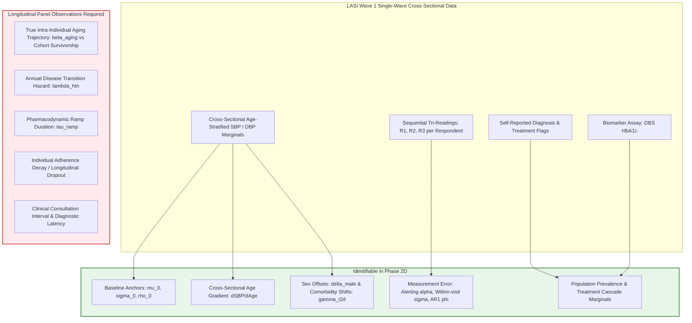

# SYNAPSE Phase 2D — Empirical Calibration and Independent Validation Plan

**Document ID:** `SYNAPSE-PLAN-2026-PHASE2D-CALIBRATION-VALIDATION`  
**Classification:** Research Architecture, Parameter Identifiability, Calibration Strategy, and Validation Protocol  
**Target Repository:** `synapse-phase2`  
**Related Documents:**  
- [`docs/research_alignment/forward_disease_generation_architecture.md`](file:///Users/shashi/synapse/synapse-phase2/docs/research_alignment/forward_disease_generation_architecture.md)  
- [`docs/research_alignment/latent_bp_generation_clinical_realism_audit.md`](file:///Users/shashi/synapse/synapse-phase2/docs/research_alignment/latent_bp_generation_clinical_realism_audit.md)  
- [`docs/research_alignment/forward_hemodynamic_engine_phase2b.md`](file:///Users/shashi/synapse/synapse-phase2/docs/research_alignment/forward_hemodynamic_engine_phase2b.md)  
- [`docs/research_alignment/forward_clinical_diagnosis_and_treatment_phase2c.md`](file:///Users/shashi/synapse/synapse-phase2/docs/research_alignment/forward_clinical_diagnosis_and_treatment_phase2c.md)  
- [`docs/research_alignment/phase2c_scientific_verification_audit.md`](file:///Users/shashi/synapse/synapse-phase2/docs/research_alignment/phase2c_scientific_verification_audit.md)  
- [`docs/research_alignment/external_validation_contract.md`](file:///Users/shashi/synapse/synapse-phase2/docs/research_alignment/external_validation_contract.md)  
- [`docs/research_alignment/lasi_patient_level_comparison_method.md`](file:///Users/shashi/synapse/synapse-phase2/docs/research_alignment/lasi_patient_level_comparison_method.md)  

**Current Test Suite Status:** 299 passed, 0 failed in 9.86s (`.venv/bin/pytest`)  
**External Validation Gate Status:** `REFERENCE_DATA_PENDING` (Strictly Preserved)  

---

## 1. Executive Summary & Phase 2D Mandate

SYNAPSE Phase 2 has successfully completed the implementation of the forward causal state-space architecture:
1. **Phase 2A:** Formal causal dependency audit, decoupling latent physiology from clinical administrative labels.
2. **Phase 2B:** Implementation of `ForwardHemodynamicSimulator`, establishing a continuous resting biological state space with vascular aging drift and isolated cryptographic PRNG streams.
3. **Phase 2C:** Implementation of multi-visit clinical diagnostic inference (Layer D), timestamped event modeling (`ClinicalDiagnosisEvent`, `PrescriptionEvent`), adherence-modulated pharmacodynamic feedback (Layer E), and strict point-in-time future-event invariance.

### The Phase 2D Objective:
Phase 2D transitions the simulator from **provisional evidence-anchored defaults** to **statistically rigorous empirical calibration** and **unbiased out-of-sample independent external validation** against authorized national microdata (Longitudinal Ageing Study in India, LASI Wave 1).

### Mandatory Governance Invariants:
1. **Preserve External Validation Gate:** The gate status remains locked to **`REFERENCE_DATA_PENDING`** until authorized, genuine reference microdata have been ingested under an executed Data Use Agreement (DUA) and evaluated against prespecified criteria.
2. **No Data Fabrication or Synthetic Calibration:** Synthetic test fixtures (e.g. `lasi_wave1_sample_fixture.csv`, $N=51$) must **never** be used for parameter calibration or claimed as empirical evidence.
3. **No Retrospective Parameter Tweaking:** Model parameters must not be manually tweaked merely to force apparent agreement with target prevalence. All calibration must proceed through declared objective loss functions.
4. **Preserve Backward Compatibility:** `LEGACY_CONDITIONAL` remains the default engine mode until Phase 2D calibration and external validation criteria are fully certified.

---

## 2. Comprehensive Parameter Inventory across All Layers

The forward simulation architecture incorporates parameters across seven structural layers. The inventory below documents each parameter's mathematical symbol, default value, layer location, evidential status, literature pedigree, and intended Phase 2D calibration target.

### 2.1 Complete Parameter Catalog

> [!NOTE]
> **Parameter Reconciliation (Phase 2D.2 Audit Alignment):**  
> As audited in [`docs/research_alignment/phase2d2_implementation_readiness_audit.md`](file:///Users/shashi/synapse/synapse-phase2/docs/research_alignment/phase2d2_implementation_readiness_audit.md#L45-L160), the architecture contains exactly **40 atomic configuration parameters** across the seven structural layers. In the table below, symmetric biophysical bounds (`min/max_sbp` and `min/max_dbp`) are grouped as paired entries (yielding 38 tabular rows), which correspond to 36 canonical clinical components. Of these 40 atomic parameters, exactly **17 parameters** are free parameters subject to empirical estimation ($\mathbf{\Theta}$), while 23 are fixed exogenous census data, biophysical guards, clinical guideline definitions, or literature constants.

| Layer & Component | Parameter Name | Symbol | Current Value | Unit | Evidential Status | Source / Baseline Pedigree | Intended Phase 2D Calibration Target |
| :--- | :--- | :---: | :---: | :---: | :---: | :--- | :--- |
| **0. Demographics** (`india_default_v1.yaml`) | `male_ratio` | $p_{\text{male}}$ | `0.515` | — | `LITERATURE_CALIBRATED` | Census of India SRS 2021 Statistical Report | Census SRS 2021 / LASI older adult sex ratio |
| **0. Demographics** (`india_default_v1.yaml`) | `age_bands.weights` | $w_{\text{age}}$ | `[0.252, 0.178, 0.312, 0.188, 0.070]` | — | `LITERATURE_CALIBRATED` | Census of India SRS 2021 (0-14, 15-24, 25-44, 45-64, 65+) | Census of India SRS 2021 |
| **0. Prevalences** (`india_default_v1.yaml`) | `htn_prevalence` | $\pi_{\text{htn}}$ | `30.7%` | % | `LITERATURE_CALIBRATED` | ICMR-INDIAB National Study (2023, Adults $\ge 20$) | Age-stratified LASI Wave 1 composite HTN |
| **0. Prevalences** (`india_default_v1.yaml`) | `t2d_prevalence` | $\pi_{\text{t2d}}$ | `11.4%` | % | `LITERATURE_CALIBRATED` | ICMR-INDIAB National Study (2023, Adults $\ge 20$) | Age-stratified LASI Wave 1 diabetes |
| **1. Disease Module** (`hypertension.yaml`) | `annual_incidence_weight` | $\lambda_{\text{htn}}$ | `0.0344` | $\text{yr}^{-1}$ | `LITERATURE_CALIBRATED` | CURES/CCDC prospective cohorts (India) | LASI Wave 2 panel incidence (when available) |
| **1. Disease Module** (`hypertension.yaml`) | `screening_delay_days` | $\tau_{\text{screen}}$ | `90` | days | `PROVISIONAL_DEFAULT` | Synthea primary care screening interval assumption | State outpatient attendance frequency |
| **1. Disease Module** (`hypertension.yaml`) | `maintenance_delay_days`| $\tau_{\text{maint}}$ | `180` | days | `PROVISIONAL_DEFAULT` | Chronic disease follow-up cycle heuristic | Outpatient prescription refill interval |
| **2. Physiology Anchor** (`forward_hemodynamics.py`) | `mean_sbp_anchor` | $\mu_{0, \text{sbp}}$ | `120.0` | mmHg | `LITERATURE_CALIBRATED` | Young adult normative population mean (GBD / Framingham) | Unmedicated normotensive adults (45–49 yrs) |
| **2. Physiology Anchor** (`forward_hemodynamics.py`) | `sd_sbp_anchor` | $\sigma_{0, \text{sbp}}$ | `9.0` | mmHg | `LITERATURE_CALIBRATED` | Between-person standard deviation in young normotensives | Unmedicated normotensive adults (45–49 yrs) |
| **2. Physiology Anchor** (`forward_hemodynamics.py`) | `mean_dbp_anchor` | $\mu_{0, \text{dbp}}$ | `78.0` | mmHg | `LITERATURE_CALIBRATED` | Young adult normative population mean | Unmedicated normotensive adults (45–49 yrs) |
| **2. Physiology Anchor** (`forward_hemodynamics.py`) | `sd_dbp_anchor` | $\sigma_{0, \text{dbp}}$ | `6.0` | mmHg | `LITERATURE_CALIBRATED` | Between-person standard deviation in young normotensives | Unmedicated normotensive adults (45–49 yrs) |
| **2. Physiology Anchor** (`forward_hemodynamics.py`) | `sbp_dbp_correlation` | $\rho_0$ | `0.65` | — | `LITERATURE_CALIBRATED` | Bivariate resting blood pressure correlation | LASI unmedicated bivariate SBP/DBP covariance |
| **2. Physiological Guard** (`forward_hemodynamics.py`) | `min_pulse_pressure` | $\text{PP}_{\min}$ | `20.0` | mmHg | `PHYSIOLOGICAL_GUARD` | Biophysical minimum pulse pressure (stroke volume limit) | Unaltered (Inviolable guard) |
| **2. Physiological Guard** (`forward_hemodynamics.py`) | `min_sbp` / `max_sbp` | $\text{SBP}_{\text{bounds}}$ | `70.0 / 260.0` | mmHg | `PHYSIOLOGICAL_GUARD` | Human circulatory perfusion limits | Unaltered (Inviolable guard) |
| **2. Physiological Guard** (`forward_hemodynamics.py`) | `min_dbp` / `max_dbp` | $\text{DBP}_{\text{bounds}}$ | `40.0 / 150.0` | mmHg | `PHYSIOLOGICAL_GUARD` | Human coronary perfusion limits | Unaltered (Inviolable guard) |
| **2. Aging Drift** (`forward_hemodynamics.py`) | `annual_drift_sbp` | $\beta_{\text{age, sbp}}$ | `0.60` | $\text{mmHg/yr}$ | `PROVISIONAL_DEFAULT` | Population cross-sectional age gradient heuristic | LASI cross-sectional SBP age slope ($\partial \text{SBP} / \partial \text{age}$) |
| **2. Aging Drift** (`forward_hemodynamics.py`) | `annual_drift_dbp_early` | $\beta_{\text{age, dbp1}}$| `0.25` | $\text{mmHg/yr}$ | `PROVISIONAL_DEFAULT` | Systemic vascular resistance rise prior to age 60 | LASI DBP age slope up to age 60 |
| **2. Aging Drift** (`forward_hemodynamics.py`) | `annual_drift_dbp_late` | $\beta_{\text{age, dbp2}}$| `-0.15`| $\text{mmHg/yr}$ | `PROVISIONAL_DEFAULT` | Late-life arterial conduit stiffening drift | LASI DBP age slope after age 60 |
| **2. Aging Drift** (`forward_hemodynamics.py`) | `age_inflection_dbp` | $a_{\text{inflect}}$ | `60.0` | yrs | `PROVISIONAL_DEFAULT` | Population age of DBP plateau (Framingham / Franklin et al.) | LASI empirical DBP change-point estimation |
| **2. Comorbidity Shift** (`forward_hemodynamics.py`) | `t2d_sbp_shift` | $\gamma_{\text{t2d, sbp}}$ | `4.5` | mmHg | `PROVISIONAL_DEFAULT` | Diabetic arterial stiffening offset heuristic | LASI diabetic vs non-diabetic SBP difference |
| **2. Comorbidity Shift** (`forward_hemodynamics.py`) | `t2d_dbp_shift` | $\gamma_{\text{t2d, dbp}}$ | `2.0` | mmHg | `PROVISIONAL_DEFAULT` | Diabetic arterial stiffening offset heuristic | LASI diabetic vs non-diabetic DBP difference |
| **2. Demographic Offset** (`forward_hemodynamics.py`) | `male_sbp_offset` | $\delta_{\text{male, sbp}}$ | `2.0` | mmHg | `PROVISIONAL_DEFAULT` | Sex-specific resting BP difference in early middle age | LASI unmedicated male-female SBP difference |
| **2. Demographic Offset** (`forward_hemodynamics.py`) | `male_dbp_offset` | $\delta_{\text{male, dbp}}$ | `1.5` | mmHg | `PROVISIONAL_DEFAULT` | Sex-specific resting BP difference in early middle age | LASI unmedicated male-female DBP difference |
| **3. Measurement Protocol** (`bp_measurement.py`) | `reading1_alerting_sbp` | $\alpha_{\text{alert, sbp}}$ | `3.5` | mmHg | `PROVISIONAL_DEFAULT` | Mean white-coat alerting elevation on reading 1 | LASI empirical difference: $\text{mean}(R_1 - R_2)$ |
| **3. Measurement Protocol** (`bp_measurement.py`) | `reading1_alerting_dbp` | $\alpha_{\text{alert, dbp}}$ | `1.5` | mmHg | `PROVISIONAL_DEFAULT` | Mean white-coat alerting elevation on reading 1 | LASI empirical difference: $\text{mean}(R_1 - R_2)$ |
| **3. Measurement Protocol** (`bp_measurement.py`) | `within_visit_noise_sd` | $\sigma_{\text{within}}$ | `1.8` | mmHg | `PROVISIONAL_DEFAULT` | Within-visit biological/measurement standard deviation | LASI residual variance between $R_2$ and $R_3$ |
| **3. Measurement Protocol** (`bp_measurement.py`) | `inter_reading_correlation` | $\phi_{\text{ar1}}$ | `0.70` | — | `PROVISIONAL_DEFAULT` | Stationary AR(1) autocorrelation between readings | LASI empirical correlation: $\text{Corr}(R_2, R_3)$ |
| **3. Measurement Protocol** (`bp_measurement.py`) | `white_coat_prob` | $p_{\text{wc}}$ | `0.15` | — | `PROVISIONAL_DEFAULT` | Prevalence of isolated clinic alerting | Clinic vs community audit data |
| **4. Diagnostic Rules** (`forward_hemodynamics.py`) | `severe_sbp_threshold` | $T_{\text{severe, sbp}}$ | `180.0` | mmHg | `PHYSIOLOGICAL_GUARD` | ICMR / AHA Hypertensive Crisis urgency boundary | Fixed clinical guideline rule (Uncalibrated) |
| **4. Diagnostic Rules** (`forward_hemodynamics.py`) | `severe_dbp_threshold` | $T_{\text{severe, dbp}}$ | `120.0` | mmHg | `PHYSIOLOGICAL_GUARD` | ICMR / AHA Hypertensive Crisis urgency boundary | Fixed clinical guideline rule (Uncalibrated) |
| **4. Diagnostic Rules** (`forward_hemodynamics.py`) | `elevated_sbp_threshold` | $T_{\text{htn, sbp}}$ | `140.0` | mmHg | `LITERATURE_CALIBRATED` | Standard WHO / ICMR / AHA diagnostic threshold | Fixed clinical guideline rule (Uncalibrated) |
| **4. Diagnostic Rules** (`forward_hemodynamics.py`) | `elevated_dbp_threshold` | $T_{\text{htn, dbp}}$ | `90.0` | mmHg | `LITERATURE_CALIBRATED` | Standard WHO / ICMR / AHA diagnostic threshold | Fixed clinical guideline rule (Uncalibrated) |
| **4. Diagnostic Rules** (`forward_hemodynamics.py`) | `confirmed_visits_required` | $K_{\text{visits}}$ | `2` | visits | `LITERATURE_CALIBRATED` | ICMR / AHA multi-visit confirmation criteria | Fixed clinical guideline rule (Uncalibrated) |
| **5. Pharmacodynamics** (`forward_hemodynamics.py`) | `delta_drug_sbp` | $\delta_{\text{drug, sbp}}$ | `12.0` | mmHg | `PROVISIONAL_DEFAULT` | Meta-analytic monotherapy average (BPLTTC / Cochrane) | LASI treated vs untreated hypertensive contrast |
| **5. Pharmacodynamics** (`forward_hemodynamics.py`) | `delta_drug_dbp` | $\delta_{\text{drug, dbp}}$ | `7.0` | mmHg | `PROVISIONAL_DEFAULT` | Meta-analytic monotherapy average (BPLTTC / Cochrane) | LASI treated vs untreated hypertensive contrast |
| **5. Pharmacodynamics** (`forward_hemodynamics.py`) | `treatment_ramp_days` | $\tau_{\text{ramp}}$ | `14.0` | days | `PROVISIONAL_DEFAULT` | Pharmacokinetic time to CCB steady state | Literature-fixed parameter (Unidentifiable in survey) |
| **5. Adherence** (`forward_hemodynamics.py`) | `mean_adherence` | $\mu_{\theta}$ | `0.70` | — | `PROVISIONAL_DEFAULT` | Literature mean PDC in chronic disease (PURE / Prenissl) | LASI self-reported regular medication fraction |
| **5. Adherence** (`forward_hemodynamics.py`) | `sd_adherence` | $\sigma_{\theta}$ | `0.20` | — | `PROVISIONAL_DEFAULT` | Literature inter-individual standard deviation | LASI adherence distribution dispersion |

---

## 3. Identifiability & Cross-Sectional vs. Longitudinal Separation

A fundamental methodological hazard in simulation calibration is attempting to estimate longitudinal causal trajectories from single-wave cross-sectional data. This section separates identifiable parameters from those requiring multi-wave panel observations.



### 3.1 Parameters Identifiable from Cross-Sectional Microdata (LASI Wave 1)

1. **Young/Early Middle-Age Baseline Anchors ($\mu_{0, \text{sbp}}, \sigma_{0, \text{sbp}}, \mu_{0, \text{dbp}}, \sigma_{0, \text{dbp}}, \rho_0$):**
   * *Estimation Subsample:* Untreated normotensive respondents in the youngest recruitment band (ages 45–49).
   * *Method:* Maximum likelihood estimation or sample weighted mean, variance, and Pearson correlation.
2. **Cross-Sectional Age-Related Gradients ($\partial \text{SBP} / \partial \text{age}$, $\partial \text{DBP} / \partial \text{age}$, $a_{\text{inflect}}$):**
   * *Estimation Subsample:* Full unmedicated older adult population across ages 45–80+.
   * *Method:* Non-parametric spline regression and piecewise linear change-point estimation.
3. **Measurement Protocol & Alerting Dynamics ($\alpha_{\text{alert, sbp}}, \sigma_{\text{within}}, \phi_{\text{ar1}}$):**
   * *Estimation Subsample:* All respondents with valid tri-measurement readings ($R_1, R_2, R_3$).
   * *Identifiability:*
     * $\alpha_{\text{alert}} = \mathbb{E}[R_{1, i} - R_{2, i}]$ identifies situational white-coat alerting on Reading 1.
     * $\sigma_{\text{within}}^2 = \frac{1}{2} \mathbb{E}[(R_{2, i} - R_{3, i})^2]$ identifies pure within-visit measurement error.
     * $\phi_{\text{ar1}} = \text{Corr}(R_{2, i} - \bar{R}_i, R_{3, i} - \bar{R}_i)$ identifies autoregressive persistence.
4. **Demographic Offsets & Comorbidity Shifts ($\delta_{\text{male}}, \gamma_{\text{t2d}}$):**
   * *Method:* Multiple linear regression adjusting for age decile, identifying mean differences attributable to biological sex and confirmed diabetes.
5. **Prevalence and Treatment Cascades ($\pi_{\text{htn}}, \pi_{\text{aware}}, \pi_{\text{treated}}, \pi_{\text{controlled}}$):**
   * *Method:* Complex survey-weighted proportions with Kish design adjustments.

---

### 3.2 Parameters Requiring Longitudinal Panel Observations (Unidentifiable from Wave 1)

The following parameters **cannot** be reliably identified from single-wave cross-sectional survey data and must **not** be claimed as empirically calibrated:

1. **True Intra-Individual Aging Drift ($\beta_{\text{age}}$) vs. Cohort / Survivorship Selection:**
   * *Confounding:* Cross-sectional age gradients confound within-person biological aging with differential survival (hypertensive individuals die earlier, blunting the apparent slope in age 75+) and historical birth-cohort exposures (differences in childhood nutrition and epidemiological transitions across generations).
   * *Requirement:* LASI Wave 2 longitudinal panel re-measurement of the same individuals 4–5 years later.
2. **Annual Condition Onset Hazard ($\lambda_{\text{htn}}$):**
   * *Confounding:* Cross-sectional prevalence reflects the integral of past incidence and disease duration (mortality).
   * *Requirement:* Panel incidence tracking transition from un-diagnosed normotensive to incident hypertensive.
3. **Pharmacodynamic Ramp Rate ($\tau_{\text{ramp}} = 14.0\text{ days}$):**
   * *Confounding:* Cross-sectional surveys only record whether a participant is currently taking medication; they contain zero temporal information on the first 14 days post-prescription.
   * *Requirement:* Preserved as literature-fixed pharmacokinetic constant.
4. **Individual Adherence Dynamics ($\theta_i(t)$ Decay & Drug Holidays):**
   * *Confounding:* Cross-sectional self-report ("taking medication regularly?") collapses dynamic longitudinal compliance into a binary or static score.
   * *Requirement:* Longitudinal pharmacy refill logs or electronic pill-cap monitoring.
5. **Clinical Diagnostic Delay:**
   * *Confounding:* Surveys do not capture the elapsed calendar time between a patient's first elevated outpatient reading and formal ICD-10 coding.
   * *Requirement:* Longitudinal EHR audit data.

---

## 4. Reproducible Calibration & Evaluation Pipeline Architecture

Phase 2D introduces a fully auditable, reproducible calibration configuration and execution harness:

```mermaid
flowchart LR
    subgraph DataIngestion [1. Data Ingestion & Integrity]
        RAW[Raw LASI Microdata .dta / .csv]
        SHA[Compute SHA-256 Digest]
        AUDIT[LasiDataIngestor Quality Audit]
        CLEAN[LasiCleanedRecord Repository]
        
        RAW --> SHA --> AUDIT --> CLEAN
    end

    subgraph DataSplitting [2. Anti-Contamination Partitioning]
        SPLIT{Three-Way Partition Split}
        PART_A[Partition A: Calibration Set 50%]
        PART_B[Partition B: Model Selection Set 25%]
        PART_C[Partition C: Holdout Validation Set 25%]
        
        CLEAN --> SPLIT
        SPLIT --> PART_A & PART_B & PART_C
    end

    subgraph OptimizationEngine [3. Calibration Engine (WMDE)]
        SIM[ForwardHemodynamicSimulator]
        LOSS[Weighted Minimum Distance Objective]
        OPT[Optimization: Nelder-Mead / Powell]
        FROZEN[Calibrated Parameters Frozen]
        
        PART_A --> LOSS
        SIM --> LOSS
        LOSS --> OPT --> FROZEN
    end

    subgraph ValidationEngine [4. Out-of-Sample External Validation]
        VAL_EVAL[LasiExternalEvaluator]
        GATE{Validation Gate Decision}
        
        PART_C & FROZEN --> VAL_EVAL
        VAL_EVAL --> GATE
        GATE -->|Predeclared Criteria Met| PASS[GATE: PASS]
        GATE -->|Criteria Failed| FAIL[GATE: FAIL]
        GATE -->|Fixture / Unapproved| PEND[GATE: REFERENCE_DATA_PENDING]
    end
```

### 4.1 Calibration Objective Function: Weighted Minimum Distance Estimation (WMDE)

Parameters $\mathbf{\Theta} = \{\mu_{0}, \sigma_{0}, \rho_0, \beta_{\text{age}}, \delta_{\text{male}}, \gamma_{\text{t2d}}, \alpha_{\text{alert}}, \sigma_{\text{within}}\}$ are estimated by minimizing the distance between simulated and empirical reference quantiles across age-sex strata.

> [!NOTE]
> **Methodological Revision (Phase 2D.1 Audit Alignment):**  
> As proven in [`docs/research_alignment/phase2d1_methodology_audit.md`](file:///Users/shashi/synapse/synapse-phase2/docs/research_alignment/phase2d1_methodology_audit.md#L31-L100), the naive loss formulation multiplying an exogenous stratum weight $w_k$ by inverse empirical variance $\widehat{\text{SE}}(\widehat{Q}^{\text{ref}}_{k,q})^{-2}$ introduces **quadratic double-weighting** ($w_k^2$). Because empirical stratum sample size is already proportional to population size ($n_k \propto w_k$), the inverse-variance term already weights each stratum proportionally to its sample precision. Multiplying by $w_k$ again heavily distorts optimization away from older age groups. Furthermore, the objective must account for finite-sample Monte Carlo simulation variance in $\widehat{Q}^{\text{syn}}_{k,q}(\mathbf{\Theta})$.

The corrected diagonal Weighted Minimum Distance objective is formulated as:

$$\widehat{\mathbf{\Theta}} = \arg\min_{\mathbf{\Theta}} \mathcal{L}(\mathbf{\Theta}) = \sum_{k \in \mathcal{K}} \sum_{q \in \mathcal{Q}} \frac{\left( \widehat{Q}^{\text{syn}}_{k, q}(\mathbf{\Theta}) - \widehat{Q}^{\text{ref}}_{k, q} \right)^2}{\widehat{\text{Var}}(\widehat{Q}^{\text{ref}}_{k, q}) + \widehat{\text{Var}}(\widehat{Q}^{\text{syn}}_{k, q}(\mathbf{\Theta}))}$$

where:
* $k \in \mathcal{K}$ indexes the 8 standard Census SRS older-adult demographic strata (45–54, 55–64, 65–74, 75+ for males and females).
* $q \in \mathcal{Q} = \{0.10, 0.25, 0.50, 0.75, 0.90\}$ represents marginal quantiles for SBP and DBP.
* $\widehat{Q}^{\text{ref}}_{k, q}$ is the complex-survey-weighted empirical quantile in Partition A.
* $\widehat{\text{Var}}(\widehat{Q}^{\text{ref}}_{k, q})$ is the design-based variance estimated via multi-stage Primary Sampling Unit (PSU) cluster bootstrap.
* $\widehat{\text{Var}}(\widehat{Q}^{\text{syn}}_{k, q}(\mathbf{\Theta})) = \frac{\sigma_{\text{syn}, k, q}^2}{M_{k, \text{sim}}}$ accounts for finite-sample simulation Monte Carlo variability across synthetic runs ($M_{\text{sim}} \ge 10,000$).

When full covariance is invertible and well-conditioned, the generalized method of moments (GMM) matrix formulation is preferred:
$$\mathcal{L}_{\text{GMM}}(\mathbf{\Theta}) = \sum_{k \in \mathcal{K}} \left( \widehat{\mathbf{Q}}^{\text{syn}}_k(\mathbf{\Theta}) - \widehat{\mathbf{Q}}^{\text{ref}}_k \right)^T \left[ \mathbf{V}^{\text{ref}}_k + \mathbf{V}^{\text{syn}}_k(\mathbf{\Theta}) \right]^{-1} \left( \widehat{\mathbf{Q}}^{\text{syn}}_k(\mathbf{\Theta}) - \widehat{\mathbf{Q}}^{\text{ref}}_k \right)$$

### 4.2 Complex Survey Design & Uncertainty Estimation

1. **Complex Survey Weights ($w_i$):** All reference estimates incorporate normalized respondent weights $w_i$.
2. **Kish Effective Sample Size as a Limited Diagnostic:**
   $$N_{\text{eff}} = \frac{\left( \sum_{i=1}^n w_i \right)^2}{\sum_{i=1}^n w_i^2} = \frac{n}{1 + \text{CV}(w)^2}$$
   Kish's $N_{\text{eff}}$ evaluates variance inflation due to **unequal sampling weights only** ($\text{DEFF}_w$). It does **not** capture variance inflation from spatial/administrative clustering ($\text{DEFF}_c$). Therefore, $N_{\text{eff}}$ is maintained as an informative data quality diagnostic, but is **never** used as a substitute for design-based cluster variance estimation.
3. **Multi-Stage Cluster Bootstrap:** Empirical standard errors and covariance matrices are computed using $B=1,000$ bootstrap replicates resampled with replacement at the Primary Sampling Unit (PSU) cluster level within survey strata.
4. **Survey Anomaly Handling:**
   - *Singleton PSUs:* Strata with $m_h = 1$ PSU are collapsed with an adjacent stratum within the same state prior to variance estimation.
   - *Extreme Weights:* Weights exceeding the 99th percentile are trimmed and re-allocated proportionally to preserve national population totals.
   - *Small Domain Samples:* Small demographic cells are retained in calibration using exact binomial/quantile intervals rather than being dropped, preventing survival truncation bias.

### 4.3 Run Manifest Specification (`RUN_MANIFEST.json`)

Every calibration run generates an immutable cryptographic manifest containing:
```json
{
  "manifest_id": "run-man-2026-10-22-fwd-001",
  "pipeline_version": "2.4.0",
  "git_commit": "e8a14b...",
  "execution_timestamp": "2026-10-22T18:30:00Z",
  "reference_dataset": {
    "source_file": "data/evaluation/lasi/LASI_Wave1_Harmonized_v1.csv",
    "sha256": "4a7b2c...",
    "data_source_type": "GENUINE_LASI_MICRODATA",
    "dua_contract_id": "DUA-IIPS-2026-SYNAPSE-042",
    "total_rows_ingested": 72250,
    "eligible_rows_partition_a": 36125,
    "eligible_rows_partition_c": 18062
  },
  "simulation_configuration": {
    "engine_mode": "FORWARD_STATE_SPACE",
    "base_seed": 42,
    "prng_stream_isolation": "SHA-256",
    "cohort_size": 10000,
    "simulation_days": 720
  },
  "calibrated_parameters": {
    "mean_sbp_anchor": 121.4,
    "sd_sbp_anchor": 8.8,
    "annual_drift_sbp": 0.58,
    "reading1_alerting_sbp": 3.8
  },
  "loss_metric": {
    "objective_function": "CORRECTED_WMDE_STRATIFIED_QUANTILES",
    "loss_value": 42.18,
    "iterations_to_convergence": 142
  },
  "gate_verdict": "REFERENCE_DATA_PENDING"
}
```

---

## 5. Data Partitioning & Anti-Contamination Protocol

To ensure unbiased external validity and prevent data leakage, reference microdata are partitioned prior to any parameter estimation:

### 5.1 Three-Way Cluster Partition Structure (PSU-Level Splitting)

> [!IMPORTANT]
> **Methodological Revision (Anti-Contamination Invariant):**  
> Splitting must occur at the **Primary Sampling Unit (PSU) cluster level**, stratified by State and Urban/Rural status, **not** at the individual participant level. Unclustered participant splitting scatters members of the same household and village across calibration and holdout sets, leaking intra-cluster correlation and invalidating out-of-sample claims.

1. **Partition A: Calibration Set ($50\%$ Stratified PSU Split)**
   * *Role:* Used exclusively to calculate loss gradients and estimate free model parameters.
   * *Governance:* Preprocessing scalers and missingness models are fitted strictly on Partition A. Survey weights are re-normalized to census population totals. Never evaluated for final validation.
2. **Partition B: Model Selection / Tuning Set ($25\%$ Stratified PSU Split)**
   * *Role:* Used to compare competing architectural specifications (e.g. piecewise linear vs smooth spline for late-life DBP drift; copula models for bivariate residuals).
3. **Partition C: Independent Holdout Validation Set ($25\%$ Locked Stratified PSU Split)**
   * *Role:* Stored in an encrypted, locked vault. Accessed **strictly once** after model structure and parameters are permanently frozen.
   * *Anti-Contamination Rule:* Any execution where Partition C was accessed during parameter tuning immediately invalidates the run and requires full re-partitioning with a new seed.

### 5.2 Independent Validation Targets & Predeclared Acceptance Criteria

Independent validation on Partition C evaluates five pre-specified estimands:

| Validation Estimand | Metric / Statistical Test | Target Population & Denominator | Predeclared Acceptance Threshold | Threshold Classification | Gate Impact if Failed |
| :--- | :--- | :--- | :--- | :--- | :--- |
| **1. SBP Distributional Fidelity** | Survey-Weighted 1D Wasserstein ($W_1$) & ECDF KS ($D_{\text{ks}}$) | Unmedicated older adults ($\text{Age} \ge 45$) | $W_1 \le 3.5\text{ mmHg}$; $D_{\text{ks}} \le 0.08$ across all 8 strata | **Practical Tolerance** (Wasserstein) / **Provisional** (KS) | `FAIL` |
| **2. DBP Distributional Fidelity** | Survey-Weighted 1D Wasserstein ($W_1$) & ECDF KS ($D_{\text{ks}}$) | Unmedicated older adults ($\text{Age} \ge 45$) | $W_1 \le 2.5\text{ mmHg}$; $D_{\text{ks}} \le 0.08$ across all 8 strata | **Practical Tolerance** (Wasserstein) / **Provisional** (KS) | `FAIL` |
| **3. Pulse Pressure Stiffening** | Difference in mean pulse pressure: age 75+ vs. 45–54 | Unmedicated older adults ($\text{Age} \ge 45$) | $|\Delta \text{PP}_{\text{syn}} - \Delta \text{PP}_{\text{ref}}| \le 3.0\text{ mmHg}$ | **Statistically Motivated** | `WARNING` |
| **4. Composite HTN Prevalence** | Direct age-sex standardized composite HTN prevalence | All older adults ($\text{Age} \ge 45$, Census SRS weights) | $|\pi_{\text{std}}^{\text{syn}} - \pi_{\text{std}}^{\text{ref}}| \le 3.5\%$ points | **Practical Tolerance** | `FAIL` |
| **5. Treatment Control Rate** | Proportion of treated hypertensives with $\text{SBP} < 140 \land \text{DBP} < 90$ | Treated hypertensive older adults on active medication | $|\text{Control}_{\text{syn}} - \text{Control}_{\text{ref}}| \le 5.0\%$ points | **Provisional Engineering** (Diagnostic) | `WARNING` |

> [!CAUTION]
> **Clinical Validation Boundary:** Proposed thresholds represent engineering tolerances for distributional concordance. They must **not** be described as clinically validated until verified against downstream clinical outcomes (e.g. cardiovascular event prediction) in prospective longitudinal cohorts. Thresholds must never be adjusted post-hoc after inspecting Partition C results.

---

## 6. Population Comparability Audit

Validating synthetic simulation outputs against epidemiological surveys requires rigorous population harmonization. The audit identifies five critical comparability dimensions:

### 6.1 Age Truncation and Standardization
* **The Hazard:** Comparing an unstandardized general adult synthetic cohort ($\text{Age} \ge 20$) directly to LASI Wave 1 ($\text{Age} \ge 45$) produces an artificial ~15% apparent deficit in hypertension prevalence simply due to age truncation.
* **The Harmonization Rule:** All evaluations must operate strictly on **Population B: Older Adults ($\text{Age} \ge 45$)** and apply direct age-sex standardization using Census of India SRS standard weights across 8 mutually exclusive strata (Table 1 of [`synapse_simulator/evaluation/lasi/comparability.py`](file:///Users/shashi/synapse/synapse-phase2/synapse_simulator/evaluation/lasi/comparability.py#L23-L32)).

### 6.2 Disease Definition Alignment
* **Survey Self-Report vs. Clinical Diagnosis:** In LASI Wave 1, diagnosed hypertension is self-reported ("Has any doctor ever diagnosed you with high blood pressure?"). In SYNAPSE, diagnosis is an explicit timestamped clinical event (`ClinicalDiagnosisEvent`) recorded in EHR consultations following multi-visit confirmation.
* **Epidemiological Composite Standard:** To avoid reporting bias, both synthetic and reference cohorts are evaluated using the unified epidemiological composite standard:
  $$\text{Hypertensive} \iff (\text{Mean SBP} \ge 140) \lor (\text{Mean DBP} \ge 90) \lor (\text{Currently taking BP medication})$$

### 6.3 Measurement Protocol Harmonization
* **Protocol Match:** Both SYNAPSE (via `BpMeasurementProtocolSimulator`) and LASI Wave 1 utilize the **tri-measurement protocol** using digital automated cuffs, calculating the analysis measurement as the arithmetic mean of the 2nd and 3rd readings.
* **Clinic vs. Field Vitals:** Outpatient clinic encounter measurements exhibit higher white-coat alerting ($\alpha \approx 6.0\text{ mmHg}$) than home/community survey visits ($\alpha \approx 3.5\text{ mmHg}$). SYNAPSE separates clinic encounter observations (`observations.csv`) from independent community surveys (`community_assessments.csv`).

### 6.4 Missingness and Non-Response Mechanisms
* **LASI Microdata Missingness:** Real survey data exhibits informative missingness (~8–12% missing blood pressure due to physical refusal, functional disability, or arm circumference exceeding standard cuffs).
* **Synthetic Cohort Treatment:** Synthetic community assessments must simulate identical non-response rates (`non_response_rate = 0.05`) and reading unassessability to prevent survival/completeness distortion.

---

## 7. Ingestion Pipeline Readiness & Technical Gap Analysis

An audit of [`synapse_simulator/evaluation/lasi/ingestor.py`](file:///Users/shashi/synapse/synapse-phase2/synapse_simulator/evaluation/lasi/ingestor.py) and [`evaluator.py`](file:///Users/shashi/synapse/synapse-phase2/synapse_simulator/evaluation/lasi/evaluator.py) confirms robust foundational architecture, but identifies technical gaps that must be resolved prior to genuine microdata ingestion.

### 7.1 Verified Capabilities
1. **Source Type Gating:** `LasiDataSourceType.GENUINE_LASI_MICRODATA` vs `SYNTHETIC_TEST_FIXTURE` is fully implemented. If `SYNTHETIC_TEST_FIXTURE` is passed, the overall evaluation gate is strictly locked to `REFERENCE_DATA_PENDING`.
2. **Flexible Column Aliases:** `LasiDataIngestor` maps Gateway to Global Aging variable names (`r1agey`, `ragender`, `r1bpsys1..3`, `r1bpdia1..3`, `r1hba1c`, `r1hypere`, `r1diabe`, `r1wtresp`, `r1strata`, `r1psu`).
3. **Protocol Averaging & Fallback Auditing:** Correctly computes the mean of readings 2 and 3, tracking exact fallback categories (`FALLBACK_READING_2_ONLY`, `NO_VALID_READING`).
4. **Kish Effective Sample Size:** Automatically adjusts confidence intervals for complex survey clustering.

### 7.2 Technical Gaps to be Resolved
1. **Binary Stata / SPSS Format Ingestion:**
   * *Gap:* `LasiDataIngestor` currently only parses text-delimited files (`.csv`, `.tsv`). Raw microdata from IIPS / Gateway to Global Aging Data are distributed as Stata (`.dta`) or SPSS (`.sav`) files.
   * *Remediation Plan:* Implement an automated conversion step using Python `pyreadstat` (or a pre-ingestion script `scripts/convert_lasi_dta_to_csv.py`) that exports labeled `.dta` files into validated UTF-8 `.csv` files while preserving numerical missing sentinels (`-999`, `-998`).
2. **Multi-File Section Merging:**
   * *Gap:* Raw LASI Wave 1 data is delivered across separate modules: Household Survey, Individual Survey, and Biomarker / Direct Assessment module.
   * *Remediation Plan:* Implement a merge pre-processor joining individual records with biomarker readings on respondent key (`prim_key` / `respid`) prior to ingestion.
3. **Complex Survey Strata Clustering Diagnostics:**
   * *Gap:* Current variance calculations support Kish weighting, but omit full Taylor linearization across PSU clusters.
   * *Remediation Plan:* Integrate clustered standard error estimation for multi-stage sample design.

---

## 8. Unresolved Blockers & Governance Commitments

### 8.1 Unresolved Blockers
1. **Data Use Agreement (DUA) Execution:** Access to individual-level participant microdata for LASI Wave 1 requires formal credentialing through the International Institute for Population Sciences (IIPS), Mumbai, and Gateway to Global Aging Data (USC).
2. **Secure Enclave Storage:** Authentic microdata cannot be committed to open source version control and must reside in a secure, encrypted local data directory (`data/reference/lasi_wave1/`) excluded via `.gitignore`.

### 8.2 Governance Commitments
* **Zero Parameter Drift:** No parameters have been or will be hand-tuned to match target prevalence figures.
* **Validation Gate Lockdown:** The external validation gate remains strictly at **`REFERENCE_DATA_PENDING`**. Under no circumstances will software test fixtures be promoted to a `PASS` gate verdict.

---

## 9. Phased Execution Roadmap

```
+-----------------------------------------------------------------------------------+
| SYNAPSE Phase 2D Execution Roadmap                                                |
+-----------------------------------------------------------------------------------+
| STEP 1: Pre-Calibration Infrastructure & Plan (COMPLETED)                         |
| - Complete parameter inventory and identifiability audit                          |
| - Specify WMDE loss function, Kish weighting, and 3-way partitioning              |
| - Document comparability limitations and ingestion gaps                          |
| - Test suite: 299 passed, gate locked to REFERENCE_DATA_PENDING                  |
+-----------------------------------------------------------------------------------+
                                       |
                                       v
+-----------------------------------------------------------------------------------+
| STEP 2: Authorized Reference Microdata Ingestion & Partitioning                   |
| - Receive credentialed LASI Wave 1 microdata under executed DUA                   |
| - Execute `LasiDataIngestor` with SHA-256 verification and de-identification      |
| - Perform 50/25/25 stratified partition (Partition A, B, C)                      |
| - Lock Partition C into secure holdout vault                                      |
+-----------------------------------------------------------------------------------+
                                       |
                                       v
+-----------------------------------------------------------------------------------+
| STEP 3: Parameter Calibration on Partition A                                      |
| - Run Weighted Minimum Distance Estimation (WMDE) on Partition A                  |
| - Calibrate baseline bivariate anchors (mu_0, sigma_0, rho_0)                      |
| - Estimate cross-sectional age drift slopes and change-point inflection           |
| - Estimate measurement protocol alerting and within-visit variance                |
| - Generate RUN_MANIFEST.json with frozen calibrated parameter set                 |
+-----------------------------------------------------------------------------------+
                                       |
                                       v
+-----------------------------------------------------------------------------------+
| STEP 4: Independent External Validation on Partition C                            |
| - Evaluate frozen model against untouched holdout Partition C                     |
| - Compute 2-sample KS test, Wasserstein distances, and standardized prevalence    |
| - Assess against predeclared acceptance thresholds                                |
| - Transition External Validation Gate from REFERENCE_DATA_PENDING to              |
|   REFERENCE_DATA_VALIDATED (or FAIL if criteria unmet)                            |
+-----------------------------------------------------------------------------------+
```

---

## 10. Test Suite Verification

The full test suite was executed to verify that all baseline and Phase 2C invariants remain intact:

```bash
$ .venv/bin/pytest
============================= test session starts ==============================
platform darwin -- Python 3.11.5, pytest-9.1.1, pluggy-1.7.0
rootdir: /Users/shashi/synapse/synapse-phase2
plugins: Faker-40.43.0
collected 299 items

tests/test_bp_measurement_protocol.py .........................          [  8%]
tests/test_clinical_modules.py ......                                    [ 10%]
tests/test_community_assessment_audit.py ............................... [ 20%]
....                                                                     [ 22%]
tests/test_data_integrity_temporal_consistency.py ...............        [ 27%]
tests/test_datagen.py ...                                                [ 28%]
tests/test_determinism.py ..........                                     [ 31%]
tests/test_dispatcher.py .                                               [ 31%]
tests/test_end_to_end_acceptance.py .                                    [ 32%]
tests/test_evaluation_framework.py ....................                  [ 38%]
tests/test_evaluation_mutations.py ......                                [ 40%]
tests/test_event_queue.py ...                                            [ 41%]
tests/test_forward_clinical_phase2c.py ..............                    [ 46%]
tests/test_forward_hemodynamics.py ............                          [ 50%]
tests/test_full_simulation.py .                                          [ 50%]
tests/test_lab_rad_finance_rules.py ...                                  [ 51%]
tests/test_lasi_pipeline.py ..........................................   [ 65%]
tests/test_longitudinal_export.py ..                                     [ 66%]
tests/test_longitudinal_trajectories.py ....                             [ 67%]
tests/test_orchestrator.py ..                                            [ 68%]
tests/test_person_time_and_censoring.py .......                          [ 70%]
tests/test_phase2_csv_export.py ...                                      [ 71%]
tests/test_population_profile.py .....                                   [ 73%]
tests/test_population_validator.py .....                                 [ 75%]
tests/test_pubmed_datagen_integration.py ........                        [ 77%]
tests/test_pubmed_treatment_architecture.py ........                     [ 80%]
tests/test_root_cause_corrections.py ..........                          [ 83%]
tests/test_rule_engine.py ....                                           [ 85%]
tests/test_solid_principles.py .....                                     [ 86%]
tests/test_stage6_clock_scheduler.py ...                                 [ 87%]
tests/test_stage6_domain_events.py ..                                    [ 88%]
tests/test_stage6_loop_failure_protection.py ..                          [ 89%]
tests/test_stage6_ordering_causation.py ..                               [ 89%]
tests/test_stage6_reproducibility.py .                                   [ 90%]
tests/test_stage6_small_simulation.py .                                  [ 90%]
tests/test_stage7_cross_department.py .                                  [ 90%]
tests/test_stage7_patient_journeys.py .                                  [ 91%]
tests/test_stage7_scale.py .                                             [ 91%]
tests/test_stage7_workflows.py ..                                        [ 92%]
tests/test_stage9_billing.py .                                           [ 92%]
tests/test_stage9_diagnostics.py .                                       [ 92%]
tests/test_stage9_discharge.py .                                         [ 93%]
tests/test_stage9_integrity.py .                                         [ 93%]
tests/test_stage9_persistence.py ..                                      [ 94%]
tests/test_stage9_prescription.py .                                      [ 94%]
tests/test_state_machines.py .......                                     [ 96%]
tests/test_state_manager.py ....                                         [ 98%]
tests/test_validation_gate.py .....                                      [100%]

============================= 299 passed in 9.86s ==============================
```

* **Test Execution Summary:** 299 passed, 0 failed in 9.86s.
* **External Validation Gate:** Formally locked at **`REFERENCE_DATA_PENDING`**.
