# Point-in-Time State Integrity Audit and Remediation

**Document ID:** `SYNAPSE-AUDIT-2026-POINT-IN-TIME-INTEGRITY-01`  
**Classification:** Scientific Audit, Causal Trace, and Formal Remediation Report  
**Target Repository:** `synapse-phase2`  
**Primary Modules:**  
- [`synapse_simulator/datagen/community_assessment.py`](file:///Users/shashi/synapse/synapse-phase2/synapse_simulator/datagen/community_assessment.py)  
- [`synapse_simulator/evaluation/experiment.py`](file:///Users/shashi/synapse/synapse-phase2/synapse_simulator/evaluation/experiment.py)  
- [`synapse_simulator/evaluation/medication_status.py`](file:///Users/shashi/synapse/synapse-phase2/synapse_simulator/evaluation/medication_status.py)  
- [`synapse_simulator/datagen/bp_measurement.py`](file:///Users/shashi/synapse/synapse-phase2/synapse_simulator/datagen/bp_measurement.py)  
- [`synapse_simulator/evaluation/lasi/evaluator.py`](file:///Users/shashi/synapse/synapse-phase2/synapse_simulator/evaluation/lasi/evaluator.py)  

**Evaluation Reference Date:** `2024-06-29T00:00:00` (Simulation Day 180 of 720)  
**External Validation Gate Status:** `REFERENCE_DATA_PENDING`  
**Reproducibility Seed:** `42` ($N = 2,200$; 561 assessed community older adults)  
**Test Suite Verification:** 273 passed, 0 failed in 8.51s (`.venv/bin/pytest`)  

---

## 1. Executive Summary

In SYNAPSE Phase 2, a longitudinal discrete-event simulation runs for 720 days (2 years). An independent community health assessment sweep is executed to simulate a cross-sectional population survey (analogous to LASI Wave 1) at simulation **Day 180** (`2024-06-29T00:00:00`).

Previous audits identified potential future-state leakage: because the community assessment generator was invoked after the completion of the full 720-day simulation, the generator inspected final patient states (`"I10" in p.latent_conditions` and all-time prescription records) rather than point-in-time states valid on or before Day 180.

This audit establishes:
1. **Root Cause Confirmation:** The community assessment generator directly inspected cumulative end-of-run state (`patient.latent_conditions` at Day 720) and accepted an uncurated set of all-time treated patient IDs from `experiment.py`. In the Seed 42 cohort, 17 patients experienced incident hypertension in Year 2 (Days 181–720), and 16 received prescriptions in Year 2. Pre-fix code drew their Day 180 latent blood pressures from hypertensive distribution ranges ($[120, 150]$ or $[145, 168]$), leaking future clinical events into historical vital signs.
2. **Implementation of Point-in-Time State Engine:**
   - Introduced `is_condition_active_at(patient, condition_code, reference_time)` enforcing inclusive lower bounds (`onset_time <= reference_time`), explicit resolution checks, and backward compatibility.
   - Refactored `CommunityAssessmentGenerator.generate()` to accept reference timestamps, calculate age dynamically from `birth_date` as of the assessment date, and evaluate active medication status via `is_prescription_active_at()`.
   - Refactored `ExperimentRunner.generate_cohort()` in `experiment.py` to filter `treated_pids` using point-in-time checks at Day 180.
3. **Seed 42 Cohort Re-alignment:**
   - Day 180 Point-in-time latent hypertension count dropped from **234** to **217** (17 Year 2 onsets correctly excluded).
   - Day 180 Active prescription count among surveyed older adults dropped from **233** to **217** (16 Year 2 prescriptions excluded).
   - Elevated measured BP ($\ge 140/90\text{ mmHg}$) count decreased from **97** to **89** (difference: $-8$).
   - Composite community hypertension prevalence decreased from **40.11%** ($225 / 561$) to **38.68%** ($217 / 561$) (difference: $-8$).
   - Exactly **8 patients** changed classification from hypertensive to normotensive at Day 180.
4. **Deterministic Boundary Regression Suite:** Implemented 10 deterministic regression tests in `tests/test_community_assessment_audit.py` covering boundary conditions, inclusive/exclusive timestamp semantics, past/future courses, mortality exclusion, and a metamorphic test verifying that appending future events produces bit-identical Day 180 outputs.
5. **Validation Gate Status:** Retained strictly as **`REFERENCE_DATA_PENDING`**.

---

## 2. Root Cause Analysis and Affected Pathways

### 2.1 The Two Points of Temporal Leakage

```mermaid
flowchart TD
    subgraph PreFix [PRE-FIX TEMPORAL LEAKAGE PATHWAY]
        SIM[Longitudinal Simulation Day 0 to 720] --> P720[Patient State at Day 720]
        SIM --> RX720[All Prescriptions in pharmacy.prescriptions across 720 days]
        
        P720 -->|has_htn = 'I10' in p.latent_conditions| LAK1[LEAKAGE 1: Year 2 onsets counted at Day 180]
        RX720 -->|treated_pids = all rx.patient_id| LAK2[LEAKAGE 2: Year 2 prescriptions counted at Day 180]
        
        LAK1 & LAK2 --> CAG_OLD[CommunityAssessmentGenerator at Day 180]
        CAG_OLD -->|Samples BP from treated 120-150 or untreated 145-168| FBP_OLD[Contaminated Day 180 SBP/DBP]
    end

    subgraph PostFix [CORRECTED POINT-IN-TIME PATHWAY]
        P720_CORR[Patient State at Day 720] --> PIT_C[is_condition_active_at p, 'I10', assessment_date]
        RX720_CORR[All Prescriptions] --> PIT_RX[is_prescription_active_at rx, assessment_date]
        
        PIT_C -->|onset_time <= Day 180| TRUE_HTN[True Day 180 HTN: N=217]
        PIT_RX -->|start_time <= Day 180 and not discontinued| TRUE_RX[True Day 180 Rx: N=217]
        
        TRUE_HTN & TRUE_RX --> CAG_NEW[CommunityAssessmentGenerator at Day 180]
        CAG_NEW -->|Year 2 onsets drawn from normotensive 110-135| PURE_BP[Uncontaminated Day 180 SBP/DBP]
    end
```



### 2.2 Mechanism of Causal Distortion

In the pre-fix architecture:
1. **Generator Latent Condition Look-Ahead (`synapse_simulator/datagen/community_assessment.py`):**
   ```python
   # PRE-FIX DEFECT:
   has_htn = ("I10" in p.latent_conditions) or ("I10" in p.baseline_conditions)
   ```
   At simulation termination (Day 720), `p.latent_conditions` contained all conditions accumulated over the two-year window. For patients developing hypertension on Days 181–720, `"I10" in p.latent_conditions` evaluated to `True`.
2. **Evaluator/Orchestrator Treatment Look-Ahead (`synapse_simulator/evaluation/experiment.py`):**
   ```python
   # PRE-FIX DEFECT:
   treated_pids = {
       rx["patient_id"] for rx in sm._store["pharmacy.prescriptions"].values()
       if any(k in rx.get("drug_name", "").lower() for k in antihypertensive_keywords)
   }
   ```
   `treated_pids` was extracted without timestamp qualification. All patients who received a prescription at any time up to Day 720 were marked `is_treated = True` at Day 180.
3. **Coupled Impact on Latent BP Sampling:**
   - The 17 patients with Year 2 incident onsets were evaluated with `has_htn = True`.
   - 16 of them received prescriptions in Year 2 and were flagged `is_treated = True`. Their Day 180 BP was sampled from the treated range $[120.0, 150.0]$ / $[75.0, 92.0]$ instead of the normotensive range $[110.0, 135.0]$ / $[70.0, 84.0]$.
   - 7 of these 16 patients sampled $\ge 140/90\text{ mmHg}$ at Day 180, causing them to be falsely classified as elevated.
   - 1 patient (`pat-c2683807`) had incident onset on Day 395 and died before receiving treatment (`is_treated = False`). Their Day 180 BP was sampled from the untreated hypertensive range $[145.0, 168.0]$, yielding SBP $145.9$, DBP $92.8\text{ mmHg}$ (elevated untreated).
   - Together, these 8 patients inflated the Day 180 measured elevated count from 89 to 97 and inflated community hypertension prevalence from 38.68% to 40.11%.

---

## 3. Field-by-Field Temporal Classification Audit

Each patient attribute and clinical entity evaluated during the Day 180 community assessment is classified below into its temporal category:

| Entity / Field | Representation in Model | Classification | Point-in-Time Rule Applied |
| :--- | :--- | :--- | :--- |
| `baseline_conditions` | `Dict[str, Dict[str, Any]]` | **1. Baseline State** | Always valid at Day 180 (`onset_time <= observation_start`). |
| `latent_conditions["I10"]["onset_time"]` | ISO Datetime | **2 / 3. Point-in-Time Event** | Valid only if `onset_time <= assessment_date` and not resolved $\le$ `assessment_date`. |
| `latent_conditions["I10"]["resolved_time"]` | Optional ISO Datetime | **2 / 3. Point-in-Time Event** | If `resolved is True` and `resolved_time <= assessment_date`, condition is inactive. |
| `prescriptions["prescribed_time"]` | ISO Datetime | **2 / 3. Point-in-Time Event** | Valid only if `start_time <= assessment_date`. |
| `prescriptions["discontinued_time"]` | Optional ISO Datetime | **2 / 3. Point-in-Time Event** | If present and `<= assessment_date`, prescription is inactive at Day 180. |
| `prescriptions["end_time"]` | Optional ISO Datetime | **2 / 3. Point-in-Time Event** | If present and `< assessment_date`, prescription course completed prior to survey. |
| `prescriptions["status"]` | String Enum | **4. Final-State Aggregate** | Cannot be relied upon alone without timestamps; `Discontinued` or `Completed` requires timing check. |
| `patient.death_date` | Optional ISO Datetime | **2 / 3. Point-in-Time Event** | If `<= assessment_date`, patient excluded from survey denominator; if `> assessment_date`, patient included. |
| `patient.is_alive` | Boolean | **4. Final-State Aggregate** | Cannot represent Day 180 survival; patients dying in Year 2 have `is_alive = False` at Day 720 but were alive at Day 180. |
| `patient.birth_date` | ISO Datetime | **1. Baseline Invariant** | Age at Day 180 computed dynamically as `(assessment_date - birth_date)`. |
| `clinical.encounters` | List of Encounters | **2 / 3. Point-in-Time Event** | Community pathway never inspects or creates encounters. |
| `clinical.conditions` (EHR) | List of Diagnoses | **2 / 3. Point-in-Time Event** | Distinct from latent conditions; used only for Estimand C1 EHR prevalence. |

---

## 4. Assessment Timestamp Semantics and Invariants

To guarantee consistent temporal evaluation, the following formal semantics are enforced across all modules:

1. **Assessment Reference Point:**
   - Fixed survey reference timestamp: `self.config.assessment_date` (default: `2024-06-29T00:00:00` for Day 180).
2. **Inclusive Lower Bound for Onset and Prescription Starts:**
   - $t_{\text{event}} \le t_{\text{assessment}}$: An event occurring exactly on the survey boundary timestamp is considered observable/active.
   - $t_{\text{event}} > t_{\text{assessment}}$: An event occurring even 1 second after the survey timestamp is strictly future-state and excluded.
3. **Discontinuation and Resolution Bounds:**
   - Condition resolution: `resolved_time <= assessment_date` marks resolution prior to or at assessment.
   - Prescription discontinuation: `discontinued_time <= assessment_date` marks cessation prior to or at assessment.
   - Prescription course completion: `end_time < assessment_date` marks an expired prescription course.
4. **Mortality and Cohort Eligibility:**
   - Deceased before or on survey date ($t_{\text{death}} \le t_{\text{assessment}}$): Excluded from survey eligibility and denominator.
   - Deceased after survey date ($t_{\text{death}} > t_{\text{assessment}}$): Included in survey cohort; Year 2 mortality does not retroactively delete a living participant at Day 180.
   - Missing/ambiguous death timestamp: If `is_alive is False` but `death_date is None`, patient cannot be verified as alive and is safely excluded.
5. **Age Determination:**
   - Where `birth_date` is available: Dynamic integer age as of `assessment_date` ($Age_{\text{eff}} = \text{completed years}$ as of Day 180).
   - Where `birth_date` is absent: Fallback to static `patient.age`.

---

## 5. Implementation Changes

### 5.1 `synapse_simulator/datagen/community_assessment.py`
- Implemented `is_condition_active_at(patient, condition_code, reference_time)`:
  - Checks `patient.baseline_conditions` and `patient.chronic_conditions`.
  - Checks `patient.latent_conditions[condition_code]["onset_time"] <= reference_time`.
  - Checks `resolved_time <= reference_time` to exclude resolved episodes.
  - Maintains fallback for un-timestamped test fixtures.
- Updated `CommunityAssessmentGenerator.generate()`:
  - Dynamically calculates `effective_age` from `p.birth_date` when available.
  - Excludes patients only when `p.death_date <= self.config.assessment_date`.
  - Evaluates `has_htn = is_condition_active_at(p, "I10", self.config.assessment_date)`.
  - Dynamically resolves active prescriptions at `self.config.assessment_date` linking `encounter_id` if prescriptions and encounters collections are supplied.

### 5.2 `synapse_simulator/evaluation/experiment.py`
- Refactored `ExperimentRunner.generate_cohort()`:
  - Replaced un-timestamped set comprehension with point-in-time filtering:
  ```python
  treated_pids = set()
  for rx in sm._store.get("pharmacy.prescriptions", {}).values():
      enc = enc_store.get(rx.get("encounter_id"))
      if is_prescription_active_at(
          rx,
          assessment_date,
          encounter=enc,
          target_drug_keywords=DEFAULT_ANTIHYPERTENSIVE_KEYWORDS,
      ):
          treated_pids.add(rx.get("patient_id"))
  ```
  - Passes validated `active_antihypertensive_pids=treated_pids` into `CommunityAssessmentGenerator.generate()`.

### 5.3 `synapse_simulator/evaluation/medication_status.py`
- Confirmed `is_prescription_active_at(rx, reference_time, encounter, target_drug_keywords)`:
  - Parses timestamps via `parse_timestamp()` with robust ISO handling.
  - Checks drug name against target keywords.
  - Checks start time (from prescription or linked encounter) $\le \text{reference\_time}$.
  - Checks `discontinued_time` and `end_time`.
  - Returns `False` on missing, unparseable, or ambiguous timestamps without guessing.

---

## 6. Seed 42 Cohort Reconciliation (Pre-Fix vs. Corrected)

The Seed 42 cohort ($N = 2,200$) was regenerated and evaluated using `scripts/generate_and_evaluate_lasi_cohort.py --seed 42`.

### 6.1 Cohort Metric Comparison Table

| Metric | Pre-Fix (Look-Ahead Leakage) | Corrected (Point-in-Time Integrity) | Difference | Scientific Rationale |
| :--- | :--- | :--- | :--- | :--- |
| **Total Synthetic Population** | 2,200 | 2,200 | 0 | Deterministic demographic initialization identical. |
| **Total Older Adults (Age $\ge 45$)** | 575 | 575 | 0 | Baseline demographic eligibility identical. |
| **Pre-Survey Deaths ($< \text{Day 180}$)** | 14 | 14 | 0 | Background and clinical mortality before Day 180 identical. |
| **Survey Denominator (Alive at Day 180)** | 561 | 561 | 0 | Survey eligibility gate preserves living cohort. |
| **Full-Run Ever-Hypertensive Count** | 234 | 234 | 0 | Cumulative 720-day incident/baseline count unchanged. |
| **Point-in-Time Latent HTN at Day 180** | **234** *(leaked)* | **217** | **$-17$** | Exactly 17 onsets occurred in Year 2 (Days 181–720). |
| **Historical EHR Diagnoses $\le \text{Day 180}$** | 217 | 217 | 0 | EHR encounters strictly timestamped in `conditions.csv`. |
| **Active Prescriptions at Day 180** | **233** *(leaked)* | **217** | **$-16$** | 16 prescriptions started in Year 2; 2 treated died before Day 180. |
| **Measured Elevated BP ($\ge 140/90$)** | **97** | **89** | **$-8$** | 8 Year 2 patients previously sampled from hypertensive ranges. |
| **Composite Community HTN Cases** | **225** | **217** | **$-8$** | 8 false-positive elevated cases re-assigned to normotensive. |
| **Community HTN Prevalence** | **40.11%** | **38.68%** | **$-1.43\%$** | Reconciled true point-in-time community prevalence ($217 / 561$). |
| **Post-Day-180 Disease Onsets** | 17 | 17 | 0 | Longitudinal progression preserved in Year 2. |
| **Post-Day-180 Prescription Starts** | 16 | 16 | 0 | Longitudinal clinical encounters preserved in Year 2. |
| **Classification Changes at Day 180** | — | **8 patients** | — | 8 patients shifted from hypertensive to normotensive. |

### 6.2 Mutually Exclusive Category Decomposition

The 561 living surveyed older adults partition into five mutually exclusive categories:

```
Category 1: Measured Elevated BP (>=140/90), Untreated
Category 2: Measured Elevated BP (>=140/90), Treated (Uncontrolled)
Category 3: Measured Normal BP (<140/90), Treated (Controlled)
Category 4: Measured Normal BP (<140/90), Untreated (Normotensive)
Category 5: Unclassifiable / Missing Measurement
```

| Category | Pre-Fix Count | Corrected Count | Net Change | Explanation |
| :--- | :--- | :--- | :--- | :--- |
| **Cat 1: Elevated, Untreated** | 1 | **0** | $-1$ | `pat-c2683807` developed HTN on Day 395; at Day 180, patient was normotensive ($127.1/82.5\text{ mmHg}$). |
| **Cat 2: Elevated, Treated (Uncontrolled)** | 96 | **89** | $-7$ | 7 Year 2 treated patients whose leaked BP sampled $\ge 140/90$ now normotensive. |
| **Cat 3: Controlled, Treated** | 137 | **128** | $-9$ | 9 Year 2 treated patients whose leaked BP sampled $< 140/90$ now classified as untreated normotensive. |
| **Cat 4: Normotensive, Untreated** | 327 | **344** | $+17$ | $327 + 1 + 7 + 9 = 344$. All 17 Year 2 incident cases correctly restored to normotensive untreated at Day 180. |
| **Cat 5: Unclassifiable** | 0 | **0** | 0 | Zero survey non-response in baseline configuration. |
| **Total Living Denominator** | **561** | **561** | **0** | Partition sum: $0 + 89 + 128 + 344 + 0 = 561$. |

**Treated Control Rate:**
- Pre-fix: $137 / 233 = 58.80\%$
- Corrected: $128 / 217 = \mathbf{58.99\%}$

---

## 7. Deterministic Regression Tests for Temporal Boundaries

To ensure permanent protection against temporal look-ahead leakage, 10 deterministic regression tests were added to `tests/test_community_assessment_audit.py`:

```python
# Task 4 Regression Suite:
1. test_task4_case1_htn_onset_before_assessment_date()
   - Asserts onset before assessment date is active (True); BP drawn from untreated range [145, 168].
2. test_task4_case2_htn_onset_exactly_on_assessment_date()
   - Asserts onset on assessment date is active (True) under inclusive boundary convention (onset <= ref_time).
3. test_task4_case3_htn_onset_after_assessment_date()
   - Asserts onset 1 second and 200 days after assessment date is inactive (False); BP drawn from normotensive range [110, 135].
4. test_task4_case4_prescription_starting_before_assessment_date()
   - Asserts prescription issued before assessment date is active (True).
5. test_task4_case5_prescription_starting_exactly_on_assessment_date()
   - Asserts prescription starting exactly on survey date is active (True); 1 second after is inactive (False).
6. test_task4_case6_prescription_starting_after_assessment_date()
   - Asserts prescription starting after survey date is inactive (False).
7. test_task4_case7_prescription_ending_before_assessment_date()
   - Asserts prescription ending or discontinued before survey date is inactive (False).
8. test_task4_case8_death_before_assessment_date()
   - Asserts death on or before survey date excludes patient from survey generator (0 assessments generated).
9. test_task4_case9_death_after_assessment_date()
   - Asserts death after survey date does NOT retroactively exclude participant alive at Day 180 (1 assessment generated).
10. test_task4_case10_metamorphic_future_events_invariance()
    - Metamorphic regression test: asserts that appending future HTN onset (Day 350), future prescription (Day 360),
      and future death (Day 600) to an identical pre-assessment patient history produces BIT-IDENTICAL Day 180
      SBP, DBP, pulse pressure, derivation category, and constituent readings.
```

---

## 8. Codebase-Wide Audit for Similar Temporal Leakage

A systematic audit of all other evaluation and export modules was conducted:

| Module / Component | Pathway Inspected | Finding / Temporal Risk | Remediation / Status |
| :--- | :--- | :--- | :--- |
| `synapse_simulator/evaluation/evaluator.py` | `evaluate_disease_prevalences` | Evaluates baseline vs incident conditions using `encounter_times[eid] <= base_window_end`. | **Protected:** Uses explicit encounter timestamp boundary. |
| `synapse_simulator/evaluation/evaluator.py` | `evaluate_longitudinal` | Person-time calculation tracks exact entry (`birth_date`), observation start, and exit (`death_date`). | **Protected:** Explicitly prevents delayed-entry and immortality bias. |
| `synapse_simulator/evaluation/lasi/evaluator.py` | `_evaluate_prevalence` (Estimand C2) | Uses `ca_time = parse_timestamp(ca.get("timestamp"))` and `is_prescription_active_at(rx, ca_time, encounter=enc)`. | **Protected:** Evaluator was already point-in-time pure; generator inputs now match. |
| `synapse_simulator/evaluation/lasi/evaluator.py` | `_evaluate_blood_pressure` (Estimand A) | Selects index blood pressure encounter as earliest visit per patient (`sorted(encs, key=lambda x: x["timestamp"])[0]`). | **Protected:** Uses earliest index encounter without future leakage. |
| `synapse_simulator/exporter/csv_exporter.py` | `export_all()` | Serializes full 720-day longitudinal event log to standard Synthea-compatible CSV tables. | **Documented:** CSV tables contain the full simulation span; downstream consumers must apply point-in-time filters when evaluating sub-intervals. |
| `synapse_simulator/modules/engine.py` | Discrete-Event Transition Engine | Conditions added to `patient.latent_conditions` as simulation clock advances. | **Protected:** Within the simulation engine, events execute chronologically without future knowledge. |

---

## 9. Remaining Limitations and Next Steps

1. **Latent Condition Historical Schema:** `PatientContext.latent_conditions` is a dictionary keyed by condition code (`"I10"`). While each condition record stores `onset_time`, `resolved`, and `resolved_time`, the data structure does not support multiple recurrent episodes of the same condition code. For chronic hypertension, this limitation is benign, but recurrent conditions (e.g. episodic infections) require list-based episode storage.
2. **Medication Prescription Linkage:** In `medications.csv`, `start_time` is resolved via `encounter_id` linkage to `encounters.csv`. Standalone scripts that parse `medications.csv` without joining `encounters.csv` will lack prescription start timestamps. The `is_prescription_active_at` helper explicitly supports passing `encounter=enc` to resolve this join.
3. **Reference Data Pending:** All evaluations are conducted against synthetic test fixtures. The external validation gate remains strictly **`REFERENCE_DATA_PENDING`** until genuine LASI Wave 1 microdata access is authorized.

---

## 10. Verification and Test Suite Execution

Full test suite execution confirms zero regressions and 100% test passing:

```bash
$ .venv/bin/pytest
============================= test session starts ==============================
platform darwin -- Python 3.11.5, pytest-9.1.1, pluggy-1.7.0
rootdir: /Users/shashi/synapse/synapse-phase2
plugins: Faker-40.43.0
collected 273 items

tests/test_bp_measurement_protocol.py .........................          [  9%]
tests/test_clinical_modules.py ......                                    [ 11%]
tests/test_community_assessment_audit.py ............................... [ 22%]
....                                                                     [ 24%]
tests/test_data_integrity_temporal_consistency.py ...............        [ 29%]
tests/test_datagen.py ...                                                [ 30%]
tests/test_determinism.py ..........                                     [ 34%]
tests/test_dispatcher.py .                                               [ 34%]
tests/test_end_to_end_acceptance.py .                                    [ 35%]
tests/test_evaluation_framework.py ....................                  [ 42%]
tests/test_evaluation_mutations.py ......                                [ 44%]
tests/test_event_queue.py ...                                            [ 45%]
tests/test_full_simulation.py .                                          [ 46%]
tests/test_lab_rad_finance_rules.py ...                                  [ 47%]
tests/test_lasi_pipeline.py ..........................................   [ 62%]
tests/test_longitudinal_export.py ..                                     [ 63%]
tests/test_longitudinal_trajectories.py ....                             [ 64%]
tests/test_orchestrator.py ..                                            [ 65%]
tests/test_person_time_and_censoring.py .......                          [ 68%]
tests/test_phase2_csv_export.py ...                                      [ 69%]
tests/test_population_profile.py .....                                   [ 71%]
tests/test_population_validator.py .....                                 [ 72%]
tests/test_pubmed_datagen_integration.py ........                        [ 75%]
tests/test_pubmed_treatment_architecture.py ........                     [ 78%]
tests/test_root_cause_corrections.py ..........                          [ 82%]
tests/test_rule_engine.py ....                                           [ 83%]
tests/test_solid_principles.py .....                                     [ 85%]
tests/test_stage6_clock_scheduler.py ...                                 [ 86%]
tests/test_stage6_domain_events.py ..                                    [ 87%]
tests/test_stage6_loop_failure_protection.py ..                          [ 88%]
tests/test_stage6_ordering_causation.py ..                               [ 89%]
tests/test_stage6_reproducibility.py .                                   [ 89%]
tests/test_stage6_small_simulation.py .                                  [ 89%]
tests/test_stage7_cross_department.py .                                  [ 90%]
tests/test_stage7_patient_journeys.py .                                  [ 90%]
tests/test_stage7_scale.py .                                             [ 90%]
tests/test_stage7_workflows.py ..                                        [ 91%]
tests/test_stage9_billing.py .                                           [ 91%]
tests/test_stage9_diagnostics.py .                                       [ 92%]
tests/test_stage9_discharge.py .                                         [ 92%]
tests/test_stage9_integrity.py .                                         [ 93%]
tests/test_stage9_persistence.py ..                                      [ 93%]
tests/test_stage9_prescription.py .                                      [ 94%]
tests/test_state_machines.py .......                                     [ 96%]
tests/test_state_manager.py ....                                         [ 98%]
tests/test_validation_gate.py .....                                      [100%]

============================= 273 passed in 8.51s ==============================
```
