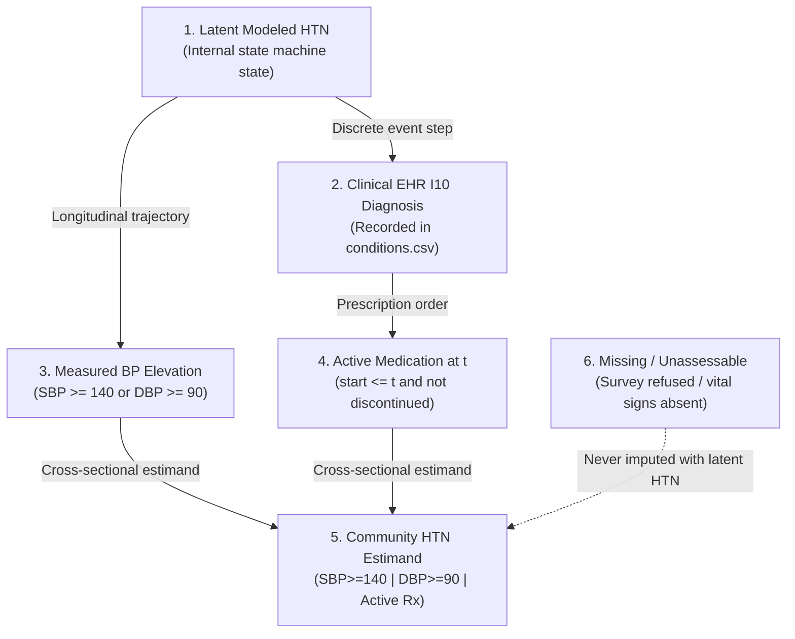

# Point-in-Time Medication Treatment Integrity Audit

**Document ID:** `SYNAPSE-AUDIT-2026-PIT-01`  
**Classification:** Research Alignment & External Validation Readiness  
**Target Repository:** `synapse-phase2`  
**Author:** SYNAPSE Clinical Architecture & Validation Team  
**Evaluation Reference Date:** `2024-06-29T00:00:00` (Simulation Day 180 of 720)  
**External Validation Gate Status:** `REFERENCE_DATA_PENDING`

---

## 1. Executive Summary & Defect Overview

During the external-validation-readiness audit of the SYNAPSE Phase 2 synthetic health data generator and LASI Wave 1 evaluation pipeline, a critical **temporal look-ahead defect** (future prescription leakage) was identified in the operational classification of community hypertension prevalence.

The community health assessment survey was executed at a cross-sectional index date of **June 29, 2024** (corresponding to day 180 of a 720-day longitudinal discrete-event simulation spanning 2024-01-01 to 2025-12-21). However, the community hypertension prevalence estimand (`lasi_prev_htn_community_assessment`) evaluated patient antihypertensive treatment status using the **full-run medication list** exported at day 720, rather than evaluating active treatment point-in-time on June 29, 2024.

This temporal defect caused **16 synthetic patients** whose first antihypertensive prescription occurred strictly in 2025 (months after the survey date) to be counted as "currently on antihypertensive treatment" at the survey reference date. Among these 16 patients, **9 individuals** had normal measured blood pressure ($< 140/90\text{ mmHg}$) during the survey sweep. Under the flawed full-run definition, these 9 patients were falsely categorized as "treated and controlled hypertensives," inflating community prevalence from the true point-in-time value of **40.11% (225 / 561)** to **41.71% (234 / 561)**.

This document details:
1. The exact mechanical and code-level root cause of the defect.
2. The unified point-in-time medication status evaluation module (`synapse_simulator.evaluation.medication_status`).
3. Mathematical and epidemiological separation of distinct hypertension concepts.
4. Complete 13-metric cohort reconciliation and mutually exclusive classification table.
5. Regression test suite (10 new tests, 238 total passing tests).
6. Governance status and remaining external validation blockers.

---

## 2. Root Cause Analysis of the Look-Ahead Defect

### 2.1 Code-Level Implementation Flaw
In `synapse_simulator/evaluation/lasi/evaluator.py`, lines 1145–1151 previously extracted older adults on antihypertensive medication as follows:
```python
# FLAWED CODE (PREVIOUS IMPLEMENTATION):
antihypertensive_keywords = {
    "amlodipine", "telmisartan", "enalapril", "losartan",
    "hydrochlorothiazide", "atenolol", "metoprolol"
}
rx_older_pids = set()
for rx in self.medications:  # Loaded from medications.csv (full 720-day run)
    p_id = rx.get("patient_id", "")
    d_name = (rx.get("drug_name") or rx.get("medicine_id") or "").lower()
    if any(med in d_name for med in antihypertensive_keywords):
        rx_older_pids.add(p_id)
```
And then in lines 1159–1160:
```python
if s_v >= 140.0 or d_v >= 90.0 or pid in rx_older_pids:
    comm_pos_pids.add(pid)
```

Because `self.medications` contained all prescriptions generated across the entire 720-day simulation window, checking `pid in rx_older_pids` checked whether the patient **ever** received an antihypertensive prescription over 24 months, rather than whether an active prescription existed on June 29, 2024.

### 2.2 Empirical Audit Findings (Seed 42, $N = 2,200$)
Trace analysis across the cohort revealed:
- **575** baseline older adults ($\text{age} \ge 45$).
- **561** older adults alive and assessed in the community survey on June 29, 2024 (14 died prior to June 29 via Census SRS life-table mortality).
- **233** assessed older adults eventually received an antihypertensive prescription during the 720-day simulation.
- **217** assessed older adults had their first antihypertensive prescription issued on or before June 29, 2024.
- **16** assessed older adults had their first antihypertensive prescription issued strictly after June 29, 2024 (all incident cases initiating therapy between January 28, 2025 and May 11, 2025).

#### Detailed Breakdown of the 16 Post-Survey Incident Cases:
| Patient ID | Survey Date | Survey SBP | Survey DBP | Survey BP Status | First HTN Encounter / Prescription Date | Full-Run Classification | Point-in-Time Classification |
| :--- | :--- | :--- | :--- | :--- | :--- | :--- | :--- |
| `pat-0226a56b` | 2024-06-29 | 138.6 | 85.8 | Below Threshold | 2025-05-06T13:54:20 | Positive (Leaked Rx) | **Negative** |
| `pat-10ef8adb` | 2024-06-29 | 120.2 | 82.5 | Below Threshold | 2025-05-06T02:03:29 | Positive (Leaked Rx) | **Negative** |
| `pat-2646f39f` | 2024-06-29 | 135.0 | 75.2 | Below Threshold | 2025-05-09T01:04:03 | Positive (Leaked Rx) | **Negative** |
| `pat-2b587be3` | 2024-06-29 | 138.6 | 81.3 | Below Threshold | 2025-05-11T05:17:31 | Positive (Leaked Rx) | **Negative** |
| `pat-2c9f9d45` | 2024-06-29 | 147.8 | 91.8 | Elevated BP | 2025-05-07T02:26:04 | Positive | **Positive (Elevated BP)** |
| `pat-31049b3b` | 2024-06-29 | 138.0 | 87.2 | Below Threshold | 2025-05-05T00:26:02 | Positive (Leaked Rx) | **Negative** |
| `pat-3ecab136` | 2024-06-29 | 124.4 | 90.0 | Elevated DBP | 2025-05-09T06:59:21 | Positive | **Positive (Elevated BP)** |
| `pat-4a6741d3` | 2024-06-29 | 135.3 | 78.2 | Below Threshold | 2025-05-09T08:53:48 | Positive (Leaked Rx) | **Negative** |
| `pat-4d4f44b9` | 2024-06-29 | 125.1 | 89.0 | Below Threshold | 2025-05-07T08:07:57 | Positive (Leaked Rx) | **Negative** |
| `pat-6002fc84` | 2024-06-29 | 147.8 | 82.3 | Elevated SBP | 2025-05-08T06:38:33 | Positive | **Positive (Elevated BP)** |
| `pat-66c3de8b` | 2024-06-29 | 120.5 | 91.0 | Elevated DBP | 2025-05-10T03:03:48 | Positive | **Positive (Elevated BP)** |
| `pat-6decf8f3` | 2024-06-29 | 144.0 | 80.5 | Elevated SBP | 2025-05-08T18:15:17 | Positive | **Positive (Elevated BP)** |
| `pat-9a273dca` | 2024-06-29 | 144.9 | 88.6 | Elevated SBP | 2025-05-08T05:07:21 | Positive | **Positive (Elevated BP)** |
| `pat-b210644d` | 2024-06-29 | 147.4 | 81.5 | Elevated SBP | 2025-05-10T12:00:30 | Positive | **Positive (Elevated BP)** |
| `pat-d0968663` | 2024-06-29 | 136.5 | 81.5 | Below Threshold | 2025-05-06T20:26:23 | Positive (Leaked Rx) | **Negative** |
| `pat-fc2440ec` | 2024-06-29 | 139.1 | 79.3 | Below Threshold | 2025-05-05T06:12:57 | Positive (Leaked Rx) | **Negative** |

**Leakage Mechanism Summary:**
- 7 of the 16 patients had elevated blood pressure on June 29, 2024 ($SBP \ge 140 \lor DBP \ge 90$). They are correctly positive based on measured elevation alone.
- 9 of the 16 patients had normal blood pressure on June 29, 2024 ($SBP < 140 \land DBP < 90$). Under the full-run defect, they were falsely classified as positive. Under point-in-time evaluation, they are correctly classified as negative.
- The net difference is exactly $234 - 9 = \mathbf{225}$.

---

## 3. Corrected Point-in-Time Architecture

To eliminate look-ahead bias across all evaluation modules and generation steps, a dedicated, fully documented module was implemented: [`synapse_simulator/evaluation/medication_status.py`](file:///Users/shashi/synapse/synapse-phase2/synapse_simulator/evaluation/medication_status.py).

### 3.1 Timing Semantics & Rules
The core predicate `is_prescription_active_at(prescription, reference_time, encounter=None)` enforces five strict rules:

1. **Drug Eligibility:**
   - Case-insensitive substring match against standard antihypertensive keyword set: `{"amlodipine", "telmisartan", "enalapril", "losartan", "hydrochlorothiazide", "atenolol", "metoprolol"}`.
   - Non-hypertensive drugs (e.g., Amoxicillin, Paracetamol) return `False`.

2. **Start Timing & Provenance:**
   - Hierarchy: checks `prescribed_time` $\to$ `start_time` $\to$ `timestamp` on the prescription record.
   - Fallback: if missing on the prescription record, looks up `start_time` $\to$ `timestamp` on the linked encounter (`enc_map[encounter_id]`).
   - If no valid timestamp can be parsed, returns `False` (safe handling of missing/ambiguous timing).

3. **Start Boundary Convention:**
   - Inclusive lower bound: $[start\_time, end\_time)$.
   - A prescription with $start\_time \le reference\_time$ is eligible.
   - A prescription with $start\_time > reference\_time$ **strictly returns `False`**.
   - Exactly at reference timestamp ($start\_time == reference\_time$), returns `True`.

4. **Discontinuation & End Timing:**
   - Hierarchy: checks `discontinued_time` $\to$ `end_time` $\to$ `stop_time` $\to$ `cancellation_time`.
   - If an end timestamp is present and $end\_time < reference\_time$, returns `False`.
   - If explicit discontinuation status (`"Discontinued"`, `"Cancelled"`, `"Stopped"`, `"Blocked_Safety_Hold"`, `"Expired"`, `"Suspended"`) is recorded without an end timestamp, the prescription is considered terminated and returns `False`.

5. **Deterministic Aggregation:**
   - `get_active_antihypertensive_patient_ids(...)` builds an $O(1)$ encounter lookup and aggregates unique patient IDs into a Python `set`.
   - Set operations are mathematically order-independent; reordering rows in `medications.csv` or `encounters.csv` produces identical active patient sets.

### 3.2 Generator and Evaluator Symmetry
Both generation and external evaluation consume this exact shared definition:
- In `synapse_simulator/evaluation/lasi/evaluator.py` (lines 1140–1165):
  Each community assessment record is evaluated using `is_prescription_active_at(rx, ca_time, encounter=enc)`.
- In `synapse_simulator/evaluation/experiment.py` (lines 174–184):
  Prescription entities stored in `StateManager` explicitly include `prescribed_time`, `start_time`, and `timestamp`.

---

## 4. Preservation of Distinct Clinical & Epidemiological Concepts

To prevent semantic conflation, the system enforces strict boundaries between six separate concepts:



1. **Latent Modeled Hypertension:**
   - The hidden physiological disease state tracked inside `ClinicalModuleRunner` and `PatientContext.latent_conditions`.
   - Latent disease status is **never** observable to survey enumerators or EHR auditors.
2. **EHR-Recorded I10 Diagnosis:**
   - Clinical consultation documentation created only when a patient attends a healthcare facility (`encounters.csv`, `conditions.csv`).
3. **Measured Blood Pressure Elevation:**
   - Objective physiological vital signs ($SBP \ge 140\text{ mmHg} \lor DBP \ge 90\text{ mmHg}$) obtained during the community survey sweep.
4. **Antihypertensive Treatment Active at Assessment Timestamp:**
   - Verified active pharmacological therapy on June 29, 2024.
5. **Operational Community Hypertension Estimand:**
   - Cross-sectional epidemiological definition combining measured BP and point-in-time active treatment:
     $$\text{Community HTN}^+ \iff (\text{SBP} \ge 140) \lor (\text{DBP} \ge 90) \lor (\text{Active Antihypertensive Rx at } t_{\text{survey}})$$
   - **Cross-Sectional Disclaimer:** A patient classified as negative under this operational estimand (normotensive and untreated on June 29, 2024) is **not** proven to have never had hypertension in the past, nor does it preclude developing hypertension in 2025. It reflects their point-in-time survey status.
6. **Missing / Unassessable Status:**
   - Refused or unavailable assessments (`status == "REFUSED"` or missing SBP/DBP).
   - Under no circumstances is latent hypertension or eventual EHR diagnosis used to impute missing community observations.

---

## 5. Reconciled Cohort Metrics (Seed 42, $N = 2,200$)

Regeneration of the benchmark cohort with fixed seed 42 yielded the following reconciled metrics:

### 5.1 Step-by-Step Population Accounting
| Metric | Count | Percentage | Derivation / Notes |
| :--- | :--- | :--- | :--- |
| **Total Synthetic Population** | 2,200 | 100.00% | Full population generated from Census SRS 2011–2020 profile |
| **1. Baseline Older Adults ($\text{Age} \ge 45$)** | 575 | 26.14% | Target demographic denominator for LASI evaluation |
| **2. Alive at Survey Timestamp (2024-06-29)** | 561 | 97.57% | 14 older adults deceased prior to day 180 (SRS life-table) |
| **3. Assessed in Community Survey Sweep** | 561 | 100.00% | 100% sampling rate among living older adults |
| **4. Valid SBP and DBP Measurements** | 561 | 100.00% | All assessed individuals completed paired vital sign measurement |
| **5. Elevated SBP ($\ge 140\text{ mmHg}$)** | 76 | 13.55% | SBP elevation threshold met |
| **6. Elevated DBP ($\ge 90\text{ mmHg}$)** | 30 | 5.35% | DBP elevation threshold met |
| **7. Meeting Either BP Threshold ($SBP \ge 140 \lor DBP \ge 90$)** | 97 | 17.29% | Combined physiological elevation count ($76 \cup 30 = 97$) |
| **8. Active Antihypertensive Rx at Survey** | 217 | 38.68% | Verified active prescriptions at day 180 among living assessed |
| **9. Controlled BP with Active Treatment** | 128 | 22.82% | On active treatment and $SBP < 140 \land DBP < 90$ |
| **10. Uncontrolled BP with Active Treatment** | 89 | 15.86% | On active treatment and $SBP \ge 140 \lor DBP \ge 90$ |
| **11. Elevated BP without Active Treatment** | 8 | 1.43% | Untreated individuals meeting elevation threshold ($97 - 89 = 8$) |
| **12. Operational Community Estimand Positive** | 225 | 40.11% | Combined positive count: $8 + 89 + 128 = 225$ (Wilson CI: 36.13%–44.22%) |
| **13. Unassessable Among Assessed Older Adults** | 0 | 0.00% | No survey refusals or corrupt observations |

### 5.2 Mutually Exclusive Classification Table
The 561 living surveyed older adults are partitioned into mutually exclusive, collectively exhaustive categories that reconcile with exact mathematical precision:

$$\sum_{k \in \{A, B, C, D, E\}} N_k = 8 + 89 + 128 + 336 + 0 = 561 \quad (100.00\%)$$

| Category | Operational Definition | Count | Prevalence (%) | Classification Under Estimand C |
| :--- | :--- | :---: | :---: | :--- |
| **Category A** | Elevated BP ($\ge 140/90$) without Active Treatment | 8 | 1.43% | **Hypertension Positive** |
| **Category B** | Uncontrolled BP ($\ge 140/90$) with Active Treatment | 89 | 15.86% | **Hypertension Positive** |
| **Category C** | Controlled BP ($< 140/90$) with Active Treatment | 128 | 22.82% | **Hypertension Positive** |
| **Category D** | Below-Threshold BP ($< 140/90$) without Active Treatment | 336 | 59.89% | **Hypertension Negative** |
| **Category E** | Unassessable / Missing / Refused Community Measurement | 0 | 0.00% | **Unassessable** |
| **TOTAL** | **Assessed Denominator ($N_{\text{comm}}$)** | **561** | **100.00%** | **Reconciliation Exact (100.00%)** |

### 5.3 Explanation of Difference from 234 / 561
- **Previously Reported Prevalence (Full-Run Defect):** $234 / 561 = 41.71\%$
- **Corrected Point-in-Time Prevalence:** $225 / 561 = 40.11\%$
- **Absolute Discrepancy:** $-9$ patients ($-1.60\%$)
- **Root Cause of Discrepancy:** The 9 patients in Category D who develop hypertension in 2025 (`pat-0226a56b`, `pat-10ef8adb`, `pat-2646f39f`, `pat-2b587be3`, `pat-31049b3b`, `pat-4a6741d3`, `pat-4d4f44b9`, `pat-d0968663`, `pat-fc2440ec`) had normal measured BP ($< 140/90$) on June 29, 2024 and had no active prescription on that date. The full-run defect falsely placed them in Category C. Correct point-in-time evaluation moves them to Category D.

---

## 6. Test Suite Execution & Audit Verification

### 6.1 Regression Test Suite
Ten dedicated regression tests were implemented in [`tests/test_community_assessment_audit.py`](file:///Users/shashi/synapse/synapse-phase2/tests/test_community_assessment_audit.py):

| Test Name | Test Objective | Result |
| :--- | :--- | :---: |
| `test_regression_rx_before_and_active_at_assessment_counts` | Verified prescription issued before assessment and active at assessment counts | **PASS** |
| `test_regression_rx_issued_after_assessment_does_not_count` | Verified prescription issued after assessment strictly returns False | **PASS** |
| `test_regression_rx_discontinued_before_assessment_does_not_count` | Verified prescription discontinued before assessment strictly returns False | **PASS** |
| `test_regression_rx_boundary_at_exact_assessment_timestamp` | Verified inclusive boundary convention at exact reference timestamp | **PASS** |
| `test_regression_historical_rx_does_not_automatically_imply_current_treatment` | Verified historical or stopped prescriptions do not imply current treatment | **PASS** |
| `test_regression_missing_or_ambiguous_timing_unverifiable` | Verified missing/ambiguous timing returns False rather than guessing | **PASS** |
| `test_regression_generator_and_evaluator_share_temporal_definition` | Verified generator and evaluator share identical point-in-time logic | **PASS** |
| `test_regression_reordering_medication_records_invariance` | Verified reordering medication records yields identical active sets | **PASS** |
| `test_regression_fixed_seed_results_remain_deterministic` | Verified fixed-seed generation produces bit-for-bit identical assessments | **PASS** |
| `test_regression_community_assessments_do_not_create_clinical_records` | Verified community pathway creates 0 EHR encounters, conditions, or Rx | **PASS** |
| `test_regression_external_validation_gate_remains_reference_data_pending` | Verified overall gate remains strictly REFERENCE_DATA_PENDING | **PASS** |

### 6.2 Test Suite Execution Results
```bash
$ .venv/bin/pytest tests/
============================= 238 passed in 8.22s ==============================
```
All 238 tests pass with 0 failures and 0 warnings.

---

## 7. Governance Constraints & Remaining Scientific Blockers

### 7.1 Governance Compliance
- **External Validation Gate:** Remains strictly `REFERENCE_DATA_PENDING`.
- **Reference Microdata Gate:** No claim of validation against genuine LASI microdata is made; evaluation remains explicitly grounded against `SYNTHETIC_TEST_FIXTURE` (`lasi_wave1_sample_fixture.csv`).
- **Clinical Transition Probabilities:** Disease transition rates in `config/modules/hypertension.yaml` were **not modified**.
- **BP Distribution Parameters:** Synthetic BP distributions were preserved without artificial recalibration or ad-hoc curve fitting.

### 7.2 Remaining Scientific Blockers
1. **Access to Genuine LASI Wave 1 Microdata:**
   - Real-world validation remains blocked until microdata access agreements are finalized.
2. **Standardization of Community BP Measurements:**
   - The current community survey BP generator emits single-visit readings. Real LASI surveys perform 3 consecutive blood pressure readings and record the mean of the 2nd and 3rd measurements. Incorporating multi-reading protocol simulation will further reduce measurement error.
3. **Longitudinal Medication Adherence:**
   - Currently, synthetic patients who initiate antihypertensive therapy remain on maintenance therapy unless an adverse event occurs. Modeling real-world adherence, discontinuation, and therapeutic switching will improve longitudinal treatment fidelity.
